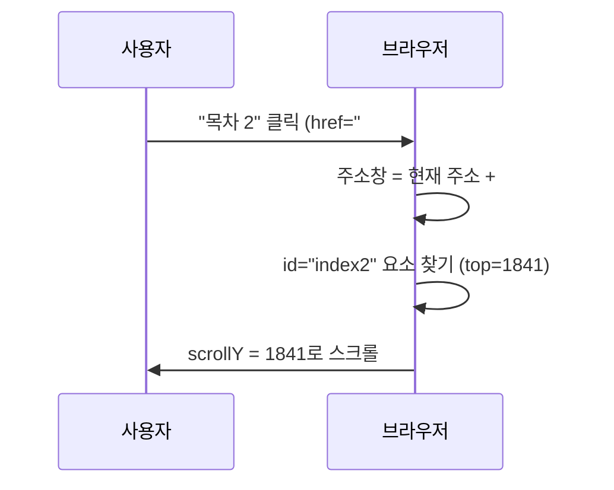

## 들어가며 (Situation)

`07_하이퍼링크관련태그.html` 첫 주석은 링크의 의미를 이렇게 적었다.

> 링크 기능은 웹 문서가 다른 문서와 구분이 되는 가장 큰 핵심 기능이다.

파일에는 링크 네 종류가 들어 있다.

| 종류 | 코드 |
|------|------|
| 같은 폴더의 다른 파일 | `<a href="01_글자관련태그.html">` |
| 외부 사이트, 새 탭 | `<a href="https://www.naver.com" target="_blank">` |
| 이미지를 감싼 링크 | `<a href="https://www.youtube.com" target="_blank"></a>` |
| 같은 페이지 안의 목차 | `<a href="#index1">` → `<h4 id="index1">` |

## 문제 상황 (Task)

목차 링크는 신기했지만 원리가 막연했다. 다른 링크들도 "누르면 이동한다" 이상은 설명할 수 없었다.

1. `href="01_글자관련태그.html"`처럼 짧게 쓴 주소는 브라우저가 실제로 어떤 주소로 바꿀까?
2. `#index2`를 누르면 정확히 어디로 이동할까?
3. `target="_blank"`로 새 탭을 열 때 주의할 점은 없을까?

## 해결 과정 (Action)

### 1. 상대 주소는 현재 문서 기준으로 완성된다

Chrome 헤드리스로 페이지를 열고 `a.getAttribute("href")`(쓴 값)와 `a.href`(브라우저가 완성한 값)를 비교했다. 긴 로컬 경로는 `(html)/`로 줄였다.

```text
01_글자관련태그.html  -> (html)/01_%EA%B8%80%EC%9E%90...%EA%B7%B8.html
https://www.naver.com -> https://www.naver.com/
#index1               -> (html)/07_하이퍼링크관련태그.html#index1
```

| 쓴 값 | 완성된 주소 | 종류 |
|-------|-------------|------|
| `01_글자관련태그.html` | 현재 파일과 **같은 폴더**의 파일 | 상대 경로 |
| `https://www.naver.com` | 그대로 (끝에 `/` 추가) | 절대 URL |
| `#index1` | **현재 문서 주소** + `#index1` | 프래그먼트 |

세 가지를 알 수 있었다.

- 상대 경로는 **현재 문서의 위치를 기준으로** 완성된다. 파일을 다른 폴더로 옮기면 링크가 깨지는 이유다.
- 한글 파일 이름은 `%EA%B8%80…`처럼 **퍼센트 인코딩**된다. URL에는 원래 ASCII 문자만 쓸 수 있어서, 한글을 UTF-8 바이트로 바꾼 뒤 `%16진수`로 적는다. 웹에 올릴 파일은 영문 이름이 안전하다. 이 블로그의 글 파일 이름이 영문인 이유이기도 하다.
- `#index1`은 다른 파일로 가는 것이 아니라 **같은 문서 안의 위치**를 가리킨다.

### 2. `#id`는 그 요소가 화면 맨 위에 오도록 스크롤한다

페이지 안 `id`를 가진 요소의 위치를 찍고, 실제로 `location.hash`를 바꿔 스크롤 위치를 확인했다.

```text
ids: title@H1 top=21, index1@H4 top=1039, index2@H4 top=1841, index3@H4 top=2642
after #index2 scrollY=1841, after #title scrollY=21
```

`#index2`로 이동하자 `scrollY`가 **1841**이 됐다. `id="index2"`인 `h4`의 위치와 정확히 같다. 해당 요소의 위쪽 끝이 화면 맨 위에 붙도록 스크롤한 것이다. "메인으로" 링크(`#title`)는 21px, 즉 맨 위 `h1`로 돌아갔다.



서버에 새로 요청하지 않고 주소창의 `#` 뒷부분만 바뀐다. 그래서 뒤로 가기를 누르면 이전 스크롤 위치로 돌아온다. 이 블로그 글의 목차 링크도 같은 원리다.

`id`는 문서 안에서 **하나뿐이어야** 한다. 같은 `id`가 두 개면 첫 번째 요소로만 이동한다. 수업 주석의 "id 속성은 고유의 key와 같다"는 말이 이 뜻이다.

### 3. `a` 안에 `h3`를 넣어도 될까

마지막 "메인으로" 링크는 `a` 안에 블록 요소 `h3`가 들어 있다.

```html
<a href="#title">
    <h3>메인으로...</h3>
</a>
```

예전 HTML에서는 인라인 요소 안에 블록을 넣으면 안 됐다. 지금 명세에서 `a`의 콘텐츠 모델은 **투명(transparent)**이다. 부모가 허용하는 내용이면 `a` 안에도 넣을 수 있다. 여기서 부모는 `body`이므로 `h3`도 가능하다. 실제로 DOM에서도 `h3`의 부모는 `A`로 그대로 유지됐다. 다만 `a` 안에 또 다른 `a`나 `button` 같은 **대화형 요소**는 넣을 수 없다.

### 4. `target="_blank"`와 `rel="noopener"`

새 탭으로 열린 페이지는 자바스크립트의 `window.opener`로 **원래 탭을 조작할 수 있었다.** 악성 사이트라면 원래 탭을 가짜 로그인 페이지로 바꿔치기할 수 있다. 이 공격을 탭내빙(reverse tabnabbing)이라고 한다. 그래서 오랫동안 `target="_blank"`에는 `rel="noopener"`를 함께 쓰라고 권장했다.

| | 예전 브라우저 | 지금 브라우저 |
|---|---------------|---------------|
| `target="_blank"`만 쓴 경우 | `window.opener` 접근 가능 (위험) | **암묵적으로 `noopener` 적용** |
| `rel="noopener"` 명시 | 차단 | 차단 |

현재 HTML 명세와 주요 브라우저는 `target="_blank"`에 `noopener`를 **기본으로 적용**한다. 측정 결과에서도 `rel`은 비어 있었지만 브라우저가 알아서 막는다. 그래도 오래된 브라우저까지 고려하거나 의도를 분명히 하려면 직접 쓰는 것이 좋다. (**예시 코드**)

```html
<a href="https://www.naver.com" target="_blank" rel="noopener noreferrer">네이버</a>
```

`noreferrer`는 이동한 사이트에 "어느 페이지에서 왔는지"(Referer 헤더)도 보내지 않는다.

### 5. 이미지 링크에는 `alt`가 링크 이름이 된다

유튜브로 가는 링크는 안에 글자 없이 이미지만 있다. 이때 화면 낭독기는 이미지의 `alt`("강")를 **링크 이름**으로 읽는다. "강, 링크"라고 읽히면 어디로 가는지 알 수 없다. 이미지 링크의 `alt`에는 그림 설명보다 **목적지**("유튜브로 이동")를 쓰는 것이 맞다.

## 결과 (Result)

| 확인 항목 | 결과 |
|-----------|------|
| 상대 경로 `01_글자관련태그.html` | 현재 폴더 기준 주소로 완성, 한글은 퍼센트 인코딩 |
| `#index2` 이동 | `scrollY = 1841` (`h4#index2`의 위치와 동일) |
| `#title` 이동 | `scrollY = 21` |
| `a` 안의 `h3` | DOM에서 그대로 유지 (투명 콘텐츠 모델) |
| `target="_blank"` | 최신 브라우저는 `noopener`를 자동 적용 |

배운 점은 다음과 같다.

- `href`에 쓴 값과 브라우저가 실제로 쓰는 주소(`a.href`)는 다를 수 있다. 상대 경로는 현재 문서 위치가 기준이다.
- 프래그먼트(`#id`)는 서버 요청 없이 그 요소가 화면 맨 위에 오도록 스크롤한다.

## 더 학습하면 좋은 개념

- **URL 구조 (scheme, host, path, query, fragment)** — 링크와 폼 전송을 이해하는 기본. 다음 폼 수업의 `?name=value`와 이어진다.
- **퍼센트 인코딩과 UTF-8** — 한글 주소가 `%EA%B8%80`처럼 바뀌는 원리.
- **CSS `:target` 선택자와 `scroll-behavior: smooth`** — 앵커로 이동한 요소를 강조하거나 부드럽게 스크롤하는 방법.
- **Referrer-Policy** — `noreferrer`가 다루는 Referer 헤더 정책을 사이트 전체에 정하는 방법.

## 참고 자료

- [HTML Living Standard - The a element](https://html.spec.whatwg.org/multipage/text-level-semantics.html#the-a-element)
- [HTML Living Standard - Link type "noopener"](https://html.spec.whatwg.org/multipage/links.html#link-type-noopener)
- [HTML Living Standard - Scrolling to a fragment](https://html.spec.whatwg.org/multipage/browsing-the-web.html#scrolling-to-a-fragment)
- [MDN - a element](https://developer.mozilla.org/en-US/docs/Web/HTML/Element/a)
- [MDN - Percent-encoding](https://developer.mozilla.org/en-US/docs/Glossary/Percent-encoding)
- [OWASP - Reverse Tabnabbing](https://owasp.org/www-community/attacks/Reverse_Tabnabbing)

---

**요약**
1. 상대 경로 `href`는 현재 문서 폴더를 기준으로 완성되고, 한글 파일 이름은 퍼센트 인코딩된다.
2. `#index2`를 누르자 `scrollY`가 그 `h4`의 위치인 1841px이 됐다. 프래그먼트는 서버 요청 없이 해당 `id` 요소로 스크롤한다.
3. `target="_blank"`는 최신 브라우저에서 `noopener`가 자동 적용되지만, 의도를 분명히 하려면 `rel="noopener noreferrer"`를 함께 쓴다.
