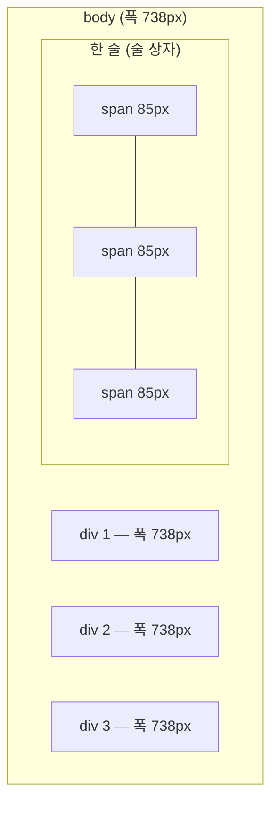

## 들어가며 (Situation)

`04_영역관련태그.html`은 아무 의미 없이 **영역을 묶기만 하는** 태그 두 개를 비교한다. 같은 스타일(테두리, 배경색)을 준 `div` 세 개와 `span` 세 개가 있다.

```html
<div style="border: 1px solid black; background-color: red;">첫 번째 영역</div>
<div style="border: 1px solid black; background-color: yellow;">두 번째 영역</div>
<div style="border: 1px solid black; background-color: blue;">세 번째 영역</div>

<span style="border: 1px solid black; background-color: red;">첫 번째 영역</span>
<span style="border: 1px solid black; background-color: yellow;">두 번째 영역</span>
<span style="border: 1px solid black; background-color: blue;">세 번째 영역</span>
```

수업 주석은 이렇게 정리했다.

> div - 줄 바꿈이 적용되어 이미 존재하는 태그의 다음 줄에 영역이 설정된다. (블럭 요소)
> span - 줄 바꿈이 적용되지 않아 옆으로 붙게 된다. (인라인 요소)

## 문제 상황 (Task)

"줄 바꿈이 되느냐"만으로는 설명이 부족해 보였다. 화면에서 `div`의 빨간 배경은 화면 오른쪽 끝까지 이어지는데 `span`은 글자만큼만 칠해졌다. 줄 바꿈 말고 차이가 또 있다는 뜻이다.

1. 블록과 인라인의 차이를 숫자로 확인할 수 있을까?
2. 크기(`width`, `height`)나 바깥 여백(`margin`)을 주면 둘은 똑같이 반응할까?

## 해결 과정 (Action)

### 1. 위치와 폭을 숫자로 찍기

Chrome 헤드리스로 각 요소의 `display`, 실제 폭, 화면 위쪽에서의 위치(`top`)를 출력했다.

```text
DIV  display=block  w=738 top=135
DIV  display=block  w=738 top=161
DIV  display=block  w=738 top=187
SPAN display=inline w=85  top=276
SPAN display=inline w=85  top=276
SPAN display=inline w=85  top=276
body w=738 viewport=754
```

| | `div` | `span` |
|---|-------|--------|
| `display` 기본값 | `block` | `inline` |
| 폭 | 738px = 부모(`body`) 폭 전체 | 85px = 글자 길이만큼 |
| 위치 | `top`이 26px씩 증가 (한 줄씩 아래로) | 셋 다 `top=276` (같은 줄) |

`div`의 폭 738px은 `body`의 폭과 정확히 같다. 화면 폭 754px에서 `body`의 기본 바깥 여백 8px씩을 뺀 값이다. **블록은 줄 바꿈만 하는 것이 아니라, 부모가 준 가로 공간을 전부 차지한다.** 그래서 다음 블록은 자리가 없어 아래로 내려간다. 줄 바꿈은 폭을 다 차지한 결과다.



### 2. 크기와 여백을 주면?

수업 파일에는 없지만 차이를 더 보려고 같은 클래스를 세 요소에 줬다. (확인용 **예시 코드**)

```html
<style>
  .box { width: 200px; height: 50px; margin-top: 30px; padding: 10px; }
</style>
<div  class="box" id="d">div</div>
<span class="box" id="s">span</span>
<span class="box" id="ib" style="display:inline-block">inline-block</span>
```

```text
d  w=220 h=70 top=166
s  w=56  h=44 top=266
ib w=220 h=70 top=266
```

| | 실제 폭 | 실제 높이 | `margin-top: 30px` |
|---|---------|-----------|-------------------|
| `div` (block) | 220px (200 + 좌우 패딩 20) | 70px | 적용됨 |
| `span` (inline) | **56px** (글자 폭 + 패딩) | 44px | **무시됨** (`inline-block`과 같은 줄, 같은 `top`) |
| `inline-block` | 220px | 70px | 적용됨 |

`span`에 준 `width: 200px`과 `height: 50px`는 화면에 반영되지 않았다. CSS 명세는 인라인 요소(정확히는 이미지가 아닌 인라인 요소)에 `width`와 `height`가 **적용되지 않는다**고 정한다. 위아래 `margin`도 줄 높이에 영향을 주지 않는다. 인라인은 "글자의 일부"처럼 취급되기 때문이다. 문장 중간의 단어 하나에 높이 50px을 줄 수 없는 것과 같다.

`display: inline-block`은 둘을 섞은 값이다. 옆으로 나란히 놓이면서도(inline) 크기와 여백은 블록처럼 받는다. 버튼이나 배지(badge)를 만들 때 자주 쓰인다.

### 3. `div`와 `span`은 "의미 없는" 상자

`div`와 `span`은 HTML 명세에서 **특별한 의미가 없는** 요소다. `div`에 대해 명세는 이렇게 권한다.

> Authors are strongly encouraged to view the div element as an element of last resort, for when no other element is suitable.

영역을 묶을 때 먼저 `header`, `nav`, `main`, `section`, `article`, `footer` 같은 의미 있는 태그를 검토하고, 맞는 것이 없을 때 `div`를 쓰라는 뜻이다. [글자 태그]()의 `b`와 같은 위치다.

| 상황 | 의미 있는 태그 | 의미 없는 대안 |
|------|----------------|----------------|
| 사이트 상단 | `header` | `div` |
| 메뉴 | `nav` | `div` |
| 본문 핵심 | `main` | `div` |
| 문장 안 일부 강조 | `strong`, `em` | `span` |

## 결과 (Result)

| 확인 항목 | 결과 |
|-----------|------|
| `div` 폭 | 738px (부모 폭 전체), 26px 간격으로 한 줄씩 |
| `span` 폭 | 85px (내용 폭), 세 개가 같은 줄 (`top=276`) |
| `span`에 `width:200px; height:50px` | 무시됨 → 56×44px |
| `span`의 `margin-top: 30px` | 무시됨 |
| `inline-block` | 옆으로 놓이면서 크기·여백 적용 (220×70px) |
| 환경 | Chrome 155 헤드리스, `getBoundingClientRect()`로 측정 |

배운 점은 다음과 같다.

- 블록이 줄을 바꾸는 이유는 **가로 공간을 전부 차지하기 때문**이다.
- 인라인에는 크기와 위아래 여백이 먹지 않는다. 필요하면 `inline-block`이나 `block`으로 바꾼다.

## 더 학습하면 좋은 개념

- **CSS 박스 모델 (`content`, `padding`, `border`, `margin`, `box-sizing`)** — 220px이 200px + 패딩 20px인 이유를 정리한 모델.
- **마진 상쇄(margin collapsing)** — 블록끼리 위아래 여백이 겹쳐 하나로 합쳐지는 현상.
- **시맨틱 레이아웃 태그 (`header`, `nav`, `main`, `section`)** — `div` 대신 쓸 수 있는 의미 있는 영역 태그.
- **Flexbox** — 블록 요소도 옆으로 나란히 놓는 현대적인 방법. 다음 CSS 수업 주제다.

## 참고 자료

- [HTML Living Standard - The div element](https://html.spec.whatwg.org/multipage/grouping-content.html#the-div-element)
- [HTML Living Standard - The span element](https://html.spec.whatwg.org/multipage/text-level-semantics.html#the-span-element)
- [CSS 2.2 - Visual formatting model details: width](https://www.w3.org/TR/CSS22/visudet.html#the-width-property)
- [MDN - Block and inline layout in normal flow](https://developer.mozilla.org/en-US/docs/Web/CSS/CSS_display/Block_and_inline_layout_in_normal_flow)
- [MDN - display](https://developer.mozilla.org/en-US/docs/Web/CSS/display)

---

**요약**
1. `div`(block)는 부모 폭 738px을 전부 차지해서 한 줄씩 쌓였고, `span`(inline)은 글자 폭 85px만큼 같은 줄에 놓였다.
2. `span`에 준 `width: 200px`, `height: 50px`, `margin-top: 30px`는 모두 무시됐고, `inline-block`으로 바꾸자 적용됐다.
3. `div`와 `span`은 의미 없는 상자라서, 맞는 의미 태그가 없을 때 마지막에 쓴다.
