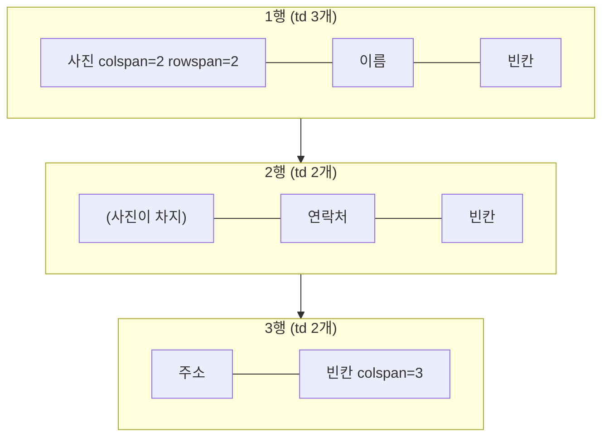

## 들어가며 (Situation)

`03_표관련태그.html`에는 표가 세 개 있다.

| 표 | 내용 | 배운 것 |
|----|------|---------|
| 1번 | 전화기 키패드 (1~9, *, 0, #) | `table`, `tr`, `td` 기본 구조 |
| 2번 | 버거 메뉴판 | 제목 칸 `th` |
| 3번 | 회원 이력서 | `caption`, `colspan`, `rowspan` |

수업 주석은 이렇게 정리했다.

> table : 기본적인 표를 생성 / tr : 표의 행 / th : 표의 제목 / td : 표에 들어갈 데이터

## 문제 상황 (Task)

이력서 표를 만들 때 가장 헷갈렸다. 코드에서 각 행의 `td` 개수가 3개, 2개, 2개로 다른데도 표는 4칸짜리 격자로 반듯하게 나온다.

```html
<table border="2">
    <caption>회원 이력서</caption>
    <tr>
        <td colspan="2" rowspan="2" width="130px" height="50px">사진</td>
        <td width="80px" height="50px">이름</td>
        <td width="200px"></td>
    </tr>
    <tr>
        <td height="50px">연락처</td>
        <td></td>
    </tr>
    <tr>
        <td width="130px" height="30px">주소</td>
        <td colspan="3"></td>
    </tr>
</table>
```

1. 셀 개수가 다른데 어떻게 격자가 맞을까?
2. 코드에 `tbody`가 없는데 개발자 도구에는 `tbody`가 보인다. 누가 넣었을까?
3. `th`와 `td`는 모양 말고 무엇이 다를까?

## 해결 과정 (Action)

### 1. 브라우저가 만든 표 구조 찍어 보기

Chrome 헤드리스로 파일을 열고, 각 표의 자식 요소와 행별 셀 개수를 출력했다.

```text
table0: children=TBODY          rows=4 cells/row=3/3/3/3
table1: children=TBODY          rows=4 cells/row=3/3/3/3
table2: children=CAPTION,TBODY  rows=3 cells/row=3/2/2
```

세 표 모두 `table` 바로 아래가 `tr`이 아니라 **`TBODY`**였다. 코드에는 한 번도 쓰지 않았다. HTML 파서는 `table` 안에서 `tr`을 만나면 `tbody`를 자동으로 만들고 그 안에 행을 넣는다. 그래서 `table > tr` 같은 CSS 선택자는 아무것도 고르지 못한다. `table tr`이나 `tbody > tr`이라고 써야 한다.

### 2. 3·2·2개로 4칸 격자가 되는 원리

표는 **위에서부터 한 칸씩 채우면서, 이미 차지된 칸은 건너뛰는** 방식으로 만들어진다.

| | 1열 | 2열 | 3열 | 4열 | 이 행의 `td` 개수 |
|---|-----|-----|-----|-----|------------------|
| 1행 | 사진 (`colspan=2`, `rowspan=2`) | ← | 이름 | (빈칸) | **3** |
| 2행 | ↑ 사진이 차지 | ↑ | 연락처 | (빈칸) | **2** |
| 3행 | 주소 | 빈칸 (`colspan=3`) | ← | ← | **2** |

- 1행: 사진이 2칸을 차지하고 이름, 빈칸이 이어진다. 3개 태그로 4칸이 된다.
- 2행: 1~2열은 위에서 내려온 사진(`rowspan=2`)이 이미 차지했다. 그래서 `연락처`가 3열부터 시작하고 2개 태그로 4칸이 된다.
- 3행: 주소 1칸과 `colspan=3` 3칸을 합쳐 4칸이다.



**`rowspan`을 쓰면 아래 행에서는 그 칸의 `td`를 빼야 한다.** 2행에 `td`를 4개 썼다면 표 오른쪽으로 칸이 하나 튀어나왔을 것이다. 행마다 "colspan 합 + 위에서 내려온 칸 수"가 같은지 세어 보면 표가 깨지지 않는다.

실제로 렌더링된 사진 칸의 크기는 `136×110px`였다. 위아래 두 행(50px + 50px)과 테두리, 셀 간격을 합친 높이다.

### 3. `th`는 제목 칸이라는 의미를 가진다

메뉴판 표의 `th`는 계산된 스타일이 `font-weight: 700`, `text-align: center`였다. 굵고 가운데 정렬된 모양은 기본 스타일일 뿐이다. 진짜 차이는 의미다. `th`는 **같은 행이나 열의 데이터가 무엇인지 알려 주는 머리글**이다. 화면 낭독기는 `13,000` 칸을 읽을 때 "가격"이라는 머리글을 함께 읽어 줄 수 있다.

머리글 행이 여러 개거나 구조가 복잡하면 `thead`, `tbody`, `tfoot`으로 직접 나누고, `th`에 `scope="col"` 또는 `scope="row"`를 붙여 방향을 알려 준다. (**예시 코드**)

```html
<table>
    <caption>버거 메뉴</caption>
    <thead>
        <tr><th scope="col">메뉴 이름</th><th scope="col">가격</th><th scope="col">판매 상태</th></tr>
    </thead>
    <tbody>
        <tr><td>통새우 와퍼</td><td>13,000</td><td>Y</td></tr>
    </tbody>
</table>
```

### 4. `border`, `width`, `height` 속성은 지금은 CSS 몫

수업에서는 테두리를 `border="2"`, 칸 크기를 `width="130px"`로 줬다. 화면에는 잘 나오지만, HTML 명세는 `table`의 `border`(값 `1`이나 빈 값 제외)와 `td`의 `width`, `height`를 **폐지된(obsolete) 속성**으로 분류한다. 같은 모양은 CSS로 낸다. (**예시 코드**)

```css
table { border-collapse: collapse; }
td, th { border: 2px solid #333; padding: 4px 8px; }
```

`border-collapse: collapse`를 주면 셀마다 따로 그려지던 이중 테두리가 한 줄로 합쳐진다. 수업 화면의 이중선이 바로 이 값이 기본값(`separate`)이라서 생긴 것이다.

## 결과 (Result)

| 확인 항목 | 결과 |
|-----------|------|
| 코드에 없는 `tbody` | 세 표 모두 자동으로 생성됨 |
| 이력서 표의 행별 `td` | 3 / 2 / 2개 → 4열 격자 |
| 사진 칸 렌더링 크기 | 136×110px (2행에 걸침) |
| `th` 기본 스타일 | `font-weight: 700`, `text-align: center` |
| `border`·`width`·`height` 속성 | 표준에서는 폐지, CSS로 대체 |

배운 점은 다음과 같다.

- `rowspan`과 `colspan`은 "이미 차지된 칸은 건너뛴다"는 규칙만 알면 계산할 수 있다.
- 브라우저는 코드에 없는 `tbody`를 넣는다. CSS 선택자나 나중에 JavaScript로 행을 다룰 때 이 점을 기억해야 한다.

## 더 학습하면 좋은 개념

- **`thead` / `tbody` / `tfoot`과 `scope`** — 표의 구조와 머리글 방향을 명시해 접근성을 높인다.
- **`border-collapse`와 `border-spacing`** — 표 테두리 모양을 결정하는 CSS 속성.
- **표는 데이터용, 레이아웃은 Flexbox·Grid로** — 예전에는 표로 화면을 나눴지만 지금은 CSS 레이아웃을 쓴다. 다음 CSS 수업 주제와 이어진다.
- **HTML 파서의 자동 삽입 규칙** — `tbody`처럼 브라우저가 알아서 넣는 요소(`html`, `head`, `body` 등)가 더 있다.

## 참고 자료

- [HTML Living Standard - The table element](https://html.spec.whatwg.org/multipage/tables.html#the-table-element)
- [HTML Living Standard - Processing model (forming a table)](https://html.spec.whatwg.org/multipage/tables.html#forming-a-table)
- [HTML Living Standard - Obsolete features](https://html.spec.whatwg.org/multipage/obsolete.html#non-conforming-features)
- [MDN - th: scope attribute](https://developer.mozilla.org/en-US/docs/Web/HTML/Element/th#scope)
- [MDN - border-collapse](https://developer.mozilla.org/en-US/docs/Web/CSS/border-collapse)

---

**요약**
1. 코드에 쓰지 않은 `tbody`를 HTML 파서가 세 표 모두에 자동으로 넣었다.
2. 이력서 표는 `td`가 3·2·2개뿐이지만 "이미 차지된 칸은 건너뛴다"는 규칙으로 4열 격자가 된다. `rowspan` 아래 행에서는 그만큼 `td`를 빼야 한다.
3. `th`는 굵은 모양보다 "머리글"이라는 의미가 중요하고, `border`·`width` 같은 표 속성은 지금은 CSS로 대체한다.
