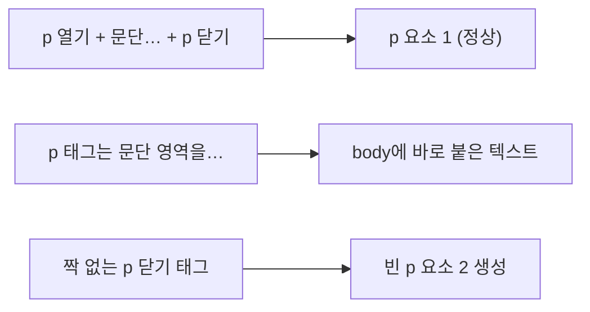

## 들어가며 (Situation)

HTML 첫 수업의 첫 파일은 `01_글자관련태그.html`이었다. 제목(`h1`~`h6`), 줄 바꿈(`br`), 수평선(`hr`), 문단(`p`, `pre`), 그리고 글자 모양을 바꾸는 태그 11개를 한 화면에 늘어놓은 파일이다.

```html
<strong>글자를 굵게 표시하는 태그</strong>
<br>
<b>글자를 굵게 표시하는 태그</b>
<br>
<em>글자를 기우리는 태그</em>
<br>
<i>글자를 기우리는 태그</i>
```

수업 메모에는 `strong`과 `b`를 둘 다 "글자를 굵게 표시하는 태그", `em`과 `i`를 둘 다 "글자를 기울이는 태그"라고 적었다.

## 문제 상황 (Task)

다시 보니 궁금한 점이 두 가지 생겼다.

1. 화면에서 똑같다면 왜 굵게 하는 태그가 두 개(`strong`, `b`)나 있을까?
2. 파일의 `p` 부분이 이상하다. 여는 `<p>` 하나에 닫는 `</p>`가 두 개다.

```html
<p>문단 영역을 나누는 태그는 p와 pre가 있다.</p>
    p 태그는 문단 영역을 나누는 태그 이지만,
    한 칸의 공백만 입력해주고, 줄 바꿈은
    적용하지 않게 된다.
</p>
```

브라우저는 짝이 맞지 않는 `</p>`를 어떻게 처리할까? 눈으로만 봐서는 알 수 없어서, Chrome 헤드리스 모드로 파일을 열고 브라우저가 실제로 만든 **DOM**과 **계산된 스타일**(`getComputedStyle`)을 찍어 봤다.

## 해결 과정 (Action)

### 1. 계산된 스타일로 비교하기

모든 태그의 `font-weight`, `font-style`, `text-decoration`, `font-size`를 출력했다.

| 태그 | 굵기 | 기울임 | 장식 | 크기 | 그 밖에 |
|------|------|--------|------|------|---------|
| `strong` | 700 | normal | - | 16px | |
| `b` | 700 | normal | - | 16px | |
| `em` | 400 | italic | - | 16px | |
| `i` | 400 | italic | - | 16px | |
| `mark` | 400 | normal | - | 16px | 배경 `rgb(255, 255, 0)` |
| `u` | 400 | normal | underline | 16px | |
| `s` | 400 | normal | line-through | 16px | |
| `small` | 400 | normal | - | 13.33px | |
| `sub` / `sup` | 400 | normal | - | 13.33px | `vertical-align: sub` / `super` |

`strong`과 `b`, `em`과 `i`는 숫자까지 완전히 같았다. **보이는 모양으로는 구분할 수 없다.**

### 2. 차이는 모양이 아니라 의미에 있다

HTML 명세(HTML Living Standard)는 각 태그를 모양이 아니라 **의미**로 정의한다.

| 태그 | 명세의 정의 (요약) | 언제 쓰나 |
|------|-------------------|-----------|
| `strong` | 내용의 **중요성, 심각성, 긴급성** | "비밀번호는 **절대** 공유하지 마세요" |
| `b` | 특별한 중요성 없이 **주의를 끌기 위해** 구분하는 글자 | 기사 요약의 키워드, 제품 이름 |
| `em` | **강세**. 문장의 뜻을 바꾸는 강조 | "*나는* 안 갔다" vs "나는 *안* 갔다" |
| `i` | 다른 목소리나 분위기의 글자 (학명, 외국어, 생각) | *Homo sapiens* |

`b`에 대해서는 명세가 직접 이렇게 적어 두었다.

> The b element should be used as a last resort when no other element is more appropriate.

다른 태그가 맞지 않을 때 **마지막 수단**으로 쓰라는 뜻이다. 굵게 보이는 것만 필요하면 CSS의 `font-weight`를 쓰면 된다. 그래서 마크업은 의미, 모양은 CSS로 나눈다.

의미가 실제로 쓰이는 곳은 화면 낭독기 같은 보조 기술, 검색 엔진, 그리고 나중에 코드를 읽는 사람이다. 굵기가 같아도 "이 부분은 중요하다"는 정보는 `strong`만 전달한다.

### 3. `p`와 `pre` — 공백을 다루는 방식

`pre`의 계산된 스타일은 `white-space: pre`, `p`는 `white-space: normal`이었다.

| | `p` | `pre` |
|---|-----|-------|
| `white-space` | `normal` (공백·줄 바꿈을 공백 하나로 합침) | `pre` (입력한 그대로) |
| 글꼴 | 기본 글꼴 16px | 고정폭(monospace) 13px |

`pre` 안의 글자는 16px가 아니라 13px였다. 고정폭 글꼴의 브라우저 기본 크기 때문이다. 수업 파일의 `pre`에는 앞쪽 들여쓰기 공백 8칸까지 그대로 보인다. 코드처럼 들여쓰기를 지켜야 할 때 `pre`를 쓰는 이유다.

### 4. 짝이 안 맞는 `</p>`는 어떻게 될까

브라우저가 만든 `body`의 자식 요소를 순서대로 찍었다.

```text
H1,H2,H3,H4,H5,H6,BR,H1,HR,H3,P(문단 영역을 나누는 태),P(),PRE,HR,...
```

`P`가 **두 개** 생겼고 두 번째는 비어 있다(`P()`). 빈 `p`의 개수를 따로 세어 봐도 1이었다.



HTML 파싱 규칙에는 이 경우가 정해져 있다. 열린 `p`가 없는데 `</p>`를 만나면 **파싱 오류로 기록하고, 빈 `<p>`를 하나 넣은 뒤 바로 닫는다.** 그래서 화면에 에러는 없지만 DOM에는 빈 문단이 생긴다. 가운데 세 줄은 어떤 문단에도 속하지 않은 텍스트가 됐다.

HTML은 이렇게 실수를 조용히 고쳐서 보여 준다. 화면만 보면 알아채기 어렵다. 그래서 개발자 도구의 Elements 탭이나 [W3C 검사기](https://validator.w3.org/)로 실제 구조를 확인하는 습관이 필요하다.

### 5. 제목 태그 크기

| 태그 | `h1` | `h2` | `h3` | `h4` | `h5` | `h6` |
|------|------|------|------|------|------|------|
| 크기 | 32px | 24px | 18.72px | 16px | 13.28px | 10.72px |

`h5`, `h6`는 본문(16px)보다 작다. 크기를 보고 고르면 안 되고 **문서의 목차 단계**에 맞춰 골라야 한다. 이 블로그 글도 같은 규칙을 따른다. 글 제목이 `h1`이고 본문 섹션은 `h2`부터 시작한다.

## 결과 (Result)

| 확인 항목 | 결과 |
|-----------|------|
| `strong` vs `b` 계산된 스타일 | 둘 다 `font-weight: 700`, 차이 없음 |
| `em` vs `i` 계산된 스타일 | 둘 다 `font-style: italic`, 차이 없음 |
| `pre` 글자 크기 | 13px (고정폭 기본값), `white-space: pre` |
| 짝 없는 `</p>` 1개 | DOM에 빈 `<p>` 1개 생성, 가운데 3줄은 문단 밖 텍스트 |
| 환경 | Chrome 155 헤드리스, `getComputedStyle`로 측정 |

배운 점은 다음과 같다.

- 글자 태그는 **모양이 아니라 의미**로 고른다. 모양만 필요하면 CSS로 처리한다.
- 브라우저는 잘못된 HTML을 에러 없이 고쳐서 보여 준다. 그래서 화면이 멀쩡해도 DOM 구조는 다를 수 있다.

## 더 학습하면 좋은 개념

- **시맨틱 HTML과 접근성(a11y)** — 화면 낭독기가 `strong`, `h1~h6`을 어떻게 읽는지 알면 태그 선택 기준이 분명해진다.
- **HTML 파싱 알고리즘** — 짝 없는 태그, 잘못된 중첩을 브라우저가 어떤 규칙으로 고치는지 정해 둔 명세 부분이다.
- **CSS `white-space`** — `pre`가 하는 일을 다른 요소에도 줄 수 있는 속성이다. `pre-wrap`, `nowrap` 같은 값이 있다.
- **문서 개요(heading 구조)** — 제목 단계를 건너뛰지 않는 것이 왜 중요한지, 목차 자동 생성과 어떻게 연결되는지.

## 참고 자료

- [HTML Living Standard - The b element](https://html.spec.whatwg.org/multipage/text-level-semantics.html#the-b-element)
- [HTML Living Standard - The strong element](https://html.spec.whatwg.org/multipage/text-level-semantics.html#the-strong-element)
- [HTML Living Standard - The em element](https://html.spec.whatwg.org/multipage/text-level-semantics.html#the-em-element)
- [HTML Living Standard - Parsing: "in body" insertion mode](https://html.spec.whatwg.org/multipage/parsing.html#parsing-main-inbody)
- [MDN - white-space](https://developer.mozilla.org/en-US/docs/Web/CSS/white-space)

---

**요약**
1. `strong`/`b`, `em`/`i`는 계산된 스타일까지 똑같고, 차이는 "중요함"과 "그냥 눈에 띄게"처럼 명세가 정한 의미에만 있다.
2. `pre`는 `white-space: pre`로 공백과 줄 바꿈을 그대로 보여 주고, 고정폭 글꼴이라 기본 크기가 13px였다.
3. 수업 파일의 짝 없는 `</p>`는 에러 없이 빈 `<p>`가 되어 DOM에 들어갔다. 브라우저는 잘못된 HTML을 조용히 고친다.
