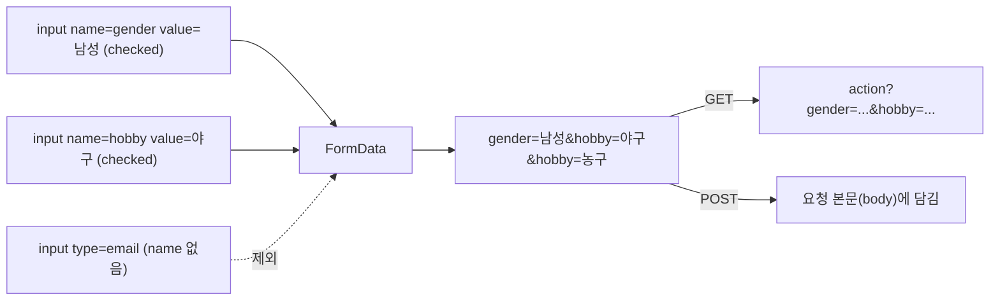

## 들어가며 (Situation)

수업 자료 맨 위에 별 세 개(⭐⭐⭐)가 붙은 파일이 `08_폼관련태그.html`이다. 150줄 안에 `form` 7개, `input` 27개, `select`, `textarea`, `button`이 들어 있다. 수업 정리는 이렇다.

> form 태그는 html에서 사용자가 값을 입력할 수 있는 양식을 제공하는 태그이다.
> 1. action 속성 - 폼의 입력 된 값들을 전송받을 서버의 주소
> 2. method 속성 - get : url 에 넘어가는 데이터가 보인다. / post : url 에 넘어가는 데이터가 감춰진다.

## 문제 상황 (Task)

화면만 보면 입력 칸이 잘 나온다. 하지만 폼의 진짜 목적은 **서버에 값을 보내는 것**이고, 그 부분은 눈에 보이지 않는다. 그래서 세 가지를 직접 확인하기로 했다.

1. `type`마다 브라우저가 정말 다른 입력 칸을 만들어 줄까?
2. `min`, `max`, `step`, `required`는 무엇을 막아 줄까?
3. 제출하면 실제로 어떤 문자열이 서버로 가나?

Chrome 헤드리스로 페이지를 열고, 입력값을 넣은 뒤 `validity`와 `FormData`를 찍었다.

## 해결 과정 (Action)

### 1. 브라우저가 모르는 `type`은 `text`가 된다

모든 `input`의 `type` 속성값과, 브라우저가 실제로 적용한 `input.type`을 비교했다.

```text
text,text,password,search,email,submit,number,range,submit,reset,
date,month,week,time,datetime=>text,datetime-local,submit,
radio,radio,checkbox,checkbox,checkbox,submit,color,file,hidden
```

`datetime`만 **`=>text`**로 바뀌었다. `type="datetime"`은 표준에서 빠진 값이라 Chrome이 모른다. 모르는 `type`은 기본값인 `text`로 처리된다. 화면에서는 달력이 아니라 평범한 글자 칸이었다. 날짜와 시간을 함께 받으려면 `datetime-local`을 쓴다.

| 분류 | 수업에서 쓴 `type` |
|------|-------------------|
| 글자 | `text`, `password`, `search`, `email` |
| 숫자 | `number`, `range` |
| 날짜/시간 | `date`, `month`, `week`, `time`, ~~`datetime`~~, `datetime-local` |
| 선택 | `radio`, `checkbox` |
| 기타 | `color`, `file`, `hidden` |
| 버튼 | `submit`, `reset` |

### 2. `min`, `max`, `step`은 함께 계산된다

수량 칸은 `min="0" max="10" value="0" step="3"`이다. 여러 값을 넣고 `validity`를 확인했다.

```text
number 0:  valid=true
number 3:  valid=true
number 4:  valid=false stepMismatch=true
number 9:  valid=true
number 10: valid=false stepMismatch=true
number 12: valid=false rangeOverflow=true
number -3: valid=false rangeUnderflow=true
```

`max="10"`인데 **10이 통과하지 못했다.** `step="3"`은 `min`(0)부터 3씩 더한 값(0, 3, 6, 9)만 허용한다. 10은 범위 안이지만 계단에서 벗어난다(`stepMismatch`). 위쪽 화살표(`stepUp()`)를 눌러도 0 → 3 → 6 → 9에서 멈췄다. 이 칸에서 고를 수 있는 최댓값은 사실상 9다.

`range`는 더 엄격하다. 슬라이더에 `150`을 넣었더니 값이 `100`(max)으로 **잘려서** 들어갔다. `number`는 틀린 값을 받아 두고 "유효하지 않다"고 표시하지만, `range`는 아예 범위 안으로 고친다.

### 3. `required`와 `email` 검사

| 칸 | 상태 | 결과 |
|----|------|------|
| 검색 칸 (`required`) | 비어 있음 | `valueMissing=true`, 메시지 "이 입력란을 작성하세요." |
| 이메일 칸 (`type="email"`) | `abc` 입력 | `valid=false` |

이 검사는 제출 버튼을 누를 때 브라우저가 막아 준다. 하지만 이것은 **사용자 편의**일 뿐 보안이 아니다. 개발자 도구로 `required`를 지우거나, 폼을 거치지 않고 서버에 직접 요청을 보내면 그만이다. 서버는 받은 값을 반드시 다시 검사해야 한다.

### 4. 서버로 가는 것은 `name=value`

라디오·체크박스 폼에서 "여성"을 고른 뒤 "남성"을 고르고, 체크박스 "농구"를 추가로 체크했다. 그리고 실제 전송 문자열을 만들었다(`new URLSearchParams(new FormData(form))`).

```text
female=false
gender=%EB%82%A8%EC%84%B1&hobby=%EC%95%BC%EA%B5%AC&hobby=%EB%86%8D%EA%B5%AC
```

퍼센트 인코딩을 풀면 `gender=남성&hobby=야구&hobby=농구`다.

- 라디오는 **같은 `name`**(`gender`)끼리 한 그룹이다. 남성을 고르자 여성은 자동으로 풀렸다(`female=false`).
- 체크박스는 같은 이름으로 **여러 번** 간다(`hobby=야구&hobby=농구`). 서버에서는 값 하나가 아니라 배열로 받아야 한다.
- 보내지는 값은 화면 글자가 아니라 **`value` 속성**이다. `select`도 마찬가지다. 화면에는 "일본"이 보이지만 `nation=jp`가 간다.

수업 주석이 이것을 정확히 짚었다.

> 한국, 중국, 일본과 같은 데이터는 개발자들을 위한 데이터가 아닌 사용자들을 위한 데이터이다. 개발자들은 name 속성과 value 속성으로 데이터를 판단하게 된다.

반대로 **`name`이 없으면 아예 전송되지 않는다.** 두 번째 폼의 전송 항목은 `userId, userPwd`뿐이었다. `search`와 `email` 칸에는 `name`이 없어서 값을 입력해도 서버에 가지 않는다.



### 5. `method`가 없으면 GET, `button`은 기본이 submit

```text
forms=7 | action=search method=post ; action=# method=post ; action=# method=get ;
          action=# method=get ; action=# method=get ; action=# method=get ; action=# method=get
buttons: "검색"=submit, "제출"=submit, "버튼"=button, "버튼2"=submit, "버튼3"=submit
```

- 4~7번 폼은 `method`를 쓰지 않았는데 `get`이다. **기본값이 GET**이다.
- `type` 없는 `<button>`은 `submit`이다. 수업 메모("button 의 타입을 지정하지 않으면 디폴트가 submit")가 맞았다. 폼 안에서 그냥 동작만 하는 버튼을 만들 때 `type="button"`을 빼먹으면, 누를 때마다 폼이 제출되는 버그가 생긴다.

GET과 POST의 차이를 "보인다/감춰진다"로 정리했는데, POST도 개발자 도구 네트워크 탭에서는 그대로 보인다. 감춰지는 것이 아니라 **주소창 대신 요청 본문에 담길 뿐**이다. 비밀번호를 보호하는 것은 POST가 아니라 HTTPS다. 이 차이는 이후 Servlet 수업에서 [서버 쪽에서 직접 확인했다]().

### 6. 파일 칸은 `enctype` 없이는 이름만 간다

마지막 폼에는 `type="file"`이 있지만 `enctype`이 기본값 `application/x-www-form-urlencoded`다. 이 상태로는 파일 내용이 아니라 **파일 이름만** 전송된다. 파일을 보내려면 `method="post" enctype="multipart/form-data"`가 필요하다.

### 7. `label`은 클릭 영역이자 이름표

`label`이 입력 칸에 연결됐는지(`input.labels.length`) 확인했다.

| 칸 | 연결 방식 | `labels.length` |
|----|-----------|-----------------|
| 아이디 | `<label for="userId">` + `id="userId"` | 1 |
| 비밀번호 | `<label>비밀번호 :</label>` (따로 떨어짐) | **0** |

비밀번호 칸은 옆에 글자가 있어도 **연결되지 않았다.** 연결된 `label`은 글자를 눌러도 칸에 포커스가 가고, 화면 낭독기가 칸의 이름으로 읽어 준다. 연결 방법은 `for`와 `id`를 맞추거나, `label`로 `input`을 감싸는 것이다.

## 결과 (Result)

| 확인 항목 | 결과 |
|-----------|------|
| `type="datetime"` | 브라우저가 몰라서 `text`로 처리 |
| `number` (`min=0 max=10 step=3`)에 10 | `stepMismatch`로 무효, 실제 최댓값 9 |
| `range`에 150 | 100으로 잘림 |
| 라디오·체크박스 전송 | `gender=남성&hobby=야구&hobby=농구` |
| `name` 없는 `search`, `email` | 전송되지 않음 |
| `method` 생략 / `type` 없는 `button` | GET / submit |
| `for` 없는 비밀번호 `label` | 연결 0개 |

배운 점은 다음과 같다.

- 서버가 받는 것은 화면이 아니라 **`name=value` 문자열**이다. `name`이 없으면 값은 사라진다.
- 브라우저 검증은 편의 기능이다. 진짜 검증은 서버에서 다시 한다.

## 더 학습하면 좋은 개념

- **HTTP 요청 구조와 `application/x-www-form-urlencoded`** — 폼 값이 요청에 담기는 형식. Servlet의 `getParameter()`가 이것을 읽는다.
- **`multipart/form-data`** — 파일 업로드에 필요한 인코딩 방식.
- **Constraint Validation API (`setCustomValidity`, `:invalid`)** — 브라우저 검증 메시지를 바꾸거나 CSS로 꾸미는 방법.
- **`fieldset`과 `legend`** — 라디오 그룹처럼 관련 칸을 묶어 이름을 붙이는 접근성 태그.

## 참고 자료

- [HTML Living Standard - The input element](https://html.spec.whatwg.org/multipage/input.html#the-input-element)
- [HTML Living Standard - Constraint validation](https://html.spec.whatwg.org/multipage/form-control-infrastructure.html#constraints)
- [HTML Living Standard - Form submission](https://html.spec.whatwg.org/multipage/form-control-infrastructure.html#form-submission-2)
- [MDN - input: step](https://developer.mozilla.org/en-US/docs/Web/HTML/Attributes/step)
- [MDN - Sending form data](https://developer.mozilla.org/en-US/docs/Learn_web_development/Extensions/Forms/Sending_and_retrieving_form_data)
- [MDN - label](https://developer.mozilla.org/en-US/docs/Web/HTML/Element/label)

---

**요약**
1. 표준에서 빠진 `type="datetime"`은 Chrome에서 `text`로 처리됐고, `step="3"` 때문에 `max="10"`인 칸에서 10은 무효였다.
2. 서버로 가는 것은 `name=value` 문자열이라서, 체크박스는 같은 이름으로 여러 번 가고 `name` 없는 칸은 아예 빠진다.
3. `method`를 생략하면 GET, `type` 없는 `button`은 submit이다. 브라우저 검증은 편의 기능이므로 서버에서 다시 검사해야 한다.
