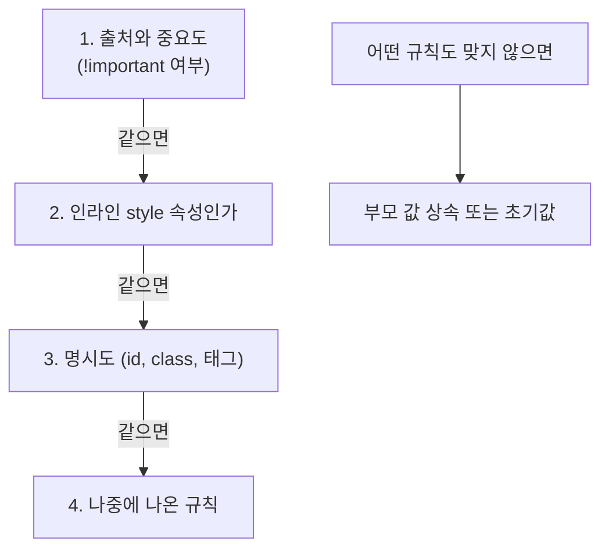

## 들어가며 (Situation)

`04_선택자우선순위.html`에서 수업은 CSS 우선순위를 한 줄로 정리했다.

> !important > 인라인 선택자 > 아이디 선택자 > 클래스 선택자 > 태그 선택자 > 전체 선택자

실습 대상은 `div` 두 개다.

```html
<div id="test1" class="test1">우선순위 테스트</div>
<div id="test2" class="test2" style="color: navy; background-color: orange;">우선순위 테스트</div>
```

```css
#test1 { color: yellow;    background-color: black; }
.test1 { color: green;     background-color: bisque; }
#test2 { background-color: aquamarine; }
.test2 { color: turquoise !important; background-color: black !important; }
div    { color: blue; }
*      { color: red; }
```

## 문제 상황 (Task)

계급표를 외우고 나니 오히려 질문이 생겼다.

1. 계급표대로라면 `#test2`의 글자는 인라인(`navy`)이어야 하나, `.test2`의 `!important`(`turquoise`)여야 하나?
2. 페이지의 `h1`, `h3`, `pre`가 모두 빨간색인 이유는? `*`이 가장 약하다면서?
3. 클래스를 아주 많이 붙이면 id 하나를 이길 수 있을까?
4. 둘 다 `!important`라면 누가 이길까?

## 해결 과정 (Action)

### 1. 계산된 색 확인

Chrome 헤드리스로 계산된 색을 찍었다.

```text
H1:     color=rgb(255, 0, 0)
H3:     color=rgb(255, 0, 0)
PRE:    color=rgb(255, 0, 0)
STRONG: color=rgb(255, 0, 0)
test1:  color=rgb(255, 255, 0)   bg=rgb(0, 0, 0)
test2:  color=rgb(64, 224, 208)  bg=rgb(0, 0, 0)
```

| 요소 | 적용 후보 | 결과 | 이긴 규칙 |
|------|-----------|------|-----------|
| `#test1` | `#test1` 노랑 / `.test1` 초록 / `div` 파랑 / `*` 빨강 | **노랑** / 검정 배경 | id |
| `#test2` 글자 | 인라인 `navy` / `.test2` `turquoise !important` / `div` / `*` | **turquoise** | `!important` |
| `#test2` 배경 | 인라인 `orange` / `#test2` `aquamarine` / `.test2` `black !important` | **검정** | `!important` |
| `h1`, `h3`, `pre`, `strong` | `*` 빨강만 | **빨강** | 전체 선택자 |

`#test2`는 **인라인 스타일보다 class가 이겼다.** 계급표의 맨 앞 `!important`가 붙었기 때문이다. 계급표대로 결과가 나왔다.

### 2. "약한 `*`"이 이기는 이유: 상속보다 강하다

`h1`은 아무 규칙도 없을 것 같은데 빨갛다. 이유는 `*`이 **모든 요소에 직접** 적용되기 때문이다. `*`의 명시도는 (0, 0, 0)으로 가장 낮다. 하지만 `h1`에 맞는 규칙이 `*` 하나뿐이니 경쟁자가 없다.

`pre` 안의 `strong`도 빨강이다. 부모 `pre`가 빨강이라 상속받은 것이 아니라, `strong` 자신에게도 `*`이 직접 맞았다. **직접 맞은 규칙은 명시도가 0이라도 부모에게서 상속받은 값보다 우선한다.** `*`이 계급표 맨 끝인데도 넓게 이기는 이유다. 예를 들어 `body { color: blue; }`를 줘도 자식들은 파랗게 되지 않는다. 자식마다 `*`의 빨강이 직접 맞기 때문이다.

### 3. 계급표의 정체: 캐스케이드 순서

계급표는 사실 CSS 명세의 **캐스케이드** 규칙을 줄인 것이다. 한 속성에 여러 값이 경쟁하면 위에서부터 차례로 비교하고, 승부가 나면 거기서 멈춘다.



명시도는 세 자리 점수 **(id 개수, class·속성·가상 클래스 개수, 태그·가상 요소 개수)**로 계산한다.

| 선택자 | 명시도 |
|--------|--------|
| `*` | (0, 0, 0) |
| `div` | (0, 0, 1) |
| `.test1` | (0, 1, 0) |
| `#test1` | (1, 0, 0) |
| `style="..."` | 명시도 비교 전에 이김 |

### 4. 클래스 11개 vs id 1개

세 자리 점수는 **앞자리부터** 비교한다. 클래스 점수가 아무리 높아도 id 자리가 0이면 진다. 확인해 봤다. (확인용 **예시 코드**)

```html
<style>
  .a.b.c.d.e.f.g.h.i.j.k { color: green; }   /* (0, 11, 0) */
  #x { color: blue; }                         /* (1, 0, 0) */
</style>
<div id="x" class="a b c d e f g h i j k">11 classes vs 1 id</div>
```

```text
#x color=rgb(0, 0, 255)
```

**파랑, id가 이겼다.** 클래스 10개가 id 1개가 되는 식의 받아올림은 없다. 명시도는 십진수가 아니라 자리마다 따로 비교하는 점수다.

### 5. `!important`끼리 붙으면

인라인에도 `!important`를 붙여 class의 `!important`와 붙였다. (**예시 코드**)

```html
<style> .imp { color: turquoise !important; } </style>
<div class="imp" style="color: navy !important;">inline important</div>
```

```text
inline!important vs class!important: rgb(0, 0, 128)
```

`navy`, 인라인이 이겼다. `!important`끼리는 다시 "인라인 → 명시도 → 순서"로 비교한다. 결국 `!important`는 계급표의 맨 위에 **새 리그**를 하나 여는 셈이다. 그 리그 안에서도 같은 규칙으로 다시 싸운다.

### 6. `!important`를 아껴야 하는 이유

`!important`로 이기면, 나중에 그 값을 바꾸고 싶을 때 또 `!important`를 써야 한다. 이게 반복되면 어떤 스타일이 이기는지 아무도 예측할 수 없게 된다. MDN도 `!important`는 다른 방법이 없을 때만 쓰라고 권한다. 실제로 다음 수업에서 Bootstrap의 유틸리티 클래스가 `!important`로 Tailwind 클래스를 덮는 장면을 봤다. 그 내용은 [Tailwind 글]()에 정리했다.

## 결과 (Result)

| 확인 항목 | 결과 |
|-----------|------|
| `#test1` | 노랑/검정 (id가 class, 태그, `*`을 이김) |
| `#test2` | turquoise/검정 (class의 `!important`가 인라인을 이김) |
| 규칙 없는 `h1`, `h3`, `pre`, `strong` | 빨강 (`*`이 직접 적용, 상속보다 우선) |
| 클래스 11개 (0,11,0) vs id (1,0,0) | id 승 (자리 받아올림 없음) |
| 인라인 `!important` vs class `!important` | 인라인 승 |

배운 점은 다음과 같다.

- 계급표는 캐스케이드 순서(중요도 → 인라인 → 명시도 → 순서)를 줄인 것이다. 순서를 알면 계급표 밖의 경우도 판단할 수 있다.
- 명시도는 0이어도 **직접 맞은 규칙이 상속보다 강하다.** `*`이 생각보다 넓게 이기는 이유다.

## 더 학습하면 좋은 개념

- **캐스케이드 레이어 (`@layer`)** — 명시도보다 먼저 비교되는 새 단계. Tailwind v4가 이것을 사용한다.
- **`:where()`와 `:is()`** — `:where()`는 명시도를 0으로 만들어 덮어쓰기 쉬운 기본 스타일을 만든다.
- **상속되는 속성과 안 되는 속성** — `color`는 상속되고 `border`는 상속되지 않는다. `inherit`, `initial`, `unset` 키워드도 함께 보면 좋다.
- **BEM 같은 클래스 이름 규칙** — id 선택자와 `!important`를 피하고 명시도를 평평하게 유지하는 방법.

## 참고 자료

- [CSS Cascading and Inheritance Level 5 - Cascade Sorting Order](https://www.w3.org/TR/css-cascade-5/#cascade-sort)
- [Selectors Level 4 - Calculating a selector's specificity](https://www.w3.org/TR/selectors-4/#specificity-rules)
- [MDN - Specificity](https://developer.mozilla.org/en-US/docs/Web/CSS/Specificity)
- [MDN - !important](https://developer.mozilla.org/en-US/docs/Web/CSS/important)
- [MDN - Inheritance](https://developer.mozilla.org/en-US/docs/Web/CSS/Inheritance)

---

**요약**
1. `#test1`은 id가 이겨 노랑, `#test2`는 class의 `!important`가 인라인 스타일을 이겨 turquoise가 됐다.
2. 명시도가 0인 `*`도 요소에 직접 맞기 때문에 상속값보다 우선해서, 규칙이 없는 `h1`·`pre`·`strong`이 모두 빨강이었다.
3. 명시도는 앞자리부터 비교해서 클래스 11개도 id 1개를 못 이겼고, `!important`끼리는 다시 인라인이 이겼다.
