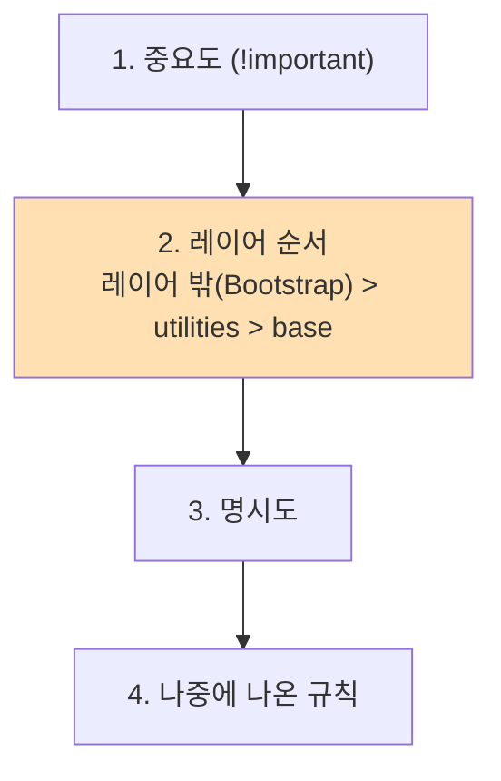

## 들어가며 (Situation)

CSS 마지막 수업에서는 같은 상품 카드 화면을 두 가지 방법으로 만들었다.

| 파일 | 방법 |
|------|------|
| `06_before_tailwind.html` + `style.css` | 클래스 이름(`.card`, `.thumb`, `.price`)을 짓고 CSS 파일에 스타일 작성 |
| `07_after_tailwind.html` | CSS 파일 없이 HTML `class`에 Tailwind 유틸리티 클래스 나열 |

`style.css` 첫 주석에 이 수업의 목표가 적혀 있다.

> 크기와 색은 뒤에서 Tailwind로 다시 만들 때 똑같이 표현할 수 있는 값으로 골랐다. 두 방법의 결과를 나란히 놓고 비교하는 것이 이 차시의 목표이기 때문이다

```css
/* before: style.css */
.card { background-color: #FFFFFF; border: 1px solid #E5E7EB; border-radius: 8px; padding: 16px; transition: all 0.3s; }
```

```html
<!-- after: Tailwind -->
<div class="bg-white border border-gray-200 rounded-lg p-4 transition hover:bg-gray-50 hover:-translate-y-2 hover:scale-105 hover:shadow-lg">
```

수업 끝에는 `07` 파일에 Bootstrap CDN과 Bootstrap 버튼 9개, 그리고 `<i data-lucide="ghost">` 아이콘도 추가했다.

## 문제 상황 (Task)

두 파일을 나란히 열어 보니 **똑같아야 할 화면이 달랐다.** `07` 쪽은 제목이 훨씬 크고, 배경이 회색이 아니라 흰색이고, 카드 사이 간격도 넓었다. 유령 아이콘은 아예 보이지 않았다.

1. 정말 두 방법은 같은 값을 만들까?
2. 다르다면 무엇이 값을 바꿨을까?
3. 아이콘은 왜 안 보일까?

## 해결 과정 (Action)

### 1. 세 가지 버전 측정

Chrome 헤드리스로 페이지를 열고 주요 요소의 계산된 스타일을 비교했다. 원인을 가르려고 `07`에서 Bootstrap의 `link`, `script` 두 줄만 뺀 버전도 만들었다. Tailwind는 CDN의 `@tailwindcss/browser@4`가 4.3.3 버전을 내려 줬다.

| 요소 · 속성 | 06 순수 CSS | 07 Tailwind만 | 07 Tailwind + Bootstrap |
|-------------|-------------|---------------|-------------------------|
| `h1` font-size | 24px | 24px | **40px** |
| `h1` font-weight | 700 | 700 | **500** |
| `h1` margin-bottom | 16px | 16px | **24px** |
| `body` 배경 | `rgb(243,244,246)` | `oklch(0.967 …)` (gray-100) | **흰색** |
| `body` padding | 20px | 20px | **48px** |
| 카드 padding | 16px | 16px | **24px** |
| 카드 간격 (`gap`) | 20px | 20px | **48px** |
| `h2` font-size | 18px | 18px | **32px** |
| 가격 `p` margin-bottom | 0px | 0px | **16px** |
| transition 시간 | 0.3s | 0.15s | 0.15s |

**Tailwind만 쓴 버전은 순수 CSS 버전과 거의 같았다.** 수업 의도대로다. `p-4`=16px, `text-2xl`=24px, `gap-5`=20px, `mb-4`=16px가 정확히 대응한다. 색은 표기만 다르다. Tailwind v4는 `oklch()`로 색을 정의해서 `#F3F4F6`과 비슷하지만 똑같지는 않은 회색이 나왔다. `transition`만 기본 시간이 0.15s로 달랐다.

달라진 것은 **Bootstrap을 넣은 순간**이었다.

### 2. 같은 클래스 이름, 다른 값

Bootstrap에도 `p-5`, `mb-4`, `gap-5` 같은 유틸리티 클래스가 있다. 이름이 같은데 값이 다르고, 게다가 `!important`가 붙어 있다. CDN 파일에서 해당 규칙을 찾았다.

```text
.mb-4{margin-bottom:1.5rem!important}
.p-5{padding:3rem!important}
.gap-5{gap:3rem!important}
```

| 클래스 | Tailwind 값 | Bootstrap 값 | 화면 |
|--------|-------------|--------------|------|
| `p-5` | 1.25rem (20px) | 3rem (48px) `!important` | 48px |
| `p-4` | 1rem (16px) | 1.5rem (24px) `!important` | 24px |
| `gap-5` | 1.25rem (20px) | 3rem (48px) `!important` | 48px |
| `mb-4` | 1rem (16px) | 1.5rem (24px) `!important` | 24px |

`!important`가 있으니 [우선순위 실습]()대로 Bootstrap이 이긴다. 여기까지는 예상할 수 있었다.

### 3. `!important`도 없는데 진 `text-2xl`

이상한 것은 `h1`이었다. Tailwind의 `text-2xl`은 클래스 선택자(0, 1, 0)다. Bootstrap의 `h1 { font-size: calc(1.375rem + 1.5vw) }`는 태그 선택자(0, 0, 1)이고 `!important`도 없다. 명시도로는 Tailwind가 이겨야 하는데 **Bootstrap이 이겼다.** `font-bold`(700)도 Bootstrap의 `h1 { font-weight: 500 }`에 졌다.

원인은 **캐스케이드 레이어**(`@layer`)였다. Tailwind v4는 자기 CSS를 레이어 안에 넣는다.

```css
@layer theme, base, components, utilities;
```

Bootstrap 5.3.8 CSS에는 `@layer`가 하나도 없다. 그래서 Bootstrap 규칙은 전부 **레이어 밖(unlayered)**에 있다. CSS 캐스케이드 명세는 일반 선언의 경우 **레이어 밖의 스타일이 모든 레이어보다 우선한다**고 정한다. 그리고 이 비교는 명시도보다 **먼저** 일어난다.



| 대결 | Tailwind | Bootstrap | 승자 | 결정 단계 |
|------|----------|-----------|------|-----------|
| `p-5` | `@layer utilities` | 레이어 밖 + `!important` | Bootstrap | 1단계 (중요도) |
| `text-2xl` vs `h1` | `@layer utilities`, (0,1,0) | 레이어 밖, (0,0,1) | **Bootstrap** | **2단계 (레이어)** |
| `bg-gray-100` vs `body` | `@layer utilities` | 레이어 밖 `body{background-color:…}` | Bootstrap | 2단계 |

명시도에서 이기더라도 그 전 단계인 레이어에서 이미 승부가 났다. Tailwind v4와 레이어를 쓰지 않는 CSS 라이브러리를 섞으면, Tailwind 유틸리티가 **조용히 진다.**

반대로 Bootstrap 버튼(`btn btn-primary`)은 Bootstrap 덕분에 파란 배경(`rgb(13,110,253)`), 둥근 모서리 6px로 잘 나왔다. Bootstrap을 뺀 버전에서는 배경이 투명이고 모서리가 0px였다. Tailwind의 `base` 레이어(Preflight)가 버튼 기본 모양을 지우기 때문이다.

### 4. 아이콘이 안 보인 이유

`<i data-lucide="ghost"></i>`는 측정 결과 자식 요소 0개, `display: inline`, 폭 `auto`였다. **빈 태그**일 뿐이다. Lucide의 이 방식은 Lucide 스크립트를 불러온 뒤 `lucide.createIcons()`를 호출해야 `data-lucide` 태그를 SVG로 바꿔 준다. 스크립트를 넣지 않았으니 아무 일도 일어나지 않았다.

### 5. 두 방식 비교

| 항목 | 순수 CSS (클래스 이름 짓기) | Tailwind (유틸리티 우선) |
|------|---------------------------|-------------------------|
| 스타일 위치 | 별도 `.css` 파일 | HTML `class` 속성 |
| 이름 짓기 | 필요 (`.card`, `.price`) | 불필요 |
| 값의 범위 | 아무 값이나 | 정해진 단계(`p-4`=1rem)를 주로 사용 |
| 같은 카드 3개 | `class="card"` 한 단어 | 긴 클래스 목록을 3번 반복 |
| 다른 CSS와 섞기 | 명시도로 조절 | **레이어 때문에 레이어 밖 CSS에 짐** |

같은 카드를 세 번 반복한 `07` 파일을 보면 Tailwind의 약점도 보인다. 카드 스타일을 바꾸려면 세 군데를 고쳐야 한다. 실제 프로젝트에서는 반복되는 부분을 컴포넌트(React 컴포넌트, 템플릿 반복문)로 묶어서 이 문제를 줄인다.

## 결과 (Result)

| 확인 항목 | 결과 |
|-----------|------|
| 06 순수 CSS vs 07 Tailwind만 | 크기·여백 값 일치 (24/16/20/16/18px), 색은 hex와 oklch 차이 |
| Bootstrap 추가 후 `h1` | 24px/700 → **40px/500** |
| Bootstrap 추가 후 `p-5`, `gap-5`, `mb-4` | 20/20/16px → **48/48/24px** (`!important`) |
| `text-2xl`이 진 이유 | 레이어 밖 CSS가 `@layer utilities`보다 우선 (명시도 이전 단계) |
| `data-lucide` 아이콘 | 스크립트가 없어 빈 `<i>` 태그 |
| 환경 | Chrome 155 헤드리스, Tailwind browser 4.3.3, Bootstrap 5.3.8 |

배운 점은 다음과 같다.

- Tailwind 하나만 쓰면 순수 CSS와 같은 결과를 얻는다. 문제는 **CSS 프레임워크 두 개를 섞을 때** 생긴다.
- 캐스케이드에는 명시도보다 앞선 **레이어** 단계가 있다. 레이어 밖의 평범한 CSS가 레이어 안의 클래스를 이길 수 있다.

## 더 학습하면 좋은 개념

- **캐스케이드 레이어 (`@layer`)** — 오늘 문제의 핵심. 외부 CSS를 `@import url(...) layer(bootstrap);`처럼 레이어에 넣어 순서를 정할 수 있다.
- **Tailwind 설치형 빌드 (CLI, Vite)** — 브라우저 CDN 버전은 개발용이다. 실제 배포는 쓰는 클래스만 뽑아 CSS 파일을 만드는 빌드 방식을 쓴다.
- **디자인 토큰** — `p-4`=1rem처럼 값을 미리 정해 두고 고르는 방식이 왜 일관성을 주는지.
- **CSS 트랜지션과 `transform`** — 카드 hover의 `translate`, `scale`이 다른 카드를 밀어내지 않는 이유.

## 참고 자료

- [Tailwind CSS - Installation: Play CDN](https://tailwindcss.com/docs/installation/play-cdn)
- [Tailwind CSS - Preflight](https://tailwindcss.com/docs/preflight)
- [CSS Cascading and Inheritance Level 5 - Cascade Layers](https://www.w3.org/TR/css-cascade-5/#layering)
- [MDN - @layer](https://developer.mozilla.org/en-US/docs/Web/CSS/@layer)
- [Bootstrap 5.3 - Spacing utilities](https://getbootstrap.com/docs/5.3/utilities/spacing/)
- [Lucide - Getting started (vanilla JS)](https://lucide.dev/guide/packages/lucide)

---

**요약**
1. Tailwind만 쓴 카드는 순수 CSS 카드와 크기·여백 값이 일치했지만, Bootstrap을 함께 넣자 `h1`이 24px에서 40px로, `gap`이 20px에서 48px로 바뀌었다.
2. `p-5`, `mb-4` 같은 같은 이름의 클래스는 Bootstrap의 `!important`가 이겼고, `!important`가 없는 `text-2xl`도 레이어 밖 CSS가 `@layer utilities`보다 우선하는 규칙 때문에 졌다.
3. `<i data-lucide>` 아이콘은 Lucide 스크립트가 없어 빈 태그로 남았다.
