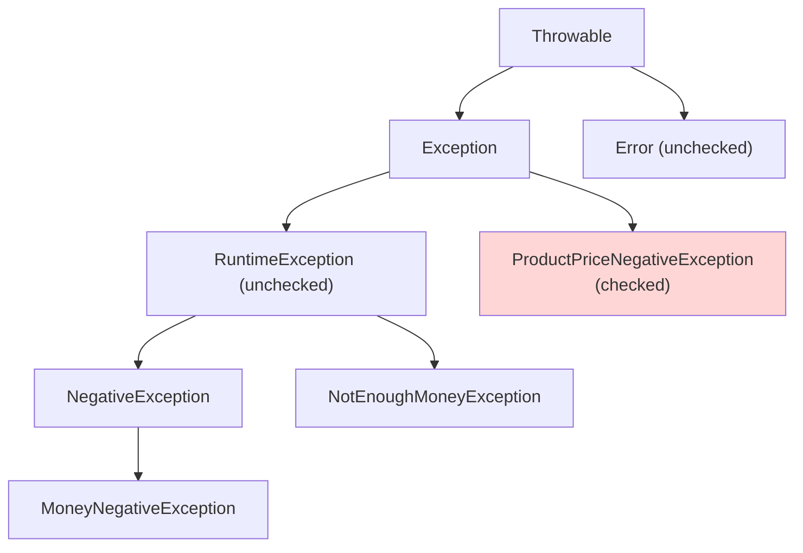

## 들어가며 (Situation)

[예외 기본 실습]() 다음은 `c_userexception` 패키지다. 수업 주석에 만드는 이유가 적혀 있다.

> JDK 설치하면 사전에 정의된 예외 클래스를 사용할 수 있다. 하지만, 현실 세계에서 발생할 수 있는 수많은 예외를 처리하기에는 너무 추상적이고 제한적이다.

상품 가격과 내가 가진 돈을 비교하는 프로그램이다. 예외 클래스 네 개를 만들었다.

```java
public class NegativeException extends RuntimeException { ... }
public class MoneyNegativeException extends NegativeException { ... }
public class NotEnoughMoneyException extends RuntimeException { ... }
public class ProductPriceNegativeException extends Exception { ... }
```

```java
public void checkMoney(int productPrice, int money) throws ProductPriceNegativeException {
    if (productPrice < 0) throw new ProductPriceNegativeException("상품의 가격은 음수일 수 없습니다!");
    if (money < 0)        throw new MoneyNegativeException("가진 돈이 음수일 수 없습니다!");
    if (productPrice > money) throw new NotEnoughMoneyException("가진 돈 보다 상품의 가격이 더 비쌉니다! 일 해야 합니다...");
    System.out.println("가진 돈이 충분합니다! 사치 좀 부려보세요");
}
```

## 문제 상황 (Task)

코드를 다시 보니 이상한 점이 있었다. 메서드는 예외를 세 종류 던지는데 `throws`에는 **하나만** 적혀 있다. 부모 클래스도 제각각이다. `Exception`을 상속한 것이 하나, `RuntimeException`을 상속한 것이 셋이다.

1. `throws`에 하나만 써도 컴파일되는 이유는 무엇일까?
2. `Exception`과 `RuntimeException` 중 무엇을 상속할지는 어떻게 정할까?
3. `MoneyNegativeException`이 `NegativeException`을 상속하면 무엇이 좋을까?

수업 `main`은 `checkMoney(-20000, -10000)` 한 경우만 실행해서 첫 번째 예외만 볼 수 있었다. 그래서 컴파일러가 무엇을 막는지, 입력별로 어떤 예외가 나는지 실험했다.

## 해결 과정 (Action)

### 1. `throws`를 지워 보기

`checkMoney` 선언부에서 `throws ProductPriceNegativeException`을 지우고 다시 컴파일했다.

```text
ExceptionTest.java:13: error: unreported exception ProductPriceNegativeException; must be caught or declared to be thrown
            throw new ProductPriceNegativeException(
            ^
```

오류는 **`ProductPriceNegativeException` 한 군데뿐**이었다. 똑같이 `throw`하는 `MoneyNegativeException`, `NotEnoughMoneyException`에는 아무 말이 없었다.

이번에는 `throws`는 그대로 두고, `main`에서 `ProductPriceNegativeException`을 잡는 `catch`만 지웠다.

```text
Application.java:28: error: unreported exception ProductPriceNegativeException; must be caught or declared to be thrown
            et.checkMoney(-20000, -10000);
                         ^
```

`throws`로 선언하면 이번에는 **호출한 쪽**이 잡거나 다시 선언해야 한다. 컴파일러가 끝까지 따라와서 확인한다.

### 2. 컴파일러가 검사하는 예외, 검사하지 않는 예외

자바 언어 명세(JLS 11.1.1)는 예외를 두 종류로 나눈다.

> The unchecked exception classes are the run-time exception classes and the error classes. The checked exception classes are all exception classes other than the unchecked exception classes.



| 구분 | 부모 | 수업 예외 | 컴파일러 |
|------|------|-----------|----------|
| **Checked** | `Exception` (단, `RuntimeException` 제외) | `ProductPriceNegativeException` | `catch`하거나 `throws`로 선언해야 컴파일됨 |
| **Unchecked** | `RuntimeException`, `Error` | `NegativeException`, `MoneyNegativeException`, `NotEnoughMoneyException` | 검사하지 않음 |

`throws`에 하나만 써도 됐던 이유가 이것이다. 나머지 셋은 컴파일러가 검사하지 않는 unchecked 예외다. 이전 글의 `IllegalArgumentException`, `NullPointerException`도 모두 `RuntimeException`의 자식이라서 `throws` 없이 던질 수 있었다.

### 3. 입력별 결과와 부모 타입으로 잡기

네 가지 입력을 넣고, `catch`를 `NegativeException`(부모)과 `Exception`으로만 써 봤다. (확인용 **예시 코드**)


```java
int[][] cases = {{-20000, -10000}, {5000, -10000}, {5000, 3000}, {5000, 10000}};
for (int[] c : cases) {
    try { new ExceptionTest().checkMoney(c[0], c[1]); }
    catch (NegativeException e) { System.out.println(Arrays.toString(c) + " NegativeException 으로 잡힘 -> " + e.getClass().getSimpleName() + ": " + e.getMessage()); }
    catch (Exception e) { System.out.println(Arrays.toString(c) + " " + e.getClass().getSimpleName() + ": " + e.getMessage() + " / checked? " + !(e instanceof RuntimeException)); }
}
```


```text
[-20000, -10000] ProductPriceNegativeException: 상품의 가격은 음수일 수 없습니다! / checked? true
[5000, -10000] NegativeException 으로 잡힘 -> MoneyNegativeException: 가진 돈이 음수일 수 없습니다!
[5000, 3000] NotEnoughMoneyException: 가진 돈 보다 상품의 가격이 더 비쌉니다! 일 해야 합니다... / checked? false
가진 돈이 충분합니다! 사치 좀 부려보세요
```

| 입력 (가격, 돈) | 던져진 예외 | 잡은 `catch` |
|-----------------|-------------|--------------|
| (-20000, -10000) | `ProductPriceNegativeException` | `Exception` |
| (5000, -10000) | `MoneyNegativeException` | **`NegativeException`** (부모 타입) |
| (5000, 3000) | `NotEnoughMoneyException` | `Exception` |
| (5000, 10000) | 없음 | - |

`MoneyNegativeException`은 부모인 `NegativeException`의 `catch`로 잡혔다. 예외도 클래스라서 다형성이 그대로 적용된다. 나중에 `AgeNegativeException` 같은 "음수 예외"가 늘어나도, `catch (NegativeException e)` 하나로 묶어서 처리할 수 있다. 예외 계층을 설계하는 이유가 이것이다.

첫 번째 입력은 가격과 돈이 **둘 다** 음수지만 가격 예외 하나만 나왔다. `throw`를 만나는 순간 메서드가 끝나기 때문에 두 번째 `if`까지 가지 않는다.

### 4. unchecked는 잊어도 컴파일된다

`catch` 없이 `checkMoney(5000, 3000)`을 호출했다. `main`에는 checked 예외 때문에 `throws Exception`만 붙였다.

```text
--- catch 없이 NotEnoughMoney ---
Exception in thread "main" com.wanted.a_exception.c_userexception.exception.NotEnoughMoneyException: 가진 돈 보다 상품의 가격이 더 비쌉니다! 일 해야 합니다...
	at com.wanted.a_exception.c_userexception.ExceptionTest.checkMoney(ExceptionTest.java:27)
	at M.main(M.java:8)
```

컴파일은 통과했고, 실행 중에 프로그램이 죽었다. **unchecked 예외는 처리하지 않아도 컴파일러가 알려 주지 않는다.** 편한 대신 놓치기 쉽다.

### 5. 무엇을 상속할지 정하는 기준

Oracle 자바 튜토리얼의 기준은 이렇다.

> If a client can reasonably be expected to recover from an exception, make it a checked exception. If a client cannot do anything to recover from the exception, make it an unchecked exception.

| 질문 | 예 | 선택 |
|------|----|------|
| 호출한 쪽이 대처할 수 있나? | 파일이 없으면 다른 경로를 묻는다 (`FileNotFoundException`) | Checked |
| 호출한 쪽의 프로그래밍 실수인가? | 음수 가격을 넘긴 것은 호출 코드의 버그 | Unchecked |

이 기준으로 보면 수업의 세 예외(음수 가격, 음수 돈, 돈 부족)는 성격이 비슷하다. 그런데 하나만 checked다. 실습에서는 두 종류를 모두 보여 주려고 일부러 섞은 것으로 보인다. 실제로 설계한다면 셋을 같은 쪽으로 맞추는 것이 일관적이다. 요즘 Spring 같은 프레임워크는 대부분의 예외를 unchecked로 만들고 한 곳에서 모아 처리하는 방식을 쓴다.

`NegativeException`의 수업 주석("모든 예외의 부모 클래스만 Exception 클래스 상속")과 달리 실제 코드는 `RuntimeException`을 상속한다. 어느 쪽을 상속하느냐에 따라 위의 컴파일러 동작이 완전히 달라지므로, 주석보다 `extends` 뒤를 봐야 한다.

## 결과 (Result)

| 확인 항목 | 결과 |
|-----------|------|
| `throws` 삭제 | `ProductPriceNegativeException` 1곳만 컴파일 오류 |
| `main`의 checked `catch` 삭제 | 호출부에서 컴파일 오류 |
| `MoneyNegativeException` | 부모 `NegativeException`의 `catch`로 잡힘 |
| 가격·돈 둘 다 음수 | 첫 번째 `throw`(가격)만 발생 |
| unchecked를 처리하지 않음 | 컴파일 통과, 실행 중 종료 |

배운 점은 다음과 같다.

- `Exception`을 상속하면 checked, `RuntimeException`을 상속하면 unchecked다. 컴파일러가 처리를 강제하는지가 달라진다.
- 예외도 클래스라서 부모 타입으로 묶어 잡을 수 있다. 예외 계층은 "어떻게 묶어서 처리할까"를 기준으로 설계한다.

## 더 학습하면 좋은 개념

- **예외 감싸기(chaining)와 `getCause()`** — checked 예외를 unchecked로 감싸 던지는 패턴. Spring AOP 실습에서 이 때문에 예외 메시지가 바뀌는 것을 봤다.
- **Spring의 전역 예외 처리 (`@ExceptionHandler`, `@ControllerAdvice`)** — unchecked 예외를 한곳에서 모아 응답으로 바꾸는 방법.
- **예외 비용과 흐름 제어** — 예외를 일반적인 분기(if) 대신 쓰면 안 되는 이유.
- **`Error`** — `OutOfMemoryError`처럼 잡지 말아야 하는 문제.

## 참고 자료

- [Java Language Specification (SE 21) - 11.1.1 The Kinds of Exceptions](https://docs.oracle.com/javase/specs/jls/se21/html/jls-11.html#jls-11.1.1)
- [Java Language Specification (SE 21) - 11.2 Compile-Time Checking of Exceptions](https://docs.oracle.com/javase/specs/jls/se21/html/jls-11.html#jls-11.2)
- [The Java Tutorials - Unchecked Exceptions: The Controversy](https://docs.oracle.com/javase/tutorial/essential/exceptions/runtime.html)
- [Java SE 21 API - RuntimeException](https://docs.oracle.com/en/java/javase/21/docs/api/java.base/java/lang/RuntimeException.html)

---

**요약**
1. `Exception`을 상속한 `ProductPriceNegativeException`만 checked라서, `throws`를 지우면 예외 3개 중 그 1개만 컴파일 오류가 났다.
2. `MoneyNegativeException`은 부모 `NegativeException`의 `catch`로 잡혔다. 예외도 다형성이 적용되어 계층으로 묶어 처리할 수 있다.
3. unchecked 예외는 처리하지 않아도 컴파일되지만 실행 중에 프로그램을 끝낸다. 호출한 쪽이 대처할 수 있으면 checked, 프로그래밍 실수면 unchecked로 만든다.
