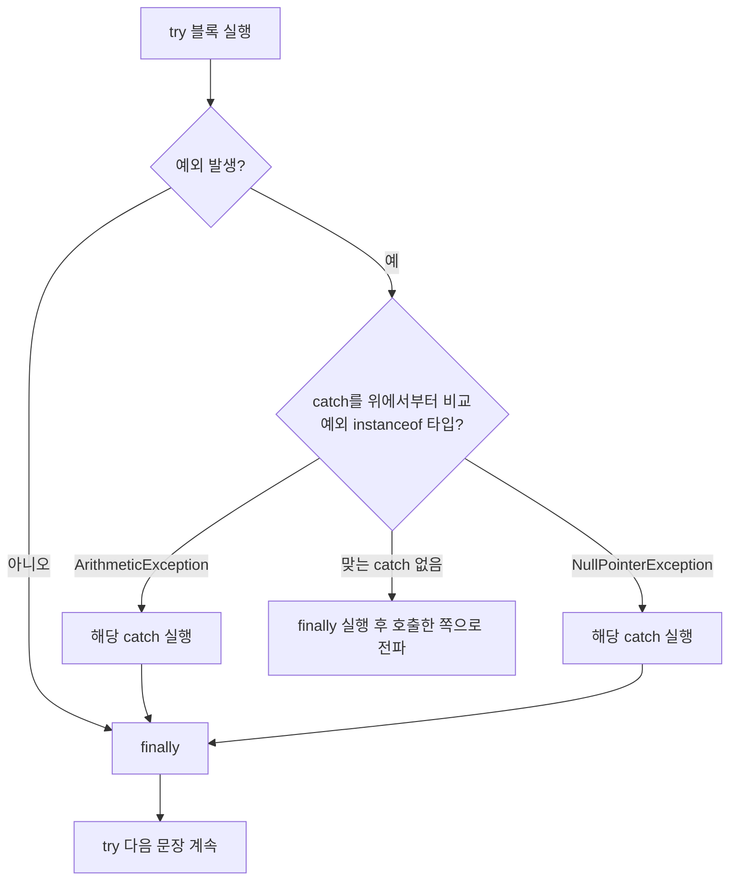

## 들어가며 (Situation)

자바 챕터5 `chap05-exception-file-io`의 첫 주제는 예외였다. 패키지 두 개로 "문제"와 "해결"을 나눴다.

| 패키지 | 내용 |
|--------|------|
| `a_exception/a_basic` | 배열 범위 밖 접근, `null` 참조로 예외를 일부러 일으킴 |
| `a_exception/b_solved` | `try-catch-finally`로 처리, `throw`로 예외 던지기 |

수업 주석은 오류를 두 가지로 나눴다.

> 컴파일 오류란, 개발자가 코드를 작성 중에 발생하는 오류를 의미한다. ex) 없는 변수 참조, 타입 불일치
> 런타임 오류 - 어플리케이션 실행 시 코드를 실행하면서 발생하는 오류이다. 대표적인 에러는 NullPointerException (null 참조)

## 문제 상황 (Task)

`a_basic`의 `main`은 예외를 두 번 일으키고 마지막에 "프로그램 종료..."를 출력하도록 짜여 있다.

```java
System.out.println("프로그램 시작...");

int[] iarr = new int[5];
System.out.println("6번째 인덱스 출력: " + iarr[6]);   // 19행

String str = null;
str.length();                                          // 22행

System.out.println("프로그램 종료...");
```

다시 실행하면서 확인할 것을 정했다.

1. 예외가 두 개인데 둘 다 보일까? "프로그램 종료..."는 출력될까?
2. `catch`를 여러 개 쓸 때 순서는 상관없을까?
3. 수업 주석의 "throw는 부른 쪽에 예외처리를 위임한다"는 설명이 정확할까?

## 해결 과정 (Action)

### 1. 첫 예외에서 멈춘다

```bash
java -cp out com.wanted.a_exception.a_basic.Application
```

```text
프로그램 시작...
Exception in thread "main" java.lang.ArrayIndexOutOfBoundsException: Index 6 out of bounds for length 5
	at com.wanted.a_exception.a_basic.Application.main(Application.java:19)
```

종료 코드는 `1`이었다. 19행의 `ArrayIndexOutOfBoundsException`에서 프로그램이 **그대로 끝났다.** 22행의 `null` 참조는 실행조차 되지 않았고, "프로그램 종료..."도 출력되지 않았다. 처리하지 않은 예외는 메서드를 빠져나가 호출한 쪽으로 올라간다(전파). `main`에서도 처리하지 않으면 JVM이 스택 트레이스를 찍고 그 스레드를 끝낸다.

19행을 주석 처리하고 다시 돌리니 이번에는 22행에서 멈췄다.

```text
Exception in thread "main" java.lang.NullPointerException: Cannot invoke "String.length()" because "str" is null
	at com.wanted.a_exception.a_basic.Application.main(Application.java:22)
```

| 실행 | 멈춘 곳 | 예외 | "프로그램 종료..." |
|------|---------|------|--------------------|
| 원본 | 19행 | `ArrayIndexOutOfBoundsException` | 출력 안 됨 |
| 19행 주석 | 22행 | `NullPointerException` | 출력 안 됨 |

스택 트레이스의 `(Application.java:19)`가 예외가 난 정확한 줄이다. 예외 메시지를 읽는 첫 번째 습관은 **맨 위 `at` 줄의 파일 이름과 줄 번호**를 보는 것이다.

### 2. NPE 메시지의 `<local1>`

`b_solved`를 터미널에서 컴파일해 실행했더니 NPE 메시지가 IntelliJ에서 보던 것과 달랐다.

```text
예외 메세지 = Cannot invoke "String.length()" because "<local1>" is null
```

변수 이름 `str` 대신 `<local1>`이 나왔다. Java 14부터 들어온 **자세한 NPE 메시지**(JEP 358)는 클래스 파일에 지역 변수 이름 정보가 있어야 이름을 보여 준다. `javac`는 기본으로 그 정보를 넣지 않는다. `-g` 옵션을 주고 다시 컴파일하자 이름이 나왔다.

```bash
javac -g -d out ...
```

```text
예외 메세지 = Cannot invoke "String.length()" because "str" is null
```

IntelliJ는 디버깅 정보를 넣어 컴파일하기 때문에 수업 중에는 `str`이 보였던 것이다.

### 3. `try-catch-finally`의 흐름

```java
try {
    String str = null;
    str.length();   // new NullPointerException();
} catch (ArithmeticException e) {
    System.out.println("!!!예외 발생!!! 🔢");
} catch (NullPointerException e) {
    System.out.println("예외 메세지 = " + e.getMessage());
    System.out.println("!!!예외 발생!!!");
} finally {
    System.out.println("예외 발생 여부와 관계없이 실행됨...");
}
```

```text
프로그램 시작됨...
예외 메세지 = Cannot invoke "String.length()" because "str" is null
!!!예외 발생!!!
예외 발생 여부와 관계없이 실행됨...
========================================
e = 나이는 음수일 수 없습니다!
프로그램 종료됨...
```

이번에는 "프로그램 종료됨..."까지 출력됐고 종료 코드는 `0`이었다. 예외를 잡았기 때문에 프로그램이 이어서 실행됐다.



`catch`는 위에서부터 **첫 번째로 맞는 것 하나만** 실행된다. `NullPointerException`은 `ArithmeticException`이 아니므로 첫 번째를 건너뛰고 두 번째가 실행됐다.

### 4. 넓은 `catch`를 먼저 쓰면 컴파일 오류

"위에서부터 첫 번째"라면 부모 타입을 먼저 쓰면 어떻게 될까? 첫 번째 `catch`를 `Exception`으로 바꿨다.

```java
} catch (Exception e) {            // 모든 예외의 부모
    ...
} catch (NullPointerException e) { // 절대 도달할 수 없음
```

```text
error: exception NullPointerException has already been caught
        } catch (NullPointerException e) {
          ^
```

**컴파일 오류**였다. `NullPointerException`은 `Exception`의 자식이라, 앞의 `catch`가 항상 먼저 잡는다. 컴파일러는 도달할 수 없는 코드를 허용하지 않는다. 그래서 `catch`는 **좁은 타입(자식)부터 넓은 타입(부모) 순서**로 쓴다.

### 5. `throw`와 `throws`는 다르다

```java
public static void checkAge(int age) {
    if (age < 0) {
        /* throw 는 해당 메서드에서 예외처리를 담당하는 것이 아닌
           부른 쪽 (호출한 쪽) 에 예외처리를 위임한다고 보면 된다. */
        throw new IllegalArgumentException("나이는 음수일 수 없습니다!");
    }
    System.out.println("전달 받은 " + age + "는 유효한 나이입니다!");
}
```

`main`에서 `checkAge(-10)`을 `try-catch`로 감쌌기 때문에 `e = 나이는 음수일 수 없습니다!`가 출력됐다. 그런데 주석의 설명은 두 키워드를 섞고 있었다.

| | `throw` | `throws` |
|---|---------|----------|
| 위치 | 메서드 **안** (문장) | 메서드 **선언부** |
| 역할 | 예외 객체를 **지금 던진다** | "이 메서드는 이 예외를 던질 수 있다"고 **선언** |
| 예 | `throw new IllegalArgumentException(...)` | `void checkMoney(...) throws ProductPriceNegativeException` |

`throw`는 예외를 **발생시키는** 문장이다. 던진 예외를 그 메서드 안에서 잡지 않으면 호출한 쪽으로 전파되는 것은 `throw`의 효과가 아니라 **모든 예외의 공통 규칙**이다. 1번의 `iarr[6]`도 `throw`를 쓰지 않았지만 `main` 밖으로 전파됐다. 호출한 쪽에 처리를 **맡긴다고 선언**하는 키워드는 `throws`다. `throws`는 [다음 글]()의 사용자 정의 예외에서 등장한다.

## 결과 (Result)

| 확인 항목 | 결과 |
|-----------|------|
| 처리 안 한 예외 2개 | 첫 예외(19행)에서 종료, 종료 코드 1, 두 번째 예외는 실행 안 됨 |
| `try-catch`로 처리 | "프로그램 종료됨..."까지 실행, 종료 코드 0 |
| NPE 메시지의 변수 이름 | 기본 `javac`는 `<local1>`, `-g`로 컴파일하면 `str` |
| `Exception`을 먼저 `catch` | 컴파일 오류 `has already been caught` |
| `throw` vs `throws` | 던지는 문장 vs 선언부의 위임 선언 |
| 환경 | Java 21 (Temurin 21.0.12) |

배운 점은 다음과 같다.

- 처리하지 않은 예외는 호출 스택을 타고 올라가고, `main`까지 올라가면 그 아래 코드는 실행되지 않는다.
- `catch`는 위에서부터 첫 번째로 맞는 하나만 실행되므로, 자식 예외부터 쓴다.

## 더 학습하면 좋은 개념

- **예외 계층 구조 (`Throwable` → `Error` / `Exception` → `RuntimeException`)** — 어떤 예외를 꼭 처리해야 하는지 정하는 기준. 다음 글의 주제다.
- **멀티 catch (`catch (A | B e)`)** — 같은 처리를 하는 예외를 한 블록으로 묶는 문법.
- **try-with-resources** — `finally`에서 자원을 닫던 코드를 자동으로 처리하는 문법. [JDBC 실습]()에서 사용했다.
- **스택 트레이스 읽기와 `Caused by`** — 예외가 다른 예외를 감쌀 때 원인을 따라가는 방법.

## 참고 자료

- [The Java Tutorials - Exceptions](https://docs.oracle.com/javase/tutorial/essential/exceptions/index.html)
- [Java Language Specification (SE 21) - 14.20 The try statement](https://docs.oracle.com/javase/specs/jls/se21/html/jls-14.html#jls-14.20)
- [Java Language Specification (SE 21) - 14.18 The throw Statement](https://docs.oracle.com/javase/specs/jls/se21/html/jls-14.html#jls-14.18)
- [JEP 358: Helpful NullPointerExceptions](https://openjdk.org/jeps/358)
- [javac - The -g option](https://docs.oracle.com/en/java/javase/21/docs/specs/man/javac.html)

---

**요약**
1. 처리하지 않은 `ArrayIndexOutOfBoundsException`에서 프로그램이 종료 코드 1로 끝나, 그 뒤의 NPE와 "프로그램 종료..."는 실행되지 않았다.
2. `try-catch`는 위에서부터 첫 번째로 맞는 `catch` 하나만 실행하므로, `Exception`을 먼저 쓰면 뒤의 `catch`에 도달할 수 없어 컴파일 오류가 난다.
3. `throw`는 예외를 던지는 문장이고 처리를 호출한 쪽에 맡긴다는 선언은 `throws`다. NPE 메시지의 변수 이름은 `-g`로 컴파일해야 보인다.
