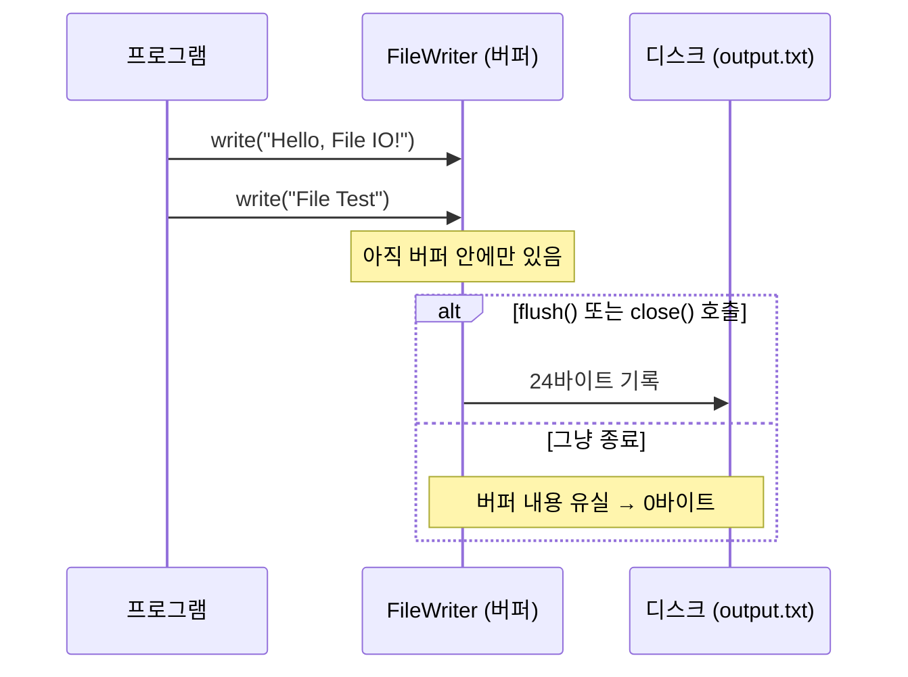

## 들어가며 (Situation)

챕터5의 마지막은 파일 입출력이다. `b_fileio/Application01.java` 하나에 파일 쓰기와 읽기가 들어 있다.

```java
// 파일 쓰기
try {
    // File IO 관련 클래스들은 객체 생성 시 예외를 반드시 처리하게 설정이 되어 있다.
    FileWriter writer = new FileWriter("output.txt");
    writer.write("Hello, File IO!");
    writer.write("File Test");

    // 버퍼(연결통로)에 있는 데이터를 밀어서 디스크에 저장한다.
    writer.flush();
} catch (IOException e) {
    throw new RuntimeException(e);
}

// 파일 읽기 작업
try {
    FileReader reader = new FileReader("output.txt");
    int data;
    // read() : 파일에서 한 문자씩 읽고, 파일 끝에 도달하면 -1을 반환
    while ( (data = reader.read()) != -1 ) {
        System.out.print((char)data);
    }
} catch (FileNotFoundException e) { ... } catch (IOException e) { ... }
```

## 문제 상황 (Task)

실행하면 `Hello, File IO!File Test`가 출력된다. 동작은 하지만, 코드를 다시 읽으니 확인하고 싶은 점이 생겼다.

1. 주석에 "버퍼에 있는 데이터를 밀어서 디스크에 저장한다"고 적혀 있다. `flush()`가 없으면 정말 저장되지 않을까?
2. `writer`와 `reader` 모두 `close()`를 하지 않는다. 닫지 않으면 무슨 문제가 생길까?
3. `output.txt`는 어디에 생길까? 한글을 쓰면 어떤 인코딩으로 저장될까?

## 해결 과정 (Action)

### 1. 원본 실행

```text
Hello, File IO!File Test
```

```text
00000000: 4865 6c6c 6f2c 2046 696c 6520 494f 2146  Hello, File IO!F
00000010: 696c 6520 5465 7374                      ile Test
```

파일은 24바이트다. `write()`를 두 번 했지만 **줄 바꿈은 없다.** `write()`는 받은 글자를 그대로 쓸 뿐이고, 줄 바꿈이 필요하면 `"\n"`을 직접 넣거나 `BufferedWriter.newLine()`을 써야 한다.

### 2. `flush()`를 지우면 0바이트

`writer.flush();`를 주석 처리하고 다시 실행했다.

```text
[읽은 내용 끝]
size=0
```

**아무것도 출력되지 않았고, 파일 크기는 0바이트였다.** 파일은 생겼지만 내용이 없다.

`FileWriter`는 글자를 바이트로 바꾸는 인코더를 거쳐 파일에 쓴다. 이 과정에 **버퍼**가 있다. `write()`를 할 때마다 디스크에 쓰는 것이 아니라, 버퍼에 모았다가 한꺼번에 내보낸다. 디스크 쓰기는 비싼 작업이라 매번 하지 않는 것이다. 버퍼가 차기 전에 프로그램이 끝나면, 내보내지 못한 데이터는 그대로 사라진다. 자바는 프로그램이 끝날 때 열린 `Writer`를 알아서 비워 주지 않는다.



`flush()`는 버퍼를 비워 디스크로 보낸다. `close()`는 **flush 후 파일을 닫는다.** 수업 코드는 `flush()`만 하고 `close()`는 하지 않았다.

### 3. 닫지 않은 파일은 지울 수 없다

닫지 않는 것이 실제로 문제가 되는지 보려고, `reader`를 연 채로 같은 파일을 지워 봤다. (확인용 **예시 코드**)

```java
FileReader r = new FileReader("output.txt");
while ((d = r.read()) != -1) n++;
System.out.println("reader 열린 채 delete() -> " + new File("output.txt").delete());
w.close(); r.close();
System.out.println("close 후 delete() -> " + new File("output.txt").delete());
```

```text
read() 호출로 읽은 문자 수=24
reader 열린 채 delete() -> false
close 후 delete() -> true
```

Windows에서는 **열려 있는 파일을 지울 수 없었다**(`false`). 닫은 뒤에야 지워졌다. 파일을 열면 운영체제의 자원(파일 핸들)을 하나 빌린다. 닫지 않으면 프로그램이 끝날 때까지 돌려주지 않는다. 짧은 실습에서는 프로그램이 곧 끝나서 드러나지 않지만, 계속 도는 서버에서 반복하면 핸들이 쌓여 결국 새 파일을 열 수 없게 된다.

`read()`가 24번 호출된 것도 눈여겨볼 만하다. 이 파일은 영문이라 글자 하나가 1바이트다. 따라서 한 글자 읽을 때마다 메서드를 한 번 호출했다. 큰 파일이라면 `BufferedReader`로 감싸 한 줄씩 읽는 것이 일반적이다.

### 4. try-with-resources로 고치기

`flush`와 `close`를 빠뜨리지 않는 가장 쉬운 방법은 **try-with-resources**다. `try ( )` 안에서 연 자원은 블록이 끝나면 예외가 나도 자동으로 `close()`된다. [JDBC 실습]()에서 `Connection`을 닫을 때 쓴 문법과 같다. (**예시 코드**)

```java
try (FileWriter writer = new FileWriter("output.txt")) {
    writer.write("Hello, File IO!\n");
    writer.write("File Test\n");
}   // 여기서 자동 close() → flush 포함

try (BufferedReader reader = new BufferedReader(new FileReader("output.txt"))) {
    String line;
    while ((line = reader.readLine()) != null) {
        System.out.println(line);
    }
}
```

| | 수업 코드 | try-with-resources |
|---|-----------|--------------------|
| 디스크 기록 | `flush()`를 직접 호출해야 함 | `close()`가 자동 flush |
| 파일 닫기 | 안 함 | 블록 끝에서 자동 |
| 중간에 예외가 나면 | 열린 채로 남음 | 그래도 닫힘 |

### 5. 파일 위치와 인코딩

```text
user.dir=C:\...\scratchpad\java\f2
default charset=UTF-8, native.encoding=MS949
kor.txt bytes=6
```

- **위치**: `"output.txt"`처럼 경로 없이 쓴 파일은 **현재 작업 디렉터리**(`user.dir`)에 생긴다. 실행 위치에 따라 달라진다. IntelliJ에서 실행하면 기본값은 프로젝트 폴더다. 그런데 강의 폴더에는 `output.txt`가 남아 있지 않았다. 다른 위치에서 실행했거나 나중에 지운 것이다. "파일이 어디 갔지?" 싶으면 먼저 `user.dir`을 출력해 본다.
- **인코딩**: "안녕"(2글자)을 썼더니 **6바이트**(`ec95 88eb 8595`), 즉 UTF-8이었다. 이 Windows의 시스템 인코딩(`native.encoding`)은 MS949지만, Java 18부터 기본 문자셋이 **UTF-8로 고정**됐다(JEP 400). Java 17 이하였다면 같은 코드가 MS949(4바이트)로 저장됐을 것이다. 인코딩에 의존하는 코드는 `new FileWriter("a.txt", StandardCharsets.UTF_8)`처럼 명시하는 것이 안전하다.

| 실험 | 결과 |
|------|------|
| `new FileWriter("kor2.txt", true)`로 두 번 쓰기 | `[A, B]` (두 번째 인자 `true` = 이어 쓰기) |
| 없는 파일 `new FileReader("nope.txt")` | `FileNotFoundException` |

수업 주석의 "File IO 관련 클래스들은 객체 생성 시 예외를 반드시 처리하게 설정이 되어 있다"는 말은 [checked 예외]()를 뜻한다. `FileWriter` 생성자는 `throws IOException`을 선언하기 때문에 `try-catch` 없이는 컴파일되지 않는다. 파일이 없거나 권한이 없는 상황은 프로그램이 대처할 수 있는 문제라서 checked로 설계됐다.

## 결과 (Result)

| 확인 항목 | 결과 |
|-----------|------|
| 원본 실행 | `Hello, File IO!File Test`, 24바이트, 줄 바꿈 없음 |
| `flush()` 제거 | 파일 **0바이트**, 출력 없음 |
| `reader`를 연 채 삭제 | `delete() = false` → 닫은 후 `true` |
| 한글 "안녕" 저장 | 6바이트 (UTF-8, Java 18+ 기본값) |
| 파일 생성 위치 | 실행 시점의 `user.dir` |
| 환경 | Java 21 (Temurin 21.0.12), Windows 11 |

배운 점은 다음과 같다.

- `Writer`는 버퍼를 거친다. `flush()`나 `close()` 없이 끝나면 쓴 내용이 사라질 수 있다.
- 연 자원은 반드시 닫는다. try-with-resources를 쓰면 flush와 close를 한 번에 해결할 수 있다.

## 더 학습하면 좋은 개념

- **바이트 스트림과 문자 스트림 (`InputStream` vs `Reader`)** — 이미지처럼 글자가 아닌 파일은 `FileInputStream`으로 다룬다.
- **보조 스트림과 데코레이터 패턴** — `new BufferedReader(new FileReader(...))`처럼 감싸서 기능을 더하는 구조.
- **`java.nio.file.Files`** — `Files.writeString()`, `Files.readAllLines()`처럼 한 줄로 파일을 다루는 최신 API.
- **문자 인코딩 (UTF-8, MS949)** — 한글이 깨지는 대부분의 원인. [응답 인코딩 실습]()에서도 같은 문제를 다뤘다.

## 참고 자료

- [Java SE 21 API - FileWriter](https://docs.oracle.com/en/java/javase/21/docs/api/java.base/java/io/FileWriter.html)
- [Java SE 21 API - Writer.flush()](https://docs.oracle.com/en/java/javase/21/docs/api/java.base/java/io/Writer.html#flush())
- [The Java Tutorials - The try-with-resources Statement](https://docs.oracle.com/javase/tutorial/essential/exceptions/tryResourceClose.html)
- [JEP 400: UTF-8 by Default](https://openjdk.org/jeps/400)
- [Java SE 21 API - Files](https://docs.oracle.com/en/java/javase/21/docs/api/java.base/java/nio/file/Files.html)

---

**요약**
1. `flush()`를 지우고 실행하자 `output.txt`는 0바이트였다. `FileWriter`는 버퍼에 모았다가 쓰기 때문에, flush나 close 없이 끝나면 내용이 사라진다.
2. 닫지 않은 `FileReader`가 열려 있는 동안 Windows는 파일 삭제를 거부했고(`false`), 닫은 뒤에야 지워졌다. try-with-resources로 자동으로 닫는 것이 안전하다.
3. 경로 없는 파일은 `user.dir`에 생기고, Java 18부터는 기본 인코딩이 UTF-8이라 "안녕"이 6바이트로 저장됐다.
