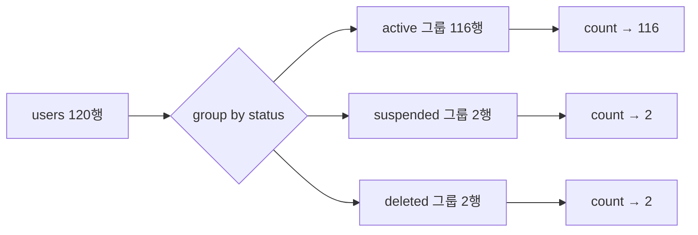

## 들어가며 (Situation)

[4편 DISTINCT와 LIMIT]({{ site.baseurl }})까지는 메뉴 데이터(`menudb`)로 실습했다. 여섯 번째 파일 `06_grouping.sql`부터는 온라인 강의 서비스(LMS)를 흉내 낸 `wanted_lms` 데이터베이스로 바꿨다. 수업 주석이 던진 질문이 그룹화의 목적을 잘 보여준다.

> 우리 서비스에 총 사용자 수?
> 가장 신고를 많이 당한 사람은?

한 행 한 행이 아니라 **여러 행을 묶어서 하나의 숫자**로 답해야 하는 질문들이다.

| 테이블 | 행 수 | 사용한 열 |
|--------|-------|-----------|
| `users` | 120 | `user_id`, `name`, `status` |
| `courses` | 30 | `course_id`, `author_id`(개설한 교육자) |
| `grades` | 8 | `score` |
| `enrollments` | 75 | `course_id`, `status`(`completed` / `active`) |

## 문제 상황 (Task)

수업에서 에러가 나는 쿼리를 주석 처리해 두고 이렇게 설명을 적었다.

> 비집계 컬럼과 집계함수를 동시에 사용시 발생한다.
> 집계가 불가능한 컬럼(문자열 등) 을 집계함수와 활용하게 되면 Error 가 발생한다.

그리고 `HAVING`은 이렇게 정리했다.

> where 는 데이터를 그룹화 하기 전에 필터링, having 절은 데이터를 그룹화 하고 난 후 필터링을 하게 된다.

복습하면서 확인할 것을 정했다.

1. 에러의 원인은 "문자열이라서"인가, "비집계 컬럼이라서"인가?
2. "그룹화 전/후"라는 차이가 실제로 어떤 에러와 결과 차이로 나타나는가?
3. `WHERE`와 `HAVING`을 같이 쓰면 행이 어떤 순서로 줄어드는가?

## 해결 과정 (Action)

### 1. 집계 함수 — 여러 행을 숫자 하나로

| 함수 | 수업 주석의 설명 |
|------|------------------|
| `count(컬럼명)` | 해당 컬럼의 데이터 개수 세기 (null 제외) |
| `sum(컬럼명)` | 숫자 데이터의 합계 |
| `avg(컬럼명)` | 숫자 데이터의 평균 |
| `max(컬럼명)` | 최댓값 |
| `min(컬럼명)` | 최솟값 |

```sql
select count(*) as '총 사용자 수' from users;
```

```text
+-------------------+
| 총 사용자 수      |
+-------------------+
|               120 |
+-------------------+
```

강좌를 개설한 교육자 수는 중복을 빼고 세야 한다.

```sql
select count(distinct author_id) as '과정 등록 교육자 수' from courses;
```

```text
+-----------------------------+
| 과정 등록 교육자 수         |
+-----------------------------+
|                          15 |
+-----------------------------+
```

강좌는 30개지만 교육자는 15명이다. `distinct` 없이 세면 30이 나온다.

```sql
select sum(score) as '총점', avg(score) '평균' from grades;
```

```text
+--------+-----------+
| 총점   | 평균      |
+--------+-----------+
| 721.67 | 90.208750 |
+--------+-----------+
```

평균의 소수점이 길어서 `round(avg(score), 2)`로 반올림하면 `90.21`이 된다.

주석의 "(null 제외)"도 확인했다. `users`에는 `NULL`이 있는 열이 없어서, 2편에서 쓴 `tbl_category`로 해봤다. (확인용 **예시 코드**)

```sql
select count(*), count(ref_category_code) from menudb.tbl_category;
```

```text
+----------+--------------------------+
| count(*) | count(ref_category_code) |
+----------+--------------------------+
|       12 |                        9 |
+----------+--------------------------+
```

`count(*)`는 **행 수**를, `count(컬럼)`은 그 열이 **NULL이 아닌 행 수**를 센다([MySQL 8.0 Reference - Aggregate Function Descriptions](https://dev.mysql.com/doc/refman/8.0/en/aggregate-functions.html#function_count)). 같은 "개수"라도 무엇을 세는지가 다르다.

### 2. 에러의 진짜 원인 — 문자열이 아니었다

**1번 질문 확인**: 주석 처리했던 쿼리를 실제로 실행했다.

```sql
select name, count(*) as '총 사용자 수' from users;
```

```text
ERROR 1140 (42000): In aggregated query without GROUP BY, expression #1 of SELECT list
contains nonaggregated column 'wanted_lms.users.name'; this is incompatible with
sql_mode=only_full_group_by
```

에러 메시지는 "문자열"이 아니라 **"GROUP BY 없는 집계 쿼리에 집계되지 않은 열(`name`)이 있다"**고 말한다. 그럼 문자열 열에 집계 함수를 쓰면 정말 에러가 날까? (확인용 **예시 코드**)

```sql
select max(name), min(name), count(name) from users;
select sum(name) from users;
```

```text
+-----------+-----------+-------------+
| max(name) | min(name) | count(name) |
+-----------+-----------+-------------+
| 황하은    | 강다연    |         120 |
+-----------+-----------+-------------+

+-----------+
| sum(name) |
+-----------+
|         0 |
+-----------+
1 row in set, 120 warnings (0.00 sec)
```

`max`, `min`, `count`는 문자열에도 잘 동작한다(가나다순 최대·최소). `sum(name)`조차 에러가 아니라 `0`과 경고 120개를 냈다. 문자열을 숫자로 바꾸려다 실패해서 0으로 계산한 것이다. 에러보다 더 위험한 "조용히 틀린 값"이다.

그러니 에러의 원인은 주석 첫 줄이 맞다. `count(*)`는 120행을 **한 행**으로 줄이는데, `name`은 120개 값을 갖고 있다. 120개 이름 중 어떤 것을 그 한 행에 써야 할지 정할 수 없다. MySQL 8.0은 `ONLY_FULL_GROUP_BY` 모드가 기본으로 켜져 있어서 이런 쿼리를 거부한다([MySQL 8.0 Reference - MySQL Handling of GROUP BY](https://dev.mysql.com/doc/refman/8.0/en/group-by-handling.html)). 내 서버의 설정도 직접 확인했다.

```sql
select @@sql_mode;
```

```text
ONLY_FULL_GROUP_BY,STRICT_TRANS_TABLES,NO_ZERO_IN_DATE,NO_ZERO_DATE,ERROR_FOR_DIVISION_BY_ZERO,NO_ENGINE_SUBSTITUTION
```

주석은 이렇게 고쳐 적었다.

> ~~집계가 불가능한 컬럼(문자열 등)을 집계함수와 활용하게 되면 Error가 발생한다.~~
> → 집계 함수와 함께, 집계되지도 않고 `GROUP BY`에도 없는 열을 SELECT하면 Error가 발생한다. 문자열도 `max`, `min`, `count`로 집계할 수 있다.

### 3. GROUP BY — 묶은 다음 그룹마다 집계

`GROUP BY`는 지정한 열의 값이 같은 행끼리 묶고, 그룹마다 집계 함수를 계산한다.

```sql
select status, count(*) as '사용자 수'
from users
group by status;
```

```text
+-----------+---------------+
| status    | 사용자 수     |
+-----------+---------------+
| active    |           116 |
| suspended |             2 |
| deleted   |             2 |
+-----------+---------------+
```



이번엔 `status`가 `GROUP BY`에 있으니, 그룹마다 `status` 값이 하나로 정해져서 에러가 나지 않는다. 반대로 그룹 기준이 아닌 열을 섞으면 같은 에러가 난다. (확인용 **예시 코드**)

```sql
select author_id, title, count(*) from courses group by author_id;
```

```text
ERROR 1055 (42000): Expression #2 of SELECT list is not in GROUP BY clause and contains
nonaggregated column 'wanted_lms.courses.title' ...
```

1번 교육자는 강좌가 4개라서, 제목 4개 중 무엇을 보여줄지 정할 수 없기 때문이다.

### 4. WHERE vs HAVING — 별칭과 집계 함수로 확인

**2번 질문 확인**: 수업에서는 개설 강좌 수가 3개 이상인 교육자를 `HAVING`으로 찾았다.

```sql
select author_id as "교육자 번호", count(*) as '개설 강좌 수'
from courses
group by author_id
having `개설 강좌 수` >= 3;
```

```text
+------------------+-------------------+
| 교육자 번호      | 개설 강좌 수      |
+------------------+-------------------+
|                1 |                 4 |
|                2 |                 3 |
|                4 |                 3 |
|                5 |                 3 |
+------------------+-------------------+
4 rows in set (0.00 sec)
```

15명 중 4명이 남았다. 같은 조건을 `WHERE`에 써보면 어떻게 될까. (확인용 **예시 코드**)

```sql
select status, count(*) as cnt from users where cnt >= 2 group by status;
select status, count(*) as cnt from users where count(*) >= 2 group by status;
select status, count(*) as cnt from users group by status having cnt >= 2;
```

```text
ERROR 1054 (42S22): Unknown column 'cnt' in 'where clause'
ERROR 1111 (HY000): Invalid use of group function
3 rows in set (0.00 sec)
```

| 위치 | 쓴 것 | 결과 |
|------|-------|------|
| `WHERE` | 별칭 `cnt` | ERROR 1054 — 그런 열 없음 |
| `WHERE` | `count(*)` | ERROR 1111 — 집계 함수 사용 불가 |
| `HAVING` | 별칭 `cnt` | 정상 |

두 에러 모두 "그룹화 전에 필터링한다"는 말로 설명된다. `WHERE`가 실행될 때는 아직 그룹이 없으니 `count(*)`를 계산할 수 없고, 그 값에 붙인 별칭 `cnt`도 존재하지 않는다. 공식 문서도 같은 이유를 든다.

> The `WHERE` clause determines which rows should be included in the `GROUP BY` clause, but it refers to the alias of a column value that is not known until after the rows have been selected, and grouped by the `GROUP BY`.
>
> — [MySQL 8.0 Reference - Problems with Column Aliases](https://dev.mysql.com/doc/refman/8.0/en/problems-with-alias.html)

같은 문서에 `GROUP BY`, `ORDER BY`, `HAVING`에서는 별칭을 쓸 수 있다고 나온다. 이걸 쿼리의 **논리적 처리 순서**로 그려보면 이해가 쉬웠다.


`WHERE`는 그룹도, 집계 값도 생기기 전 단계다. (`HAVING`이 그림상 SELECT보다 앞인데도 별칭을 쓸 수 있는 건 MySQL이 허용해주는 것이고, 표준 SQL에서는 `having count(*) >= 3`처럼 식을 그대로 쓰는 편이 안전하다.)

### 5. WHERE와 HAVING을 함께 — 75행이 7행이 되기까지

**3번 질문 확인**: 마지막 문제는 "수강 상태가 `completed`인 등록 중, 2명 이상이 완료한 과정"이었다.

```sql
select
    course_id as '등록한 과정',
    count(*) as '학생 수'
from enrollments
where status = 'completed'
group by course_id
having count(*) >= 2;
```

```text
+------------------+------------+
| 등록한 과정      | 학생 수    |
+------------------+------------+
|                1 |          9 |
|                2 |          5 |
|                3 |          6 |
|                4 |          4 |
|                5 |          5 |
|                7 |          2 |
|                9 |          2 |
+------------------+------------+
7 rows in set (0.00 sec)
```

단계마다 행이 몇 개인지 세어봤다. (확인용 **예시 코드**: `count(*)`, `count(distinct course_id)`로 단계별 집계)


`WHERE`를 빼면 어떻게 될까? 상태와 관계없이 등록 2명 이상인 과정은 10개였고, 1번 과정의 학생 수도 9명이 아니라 17명이 됐다. `WHERE`는 **어떤 행을 셀지**, `HAVING`은 **센 결과 중 어떤 그룹을 남길지**를 정한다는 차이가 숫자로 보였다.

| 쿼리 | 1번 과정 학생 수 | 남은 과정 수 |
|------|------------------|--------------|
| `where completed` + `having >= 2` | 9 | 7 |
| `having >= 2`만 | 17 | 10 |

## 결과 (Result)

| 확인한 내용 | 결과 |
|-------------|------|
| `count(*)` vs `count(ref_category_code)` | 12 vs 9 (NULL 제외) |
| `select name, count(*)` | ERROR 1140 — 원인은 비집계 열 |
| `max(name)`, `sum(name)` | 문자열도 집계됨, `sum`은 0 + 경고 120개 |
| `WHERE cnt >= 2` / `WHERE count(*) >= 2` | ERROR 1054 / ERROR 1111 |
| `HAVING cnt >= 2` | 정상 |
| 완료 수강 집계 단계 | 75행 → 40행 → 14그룹 → 7과정 |

배운 점은 다음과 같다.

- 집계 쿼리의 에러는 "결과 한 행에 값을 하나로 정할 수 없는 열"이 있을 때 난다. 문자열인지 여부와는 상관없다.
- `WHERE`는 행을, `HAVING`은 그룹을 거른다. 처리 순서를 그려보면 별칭과 집계 함수를 어디서 쓸 수 있는지가 저절로 정해진다.
- 에러 메시지를 실제로 읽어보니 주석보다 정확했다. 주석 처리한 에러 코드도 한 번은 실행해볼 가치가 있다.

## 더 학습하면 좋은 개념

- **함수 종속성(Functional Dependency)** — `GROUP BY user_id`일 때 `name`은 `user_id`로 결정되므로 MySQL이 허용한다. `ONLY_FULL_GROUP_BY`가 정확히 무엇을 검사하는지 알 수 있다.
- **`WITH ROLLUP`** — 그룹별 소계와 전체 합계를 한 번에 구하는 확장 문법.
- **윈도 함수(`OVER`)** — 행을 줄이지 않고 그룹 집계 값을 각 행 옆에 붙인다. "각 사용자와 그 사용자가 속한 상태의 인원 수"처럼 비집계 열과 집계를 함께 보고 싶을 때 쓴다.
- **`DECIMAL`과 `AVG` 정밀도** — `avg(score)`가 `90.208750`처럼 소수 6자리로 나온 이유와 `ROUND`, `TRUNCATE`의 차이.

## 참고 자료

- [MySQL 8.0 Reference - Aggregate Function Descriptions](https://dev.mysql.com/doc/refman/8.0/en/aggregate-functions.html)
- [MySQL 8.0 Reference - MySQL Handling of GROUP BY](https://dev.mysql.com/doc/refman/8.0/en/group-by-handling.html)
- [MySQL 8.0 Reference - Problems with Column Aliases](https://dev.mysql.com/doc/refman/8.0/en/problems-with-alias.html)
- [MySQL 8.0 Reference - SELECT Statement (GROUP BY, HAVING)](https://dev.mysql.com/doc/refman/8.0/en/select.html)

---

**요약**
1. `select name, count(*)`의 에러(ERROR 1140)는 문자열 때문이 아니라 `ONLY_FULL_GROUP_BY`에서 비집계 열을 섞었기 때문이고, 문자열도 `max`·`min`·`count`로 집계된다.
2. `WHERE`는 그룹화 전이라 `count(*)`와 별칭을 쓸 수 없고(ERROR 1111, 1054), 그룹을 거르는 조건은 `HAVING`에 쓴다.
3. 완료 수강 집계는 75행 → `WHERE` 40행 → `GROUP BY` 14그룹 → `HAVING` 7과정 순으로 줄어들었다.
