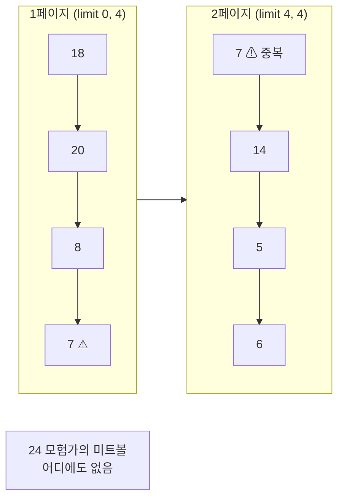

## 들어가며 (Situation)

[3편 WHERE]({{ site.baseurl }})에서 조건으로 행을 골랐다. 이번 글은 결과를 줄이는 다른 두 가지 방법을 다룬다.

| 파일 | 키워드 | 줄이는 방법 |
|------|--------|-------------|
| `04_distinct.sql` | `DISTINCT` | 중복된 값을 하나로 합친다 |
| `05_limit.sql` | `LIMIT` | 결과 개수를 제한한다 |

`LIMIT`의 수업 주석은 이 기능이 왜 필요한지 설명한다.

> 수백만건 데이터를 한 번에 조회하면 시스템 상에 큰 부하를 주게 된다.
> limit 는 '상위 5개만', '한 페이지에 10개만' 등 웹 앱의 페이징 기능을 구현하는데 필수적인 기능이다.

## 문제 상황 (Task)

`05_limit.sql`의 두 쿼리를 다시 실행하다가 이상한 점을 발견했다. 가격 내림차순 상위 5개(`limit 5`)와, 1칸 밀어서 5개(`limit 1,5`)를 비교했는데 **15000원짜리 두 메뉴의 순서가 뒤바뀌어 있었다.**

```text
limit 5   : ... | 7 민트미역국 | 24 모험가의 미트볼 |
limit 1,5 : ... | 24 모험가의 미트볼 | 7 민트미역국 | ...
```

같은 정렬 조건인데 순서가 왜 바뀔까? 실제 페이징에서는 이게 문제가 될까? 함께 확인할 것을 정리했다.

1. `DISTINCT`는 열을 여러 개 쓰면 어떻게 동작하는가?
2. `limit 1,5`의 `1`은 주석처럼 "시작할 행의 번호"인가?
3. 동점인 행의 순서가 바뀌면 페이징에서 무슨 일이 생기는가?

## 해결 과정 (Action)

### 1. DISTINCT — 36행을 11행으로

메뉴마다 카테고리 코드가 있으니, 그냥 조회하면 같은 코드가 여러 번 나온다.

```sql
select category_code from tbl_menu order by category_code;
```

```text
+---------------+
| category_code |
+---------------+
|             1 |
|             1 |
|             1 |
|             2 |
|             4 |
|           ... |
+---------------+
36 rows in set (0.00 sec)
```

`DISTINCT`를 붙이면 중복이 사라진다.

```sql
select distinct category_code from tbl_menu order by category_code;
```

```text
+---------------+
| category_code |
+---------------+
|             1 |
|             2 |
|             4 |
|             5 |
|           ... |
|            12 |
+---------------+
11 rows in set (0.00 sec)
```

11행이다. 카테고리는 12개인데 3번(디저트)이 없다. 디저트는 동양·서양을 묶는 상위 카테고리이고, 3번에 직접 속한 메뉴는 하나도 없기 때문이다. "메뉴가 실제로 쓰고 있는 카테고리 목록"을 얻은 셈이다.

**1번 질문 확인**: 수업 주석에는 "중복 data 가 존재하는 컬럼 앞"에 쓴다고 적었다. 그럼 열을 두 개 쓰면 앞 열만 중복 제거될까? (확인용 **예시 코드**)

```sql
select distinct category_code, orderable_status
from tbl_menu
order by category_code;
```

```text
+---------------+------------------+
| category_code | orderable_status |
+---------------+------------------+
|             1 | N                |
|             1 | Y                |
|             2 | Y                |
|             4 | N                |
|             4 | Y                |
|           ... | ...              |
+---------------+------------------+
16 rows in set (0.00 sec)
```

16행이 나왔고 `1`이 두 번 나온다. `DISTINCT`는 특정 열 하나가 아니라 **SELECT한 열 전체의 조합**에서 중복을 제거한다. `(1, N)`과 `(1, Y)`는 다른 조합이라 둘 다 남았다. `DISTINCT`는 열 앞에 붙는 게 아니라 SELECT 목록 전체에 붙는 키워드다([MySQL 8.0 Reference - SELECT Statement](https://dev.mysql.com/doc/refman/8.0/en/select.html)).

| 쿼리 | 결과 | 기준 |
|------|------|------|
| `select category_code` | 36행 | 중복 그대로 |
| `select distinct category_code` | 11행 | 카테고리 하나 |
| `select distinct category_code, orderable_status` | 16행 | (카테고리, 판매 상태) 조합 |

개수만 필요하면 집계 함수 안에 넣을 수도 있다. 이 방법은 [5편]({{ site.baseurl }})에서 `count(distinct author_id)`로 다시 나온다.

```sql
select count(distinct category_code), count(category_code) from tbl_menu;
```

```text
+-------------------------------+----------------------+
| count(distinct category_code) | count(category_code) |
+-------------------------------+----------------------+
|                            11 |                   36 |
+-------------------------------+----------------------+
```

### 2. LIMIT — offset은 "건너뛸 개수"

```sql
select * from tbl_menu order by menu_price desc limit 5;
```

```text
+-----------+------------------------+------------+---------------+------------------+
| menu_code | menu_name              | menu_price | category_code | orderable_status |
+-----------+------------------------+------------+---------------+------------------+
|        18 | 붕어빵초밥             |      35000 |             6 | Y                |
|        20 | 마라깐쇼한라봉         |      22000 |             5 | N                |
|         8 | 한우딸기국밥           |      20000 |             4 | Y                |
|         7 | 민트미역국             |      15000 |             4 | Y                |
|        24 | 모험가의 미트볼        |      15000 |             4 | Y                |
+-----------+------------------------+------------+---------------+------------------+
5 rows in set (0.00 sec)
```

```sql
select * from tbl_menu order by menu_price desc limit 1,5;
```

```text
+-----------+------------------------+------------+---------------+------------------+
| menu_code | menu_name              | menu_price | category_code | orderable_status |
+-----------+------------------------+------------+---------------+------------------+
|        20 | 마라깐쇼한라봉         |      22000 |             5 | N                |
|         8 | 한우딸기국밥           |      20000 |             4 | Y                |
|        24 | 모험가의 미트볼        |      15000 |             4 | Y                |
|         7 | 민트미역국             |      15000 |             4 | Y                |
|        14 | 과메기커틀릿           |      13000 |             6 | Y                |
+-----------+------------------------+------------+---------------+------------------+
5 rows in set (0.00 sec)
```

**2번 질문 확인**: 주석에는 "offset : 시작할 행의 번호"라고 적었다. 그런데 `limit 1,5`는 1등 붕어빵초밥을 빼고 **2등부터** 시작했다. 첫 행의 offset은 `1`이 아니라 `0`이다([MySQL 8.0 Reference - SELECT Statement](https://dev.mysql.com/doc/refman/8.0/en/select.html)). 그래서 offset은 "몇 번째 행"보다 **"앞에서 건너뛸 행의 개수"**라고 이해하는 편이 정확하다.

| 쓰는 법 | 뜻 |
|---------|----|
| `limit 5` | 처음부터 5개 (`limit 0, 5`와 같음) |
| `limit 1, 5` | 1개 건너뛰고 5개 |
| `limit 5 offset 1` | `limit 1, 5`와 같음 (PostgreSQL 호환 문법) |

`limit 5 offset 1`도 실행해서 `limit 1,5`와 같은 5행이 나오는 걸 확인했다.

### 3. 동점의 순서는 보장되지 않는다

이제 문제 상황으로 돌아왔다. 두 결과에서 15000원짜리 7번과 24번의 순서가 바뀌었다. [2편]({{ site.baseurl }})에서 5000원짜리 메뉴 순서가 `2, 22, 21`로 제멋대로였던 것과 같은 현상이다. 공식 문서에는 이렇게 적혀 있다.

> If multiple rows have identical values in the `ORDER BY` columns, the server is free to return those rows in any order, and may do so differently depending on the overall execution plan.
>
> — [MySQL 8.0 Reference - LIMIT Query Optimization](https://dev.mysql.com/doc/refman/8.0/en/limit-optimization.html)

정렬 기준이 같은 행들은 MySQL이 아무 순서로나 돌려줄 수 있고, **실행 계획에 따라(`LIMIT` 값이 달라지는 것만으로도) 다른 순서가 될 수 있다**는 뜻이다.

### 4. 실험 — 페이지당 4개로 나눠봤다

**3번 질문 확인**: 순서가 바뀌는 게 실제 페이징에서 문제가 되는지 보려고, 한 페이지에 4개씩 보여주는 상황을 만들었다. 4번째와 5번째 자리가 마침 15000원 동점이다. (확인용 **예시 코드**)

```sql
-- 1페이지
select menu_code, menu_price from tbl_menu order by menu_price desc limit 0, 4;
-- 2페이지
select menu_code, menu_price from tbl_menu order by menu_price desc limit 4, 4;
```

```text
-- 1페이지
+-----------+------------+
| menu_code | menu_price |
+-----------+------------+
|        18 |      35000 |
|        20 |      22000 |
|         8 |      20000 |
|         7 |      15000 |
+-----------+------------+

-- 2페이지
+-----------+------------+
| menu_code | menu_price |
+-----------+------------+
|         7 |      15000 |
|        14 |      13000 |
|         5 |      13000 |
|         6 |      12000 |
+-----------+------------+
```

**7번 민트미역국이 1페이지와 2페이지에 두 번 나왔고, 24번 모험가의 미트볼은 어느 페이지에도 없다.** 쇼핑몰이었다면 상품 하나가 목록에서 사라진 것이다.



각 쿼리는 따로 실행되기 때문에, 1페이지 쿼리에서는 7번을 4등으로 정하고 2페이지 쿼리에서는 24번을 4등으로 정했다. 각각은 "15000원 두 개 중 아무거나 먼저"라는 규칙을 지켰을 뿐인데, 합쳐보니 틀렸다.

### 5. 해결 — 유일한 열로 동점 깨기

공식 문서가 권하는 방법은 `ORDER BY`에 열을 더 붙여서 순서를 하나로 확정하는 것이다. 메뉴 코드(`menu_code`)는 기본키라서 겹치지 않으니 2차 기준으로 쓰기 좋다. (확인용 **예시 코드**)

```sql
select menu_code, menu_price from tbl_menu
order by menu_price desc, menu_code
limit 0, 4;

select menu_code, menu_price from tbl_menu
order by menu_price desc, menu_code
limit 4, 4;
```

```text
-- 1페이지: 18, 20, 8, 7
-- 2페이지: 24, 5, 14, 6
```

이제 7번은 1페이지에만, 24번은 2페이지 첫 줄에 나온다. 13000원 동점도 `5, 14`로 코드 순서가 확정됐다.

| 정렬 기준 | 1페이지 | 2페이지 | 문제 |
|-----------|---------|---------|------|
| `menu_price desc` | 18, 20, 8, **7** | **7**, 14, 5, 6 | 7번 중복, 24번 누락 |
| `menu_price desc, menu_code` | 18, 20, 8, 7 | 24, 5, 14, 6 | 없음 |

페이지 번호로 offset을 구하는 식도 정리했다.

```text
offset = (페이지 번호 - 1) × 페이지 크기
3페이지, 페이지당 10개 → limit 20, 10
```

## 결과 (Result)

| 확인한 내용 | 결과 |
|-------------|------|
| `distinct category_code` | 36행 → 11행 |
| `distinct category_code, orderable_status` | 16행 — 열 조합 기준 |
| `limit 1,5` | 2등부터 5개 — offset은 0부터 |
| 동점 정렬 + `limit` 페이지당 4개 | 7번 2회 노출, 24번 누락 |
| `order by menu_price desc, menu_code` | 중복·누락 없음 |

배운 점은 다음과 같다.

- `DISTINCT`는 SELECT 목록 **전체 조합**의 중복을 제거한다.
- `LIMIT`의 offset은 0부터 시작하는 "건너뛸 개수"다.
- 페이징 쿼리에는 반드시 **유일한 열을 마지막 정렬 기준**으로 넣는다. 수업 데이터 36행에서도 중복과 누락이 바로 재현될 만큼 흔한 문제다.

## 더 학습하면 좋은 개념

- **커서 기반 페이지네이션(Keyset Pagination)** — `limit 100000, 10`은 앞의 10만 행을 읽고 버린다. "마지막으로 본 값보다 작은 것"을 `WHERE`로 거는 방식이 대용량에서 빠르다.
- **실행 계획(`EXPLAIN`)** — 같은 정렬인데 `LIMIT`에 따라 순서가 달라진 이유는 MySQL이 고른 실행 방식이 달라서다. `EXPLAIN`으로 어떤 방식을 골랐는지 볼 수 있다.
- **`DISTINCT`와 `GROUP BY`의 관계** — 중복 제거만 하는 `GROUP BY`는 `DISTINCT`와 같은 결과를 낸다. 5편의 그룹화와 이어서 보면 좋다.
- **페이징 API 설계** — 프론트엔드에서 `page`, `size`를 받아 offset을 계산하는 흐름과 전체 개수(`count(*)`)를 함께 돌려주는 방법.

## 참고 자료

- [MySQL 8.0 Reference - SELECT Statement (DISTINCT, LIMIT)](https://dev.mysql.com/doc/refman/8.0/en/select.html)
- [MySQL 8.0 Reference - LIMIT Query Optimization](https://dev.mysql.com/doc/refman/8.0/en/limit-optimization.html)
- [MySQL 8.0 Reference - DISTINCT Optimization](https://dev.mysql.com/doc/refman/8.0/en/distinct-optimization.html)

---

**요약**
1. `DISTINCT`는 SELECT한 열 전체 조합의 중복을 제거해서, 열 하나면 11행, 판매 상태를 더하면 16행이 나왔다.
2. `LIMIT offset, count`의 offset은 0부터 시작하는 "건너뛸 개수"라서 `limit 1,5`는 2등부터 5개를 가져온다.
3. 가격만으로 정렬해 4개씩 페이징했더니 7번이 두 번 나오고 24번이 사라졌고, 유일한 `menu_code`를 2차 정렬 기준으로 넣어 해결했다.
