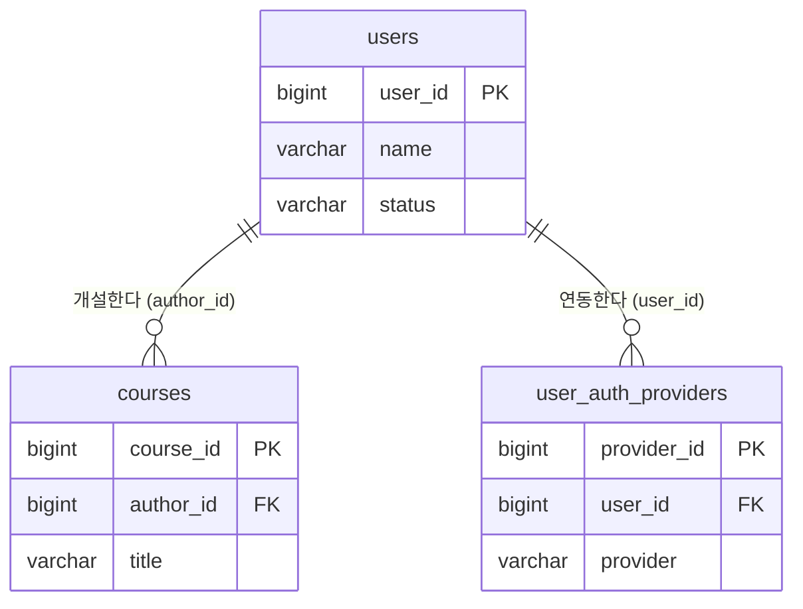
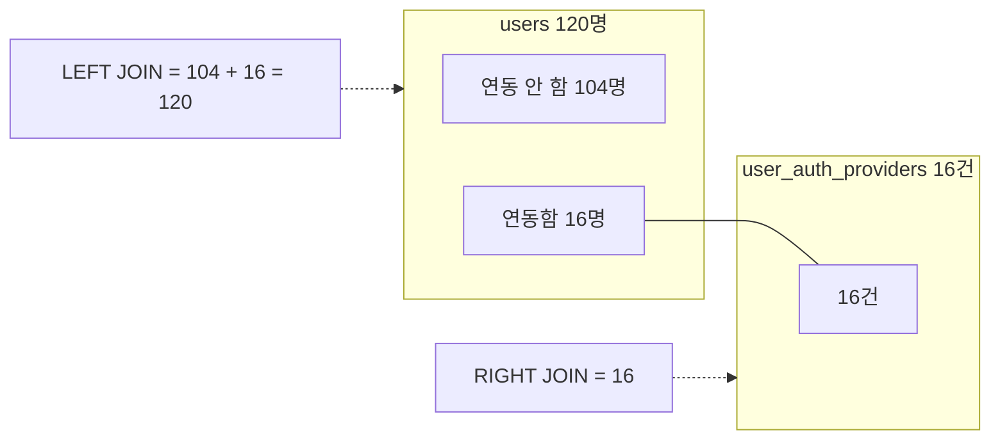

## 들어가며 (Situation)

오늘 마지막 파일 `07_join.sql`의 첫 줄에는 "Join (굉장히 중요 !!!!!!!!!!!!)"라고 적혀 있다. 수업 주석은 JOIN이 필요한 이유를 이렇게 설명했다.

> 실제 데이터베이스는 비슷한 의미를 가진 데이터를 각각의 테이블에 분리되어 저장이 되어 있다.
> 따라서 join 은 각각의 테이블에 존재하는 데이터들을 공통으로 포함하는 값을 기준으로 합쳐서 결과 집합으로 만드는 것을 의미하게 된다.

[5편]({{ site.baseurl }})에서 교육자별 강좌 수를 셀 때 결과는 `author_id`라는 **번호**였다. "1번 교육자"가 누구인지는 `users` 테이블에 가서 따로 찾아봐야 했다. 두 테이블을 합쳐서 한 번에 보는 것이 JOIN이다.

| 테이블 | 행 수 | 연결 열 |
|--------|-------|---------|
| `users` | 120 | `user_id` |
| `courses` | 30 | `author_id` → `users.user_id` |
| `user_auth_providers` (소셜 로그인 연동) | 16 | `user_id` → `users.user_id` |

## 문제 상황 (Task)

수업에서 `LEFT JOIN`과 `RIGHT JOIN`을 같은 테이블로 실행했는데 결과가 **120행과 16행**으로 크게 달랐다. 주석에는 이렇게 적었다.

> from 테이블A LEFT JOIN 테이블B
> null 유무에 따라 left, right 기준이 달라질 수 있다.
> 테이블A를 기준으로 데이터를 출력하며 테이블B 의 데이터가 NULL 이여도 출력한다.

"기준이 달라진다"는 말을 행 수로 정확히 설명하고 싶었다.

1. `courses`의 `author_id`와 `users`의 `user_id`는 실제로 어떻게 연결되어 있는가?
2. 120행과 16행은 각각 어디서 나온 숫자인가?
3. 주석에 적은 JOIN 종류(inner, left, right, self, outer)를 MySQL에서 전부 쓸 수 있는가?

## 해결 과정 (Action)

### 1. 두 테이블은 외래키로 연결되어 있다

`desc`로 두 테이블 구조를 먼저 봤다.

```sql
desc courses;
```

```text
+-------------+--------------+------+-----+---------+----------------+
| Field       | Type         | Null | Key | Default | Extra          |
+-------------+--------------+------+-----+---------+----------------+
| course_id   | bigint       | NO   | PRI | NULL    | auto_increment |
| author_id   | bigint       | NO   | MUL | NULL    |                |
| title       | varchar(255) | NO   |     | NULL    |                |
| description | text         | YES  |     | NULL    |                |
| status      | varchar(20)  | NO   |     | draft   |                |
+-------------+--------------+------+-----+---------+----------------+
```

**1번 질문 확인**: 수업에서는 `author_id`를 "외래키(FK)라고 불리며, 지금은 간단하게 users 테이블과 연결되기 위한 컬럼"이라고 설명했다. 실제로 그런 제약이 걸려 있는지 테이블 생성문을 열어봤다. (확인용 **예시 코드**)

```sql
show create table courses;
```

```text
  PRIMARY KEY (`course_id`),
  KEY `author_id` (`author_id`),
  CONSTRAINT `courses_ibfk_1` FOREIGN KEY (`author_id`) REFERENCES `users` (`user_id`),
```

`FOREIGN KEY (author_id) REFERENCES users (user_id)`가 그대로 있다. `courses.author_id`에는 `users.user_id`에 **실제로 존재하는 값만** 들어갈 수 있다는 규칙이다([MySQL 8.0 Reference - FOREIGN KEY Constraints](https://dev.mysql.com/doc/refman/8.0/en/create-table-foreign-keys.html)). `desc`의 `MUL`은 이 열에 같은 값이 여러 번 올 수 있는 인덱스가 있다는 표시였다.



### 2. INNER JOIN — 양쪽에 다 있는 것만

```sql
select
    c.title as '과정 제목',
    u.name as '교육자 이름'
from courses as c
join users as u
on c.author_id = u.user_id;
```

```text
+------------------------------------------------+------------------+
| 과정 제목                                      | 교육자 이름      |
+------------------------------------------------+------------------+
| 왕초보를 위한 Python 기초                      | 홍길동           |
| Java와 Spring Boot로 시작하는 웹 개발          | 김철수           |
| SQL 기본부터 활용까지                          | 이영희           |
| ...                                            | ...              |
+------------------------------------------------+------------------+
30 rows in set (0.00 sec)
```

그냥 `join`이라고 쓰면 `inner join`이다. MySQL에서 `JOIN`, `INNER JOIN`, `CROSS JOIN`은 문법상 같은 것으로 취급된다([MySQL 8.0 Reference - JOIN Clause](https://dev.mysql.com/doc/refman/8.0/en/join.html)). 강좌 30개가 모두 나온 건 외래키 덕분에 모든 강좌의 `author_id`가 `users`에 존재하기 때문이다.

`on`을 빼면 어떻게 될까? (확인용 **예시 코드**)

```sql
select count(*) from courses c, users u;
```

```text
+----------+
| count(*) |
+----------+
|     3600 |
+----------+
```

30 × 120 = 3600. 연결 조건이 없으면 **모든 강좌와 모든 사용자를 하나씩 짝지은 조합**이 나온다. `on c.author_id = u.user_id`가 3600개 조합 중 "강좌의 개설자가 그 사용자인" 30개만 남기는 조건이었다.

테이블 별칭 `c`, `u`가 꼭 필요한 이유도 하나 찾았다. 두 테이블 모두 `status` 열이 있다. (확인용 **예시 코드**)

```sql
select title, status from courses c join users u on c.author_id = u.user_id;
```

```text
ERROR 1052 (23000): Column 'status' in field list is ambiguous
```

강좌 상태(`draft`/`published`)인지 사용자 상태(`active`/...)인지 알 수 없어서 에러가 난다. `c.status`처럼 어느 테이블의 열인지 붙여주면 해결된다.

### 3. LEFT JOIN — 120행의 정체

수업 코드는 사용자와 소셜 로그인 제공자를 합쳤다.

```sql
select
    u.name as '사용자 이름',
    uap.provider as '소셜 로그인 제공자'
from users as u left join user_auth_providers as uap
on u.user_id = uap.user_id;
```

```text
+--------------------+----------------------------+
| 사용자 이름        | 소셜 로그인 제공자         |
+--------------------+----------------------------+
| 홍길동             | google                     |
| 김철수             | NULL                       |
| 이영희             | github                     |
| 박민수             | NULL                       |
| ...                | ...                        |
+--------------------+----------------------------+
120 rows in set (0.00 sec)
```

**2번 질문 확인**: 120은 `users`의 행 수와 같다. `LEFT JOIN`은 **왼쪽 테이블(`users`)의 모든 행을 남기고**, 오른쪽에 짝이 없으면 오른쪽 열을 `NULL`로 채운다. 짝이 없는 사람만 세어봤다. (확인용 **예시 코드**)

```sql
select count(*)
from users u left join user_auth_providers uap on u.user_id = uap.user_id
where uap.user_id is null;
```

```text
+----------+
| count(*) |
+----------+
|      104 |
+----------+
```

소셜 로그인을 연동한 사용자 16명 + 연동하지 않은 사용자 104명 = 120명이다. `user_auth_providers`에서 `count(distinct user_id)`와 `count(*)`가 둘 다 16이라 한 사람이 두 개를 연동한 경우는 없었고, 그래서 행이 불어나지 않고 정확히 120행이 됐다.

### 4. RIGHT JOIN — 16행의 정체

```sql
select
    u.name as '사용자 이름',
    uap.provider as '소셜 로그인 제공자'
from users as u right join user_auth_providers as uap
on u.user_id = uap.user_id;
```

```text
+------------------+----------------------------+
| 사용자 이름      | 소셜 로그인 제공자         |
+------------------+----------------------------+
| 홍길동           | google                     |
| 이영희           | github                     |
| 최수진           | google                     |
| ...              | ...                        |
+------------------+----------------------------+
16 rows in set (0.00 sec)
```

`RIGHT JOIN`은 **오른쪽 테이블(`user_auth_providers`)의 모든 행**이 기준이다. 연동 기록 16개는 모두 실제 사용자를 가리키므로 `NULL` 없이 16행이 나왔다. 테이블 순서를 바꾼 `user_auth_providers left join users`도 16행으로 같았다. 공식 문서도 `RIGHT JOIN`은 `LEFT JOIN`과 비슷하게 동작하며, 이식성을 위해 `LEFT JOIN`을 권한다고 설명한다([MySQL 8.0 Reference - JOIN Clause](https://dev.mysql.com/doc/refman/8.0/en/join.html)).

| JOIN | 기준 | 결과 | 구성 |
|------|------|------|------|
| `users join uap` | 양쪽 모두 있는 것 | 16행 | 연동한 사용자 |
| `users left join uap` | 왼쪽 `users` 전체 | 120행 | 16 + NULL 104 |
| `users right join uap` | 오른쪽 `uap` 전체 | 16행 | 연동 기록 전부 |
| `uap left join users` | 왼쪽 `uap` 전체 | 16행 | RIGHT JOIN과 같음 |



그래서 주석의 "null 유무에 따라 기준이 달라진다"는 이렇게 고쳐 적었다.

> → LEFT/RIGHT는 **어느 쪽 테이블의 행을 전부 남길지**를 정한다. 반대쪽에 짝이 없으면 그 열이 `NULL`로 채워진다. 행 수 차이(120 vs 16)는 짝이 없는 104명이 남느냐 사라지느냐의 차이다.

### 5. LEFT JOIN에서 조건을 ON에 쓸까, WHERE에 쓸까

google 사용자만 보고 싶어서 조건을 추가하다가 결과가 크게 달라지는 걸 발견했다. (확인용 **예시 코드**)

```sql
-- 조건을 ON에
select count(*) from users u
left join user_auth_providers uap
on u.user_id = uap.user_id and uap.provider = 'google';

-- 조건을 WHERE에
select count(*) from users u
left join user_auth_providers uap
on u.user_id = uap.user_id
where uap.provider = 'google';
```

```text
120
8
```

`ON`의 조건은 "어떤 짝을 붙일지"만 정한다. github 사용자도 왼쪽 행이라 사라지지 않고 오른쪽만 `NULL`이 된다(120행). `WHERE`는 JOIN이 끝난 결과에서 행을 거르기 때문에, `provider`가 `NULL`인 104행과 github 8행이 모두 빠져 8행이 된다. [3편]({{ site.baseurl }})에서 본 대로 `NULL = 'google'`은 UNKNOWN이라서다. 결국 LEFT JOIN을 걸어놓고 WHERE에 오른쪽 테이블 조건을 쓰면 INNER JOIN과 같아진다.

### 6. 주석의 JOIN 종류를 MySQL에서 확인

**3번 질문 확인**: 주석에는 `inner`, `left`, `right`, `self`, `outer` 다섯 가지가 적혀 있었다. 수업에서 다루지 않은 두 가지를 직접 실행해봤다.

먼저 **SELF JOIN**. 2편의 `tbl_category`는 `ref_category_code`가 같은 테이블의 `category_code`를 가리키는 외래키를 갖고 있다. 같은 테이블에 별칭을 두 개 붙여 조인했다. (확인용 **예시 코드**)

```sql
select c.category_name as '카테고리', p.category_name as '상위 카테고리'
from menudb.tbl_category c
join menudb.tbl_category p on c.ref_category_code = p.category_code;
```

```text
+--------------+---------------------+
| 카테고리     | 상위 카테고리       |
+--------------+---------------------+
| 한식         | 식사                |
| 중식         | 식사                |
| ...          | ...                 |
| 서양         | 디저트              |
+--------------+---------------------+
9 rows in set (0.00 sec)
```

SELF JOIN은 별도 키워드가 아니라 **같은 테이블을 두 번 쓰는 일반 JOIN**이다. 상위가 없는 3개(`NULL`)는 INNER JOIN이라 빠지고 9행이 나왔다.

다음은 양쪽을 모두 남기는 **FULL OUTER JOIN**이다. (확인용 **예시 코드**)

```sql
select u.name, uap.provider
from users u full outer join user_auth_providers uap on u.user_id = uap.user_id;
```

```text
ERROR 1064 (42000): You have an error in your SQL syntax; ... near 'full outer join user_auth_providers ...'
```

문법 에러가 났다. MySQL의 JOIN 문법에는 `LEFT [OUTER] JOIN`과 `RIGHT [OUTER] JOIN`만 있고 `FULL OUTER JOIN`은 없다([MySQL 8.0 Reference - JOIN Clause](https://dev.mysql.com/doc/refman/8.0/en/join.html)). 주석의 "outer join"은 LEFT/RIGHT를 묶어 부르는 이름으로 이해하는 게 맞다.

| 주석의 종류 | MySQL에서 | 실습 결과 |
|-------------|-----------|-----------|
| inner join | `JOIN` / `INNER JOIN` | 30행 |
| left join | `LEFT [OUTER] JOIN` | 120행 |
| right join | `RIGHT [OUTER] JOIN` | 16행 |
| self join | 같은 테이블 + 별칭 2개 | 9행 |
| (full) outer join | **지원 안 함** | ERROR 1064 |

## 결과 (Result)

| 확인한 내용 | 결과 |
|-------------|------|
| `courses.author_id` | `users.user_id`를 참조하는 실제 외래키 |
| `on` 없는 조인 | 30 × 120 = 3600행 |
| 양쪽 `status` 열 | ERROR 1052 → 테이블 별칭 필요 |
| LEFT / RIGHT JOIN | 120행(16 + NULL 104) / 16행 |
| 조건을 `ON` vs `WHERE` | 120행 vs 8행 |
| SELF JOIN / FULL OUTER JOIN | 9행 / ERROR 1064 |

배운 점은 다음과 같다.

- JOIN 결과의 행 수는 "기준 테이블 행 수 + 짝 유무"로 설명할 수 있다. 숫자를 맞춰보니 LEFT와 RIGHT의 차이가 문장보다 명확해졌다.
- `ON`은 짝을 붙이는 조건, `WHERE`는 붙인 뒤 거르는 조건이다. LEFT JOIN에서는 둘의 결과가 크게 다르다.
- 오늘 배운 WHERE의 NULL 비교, GROUP BY의 집계, ORDER BY의 자기 참조 테이블이 JOIN에서 전부 다시 등장했다.

## 더 학습하면 좋은 개념

- **`UNION`으로 FULL OUTER JOIN 흉내 내기** — `LEFT JOIN 결과 UNION RIGHT JOIN 결과`로 양쪽을 모두 남긴다. `UNION`과 `UNION ALL`의 차이도 함께 알아두면 좋다.
- **정규화(Normalization)** — 수업 주석의 "데이터가 각각의 테이블에 분리되어 저장"되는 이유. 분리했기 때문에 JOIN이 필요해진다.
- **JOIN + GROUP BY** — "교육자 이름별 개설 강좌 수"처럼 5편의 집계와 JOIN을 합치면 번호 대신 이름으로 집계할 수 있다.
- **외래키의 `ON DELETE` 옵션** — 사용자가 삭제되면 그 사람이 만든 강좌는 어떻게 되는가? `RESTRICT`, `CASCADE`, `SET NULL`의 차이.
- **조인 성능과 인덱스** — `desc`에서 본 `MUL` 인덱스가 조인 속도와 어떤 관계인지 `EXPLAIN`으로 확인할 수 있다.

## 참고 자료

- [MySQL 8.0 Reference - JOIN Clause](https://dev.mysql.com/doc/refman/8.0/en/join.html)
- [MySQL 8.0 Reference - FOREIGN KEY Constraints](https://dev.mysql.com/doc/refman/8.0/en/create-table-foreign-keys.html)
- [MySQL 8.0 Reference - Outer Join Optimization](https://dev.mysql.com/doc/refman/8.0/en/outer-join-optimization.html)
- [MySQL 8.0 Reference - DESCRIBE Statement](https://dev.mysql.com/doc/refman/8.0/en/describe.html)

---

**요약**
1. `courses.author_id`는 `users.user_id`를 참조하는 외래키이고, `on` 조건이 3600개 조합 중 맞는 짝 30개만 남긴다.
2. LEFT JOIN 120행은 연동한 16명 + 짝이 없어 `NULL`로 채워진 104명이고, RIGHT JOIN 16행은 오른쪽 연동 기록 전부다.
3. LEFT JOIN 조건을 `ON`에 쓰면 120행, `WHERE`에 쓰면 8행이 되며, MySQL은 FULL OUTER JOIN을 지원하지 않는다(ERROR 1064).
