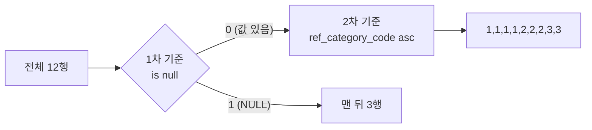

## 들어가며 (Situation)

[1편 SELECT]({{ site.baseurl }})에서 열을 고르는 법을 배웠다. 두 번째 파일 `02_orderby.sql`에서는 결과를 원하는 순서로 정렬하는 `ORDER BY`를 다뤘다. 실습 테이블은 `menudb`의 `tbl_menu`(메뉴 36개)와 `tbl_category`(카테고리 12개)다.

`tbl_category`는 상위 카테고리를 `ref_category_code`로 가리키는 구조라서, 최상위 카테고리 세 개(식사·음료·디저트)는 이 값이 `NULL`이다.

```text
+---------------+---------------+-------------------+
| category_code | category_name | ref_category_code |
+---------------+---------------+-------------------+
|             1 | 식사          |              NULL |
|             2 | 음료          |              NULL |
|             3 | 디저트        |              NULL |
|             4 | 한식          |                 1 |
|           ... | ...           |               ... |
|            12 | 서양          |                 3 |
+---------------+---------------+-------------------+
12 rows in set (0.00 sec)
```

## 문제 상황 (Task)

수업 파일 마지막에는 NULL이 있는 열의 정렬을 다루며 이런 주석을 적었다.

> 오름차순 정렬 시 null 최상단
>
> is null 오름차순 시 null 값이 뒤로 빠지고 오름차순이 된다.

복습하면서 두 가지가 마음에 걸렸다.

1. `order by ref_category_code is null asc`는 `is null`의 결과로만 정렬하는데, 정말 나머지 값까지 오름차순이 되는가?
2. 별칭을 백틱(`` `코드*가격` ``)으로 감쌌는데, 평소처럼 작은따옴표로 쓰면 어떻게 되는가?

## 해결 과정 (Action)

### 1. 기본 정렬 — asc와 desc

```sql
select menu_code, menu_name, menu_price
from tbl_menu
order by menu_price;   -- asc 생략 = 오름차순
```

```text
+-----------+-----------------------------+------------+
| menu_code | menu_name                   | menu_price |
+-----------+-----------------------------+------------+
|        12 | 날치알스크류바              |       2000 |
|        29 | 드래곤 숨결 핫소스          |       3000 |
|        32 | 외계인의 초록 젤리          |       4200 |
|         1 | 열무김치라떼                |       4500 |
|         2 | 우럭스무디                  |       5000 |
|        22 | 우주정복 마카롱             |       5000 |
|        21 | 돌미나리백설기              |       5000 |
|       ... | ...                         |        ... |
+-----------+-----------------------------+------------+
36 rows in set (0.00 sec)
```

방향을 생략하면 `asc`(오름차순)이고, 내림차순은 `desc`를 붙인다. 그런데 결과를 보다가 5000원짜리 세 메뉴의 순서가 `2, 22, 21`인 게 눈에 들어왔다. 코드 순서도 아니고 이름 순서도 아니다. 가격이 같은 행끼리의 순서는 **정해지지 않는다**는 뜻인데, 이게 [4편 LIMIT 페이징]({{ site.baseurl }})에서 실제 문제로 이어졌다.

### 2. 별칭으로 정렬 — 작은따옴표의 함정

수업 코드는 계산 결과에 별칭을 붙이고, 그 별칭으로 정렬했다.

```sql
select
    menu_code as '코드',
    menu_price as '가격',
    menu_code * menu_price as `코드*가격`
from tbl_menu
order by `코드*가격` desc;
```

```text
+--------+--------+---------------+
| 코드   | 가격   | 코드*가격     |
+--------+--------+---------------+
|     18 |  35000 |        630000 |
|     20 |  22000 |        440000 |
|     33 |  11000 |        363000 |
|    ... |    ... |           ... |
+--------+--------+---------------+
36 rows in set (0.00 sec)
```

**2번 질문 확인**: `ORDER BY`의 백틱만 작은따옴표로 바꿔봤다. (확인용 **예시 코드**)

```sql
select
    menu_code as '코드',
    menu_price as '가격',
    menu_code * menu_price as `코드*가격`
from tbl_menu
order by '코드*가격' desc
limit 5;
```

```text
+--------+--------+---------------+
| 코드   | 가격   | 코드*가격     |
+--------+--------+---------------+
|      1 |   4500 |          4500 |
|      2 |   5000 |         10000 |
|      3 |   6000 |         18000 |
|      4 |   7000 |         28000 |
|      5 |  13000 |         65000 |
+--------+--------+---------------+
5 rows in set (0.00 sec)
```

에러도 없이 **정렬이 전혀 되지 않았다.** `desc`를 붙였는데 오히려 작은 값부터 나온다. 공식 문서에 이유가 그대로 적혀 있었다.

> Elsewhere in the statement, quoted references to the alias must use identifier quoting or the reference is treated as a string literal.
>
> — [MySQL 8.0 Reference - Problems with Column Aliases](https://dev.mysql.com/doc/refman/8.0/en/problems-with-alias.html)

SELECT 목록 밖에서는 별칭을 반드시 식별자 따옴표(백틱)로 불러야 하고, 아니면 문자열 리터럴로 취급된다는 뜻이다. 그래서 `'코드*가격'`은 **모든 행에 똑같은 문자열 상수**가 됐고, 36행 전부 같은 값으로 정렬했으니 순서가 바뀔 이유가 없었다.

| `ORDER BY`에 쓴 것 | 해석 | 결과 |
|---------------------|------|------|
| `` `코드*가격` `` | 별칭(이름) | 630000부터 내림차순 |
| `'코드*가격'` | 문자열 상수 | 정렬 안 됨, 에러도 없음 |

에러가 나지 않아서 더 위험한 실수다. 1편에서 정리한 "작은따옴표는 값, 백틱은 이름" 규칙이 여기서 실제로 차이를 만들었다.

### 3. NULL은 어디로 가는가

```sql
select * from tbl_category order by ref_category_code asc;
```

```text
+---------------+---------------+-------------------+
| category_code | category_name | ref_category_code |
+---------------+---------------+-------------------+
|             1 | 식사          |              NULL |
|             2 | 음료          |              NULL |
|             3 | 디저트        |              NULL |
|             4 | 한식          |                 1 |
|           ... | ...           |               ... |
+---------------+---------------+-------------------+
```

주석대로 오름차순이면 `NULL`이 맨 위다. 반대로 내림차순은 어떨까. (확인용 **예시 코드**)

```sql
select * from tbl_category order by ref_category_code desc;
```

```text
+---------------+---------------+-------------------+
| category_code | category_name | ref_category_code |
+---------------+---------------+-------------------+
|            11 | 동양          |                 3 |
|            12 | 서양          |                 3 |
|             8 | 커피          |                 2 |
|           ... | ...           |               ... |
|             1 | 식사          |              NULL |
|             2 | 음료          |              NULL |
|             3 | 디저트        |              NULL |
+---------------+---------------+-------------------+
```

`NULL`이 맨 아래로 갔다. MySQL은 정렬할 때 `NULL`을 **어떤 값보다도 작은 값처럼** 다룬다. 공식 문서의 설명도 같다.

> When doing an `ORDER BY`, `NULL` values are presented first if you do `ORDER BY ... ASC` and last if you do `ORDER BY ... DESC`.
>
> — [MySQL 8.0 Reference - Working with NULL Values](https://dev.mysql.com/doc/refman/8.0/en/working-with-null.html)

### 4. `is null` 정렬은 정말 오름차순일까?

그래서 수업에서 오름차순인데 `NULL`을 뒤로 보내는 방법을 배웠다.

```sql
select * from tbl_category order by ref_category_code is null asc;
```

```text
+---------------+---------------+-------------------+
| category_code | category_name | ref_category_code |
+---------------+---------------+-------------------+
|             4 | 한식          |                 1 |
|             5 | 중식          |                 1 |
|             6 | 일식          |                 1 |
|             7 | 퓨전          |                 1 |
|             8 | 커피          |                 2 |
|             9 | 쥬스          |                 2 |
|            10 | 기타          |                 2 |
|            11 | 동양          |                 3 |
|            12 | 서양          |                 3 |
|             1 | 식사          |              NULL |
|             2 | 음료          |              NULL |
|             3 | 디저트        |              NULL |
+---------------+---------------+-------------------+
```

결과만 보면 주석대로 `NULL`은 뒤로, 나머지는 `1, 1, ..., 3` 오름차순이다. 하지만 `ref_category_code is null`이 무엇을 돌려주는지 먼저 찍어봤다. (확인용 **예시 코드**)

```sql
select category_code, ref_category_code, ref_category_code is null
from tbl_category;
```

```text
+---------------+-------------------+---------------------------+
| category_code | ref_category_code | ref_category_code is null |
+---------------+-------------------+---------------------------+
|             1 |              NULL |                         1 |
|             2 |              NULL |                         1 |
|             3 |              NULL |                         1 |
|             4 |                 1 |                         0 |
|           ... |               ... |                         0 |
|            12 |                 3 |                         0 |
+---------------+-------------------+---------------------------+
```

`is null`은 `0`(거짓) 또는 `1`(참)만 돌려준다. 즉 이 정렬 기준은 값이 **0인 그룹과 1인 그룹, 두 개로만 나눈다.** 0 그룹 안의 순서는 아무도 정해주지 않았다. 그런데도 오름차순처럼 보인 건, 이 테이블은 `category_code` 순서와 `ref_category_code` 순서가 우연히 같기 때문이 아닐까?

**1번 질문 확인**: 순서가 우연히 맞지 않는 `tbl_menu`의 가격으로 똑같이 해봤다. (확인용 **예시 코드**)

```sql
select menu_code, menu_price
from tbl_menu
order by menu_price is null
limit 6;
```

```text
+-----------+------------+
| menu_code | menu_price |
+-----------+------------+
|         1 |       4500 |
|         2 |       5000 |
|         3 |       6000 |
|         4 |       7000 |
|         5 |      13000 |
|         6 |      12000 |
+-----------+------------+
```

`13000` 다음에 `12000`이 나왔다. 가격 순이 아니라 그냥 저장된 순서다. **`is null` 하나만으로는 "NULL 뒤로"까지만 보장되고, 오름차순은 보장되지 않는다.** 정렬 기준을 두 개 써야 주석이 말한 결과를 확실히 얻는다.

```sql
select category_code, ref_category_code
from tbl_category
order by
    ref_category_code is null,   -- 1차: NULL 아닌 것(0) 먼저
    ref_category_code;           -- 2차: 같은 그룹 안에서 오름차순
```



`ORDER BY`에 여러 기준을 쉼표로 나열하면 앞 기준이 같은 행끼리만 뒤 기준으로 다시 정렬한다([MySQL 8.0 Reference - Sorting Rows](https://dev.mysql.com/doc/refman/8.0/en/sorting-rows.html)). 주석은 이렇게 고쳐 적었다.

> ~~is null 오름차순 시 null 값이 뒤로 빠지고 오름차순이 된다.~~
> → `is null`은 NULL을 뒤로 보내기만 한다. 오름차순까지 원하면 `order by 컬럼 is null, 컬럼`처럼 2차 기준을 붙인다.

### 5. 덤 — 열 번호로 정렬

`order by 3 desc`처럼 SELECT 목록의 순서 번호로도 정렬된다. (확인용 **예시 코드**)

```sql
select menu_code, menu_name, menu_price from tbl_menu order by 3 desc limit 3;
```

```text
+-----------+-----------------------+------------+
| menu_code | menu_name             | menu_price |
+-----------+-----------------------+------------+
|        18 | 붕어빵초밥            |      35000 |
|        20 | 마라깐쇼한라봉        |      22000 |
|         8 | 한우딸기국밥          |      20000 |
+-----------+-----------------------+------------+
```

동작은 하지만 SELECT 목록을 고치면 정렬 기준이 조용히 바뀌므로, 열 이름이나 별칭을 쓰는 편이 안전하다.

## 결과 (Result)

| 확인한 내용 | 결과 |
|-------------|------|
| `order by menu_price` (같은 가격) | 5000원 3개가 `2, 22, 21` 순 — 동점 순서는 정해지지 않음 |
| ``order by `코드*가격` desc`` | 630000부터 정상 정렬 |
| `order by '코드*가격' desc` | **정렬 안 됨**, 에러 없음 |
| `asc` / `desc`에서 NULL 위치 | 맨 위 / 맨 아래 |
| `tbl_menu`에 `order by menu_price is null` | `13000` → `12000`, 오름차순 아님 |
| `order by 컬럼 is null, 컬럼` | NULL 뒤로 + 오름차순 보장 |

배운 점은 다음과 같다.

- 결과가 맞아 보여도 **우연일 수 있다.** 같은 쿼리를 성질이 다른 데이터에 넣어보니 주석의 설명이 반만 맞다는 걸 알 수 있었다.
- 정렬 기준이 같은 행들의 순서는 MySQL이 보장하지 않는다. 순서가 중요하면 기준을 하나 더 붙인다.
- 작은따옴표 별칭 실수는 에러 없이 틀린 결과를 낸다. `ORDER BY`에서 별칭은 백틱으로 쓴다.

## 더 학습하면 좋은 개념

- **정렬 안정성(Stable Sort)** — 같은 값끼리 원래 순서를 유지하는 정렬을 말한다. SQL은 이를 약속하지 않기 때문에 동점 처리 기준을 직접 써야 한다.
- **`NULLS FIRST` / `NULLS LAST`** — PostgreSQL, Oracle은 NULL 위치를 지정하는 문법이 있지만 MySQL에는 없어서 `is null` 기법을 쓴다. DB마다 기본 NULL 위치도 다르다.
- **인덱스와 정렬(filesort)** — 정렬 열에 인덱스가 있으면 MySQL이 정렬 작업 없이 인덱스 순서로 읽을 수 있다. `EXPLAIN`의 `Using filesort`로 확인한다.
- **자기 참조 관계** — `tbl_category`가 자기 자신을 가리키는 구조다. [6편 JOIN]({{ site.baseurl }})의 셀프 조인으로 이어진다.

## 참고 자료

- [MySQL 8.0 Reference - Sorting Rows](https://dev.mysql.com/doc/refman/8.0/en/sorting-rows.html)
- [MySQL 8.0 Reference - Working with NULL Values](https://dev.mysql.com/doc/refman/8.0/en/working-with-null.html)
- [MySQL 8.0 Reference - Problems with Column Aliases](https://dev.mysql.com/doc/refman/8.0/en/problems-with-alias.html)
- [MySQL 8.0 Reference - SELECT Statement](https://dev.mysql.com/doc/refman/8.0/en/select.html)
- [MySQL 8.0 Reference - Schema Object Names](https://dev.mysql.com/doc/refman/8.0/en/identifiers.html)

---

**요약**
1. `ORDER BY`는 기본이 오름차순이고, MySQL은 NULL을 가장 작은 값처럼 다뤄 `asc`에서는 맨 위, `desc`에서는 맨 아래에 둔다.
2. `order by 컬럼 is null`은 0/1 두 그룹으로만 나눠서, `tbl_menu`에 적용하니 `13000 → 12000` 순서가 나왔다. 오름차순까지 원하면 2차 기준을 붙인다.
3. `order by '별칭'`처럼 작은따옴표를 쓰면 문자열 상수로 해석되어 에러 없이 정렬이 사라지므로 별칭은 백틱으로 쓴다.
