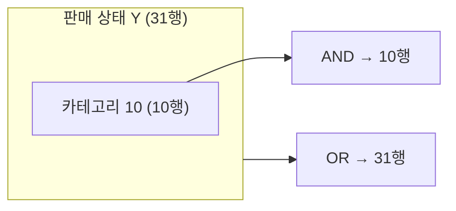
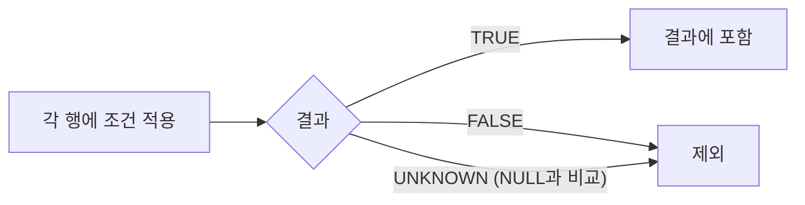

## 들어가며 (Situation)

[2편 ORDER BY]({{ site.baseurl }})까지는 테이블의 모든 행을 가져왔다. 세 번째 파일 `03_where.sql`은 이렇게 시작한다.

> select (조회) — SQL 의 90% 을 차지하는 문법으로 SQL 의 전부라고도 볼 수 있다.
> 핵심 2가지
> 1. 어떤 열을 가져올 것인가? (정보의 종류)
> 2. 어떤 행을 가져올 것인가? (정보의 범위)

1번이 SELECT 절이라면, 2번이 오늘 배운 `WHERE` 조건절이다. 실습은 `menudb`의 `tbl_menu`(메뉴 36개, 판매 상태 `Y` 31개·`N` 5개)와 `tbl_category`(12개)로 했다.

## 문제 상황 (Task)

수업에서 정리한 비교 연산자 목록은 이랬다.

| 연산자 | 뜻 |
|--------|----|
| `=` | 같다 |
| `!=`, `<>` | 같지 않다 |
| `>`, `<`, `>=`, `<=` | 크다, 작다, 크거나 같다, 작거나 같다 |
| `LIKE` | 특정 패턴을 포함한다 |
| `IN` | 목록 안의 값 중 하나와 일치한다 |
| `BETWEEN` | 두 값 사이의 범위에 있다 |
| `NOT` | 부정 |

목록만 외우면 금방 잊어버릴 것 같아서, 결과 행 수를 세어가며 경계를 확인하기로 했다.

1. "가격 10000원 이상, 20000원 미만"과 "10000원과 20000원 사이(`BETWEEN`)"는 같은 결과인가?
2. OR 조건을 썼는데 결과가 31행으로, 판매 상태 `Y`만 조회했을 때와 똑같았다. 왜?
3. `NULL`은 왜 `=`가 아니라 `is null`로 비교해야 하는가?

## 해결 과정 (Action)

### 1. 가장 기본 — `=`로 행 고르기

```sql
use menudb;

select menu_name, menu_price, orderable_status
from tbl_menu
where orderable_status = 'Y';
```

```text
+------------------------+------------+------------------+
| menu_name              | menu_price | orderable_status |
+------------------------+------------+------------------+
| 열무김치라떼           |       4500 | Y                |
| 우럭스무디             |       5000 | Y                |
| ...                    |        ... | ...              |
+------------------------+------------+------------------+
31 rows in set (0.00 sec)
```

36행 중 조건이 참인 31행만 남았다. 문자열 비교 중 궁금해서 소문자로도 해봤다. (확인용 **예시 코드**)

```sql
select count(*) from tbl_menu where orderable_status = 'y';
```

```text
+----------+
| count(*) |
+----------+
|       31 |
+----------+
```

소문자 `'y'`도 31건이다. 테이블의 문자 정렬 규칙(collation)이 `utf8mb4_0900_ai_ci`인데, 끝의 `ci`가 **case-insensitive**(대소문자 구분 안 함)라는 뜻이다([MySQL 8.0 Reference - Case Sensitivity in String Searches](https://dev.mysql.com/doc/refman/8.0/en/case-sensitivity.html)). 자바의 `"Y".equals("y")`가 `false`인 것과 달라서 기억해둘 부분이다.

### 2. 범위 — `>= and <`와 `BETWEEN`은 다르다

**1번 질문 확인**: 수업에서 두 쿼리를 따로 실행했는데, 결과 행 수가 달랐다.

```sql
-- 10000원 이상, 20000원 미만
select * from tbl_menu
where menu_price >= 10000 and menu_price < 20000
order by menu_price;
```

```text
9 rows in set (0.00 sec)
```

```sql
-- 10000원과 20000원 사이
select * from tbl_menu
where menu_price between 10000 and 20000;
```

```text
+-----------+--------------------------+------------+---------------+------------------+
| menu_code | menu_name                | menu_price | category_code | orderable_status |
+-----------+--------------------------+------------+---------------+------------------+
|         5 | 앙버터김치찜             |      13000 |             4 | N                |
|         6 | 생마늘샐러드             |      12000 |             4 | Y                |
|         7 | 민트미역국               |      15000 |             4 | Y                |
|         8 | 한우딸기국밥             |      20000 |             4 | Y                |
|       ... | ...                      |        ... |           ... | ...              |
+-----------+--------------------------+------------+---------------+------------------+
10 rows in set (0.00 sec)
```

1행 차이는 **20000원짜리 한우딸기국밥**이다. `BETWEEN`은 양 끝값을 **포함**한다. `<=`로 바꾸면 정말 같은지 확인했다. (확인용 **예시 코드**)

```sql
select count(*) from tbl_menu where menu_price >= 10000 and menu_price <= 20000;
```

```text
+----------+
| count(*) |
+----------+
|       10 |
+----------+
```

공식 문서도 `expr BETWEEN min AND max`를 `min <= expr AND expr <= max`와 같다고 설명한다([MySQL 8.0 Reference - Comparison Operators](https://dev.mysql.com/doc/refman/8.0/en/comparison-operators.html#operator_between)). 순서를 뒤집으면 어떨까. (확인용 **예시 코드**)

```sql
select menu_name from tbl_menu where menu_price between 20000 and 10000;
```

```text
Empty set (0.00 sec)
```

`20000 <= 가격 AND 가격 <= 10000`을 만족하는 값은 없으니 0건이다. 작은 값을 먼저 써야 한다.

| 조건 | 결과 | 20000원 포함 |
|------|------|--------------|
| `>= 10000 and < 20000` | 9행 | X |
| `>= 10000 and <= 20000` | 10행 | O |
| `between 10000 and 20000` | 10행 | O |
| `between 20000 and 10000` | 0행 | - |
| `not between 10000 and 20000` | 26행 | X |

`BETWEEN` 10행과 `NOT BETWEEN` 26행을 더하면 정확히 36행이다.

### 3. AND, OR — 결과가 같았던 이유와 우선순위

**2번 질문 확인**: 수업 쿼리다.

```sql
select * from tbl_menu
where orderable_status = 'Y' or category_code = 10
order by category_code asc;
```

```text
31 rows in set (0.00 sec)
```

OR은 조건이 하나라도 참이면 남기니까, 카테고리 10번 메뉴가 더해져서 31행보다 많아야 할 것 같았다. 카테고리 10번이 몇 개고 그중 판매 중지가 몇 개인지 세어봤다. (확인용 **예시 코드**)

```sql
select count(*) from tbl_menu where category_code = 10;
select count(*) from tbl_menu where category_code = 10 and orderable_status = 'N';
```

```text
10
0
```

카테고리 10번 메뉴 10개가 **전부 이미 판매 상태 `Y`**였다. 새로 더해질 행이 없었으니 31행 그대로다. 같은 조건을 AND로 바꾸면 두 조건을 모두 만족하는 10행만 남는다.



AND와 OR을 섞으면 우선순위도 중요하다. 비싼 메뉴(30000원 초과)를 찾으려고 일부러 괄호를 빼고 써봤다. (확인용 **예시 코드**)

```sql
-- 괄호 없음
select count(*) from tbl_menu
where orderable_status = 'Y' or category_code = 10 and menu_price > 30000;

-- 괄호 있음
select count(*) from tbl_menu
where (orderable_status = 'Y' or category_code = 10) and menu_price > 30000;
```

```text
31
1
```

괄호가 없으면 **AND가 OR보다 먼저** 묶여서 `Y or (10번 and 30000원 초과)`가 된다. 그래서 가격 조건이 판매 중인 메뉴에는 전혀 적용되지 않았다([MySQL 8.0 Reference - Operator Precedence](https://dev.mysql.com/doc/refman/8.0/en/operator-precedence.html)). AND와 OR을 같이 쓸 때는 괄호를 습관처럼 붙이기로 했다.

### 4. LIKE — 주석과 코드가 달랐다

수업 문제는 "메뉴 이름이 **'마늘'을 포함**하고 있는 메뉴만 조회"였는데, 코드는 이렇게 되어 있었다.

```sql
select menu_name, menu_price
from tbl_menu
where menu_name like '생마늘%';
```

```text
+--------------------+------------+
| menu_name          | menu_price |
+--------------------+------------+
| 생마늘샐러드       |      12000 |
+--------------------+------------+
1 row in set (0.00 sec)
```

`'생마늘%'`은 "생마늘로 **시작**하는" 패턴이라 문제의 의도와 다르다. 주석에 적은 세 가지 패턴을 전부 실행해봤다. (확인용 **예시 코드**)

```sql
select menu_name from tbl_menu where menu_name like '%마늘%';
select menu_name from tbl_menu where menu_name like '%마늘';
```

```text
+--------------------------+
| menu_name                |
+--------------------------+
| 생마늘샐러드             |
| 코다리마늘빵             |
| 흑마늘아메리카노         |
+--------------------------+
3 rows in set (0.00 sec)

Empty set (0.00 sec)
```

| 패턴 | 뜻 | 결과 |
|------|----|------|
| `'생마늘%'` | 생마늘로 시작 | 1행 |
| `'%마늘%'` | 마늘을 포함 | 3행 |
| `'%마늘'` | 마늘로 끝남 | 0행 |

`%`는 "0글자 이상 아무 문자"를 뜻한다([MySQL 8.0 Reference - String Comparison Functions](https://dev.mysql.com/doc/refman/8.0/en/string-comparison-functions.html#operator_like)). 문제 의도대로라면 `'%마늘%'`이 맞고 답은 3개다.

### 5. IN — OR을 줄여 쓴 것

```sql
select menu_name, category_code from tbl_menu where category_code in (4, 5, 6);
select menu_name, category_code from tbl_menu where category_code not in (4, 5, 6);
```

```text
10 rows in set (0.00 sec)
26 rows in set (0.00 sec)
```

`in (4, 5, 6)`은 `category_code = 4 or category_code = 5 or category_code = 6`과 같다. 10행 + 26행 = 36행으로 빠짐없이 나뉜다.

### 6. NULL — 왜 `=`로는 안 되는가

**3번 질문 확인**: 상위 카테고리가 없는 카테고리를 `=`로 찾아봤다. (확인용 **예시 코드**)

```sql
select * from tbl_category where ref_category_code = null;
```

```text
Empty set (0.00 sec)
```

```sql
select count(*) from tbl_category where ref_category_code is null;      -- 3
select count(*) from tbl_category where ref_category_code is not null;  -- 9
```

`NULL`인 행이 3개나 있는데 `= null`은 0건이다. `NULL`은 "값이 없음/알 수 없음"이라서, `NULL`과 무엇을 비교하든 결과는 참도 거짓도 아닌 `NULL`(UNKNOWN)이 된다. `WHERE`는 조건이 **참인 행만** 남기므로 하나도 남지 않는다([MySQL 8.0 Reference - Working with NULL Values](https://dev.mysql.com/doc/refman/8.0/en/working-with-null.html)).



그래서 `NULL` 전용 연산자 `is null`, `is not null`이 따로 있다. 3 + 9 = 12행으로 테이블 전체와 맞는다.

## 결과 (Result)

| 확인한 내용 | 결과 |
|-------------|------|
| `= 'Y'` / `= 'y'` | 둘 다 31행 (대소문자 구분 안 함) |
| `>= and <` vs `BETWEEN` | 9행 vs 10행, `BETWEEN`은 끝값 포함 |
| `Y or 카테고리 10` | 31행 — 10번 메뉴가 전부 `Y`라서 |
| AND/OR 괄호 유무 | 31행 vs 1행 |
| `like '생마늘%'` vs `'%마늘%'` | 1행 vs 3행 — 수업 코드가 문제 의도와 다름 |
| `= null` vs `is null` | 0행 vs 3행 |

배운 점은 다음과 같다.

- 결과 **행 수**를 세어보면 조건이 맞게 쓰였는지 바로 검증된다. `BETWEEN` + `NOT BETWEEN`, `IN` + `NOT IN`, `is null` + `is not null`이 모두 전체 행 수로 맞아떨어졌다.
- OR 결과가 기대와 같았던 건 쿼리가 아니라 **데이터** 때문이었다. 조건을 검증할 때는 데이터 분포도 같이 봐야 한다.
- `NULL`은 값이 아니라 상태다. `=`로 비교하면 언제나 UNKNOWN이 된다.

## 더 학습하면 좋은 개념

- **3값 논리(Three-valued Logic)** — TRUE/FALSE/UNKNOWN으로 동작하는 SQL의 논리 체계. `NOT IN` 목록에 `NULL`이 섞이면 결과가 0건이 되는 유명한 함정도 여기서 나온다.
- **Collation(문자 정렬 규칙)** — `ai_ci`, `as_cs`, `bin`의 차이를 알면 대소문자·악센트 비교가 왜 그렇게 동작하는지 설명할 수 있다.
- **`LIKE` 이스케이프와 `REGEXP`** — `%`나 `_` 자체를 검색하는 방법, 더 복잡한 패턴에는 정규식을 쓰는 방법.
- **인덱스와 `LIKE '%단어%'`** — 앞에 `%`가 붙으면 인덱스를 타기 어렵다. 데이터가 많아지면 성능 차이가 커진다.

## 참고 자료

- [MySQL 8.0 Reference - Comparison Operators (BETWEEN, IN, IS NULL)](https://dev.mysql.com/doc/refman/8.0/en/comparison-operators.html)
- [MySQL 8.0 Reference - Operator Precedence](https://dev.mysql.com/doc/refman/8.0/en/operator-precedence.html)
- [MySQL 8.0 Reference - String Comparison Functions (LIKE)](https://dev.mysql.com/doc/refman/8.0/en/string-comparison-functions.html)
- [MySQL 8.0 Reference - Working with NULL Values](https://dev.mysql.com/doc/refman/8.0/en/working-with-null.html)
- [MySQL 8.0 Reference - Case Sensitivity in String Searches](https://dev.mysql.com/doc/refman/8.0/en/case-sensitivity.html)

---

**요약**
1. `BETWEEN 10000 AND 20000`은 끝값을 포함해서 `>= 10000 and < 20000`(9행)보다 1행 많은 10행이 나왔다.
2. AND는 OR보다 먼저 묶이므로 괄호 유무에 따라 결과가 31행과 1행으로 갈렸고, `like '생마늘%'`은 '포함'이 아니라 '시작' 패턴이었다.
3. `NULL`과의 `=` 비교는 UNKNOWN이 되어 0건이므로 `is null` / `is not null`로 비교해야 한다.
