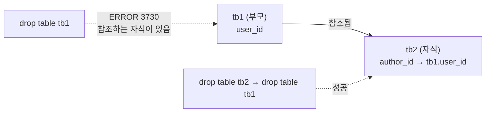

## 들어가며 (Situation)

[7편 서브쿼리]({{ site.baseurl }})까지는 이미 있는 테이블을 **조회**만 했다. `09_ddl.sql`부터는 테이블을 직접 만들고 고친다. DDL(Data Definition Language)은 데이터가 아니라 **데이터를 담을 틀**을 정의하는 언어다.

수업 주석에서 가장 기억에 남은 문장은 이것이다.

> 테이블을 만드는 것은 단순히 칸을 나누는 작업이 아니다.
> 데이터가 지켜야 할 규칙을 정의하고, 데이터베이스가 스스로 데이터의 품질을 유지하도록 만드는 시스템을 설계하는 과정이다.

그 규칙의 두 축이 **데이터 타입**과 **제약 조건**이다.

| 명령어 | 하는 일 | 오늘 실습 |
|--------|---------|-----------|
| `CREATE TABLE` | 테이블 생성 | `tb1`, `tb2`, `courses_temp` |
| `ALTER TABLE` | 열 추가·수정·삭제 | `price` 열 |
| `DROP TABLE` | 테이블 구조와 데이터 삭제 | `tb1`, `tb2`, `courses_temp` |
| `TRUNCATE TABLE` | 구조는 두고 데이터만 삭제 | `courses_temp` |

## 문제 상황 (Task)

수업 파일을 순서대로 다시 실행하다가 한 줄에서 막혔다.

```sql
drop table tb1;
drop table tb2;
```

```text
ERROR 3730 (HY000): Cannot drop table 'tb1' referenced by a foreign key constraint 'tb2_ibfk_1' on table 'tb2'.
```

`tb1`이 지워지지 않았다. 이 에러를 계기로 확인할 것을 정리했다.

1. 제약 조건은 실제로 어떤 데이터를 막는가?
2. `tb1`은 왜 지워지지 않는가? 올바른 순서는?
3. `create table ... as select`로 복제한 테이블은 원본과 같은가?
4. `ALTER`로 타입을 바꾸면 기존 데이터는 어떻게 되는가?
5. 주석에 "drop은 롤백 불가"라고 적었는데, `truncate`와 `delete`는 어떤가?

## 해결 과정 (Action)

### 1. CREATE TABLE — 열 이름, 타입, 제약 조건

수업에서 만든 첫 테이블이다.

```sql
create table tb1 (
    user_id int primary key,
    user_pwd varchar(12) not null comment '사용자 비밀번호',
    email varchar(30) not null unique comment '이메일',
    user_status varchar(10) default 'active' comment '계정 활성 상태',
    created_at timestamp not null default current_timestamp comment '가입 일시'
) comment '서비스 유저 정보 테이블';

describe tb1;
```

```text
+-------------+-------------+------+-----+-------------------+-------------------+
| Field       | Type        | Null | Key | Default           | Extra             |
+-------------+-------------+------+-----+-------------------+-------------------+
| user_id     | int         | NO   | PRI | NULL              |                   |
| user_pwd    | varchar(12) | NO   |     | NULL              |                   |
| email       | varchar(30) | NO   | UNI | NULL              |                   |
| user_status | varchar(10) | YES  |     | active            |                   |
| created_at  | timestamp   | NO   |     | CURRENT_TIMESTAMP | DEFAULT_GENERATED |
+-------------+-------------+------+-----+-------------------+-------------------+
```

`desc` 결과의 각 칸이 정의한 규칙과 그대로 대응한다.

| 정의 | `desc`에서 보이는 곳 | 의미 |
|------|---------------------|------|
| `primary key` | Null `NO`, Key `PRI` | 비어 있을 수 없고 중복 불가인 대표 식별자 |
| `not null` | Null `NO` | 필수 입력 |
| `unique` | Key `UNI` | 중복 불가 (NULL은 허용) |
| `default 'active'` | Default `active` | 값을 안 주면 들어갈 기본값 |
| `default current_timestamp` | Extra `DEFAULT_GENERATED` | 입력 시각이 자동으로 들어감 |

`primary key`만 썼는데 Null이 `NO`가 된 것은 기본 키가 `NOT NULL` + `UNIQUE`의 성질을 모두 갖기 때문이다. `user_status`는 `not null`이 없어서 `YES`였다. 기본값이 있어도 누군가 `NULL`을 직접 넣으면 막을 수 없다는 뜻이다.

### 2. 제약 조건이 실제로 막는 것

**1번 질문 확인**: 규칙을 어기는 데이터를 넣어봤다. (확인용 **예시 코드**)

```sql
insert into tb1 (user_id, user_pwd, email) values (1, 'pw1', 'a@a.com');
select * from tb1;
```

```text
+---------+----------+---------+-------------+---------------------+
| user_id | user_pwd | email   | user_status | created_at          |
+---------+----------+---------+-------------+---------------------+
|       1 | pw1      | a@a.com | active      | 2026-10-13 15:19:56 |
+---------+----------+---------+-------------+---------------------+
```

`user_status`와 `created_at`을 안 줬는데 기본값이 채워졌다. 다음은 비밀번호 길이 제한(`varchar(12)`)을 넘겨봤다.

```sql
insert into tb1 (user_id, user_pwd, email) values (2, 'thisistoolongpw', 'c@c.com');
```

```text
ERROR 1406 (22001): Data too long for column 'user_pwd' at row 1
```

15글자라 거부됐다. 수업 주석의 "'나이' 열에 '스무살'이라는 글자가 들어가는 것을 원천 차단"이 데이터 타입의 역할이다.

### 3. FOREIGN KEY — 부모와 자식

`tb2`는 `tb1`의 `user_id`를 참조하는 외래키를 가진다.

```sql
create table tb2 (
    user_id int primary key,
    author_id int not null comment 'tb1 에서 전달 받는 외래키',
    -- (나머지 열 생략)
    foreign key(`author_id`) references `tb1`(`user_id`)
) comment '서비스 유저 정보 테이블';
```

`tb1`에 없는 `user_id`(99)를 `author_id`로 넣어봤다. (확인용 **예시 코드**)

```sql
insert into tb2 (user_id, author_id, user_pwd, email) values (2, 99, 'pw', 'c@c.com');
```

```text
ERROR 1452 (23000): Cannot add or update a child row: a foreign key constraint fails
(`wanted_lms`.`tb2`, CONSTRAINT `tb2_ibfk_1` FOREIGN KEY (`author_id`) REFERENCES `tb1` (`user_id`))
```

주석의 "부모 테이블에 존재하지 않는 user_id를 자식 테이블에 입력을 하려고 하면 데이터베이스가 자동으로 차단을 한다"가 이 에러다. 에러 메시지의 `tb2_ibfk_1`은 내가 이름을 안 줘서 MySQL이 붙인 제약 조건 이름이다.

### 4. DROP 순서 — 자식부터 지워야 한다

**2번 질문 확인**: 처음 막혔던 에러로 돌아가자. 수업 파일은 `tb1`을 먼저 지웠다.



`tb1`을 지우면 `tb2.author_id`가 가리키는 대상이 사라진다. 외래키는 이런 상황을 막는 장치라서 **부모 테이블 자체의 삭제**도 거부한다. 순서를 바꾸니 둘 다 지워졌다.

```sql
drop table tb2;  -- 자식 먼저
drop table tb1;  -- 부모 나중
```

```text
Query OK, 0 rows affected (0.02 sec)
Query OK, 0 rows affected (0.01 sec)
```

주석의 "tb1 테이블은 tb2 테이블에 user_id 라는 컬럼을 제공하고 있다"는 문장이 바로 이 순서의 이유였다. 만들 때는 **부모 → 자식**, 지울 때는 **자식 → 부모** 순이다.

### 5. CREATE TABLE ... AS SELECT — 복제본은 원본과 다르다

**3번 질문 확인**: 수업은 `courses`를 복제해서 실험용 테이블을 만들었다.

```sql
create table courses_temp as select * from courses;
desc courses_temp;
```

```text
+-------------+--------------+------+-----+---------+-------+
| Field       | Type         | Null | Key | Default | Extra |
+-------------+--------------+------+-----+---------+-------+
| course_id   | bigint       | NO   |     | 0       |       |
| author_id   | bigint       | NO   |     | NULL    |       |
| title       | varchar(255) | NO   |     | NULL    |       |
| description | text         | YES  |     | NULL    |       |
| status      | varchar(20)  | NO   |     | draft   |       |
+-------------+--------------+------+-----+---------+-------+
```

데이터 30행은 그대로 왔지만 원본에 있던 `PRI`, `auto_increment`, `MUL`(외래키 인덱스)이 **모두 사라졌다**. `as select`는 SELECT 결과의 열과 데이터만 가져온다. 공식 문서도 이 방식은 원본의 인덱스를 자동으로 만들지 않는다고 설명한다([MySQL 8.0 Reference - CREATE TABLE ... SELECT Statement](https://dev.mysql.com/doc/refman/8.0/en/create-table-select.html)).

구조를 그대로 복제하는 `create table ... like`도 시험해봤다. (확인용 **예시 코드**)

```sql
create table courses_like like courses;
show create table courses_like\G
```

```text
  PRIMARY KEY (`course_id`),
  KEY `author_id` (`author_id`),
  CONSTRAINT `courses_like_chk_1` CHECK ((`status` in (_utf8mb4'draft',_utf8mb4'published')))
```

| 복제 방법 | 데이터 | PK·auto_increment | 인덱스 | CHECK | FOREIGN KEY |
|-----------|--------|-------------------|--------|-------|-------------|
| `create table ... as select` | 복사됨 | 없음 | 없음 | 없음 | 없음 |
| `create table ... like` | 없음 | 복사됨 | 복사됨 | 복사됨 | **없음** |

`like`도 외래키만은 가져오지 않았다([MySQL 8.0 Reference - CREATE TABLE ... LIKE Statement](https://dev.mysql.com/doc/refman/8.0/en/create-table-like.html)). 실험용 사본이면 상관없지만, 사본을 실제로 쓸 거라면 제약 조건을 다시 걸어야 한다.

### 6. ALTER TABLE — 열 추가, 수정, 삭제

```sql
alter table courses_temp add column price int not null default 0;
```

기존 30행의 `price`가 전부 `0`으로 채워졌다. `not null`인 열을 추가할 때 `default`가 있어야 기존 행에 넣을 값이 생긴다.

```sql
alter table courses_temp modify column price varchar(200) not null default '0원';
select course_id, price from courses_temp limit 3;
```

```text
+-----------+-------+
| course_id | price |
+-----------+-------+
|         1 | 0     |
|         2 | 0     |
|         3 | 0     |
+-----------+-------+
```

**4번 질문 확인**: 기본값은 `'0원'`으로 바뀌었지만 기존 값은 `'0원'`이 아니라 숫자 `0`이 문자 `'0'`으로 변환된 것이었다. **default는 앞으로 들어올 행에만 적용**된다.

반대로 문자에서 숫자로 되돌리면 어떨까. 한 행에 `'15000원'`을 넣고 다시 `int`로 바꿔봤다. (확인용 **예시 코드**)

```sql
update courses_temp set price = '15000원' where course_id = 1;
alter table courses_temp modify column price int not null default 0;
```

```text
ERROR 1265 (01000): Data truncated for column 'price' at row 1
```

`'0'`만 있을 때는 바뀌었는데 `'15000원'`은 숫자로 바꿀 수 없어서 `ALTER` 전체가 거부됐다. 데이터가 쌓인 뒤에 타입을 바꾸는 것은 기존 데이터를 전부 변환하는 작업이라 실패할 수 있다.

### 7. DROP vs TRUNCATE vs DELETE

**5번 질문 확인**: 주석에는 drop에 대해 "장점 : 매우 빠르다. 단점 : 롤백이 불가"라고 적었다. 트랜잭션 안에서 `delete`와 `truncate`를 비교했다. (확인용 **예시 코드**)

```sql
start transaction;
delete from courses_temp;
select count(*) from courses_temp;   -- 0
rollback;
select count(*) from courses_temp;   -- 30 (복구됨)

start transaction;
truncate table courses_temp;
rollback;
select count(*) from courses_temp;   -- 0 (복구 안 됨)
```

```text
+----------+
| count(*) |
+----------+
|       30 |
+----------+
...
+----------+
| count(*) |
+----------+
|        0 |
+----------+
```

`delete`는 롤백으로 30행이 돌아왔지만 `truncate`는 돌아오지 않았다. `TRUNCATE`는 DML이 아니라 **DDL**이고, MySQL에서 DDL은 실행 전에 진행 중인 트랜잭션을 자동으로 커밋(**암시적 커밋**)한다([MySQL 8.0 Reference - Statements That Cause an Implicit Commit](https://dev.mysql.com/doc/refman/8.0/en/implicit-commit.html)).

| 명령어 | 분류 | 남는 것 | 롤백 | `where` |
|--------|------|---------|------|---------|
| `DELETE FROM` | DML | 구조 | 가능 | 가능 (일부만 삭제) |
| `TRUNCATE TABLE` | DDL | 구조 | **불가** | 불가 (전체 삭제) |
| `DROP TABLE` | DDL | 없음 | **불가** | 불가 |

## 결과 (Result)

| 실험 | 결과 |
|------|------|
| `varchar(12)`에 15글자 | ERROR 1406 |
| 부모에 없는 값을 외래키에 | ERROR 1452 |
| 부모 테이블 먼저 `drop` | ERROR 3730 → 자식부터 지우면 성공 |
| `as select` 복제 | 데이터 30행만, PK·인덱스·외래키 없음 |
| `'15000원'` 있는 열을 `int`로 | ERROR 1265 |
| 트랜잭션 안 `delete` / `truncate` 후 롤백 | 30행 복구 / 0행 그대로 |

배운 점은 다음과 같다.

- 테이블을 만들 때 정한 규칙(타입, NOT NULL, UNIQUE, FK)이 이후 모든 INSERT를 검사한다. 수업에서 말한 "자동 경찰"을 에러 번호로 직접 확인했다.
- 외래키로 연결된 테이블은 만들 때 부모 → 자식, 지울 때 자식 → 부모 순서다.
- `TRUNCATE`는 `DELETE`의 빠른 버전처럼 보이지만 DDL이라 롤백이 안 된다.

## 더 학습하면 좋은 개념

- **`ON DELETE CASCADE` / `SET NULL`** — 부모 행이 삭제될 때 자식 행을 같이 지우거나 NULL로 바꾸는 외래키 옵션. ERROR 3730·1451을 만나지 않는 다른 설계다.
- **`CHECK` 제약 조건** — `courses` 테이블에서 본 `status in ('draft', 'published')`처럼 값의 범위를 제한한다. MySQL 8.0.16부터 실제로 검사한다.
- **`AUTO_INCREMENT`** — `courses`의 `course_id`가 자동으로 증가하는 원리와, 롤백해도 번호가 되돌아가지 않는 이유.
- **스키마 마이그레이션** — 실서비스에서 `ALTER TABLE`을 안전하게 관리하는 방법(Flyway, Liquibase 등). 타입 변경이 실패할 수 있다는 걸 오늘 봤다.
- **정규화** — 어떤 데이터를 어느 테이블로 나눌지 정하는 기준. 테이블을 직접 설계하기 시작하면 바로 필요하다.

## 참고 자료

- [MySQL 8.0 Reference - CREATE TABLE Statement](https://dev.mysql.com/doc/refman/8.0/en/create-table.html)
- [MySQL 8.0 Reference - FOREIGN KEY Constraints](https://dev.mysql.com/doc/refman/8.0/en/create-table-foreign-keys.html)
- [MySQL 8.0 Reference - CREATE TABLE ... SELECT Statement](https://dev.mysql.com/doc/refman/8.0/en/create-table-select.html)
- [MySQL 8.0 Reference - CREATE TABLE ... LIKE Statement](https://dev.mysql.com/doc/refman/8.0/en/create-table-like.html)
- [MySQL 8.0 Reference - ALTER TABLE Statement](https://dev.mysql.com/doc/refman/8.0/en/alter-table.html)
- [MySQL 8.0 Reference - TRUNCATE TABLE Statement](https://dev.mysql.com/doc/refman/8.0/en/truncate-table.html)
- [MySQL 8.0 Reference - Statements That Cause an Implicit Commit](https://dev.mysql.com/doc/refman/8.0/en/implicit-commit.html)

---

**요약**
1. DDL은 테이블이라는 틀과 그 규칙(데이터 타입, 제약 조건)을 정의하며, 규칙을 어기는 데이터는 ERROR 1406·1452처럼 DB가 직접 거부한다.
2. 외래키로 연결된 테이블은 자식부터 지워야 하고(부모 먼저면 ERROR 3730), `as select` 복제는 데이터만 가져오고 PK·인덱스·외래키는 빠진다.
3. `TRUNCATE`는 DDL이라 암시적 커밋 때문에 롤백이 안 되고, 롤백이 필요하면 DML인 `DELETE`를 써야 한다.
