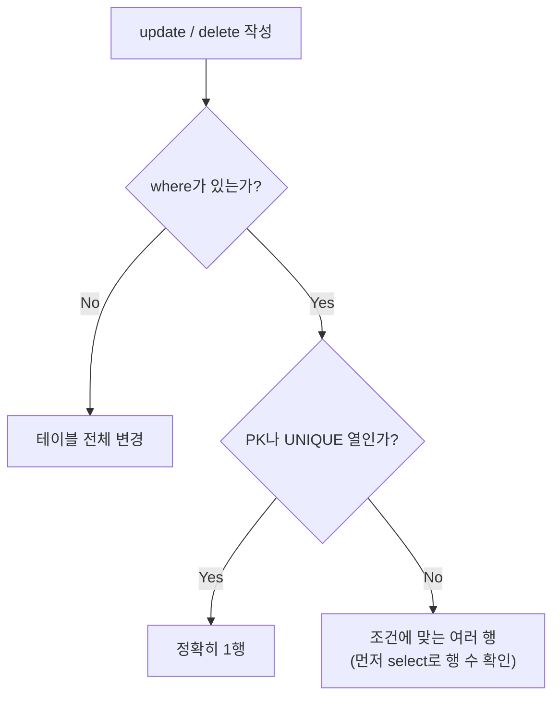

## 들어가며 (Situation)

[8편 DDL]({{ site.baseurl }})에서 테이블과 규칙을 만들었다. `10_dml.sql`은 그 테이블에 실제로 데이터를 넣고, 고치고, 지운다. DML(Data Manipulation Language)이다.

수업 파일 첫 줄에는 "⭐⭐⭐중요⭐⭐⭐"가 붙어 있었고, 에러 케이스마다 같은 문장이 반복됐다.

> 데이터를 삽입할 때 Error 가 무지막지하게 많이 발생한다.
> ⭐⭐⭐ 이럴 때 확인해야 하는 건 테이블의 제약 조건과, 데이터 타입! ⭐⭐⭐

| 명령어 | 형식 |
|--------|------|
| `INSERT` | `insert into 테이블 (열...) values (값...)` |
| `UPDATE` | `update 테이블 set 열 = 값 where 조건` |
| `DELETE` | `delete from 테이블 where 조건` |

이 글의 실험은 모두 `start transaction` 안에서 하고 `rollback`으로 되돌렸다. 에러가 나는 문장은 원래 아무것도 바꾸지 않는다.

## 문제 상황 (Task)

수업 코드에는 이런 줄이 있었다.

```sql
update users set `name` = '조평훈';
```

`where`가 없다. 주석은 "수정, 삭제 작업에서 가장 필수적으로 생각해야 하는 것은 where 조건절!!!"이라고 경고했다. 그런데 수업이 끝나고 `users`를 다시 조회해 보니 이름이 전부 원래대로였다. 확인할 것을 정리했다.

1. 수업 파일의 에러 케이스는 각각 어떤 에러 번호와 메시지로 나타나는가?
2. `where` 없는 `update`는 실제로 몇 행을 바꾸는가?
3. 그런데 수업 DB의 이름은 왜 멀쩡했는가?
4. `delete from users where user_id = 1`은 왜 거부되는가?

## 해결 과정 (Action)

### 1. INSERT — 안 준 열은 누가 채우는가

```sql
insert into users (`email`, `name`) values ('email@gmail.com', '조평훈');
select user_id, email, name, status, password_hash, created_at
from users where email = 'email@gmail.com';
```

```text
+---------+-----------------+-----------+--------+---------------+---------------------+
| user_id | email           | name      | status | password_hash | created_at          |
+---------+-----------------+-----------+--------+---------------+---------------------+
|     121 | email@gmail.com | 조평훈    | active | NULL          | 2026-10-13 15:20:17 |
+---------+-----------------+-----------+--------+---------------+---------------------+
```

열 두 개만 줬는데 나머지가 다 채워졌다. `desc users`와 비교하면 누가 채웠는지 보인다.

| 열 | 채운 주체 |
|----|-----------|
| `user_id` = 121 | `auto_increment` (기존 최대 120 다음) |
| `status` = active | `default 'active'` |
| `password_hash` = NULL | NULL 허용 열이라 비워둠 |
| `created_at` | `default current_timestamp` |

### 2. 에러 케이스 — 에러 번호로 원인 찾기

**1번 질문 확인**: 수업 파일의 에러 케이스를 하나씩 다시 실행했다.

**UNIQUE 위반.** 수업에서는 같은 이메일을 두 번 넣었다. 나는 이미 있는 홍길동의 이메일로 재현했다.

```sql
insert into users (`email`, `name`) values ('gildong.hong@example.com', '조평순');
```

```text
ERROR 1062 (23000): Duplicate entry 'gildong.hong@example.com' for key 'users.email'
```

**NOT NULL 위반.** `name`을 빼고 넣었다.

```sql
insert into users (`email`) values ('email2@gmail.com');
```

```text
ERROR 1364 (HY000): Field 'name' doesn't have a default value
```

주석에는 "not null 제약조건 위반"이라고 적었는데 메시지는 "기본값이 없다"였다. 열을 **아예 빼면** MySQL은 기본값을 찾고, `name`에는 기본값이 없으니 이 에러가 난다. `NULL`을 **직접 넣으면** 메시지가 달라진다. (확인용 **예시 코드**)

```sql
insert into users (email, name) values ('email3@gmail.com', null);
```

```text
ERROR 1048 (23000): Column 'name' cannot be null
```

둘 다 이 서버의 `sql_mode`에 `STRICT_TRANS_TABLES`가 켜져 있어서 에러가 된다. strict 모드가 꺼져 있으면 경고만 내고 빈 문자열 같은 값을 넣어버린다([MySQL 8.0 Reference - Strict SQL Mode](https://dev.mysql.com/doc/refman/8.0/en/sql-mode.html#sql-mode-strict)).

**외래키 위반.** 없는 사용자 999번을 강좌 개설자로 넣었다.

```sql
insert into courses (`author_id`, `title`, `description`)
values (999, 'SQL 제약조건!', '제약조건을 확인해보아요~');
```

```text
ERROR 1452 (23000): Cannot add or update a child row: a foreign key constraint fails
(`wanted_lms`.`courses`, CONSTRAINT `courses_ibfk_1` FOREIGN KEY (`author_id`) REFERENCES `users` (`user_id`))
```

주석의 "고아 데이터를 방지하는 역할"이다. `author_id`를 1로 바꾸면 `course_id` 31번, `status`는 기본값 `draft`로 들어갔다.

`courses`에는 수업에서 다루지 않은 제약이 하나 더 있었다. `status`에 정해진 값만 들어가게 하는 `CHECK`다. (확인용 **예시 코드**)

```sql
insert into courses (author_id, title, status) values (1, 't', 'deleted');
```

```text
ERROR 3819 (HY000): Check constraint 'courses_chk_1' is violated.
```

| 에러 번호 | 원인 | 확인할 곳 |
|-----------|------|-----------|
| 1062 | UNIQUE·PK 중복 | `desc`의 Key `UNI`/`PRI` |
| 1364 | NOT NULL 열을 생략, 기본값 없음 | `desc`의 Null `NO` + Default `NULL` |
| 1048 | NOT NULL 열에 NULL 직접 입력 | `desc`의 Null `NO` |
| 1452 | 외래키 대상 없음 | `show create table`의 `FOREIGN KEY` |
| 3819 | CHECK 조건 위반 | `show create table`의 `CHECK` |

에러 번호만 보면 `desc`나 `show create table`의 어디를 봐야 하는지 바로 알 수 있다. 수업이 "제약 조건과 데이터 타입을 확인하라"고 반복한 이유다.

### 3. 에러가 나지 않는 게 더 위험한 경우

`name`에 숫자 `123`을 넣었다.

```sql
insert into users (`email`, `name`) values ('email2@gmail.com', 123);
select user_id, name, name = 123, name = '123' from users where email = 'email2@gmail.com';
```

```text
+---------+------+------------+--------------+
| user_id | name | name = 123 | name = '123' |
+---------+------+------------+--------------+
|     122 | 123  |          1 |            1 |
+---------+------+------------+--------------+
```

에러 없이 문자열 `'123'`으로 바뀌어 들어갔다. 주석은 이렇게 결론 내렸다.

> 예외에 대한 처리를 DB 에서 하는 것이 아닌 front, back 쪽에서 해야 된다.

DB의 타입 검사는 "문자열로 바꿀 수 있는가"까지만 본다. "이름이 숫자여도 되는가"는 애플리케이션이 검사해야 한다.

### 4. WHERE 없는 UPDATE — 122행

**2번 질문 확인**: 트랜잭션 안에서 수업의 위험한 한 줄을 그대로 실행했다. (확인용 **예시 코드**, 롤백함)

```sql
start transaction;
update users set name = '전부바뀜';
select name, count(*) from users group by name;
rollback;
```

```text
Query OK, 122 rows affected (0.01 sec)
Rows matched: 122  Changed: 122  Warnings: 0

+--------------+----------+
| name         | count(*) |
+--------------+----------+
| 전부바뀜     |      122 |
+--------------+----------+
```

앞에서 넣은 2명까지 **122명 전원**의 이름이 바뀌었다. 경고도 확인 창도 없다. `where`에 기본 키를 쓰면 정확히 1행만 바뀐다.

```sql
update users set `name` = '조평순' where `user_id` = 1;
```

```text
Query OK, 1 row affected (0.00 sec)
Rows matched: 1  Changed: 1  Warnings: 0
```

주석의 "where 조건절에는 1개의 행을 식별할 수 있는 유일한 값으로 조건을 거는 것이 권장된다 (pk, unique)"가 이 차이다. 이름처럼 중복될 수 있는 열로 조건을 걸면 동명이인까지 같이 바뀐다.



### 5. 수업 DB는 왜 멀쩡했나 — Safe Updates 모드

**3번 질문 확인**: 수업에서 그 줄을 실행했는데도 `users`의 이름이 원래대로였다. 같은 서버에서 MySQL의 **safe updates 모드**를 켜고 실행해봤다. (확인용 **예시 코드**)

```sql
set sql_safe_updates = 1;
update users set name = '조평훈';
```

```text
ERROR 1175 (HY000): You are using safe update mode and you tried to update a table without a WHERE that uses a KEY column.
```

safe updates 모드에서는 **키 열을 쓰는 `where`가 없는 UPDATE·DELETE**가 거부된다([MySQL 8.0 Reference - Using Safe-Updates Mode](https://dev.mysql.com/doc/refman/8.0/en/mysql-tips.html#safe-updates)). 내가 터미널로 접속했을 때는 이 값이 `OFF`였지만, 수업에서 쓴 MySQL Workbench는 SQL Editor 설정의 "Safe Updates" 옵션으로 이 모드를 켜고 접속한다. 수업 DB가 멀쩡했던 건 이 모드 덕분으로 보인다. 같은 모드에서도 `where user_id = 1`은 정상 실행됐다.

Workbench에 익숙해지면 이 옵션을 끄고 싶어질 수 있는데, 오늘 본 122행을 생각하면 켜두는 게 맞다.

### 6. DELETE — 부모 행은 지울 수 없다

**4번 질문 확인**:

```sql
delete from users where user_id = 1;
```

```text
ERROR 1451 (23000): Cannot delete or update a parent row: a foreign key constraint fails
(`wanted_lms`.`courses`, CONSTRAINT `courses_ibfk_1` FOREIGN KEY (`author_id`) REFERENCES `users` (`user_id`))
```

홍길동(1번)은 강좌 4개의 개설자다. 1번을 지우면 그 강좌 4개가 존재하지 않는 사용자를 가리키게 된다. INSERT 때의 ERROR 1452가 "자식에 없는 부모를 넣지 마라"였다면, 1451은 "자식이 있는 부모를 지우지 마라"다.

`users`를 참조하는 외래키가 몇 개인지 세어봤다. (확인용 **예시 코드**)

```sql
select table_name, constraint_name
from information_schema.referential_constraints
where constraint_schema = 'wanted_lms' and referenced_table_name = 'users';
```

```text
14 rows in set (0.00 sec)
```

`courses`, `enrollments`, `grades`, `user_auth_providers` 등 14개 제약이 `users`를 참조하고 있었다. 사용자 한 명을 지우려면 이 모든 곳에 연결된 데이터가 없어야 한다. 그래서 실제 서비스는 회원 탈퇴 시 행을 지우지 않고, 이 테이블처럼 `status`를 `deleted`로 바꾸는 방식을 많이 쓴다.

## 결과 (Result)

| 실험 | 결과 |
|------|------|
| 열 2개만 INSERT | 나머지 4개 열은 auto_increment·default·NULL로 채워짐 |
| 중복 이메일 / name 생략 / name에 NULL | ERROR 1062 / 1364 / 1048 |
| 없는 author_id / 잘못된 status | ERROR 1452 / 3819 |
| name에 숫자 123 | 에러 없이 `'123'` 저장 |
| `where` 없는 UPDATE | **122행** 변경 (롤백) |
| safe updates 모드 + `where` 없는 UPDATE | ERROR 1175 |
| 강좌가 있는 사용자 DELETE | ERROR 1451 (참조하는 외래키 14개) |

배운 점은 다음과 같다.

- DML 에러는 대부분 DDL에서 정한 규칙에 걸린 것이다. 에러 번호 → `desc`/`show create table` 순서로 보면 원인을 바로 찾는다.
- 진짜 위험한 건 에러가 아니라 **에러가 안 나는 실수**다. `where` 없는 UPDATE와 숫자 이름은 둘 다 조용히 성공했다.
- UPDATE·DELETE 전에는 같은 `where`로 `select`를 먼저 돌려 행 수를 확인한다.

## 더 학습하면 좋은 개념

- **`ON DELETE CASCADE`와 소프트 삭제(soft delete)** — 부모 삭제 시 자식을 같이 지울지, `status`만 바꿀지. ERROR 1451에 대한 두 가지 설계 방향이다.
- **`INSERT ... ON DUPLICATE KEY UPDATE`** — ERROR 1062가 날 상황에서 대신 기존 행을 수정하는 문법.
- **여러 행 INSERT** — `values (...), (...)`로 한 번에 여러 행을 넣으면 왕복 횟수가 줄어든다.
- **SQL 모드(sql_mode)** — `STRICT_TRANS_TABLES`가 없으면 오늘 본 에러들이 경고로 바뀐다. 서버 설정이 데이터 품질을 좌우한다.
- **트랜잭션** — 실수한 UPDATE를 되돌릴 수 있었던 이유. [13편]({{ site.baseurl }})에서 다룬다.

## 참고 자료

- [MySQL 8.0 Reference - INSERT Statement](https://dev.mysql.com/doc/refman/8.0/en/insert.html)
- [MySQL 8.0 Reference - UPDATE Statement](https://dev.mysql.com/doc/refman/8.0/en/update.html)
- [MySQL 8.0 Reference - DELETE Statement](https://dev.mysql.com/doc/refman/8.0/en/delete.html)
- [MySQL 8.0 Reference - Using Safe-Updates Mode](https://dev.mysql.com/doc/refman/8.0/en/mysql-tips.html#safe-updates)
- [MySQL 8.0 Reference - Server SQL Modes](https://dev.mysql.com/doc/refman/8.0/en/sql-mode.html)
- [MySQL Workbench Manual - SQL Editor Preferences](https://dev.mysql.com/doc/workbench/en/wb-preferences-sql-editor.html)
- [MySQL 8.0 Reference - FOREIGN KEY Constraints](https://dev.mysql.com/doc/refman/8.0/en/create-table-foreign-keys.html)

---

**요약**
1. DML 에러(1062·1364·1048·1452·3819)는 대부분 테이블의 제약 조건에 걸린 것이라, 에러 번호를 보고 `desc`·`show create table`의 해당 부분을 확인하면 된다.
2. `where` 없는 UPDATE는 경고 없이 122행 전체를 바꿨고, Workbench의 Safe Updates 모드(ERROR 1175)가 이런 실수를 막아준다.
3. 자식 데이터가 있는 부모 행은 DELETE가 거부되며(ERROR 1451), `users`는 14개 외래키가 참조하고 있어 실무에서는 `status` 변경으로 탈퇴를 처리하곤 한다.
