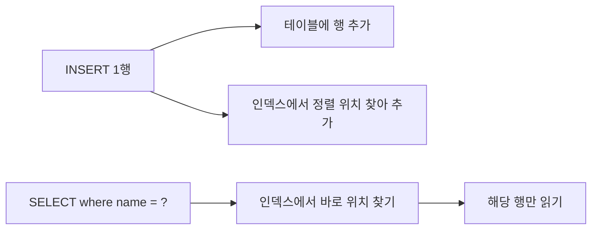

## 들어가며 (Situation)

`13_index.sql`의 주석은 이렇게 시작한다.

> 100만명의 users 테이블 중 홍길동이라는 사람을 찾아야 한다.
> 데이터베이스는 데이터를 조회할 때 첫번째 행부터 마지막 행까지 하나씩 비교를 하면서 스캔을 하게 된다. 이를 full table scan 이라고 한다.

인덱스는 책의 **목차**다. 특정 열의 값과 그 행의 위치를 미리 정렬해 두고, 조회할 때 목차를 보고 바로 찾아간다. 주석은 동시에 "index 는 양날의 검, trade-off"라고 경고했다.

| 장점 | 단점 (수업 주석) |
|------|------------------|
| SELECT 검색 속도 향상 | 1. 저장 공간 비용 — 인덱스는 별도 공간을 차지한다 |
| | 2. DML 성능 저하 — INSERT·UPDATE·DELETE 때 인덱스도 고쳐야 한다 |

## 문제 상황 (Task)

수업에서는 `users`(120행)에 인덱스를 만들고 `EXPLAIN`으로 확인했다.

> 인덱스 적용 전 : 120개의 row 를 full scan 했다.
> 인덱스 적용 후 : 1 개의 row 만 scan 했다.

120행 → 1행은 분명한 차이지만, 실행 시간은 둘 다 `0.00 sec`였다. 120행으로는 체감할 수 없었고, 단점은 숫자로 확인하지 못했다. 그래서 확인할 것을 정리했다.

1. `EXPLAIN` 결과의 어떤 칸을 보면 인덱스 사용 여부를 알 수 있는가?
2. 주석의 예시처럼 100만 행이면 실제로 얼마나 빨라지는가?
3. 단점(저장 공간, DML 저하)은 실제로 얼마나 되는가?
4. 인덱스를 만들어도 안 쓰이는 경우는 언제인가?

## 해결 과정 (Action)

### 1. EXPLAIN 읽기 — type, key, rows

`users.name`에는 수업에서 만든 `idx_users_name`이 이미 있다. 그래서 "인덱스 적용 전"은 `ignore index` 힌트로 인덱스를 무시하게 해서 재현했다.

```sql
-- 인덱스 생성 (수업)
create index idx_users_name on users(name);

-- 적용 전 재현
explain select * from users ignore index (idx_users_name) where name = '홍길동';
-- 적용 후
explain select * from users where name = '홍길동';
```

```text
+-------+------+----------------+----------------+-------+------+----------+-------------+
| table | type | possible_keys  | key            | ref   | rows | filtered | Extra       |
+-------+------+----------------+----------------+-------+------+----------+-------------+
| users | ALL  | NULL           | NULL           | NULL  |  120 |     0.83 | Using where |
| users | ref  | idx_users_name | idx_users_name | const |    1 |   100.00 | NULL        |
+-------+------+----------------+----------------+-------+------+----------+-------------+
```

(두 결과를 한 표에 모으고 주요 열만 남김)

**1번 질문 확인**: 세 칸만 보면 된다.

| 칸 | 적용 전 | 적용 후 | 의미 |
|----|---------|---------|------|
| `type` | `ALL` | `ref` | `ALL`은 전체 스캔. `ref`는 인덱스로 같은 값을 찾음 |
| `key` | `NULL` | `idx_users_name` | 실제로 쓴 인덱스 |
| `rows` | 120 | 1 | 읽을 것으로 예상한 행 수 |

`filtered 0.83`은 120행을 읽고 그중 0.83%(1행)만 조건에 맞을 거라는 예상이다. 119행은 헛걸음이었다는 뜻이다. 각 칸의 의미는 공식 문서에 정리되어 있다([MySQL 8.0 Reference - EXPLAIN Output Format](https://dev.mysql.com/doc/refman/8.0/en/explain-output.html)).

`EXPLAIN ANALYZE`를 쓰면 예상이 아니라 **실제로 실행한 시간**이 나온다. (확인용 **예시 코드**)

```text
-- 인덱스 무시
-> Filter: (users.`name` = '홍길동')  (actual time=0.104..0.244 rows=1 loops=1)
    -> Table scan on users  (actual time=0.0989..0.214 rows=120 loops=1)

-- 인덱스 사용
-> Index lookup on users using idx_users_name (name='홍길동')  (actual time=0.0273..0.029 rows=1 loops=1)
```

0.244ms → 0.029ms. 약 8배지만, 둘 다 1ms도 안 돼서 화면에는 `0.00 sec`로 보였던 것이다.

### 2. 100만 행으로 다시 재기

**2번 질문 확인**: 주석의 예시처럼 100만 행 테이블을 만들었다. 재귀 CTE로 `user1` ~ `user1000000`을 넣었다. (확인용 **예시 코드**, 실험 후 삭제)

```sql
create table idx_test (
    id int primary key auto_increment,
    name varchar(100) not null
);

set session cte_max_recursion_depth = 1000000;
insert into idx_test (name)
with recursive seq(n) as (
    select 1 union all select n + 1 from seq where n < 1000000
)
select concat('user', n) from seq;
```

```text
Query OK, 1000000 rows affected (13.60 sec)
```

인덱스 없이 `user777777`을 찾았다.

```sql
select * from idx_test where name = 'user777777';
```

```text
+--------+------------+
| id     | name       |
+--------+------------+
| 777777 | user777777 |
+--------+------------+
1 row in set (0.51 sec)
```

```text
-> Filter: (idx_test.`name` = 'user777777')  (actual time=450..605 rows=1 loops=1)
    -> Table scan on idx_test  (actual time=0.0424..404 rows=1e+6 loops=1)
```

100만 행(`rows=1e+6`)을 전부 읽었다. 인덱스를 만들고 다시 실행했다.

```sql
create index idx_test_name on idx_test(name);
select * from idx_test where name = 'user777777';
```

```text
Query OK, 0 rows affected (4.21 sec)

1 row in set (0.00 sec)
```

```text
-> Covering index lookup on idx_test using idx_test_name (name='user777777')  (actual time=0.0074..0.0088 rows=1 loops=1)
```

**605ms → 0.0088ms**. 화면 기준으로도 0.51초 → 0.00초다. 인덱스를 만드는 데는 4.21초가 걸렸다.

### 3. 단점도 숫자로 재기

**3번 질문 확인**: 같은 테이블에서 저장 공간과 DML 시간을 비교했다. (`analyze table` 후 `information_schema.tables`의 크기 값을 봤다.)

```text
+---------+----------+
| data_mb | index_mb |
+---------+----------+
|    34.6 |     22.5 |
+---------+----------+
```

`name` 열 하나에 만든 인덱스가 **22.5MB**, 데이터의 65% 크기다. 주석의 "목차 10~20 page"보다 훨씬 두꺼운 목차다. 인덱스에는 정렬된 `name` 값과 그 행을 찾아갈 기본 키가 함께 저장되기 때문이다.

인덱스가 있는 상태와 없는 상태에서 같은 100만 행 INSERT, 10만 행 UPDATE를 실행했다.

| 작업 | 인덱스 없음 | 인덱스 있음 | 차이 |
|------|-------------|-------------|------|
| 100만 행 INSERT | 13.60초 / 12.31초 (2회) | **22.96초** | 약 1.7~1.9배 |
| `name` 열 10만 행 UPDATE | 5.24초 | 5.70초 | 약 9% |
| `where name = ...` SELECT | 0.51초 | 0.00초 | — |

INSERT는 확실히 느려졌다. 행마다 테이블에 넣고, 인덱스의 **정렬된 위치를 찾아** 한 번 더 넣기 때문이다. UPDATE 차이는 예상보다 작았는데, 주석의 설명대로 인덱스에서는 "삭제 + 삽입"이 일어나지만 이 실험에서는 10만 행을 고치는 작업 자체의 비용이 더 컸던 것으로 보인다. 로컬 PC에서 1~2회씩 잰 값이라 정확한 배율보다는 **방향**을 보는 데 의미가 있다.



### 4. 인덱스가 있어도 안 쓰이는 경우

**4번 질문 확인**: `users.name`에 인덱스가 있는 상태에서 조건을 바꿔가며 `EXPLAIN`을 봤다. (확인용 **예시 코드**)

```sql
explain select * from users where name like '홍%';
explain select * from users where name like '%길동';
explain select * from users where left(name, 1) = '홍';
explain select * from users where status = 'active';
```

| 조건 | type | key | rows |
|------|------|-----|------|
| `name = '홍길동'` | `ref` | idx_users_name | 1 |
| `name like '홍%'` | `range` | idx_users_name | 4 |
| `name like '%길동'` | **`ALL`** | NULL | 120 |
| `left(name, 1) = '홍'` | **`ALL`** | NULL | 120 |
| `status = 'active'` | `ALL` | NULL | 120 (인덱스 없음) |

인덱스는 **값의 앞부분부터 정렬**된 목차다. `'홍%'`는 "홍"으로 시작하는 구간만 보면 되지만, `'%길동'`은 앞글자를 모르니 목차를 쓸 수 없다. 열에 함수(`left()`)를 씌워도 목차의 값과 비교할 수 없어 전체 스캔이 된다. [7편]({{ site.baseurl }})의 `year(created_at) = ...`도 같은 이유로 인덱스를 쓰지 못하는 형태다.

### 5. PK·UNIQUE·FK에는 자동으로 인덱스가 있다

주석의 마지막 문장은 "pk, unique 제약 조건이 걸린 컬럼은 테이블 생성 시 자동으로 index 가 적용이 된다"였다.

```sql
show index from users;
show index from courses;
```

```text
+---------+----------------+-------------+------------+
| Table   | Key_name       | Column_name | Non_unique |
+---------+----------------+-------------+------------+
| users   | PRIMARY        | user_id     |          0 |
| users   | email          | email       |          0 |
| users   | idx_users_name | name        |          1 |
| courses | PRIMARY        | course_id   |          0 |
| courses | author_id      | author_id   |          1 |
+---------+----------------+-------------+------------+
```

(두 결과를 합치고 주요 열만 남김)

내가 만든 건 `idx_users_name` 하나뿐이다. `PRIMARY`와 `email`은 PK·UNIQUE 때문에, `courses.author_id`는 **외래키** 때문에 자동으로 생겼다. InnoDB는 외래키 열에 인덱스가 없으면 자동으로 만든다([MySQL 8.0 Reference - FOREIGN KEY Constraints](https://dev.mysql.com/doc/refman/8.0/en/create-table-foreign-keys.html)). 그래서 `user_id = 1`이나 `email = ...` 조회는 인덱스를 따로 안 만들어도 `type`이 `const`로 나왔다.

## 결과 (Result)

| 측정 | 인덱스 없음 | 인덱스 있음 |
|------|-------------|-------------|
| `users` 120행 조회 (실행 시간) | 0.244ms, 120행 스캔 | 0.029ms, 1행 |
| 100만 행 조회 (실행 시간) | **605ms**, 100만 행 스캔 | **0.0088ms** |
| 100만 행 INSERT | 13.60초 | **22.96초** |
| 저장 공간 | 데이터 34.6MB | + 인덱스 **22.5MB** |
| 인덱스 생성 | — | 4.21초 |

배운 점은 다음과 같다.

- `EXPLAIN`은 `type`(ALL이면 전체 스캔), `key`(쓴 인덱스), `rows`(읽을 행 수) 세 칸부터 본다.
- 인덱스의 효과는 데이터가 많을수록 커진다. 120행에서는 안 보이던 차이가 100만 행에서는 약 7만 배였다.
- 대가도 숫자로 나왔다. INSERT가 2배 가까이 느려지고 데이터의 65%만큼 공간을 더 썼다. 그래서 주석의 기준처럼 "조회가 압도적으로 많고, 수정이 드문 열"에 건다.
- `like '%...'`나 함수를 씌운 열에는 인덱스가 있어도 쓰이지 않는다.

## 더 학습하면 좋은 개념

- **B-Tree 구조** — 인덱스가 "정렬된 목차"를 실제로 어떤 자료구조로 유지하는지. `like '홍%'`는 되고 `'%길동'`은 안 되는 이유가 여기서 나온다.
- **클러스터드 인덱스와 세컨더리 인덱스** — InnoDB는 테이블 자체가 PK 순서로 저장된다. 세컨더리 인덱스에 PK가 같이 들어 있어서 100만 행 실험에서 "Covering index lookup"이 나왔다.
- **복합 인덱스와 왼쪽 접두사 규칙** — `(status, name)`처럼 여러 열로 만든 인덱스는 어떤 조건에서 쓰이는가.
- **카디널리티(Cardinality)** — `status`처럼 값의 종류가 3개뿐인 열은 인덱스 효과가 작다. `show index`의 Cardinality 칸이 그 지표다.
- **함수 기반 인덱스** — MySQL 8.0.13부터 `(year(created_at))` 같은 식에도 인덱스를 만들 수 있다.

## 참고 자료

- [MySQL 8.0 Reference - How MySQL Uses Indexes](https://dev.mysql.com/doc/refman/8.0/en/mysql-indexes.html)
- [MySQL 8.0 Reference - CREATE INDEX Statement](https://dev.mysql.com/doc/refman/8.0/en/create-index.html)
- [MySQL 8.0 Reference - EXPLAIN Statement](https://dev.mysql.com/doc/refman/8.0/en/explain.html)
- [MySQL 8.0 Reference - EXPLAIN Output Format](https://dev.mysql.com/doc/refman/8.0/en/explain-output.html)
- [MySQL 8.0 Reference - Index Hints](https://dev.mysql.com/doc/refman/8.0/en/index-hints.html)
- [MySQL 8.0 Reference - FOREIGN KEY Constraints](https://dev.mysql.com/doc/refman/8.0/en/create-table-foreign-keys.html)

---

**요약**
1. `EXPLAIN`의 `type`·`key`·`rows`를 보면 인덱스 사용 여부를 알 수 있고, `users`의 이름 조회는 `ALL` 120행에서 `ref` 1행으로 바뀌었다.
2. 100만 행에서는 조회가 605ms → 0.0088ms로 빨라졌지만, INSERT는 13.6초 → 23.0초로 느려지고 인덱스가 22.5MB를 더 차지했다.
3. `like '%길동'`이나 함수를 씌운 열에는 인덱스가 쓰이지 않으며, PK·UNIQUE·외래키 열에는 인덱스가 자동으로 생긴다.
