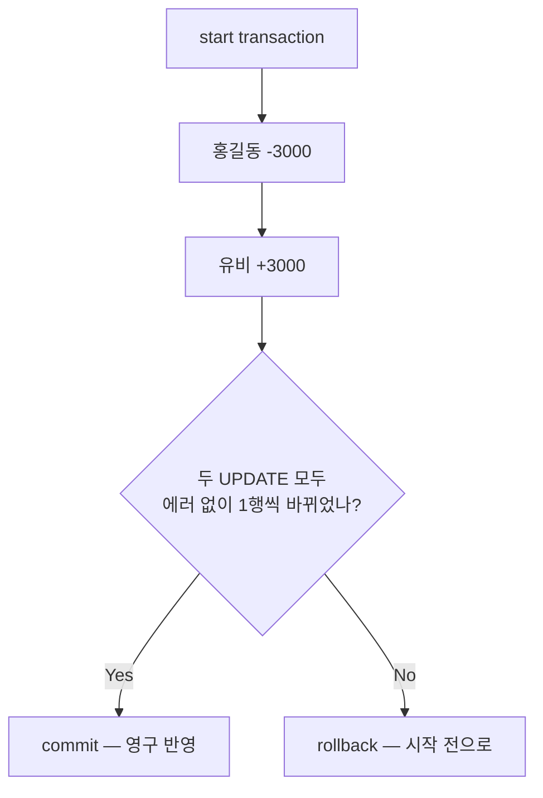
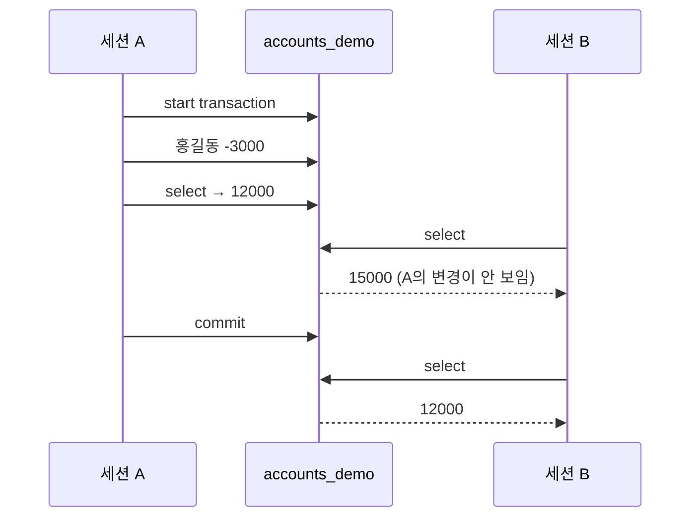

## 들어가며 (Situation)

오늘의 마지막 파일 `14_transaction.sql`은 은행 계좌이체 예제였다. 홍길동(15,000원)이 유비(30,000원)에게 3,000원을 보낸다.

```sql
create table accounts (
    id int primary key,
    owner varchar(50),
    balance decimal(10, 2)
);
insert into accounts(id, owner, balance) values (1, '홍길동', 15000);
insert into accounts(id, owner, balance) values (2, '유비', 30000);
```

수업 주석은 문제를 이렇게 짚었다.

> 계좌이체는 논리적으로 하나의 작업이지만, 실제로 동작하는 작업은 2번의 업데이트가 발생한다.

1. 홍길동 계좌에서 -3000
2. 유비 계좌에 +3000

1번과 2번 사이에 "은행 정전"이 나면 3,000원이 사라진다. 그래서 두 작업을 하나로 묶는 **트랜잭션**이 필요하다.

> 다수의 작업을 하나의 논리적인 작업 단위로 묶는 것을 의미한다.
> 따라서 다수의 작업 중 1개의 작업이라도 잘못되면 롤백 시키는 것이 핵심이다.

| 명령어 | 역할 |
|--------|------|
| `start transaction` | 지금부터의 작업을 하나로 묶기 시작 |
| `commit` | 묶인 작업을 영구 반영 |
| `rollback` | 묶인 작업을 전부 취소 |

이 글의 실험은 수업의 `accounts`를 건드리지 않도록, 같은 구조의 `accounts_demo`를 만들어 했고 끝나고 삭제했다.

## 문제 상황 (Task)

수업의 "비정상 계좌이체"는 없는 계좌(99번)에 3,000원을 넣는 예제였다. 그런데 실행해 보니 **에러가 나지 않았다**. 수업에서는 결과를 눈으로 보고 `rollback`을 직접 입력했다. 그렇다면 DB는 무엇을 대신 해주고, 무엇을 내가 해야 하는 걸까? 확인할 것을 정리했다.

1. 없는 계좌로의 UPDATE는 왜 에러가 아닌가? "실패"는 누가 판단하는가?
2. 트랜잭션 중간에 진짜 에러가 나면 MySQL이 자동으로 롤백해 주는가?
3. "은행 정전"처럼 `commit` 전에 연결이 끊기면 어떻게 되는가?
4. `commit` 전의 변경은 다른 사용자에게 보이는가?

## 해결 과정 (Action)

### 1. 정상 이체 — COMMIT

```sql
start transaction;
update accounts set balance = balance - 3000 where id = 1;
-- ** 은행 정전 ** --
update accounts set balance = balance + 3000 where id = 2;
select * from accounts;   -- 중간 확인: 아직 영구 반영 아님
commit;
```

```text
+----+-----------+----------+
| id | owner     | balance  |
+----+-----------+----------+
|  1 | 홍길동    | 12000.00 |
|  2 | 유비      | 33000.00 |
+----+-----------+----------+
```

수업 DB의 `accounts`는 지금도 12,000 / 33,000이다. 정상 이체가 커밋된 결과다.

### 2. 없는 계좌 — 에러가 아니라 "0 rows affected"

**1번 질문 확인**: 비정상 이체를 다시 실행했다.

```sql
start transaction;
update accounts_demo set balance = balance - 3000 where id = 1;
update accounts_demo set balance = balance + 3000 where id = 99;
```

```text
Query OK, 1 row affected (0.00 sec)
Rows matched: 1  Changed: 1  Warnings: 0

Query OK, 0 rows affected (0.00 sec)
Rows matched: 0  Changed: 0  Warnings: 0
```

두 번째 UPDATE는 **성공(Query OK)**했다. `where id = 99`에 맞는 행이 없으니 0행을 바꾼 것뿐이다. SQL 입장에서 "조건에 맞는 행이 없음"은 정상적인 결과다. 실패를 알려주는 건 `0 rows affected`라는 숫자뿐이었다. 프로그램에서는 `row_count()`로 이 값을 읽을 수 있다.

```sql
select row_count();
```

```text
+-------------+
| row_count() |
+-------------+
|           0 |
+-------------+
```

이 시점에 홍길동은 12,000원, 유비는 30,000원으로 3,000원이 사라진 상태다. `rollback`으로 되돌렸다.

```sql
rollback;
select * from accounts_demo;
```

```text
+----+-----------+----------+
| id | owner     | balance  |
+----+-----------+----------+
|  1 | 홍길동    | 15000.00 |
|  2 | 유비      | 30000.00 |
+----+-----------+----------+
```

**"이체가 실패했다"는 판단은 DB가 아니라 내가 했다.** 실제 애플리케이션이라면 "바뀐 행이 1이 아니면 롤백"을 코드로 짜야 한다.

### 3. 진짜 에러가 나면 자동으로 롤백될까

**2번 질문 확인**: 이번에는 2단계에서 진짜 에러를 냈다. `decimal(10, 2)`의 최대값을 넘는 금액을 더했다. (확인용 **예시 코드**)

```sql
start transaction;
update accounts_demo set balance = balance - 3000 where id = 1;
update accounts_demo set balance = balance + 99999999999 where id = 2;
select * from accounts_demo;
commit;
```

```text
Query OK, 1 row affected (0.00 sec)

ERROR 1264 (22003): Out of range value for column 'balance' at row 1

+----+-----------+----------+
| id | owner     | balance  |
+----+-----------+----------+
|  1 | 홍길동    | 12000.00 |
|  2 | 유비      | 30000.00 |
+----+-----------+----------+

Query OK, 0 rows affected (0.00 sec)   -- commit
```

에러가 났는데도 **1단계의 -3,000은 살아 있었고**, 그대로 `commit`하니 3,000원이 사라진 채로 영구 반영됐다. MySQL(InnoDB)은 에러가 난 **그 문장 하나만** 취소하고, 트랜잭션 전체를 롤백하지는 않는다([MySQL 8.0 Reference - InnoDB Error Handling](https://dev.mysql.com/doc/refman/8.0/en/innodb-error-handling.html)).

| 상황 | MySQL이 하는 일 | 내가 해야 하는 일 |
|------|-----------------|-------------------|
| 조건에 맞는 행 없음 | 정상 처리 (0 rows) | 행 수 확인 후 `rollback` |
| 문장 에러 (1264 등) | 그 문장만 취소 | 에러 확인 후 `rollback` |
| 모두 정상 | — | `commit` |

트랜잭션은 "자동으로 지켜주는 장치"가 아니라 **"되돌릴 수 있는 기회"**를 주는 장치였다. `rollback`을 부를지 결정하는 건 작성자의 몫이다.



### 4. 은행 정전 — COMMIT 전에 연결이 끊기면

**3번 질문 확인**: 수업 코드의 `-- ** 은행 정전 ** --` 주석 위치를 재현했다. 1단계만 실행하고 `commit` 없이 접속을 끊은 뒤, 새로 접속해서 조회했다. (확인용 **예시 코드**)

```sql
-- 세션 A
start transaction;
update accounts_demo set balance = balance - 3000 where id = 1;
select * from accounts_demo;     -- 홍길동 12000
-- (commit 없이 접속 종료)

-- 새 세션
select * from accounts_demo;
```

```text
+----+-----------+----------+
| id | owner     | balance  |
+----+-----------+----------+
|  1 | 홍길동    | 15000.00 |
|  2 | 유비      | 30000.00 |
+----+-----------+----------+
```

15,000원 그대로다. 커밋되지 않은 트랜잭션은 연결이 끊기면 롤백된다. 정전이 나도 돈이 사라지지 않는 이유다.

반대로 트랜잭션 **없이** 실행했다면 어땠을까. 이 서버는 `autocommit`이 `ON`이다. 이 상태에서는 UPDATE 하나하나가 실행 즉시 커밋된다([MySQL 8.0 Reference - autocommit, Commit, and Rollback](https://dev.mysql.com/doc/refman/8.0/en/innodb-autocommit-commit-rollback.html)). 1단계 직후 정전이 나면 -3,000은 이미 영구 반영된 뒤다. `start transaction`이 autocommit을 잠시 멈추고 두 문장을 하나로 묶는 것이다.

### 5. COMMIT 전의 변경은 다른 사람에게 보일까

**4번 질문 확인**: 수업 주석의 "중간 확인 / 주의 : 영구 반영된 상태는 아니다"가 다른 사용자에게는 어떻게 보이는지 확인했다. 세션 A가 트랜잭션 안에서 UPDATE하고 4초 기다리는 동안 세션 B에서 조회했다. (확인용 **예시 코드**)



```text
-- 세션 A (트랜잭션 안)
|  1 | 홍길동    | 12000.00 |

-- 세션 B (A가 commit 하기 전)
|  1 | 홍길동    | 15000.00 |

-- 세션 B (A가 commit 한 후)
|  1 | 홍길동    | 12000.00 |
```

A는 자기 변경(12,000)을 보지만 B는 커밋 전까지 원래 값(15,000)을 본다. 이체 도중의 "반쯤 끝난 상태"를 다른 사람이 볼 수 없다. 이 서버의 격리 수준은 MySQL 기본값인 `REPEATABLE-READ`였다([MySQL 8.0 Reference - Transaction Isolation Levels](https://dev.mysql.com/doc/refman/8.0/en/innodb-transaction-isolation-levels.html)).

### 6. 오늘 배운 DDL과의 연결

[8편]()에서 `truncate`는 롤백이 안 됐다. DDL은 실행 전에 진행 중인 트랜잭션을 **암시적으로 커밋**하기 때문이다. 트랜잭션 도중에 `create`, `alter`, `drop`, `truncate`를 실행하면 그때까지의 변경도 함께 커밋되어 버린다([MySQL 8.0 Reference - Statements That Cause an Implicit Commit](https://dev.mysql.com/doc/refman/8.0/en/implicit-commit.html)). 트랜잭션으로 보호되는 건 DML뿐이다.

## 결과 (Result)

| 실험 | 결과 |
|------|------|
| 정상 이체 후 `commit` | 12,000 / 33,000 영구 반영 |
| 없는 계좌(99) UPDATE | 에러 없음, `0 rows affected` → 직접 `rollback` |
| 범위 초과 에러 후 `commit` | 에러 문장만 취소, **-3,000은 커밋됨** |
| `commit` 없이 접속 종료 | 자동 롤백, 15,000 유지 |
| 커밋 전 다른 세션 조회 | 15,000 (변경 안 보임) → 커밋 후 12,000 |

배운 점은 다음과 같다.

- 트랜잭션은 여러 문장을 "전부 반영 또는 전부 취소"로 묶는 단위다. 정전·접속 끊김에는 자동으로 롤백된다.
- 하지만 0행 UPDATE나 문장 에러가 났을 때 **롤백할지는 내가 판단**해야 한다. 에러가 났는데 그대로 `commit`하면 반쪽짜리 이체가 저장된다.
- 커밋 전의 변경은 다른 세션에 보이지 않는다. 수업 주석의 "영구 반영된 상태는 아니다"는 나에게만 보이는 상태라는 뜻이었다.

## 더 학습하면 좋은 개념

- **ACID** — 원자성(Atomicity), 일관성(Consistency), 격리성(Isolation), 지속성(Durability). 오늘 본 롤백은 A, 다른 세션에 안 보이는 것은 I다.
- **트랜잭션 격리 수준** — `READ UNCOMMITTED`부터 `SERIALIZABLE`까지. 수준에 따라 다른 세션의 미커밋 변경이 보이기도 한다.
- **락(Lock)과 데드락** — 두 세션이 같은 계좌를 동시에 UPDATE하면 한쪽이 기다린다. 서로를 기다리면 데드락이 된다.
- **`SAVEPOINT`** — 트랜잭션 전체가 아니라 중간 지점까지만 되돌리는 방법.
- **애플리케이션의 트랜잭션 처리** — 자바(JDBC)에서 `setAutoCommit(false)`와 `try-catch`로 "에러 시 rollback"을 코드로 만드는 방법. 3번 실험의 해결책이다.

## 참고 자료

- [MySQL 8.0 Reference - START TRANSACTION, COMMIT, and ROLLBACK Statements](https://dev.mysql.com/doc/refman/8.0/en/commit.html)
- [MySQL 8.0 Reference - autocommit, Commit, and Rollback](https://dev.mysql.com/doc/refman/8.0/en/innodb-autocommit-commit-rollback.html)
- [MySQL 8.0 Reference - InnoDB Error Handling](https://dev.mysql.com/doc/refman/8.0/en/innodb-error-handling.html)
- [MySQL 8.0 Reference - Transaction Isolation Levels](https://dev.mysql.com/doc/refman/8.0/en/innodb-transaction-isolation-levels.html)
- [MySQL 8.0 Reference - Statements That Cause an Implicit Commit](https://dev.mysql.com/doc/refman/8.0/en/implicit-commit.html)
- [MySQL 8.0 Reference - ROW_COUNT()](https://dev.mysql.com/doc/refman/8.0/en/information-functions.html#function_row-count)

---

**요약**
1. 트랜잭션은 계좌이체처럼 여러 UPDATE를 하나로 묶어 `commit`(전부 반영) 또는 `rollback`(전부 취소)하게 하며, 커밋 전에 접속이 끊기면 자동으로 롤백된다.
2. 없는 계좌로의 UPDATE는 에러가 아닌 `0 rows affected`이고, 진짜 에러(1264)도 그 문장만 취소되므로 롤백 여부는 작성자가 판단해야 한다.
3. 커밋 전 변경은 다른 세션에 보이지 않으며(REPEATABLE-READ), DDL은 암시적 커밋을 일으켜 트랜잭션으로 보호되지 않는다.
