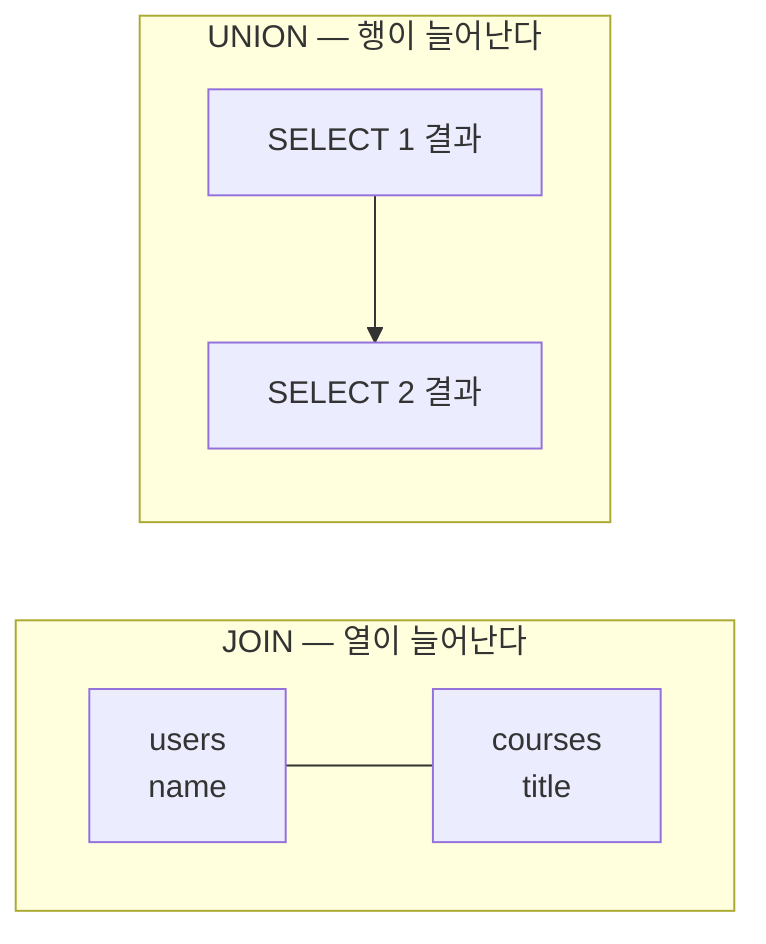
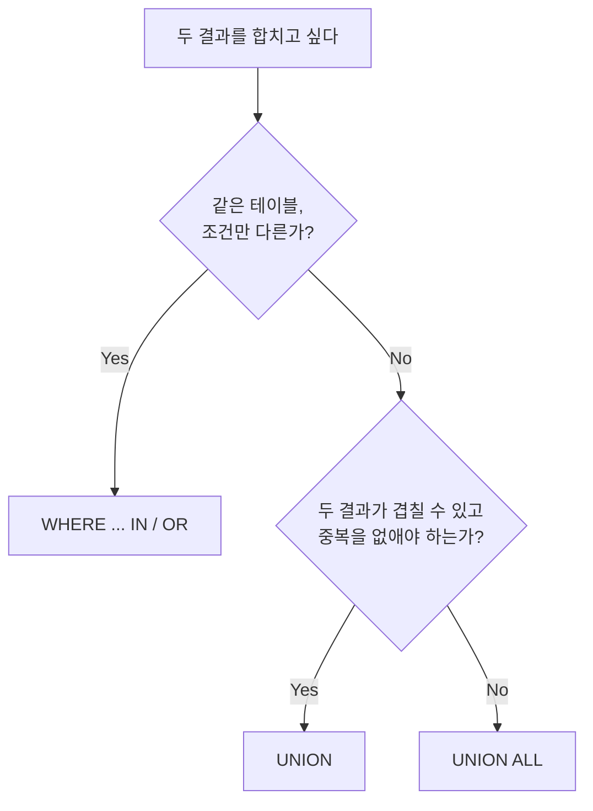

## 들어가며 (Situation)

`11_union.sql`은 오늘 파일 중 가장 짧았다. 여러 SELECT 결과를 위아래로 이어 붙이는 `UNION`이다. 수업 주석은 이렇게 정의했다.

> 각 쿼리문의 결과를 합치는 Union
> 수학의 합집합, 중복된 행은 제거하여 순수한 합집합을 만든다.

시나리오는 이랬다.

> users 테이블에 active 사용자와 suspended 사용자 모두에게 이메일을 발송하고자 한다.
> 탈퇴한 deleted 유저는 제외한다. 사용자의 이름, 이메일, 상태를 조회해라.

[6편 JOIN]()이 테이블을 **옆으로** 붙였다면, UNION은 결과를 **아래로** 붙인다.



## 문제 상황 (Task)

수업 쿼리를 실행하고 나서 의문이 생겼다. 두 SELECT가 **같은 테이블, 같은 열**이고 `where`만 다르다. 이걸 꼭 UNION으로 써야 했을까?

1. 수업 쿼리의 결과는 몇 행이고, 다른 방법으로도 같은 결과가 나오는가?
2. 주석의 "중복된 행은 제거"는 실제로 어떻게 보이는가? `UNION ALL`과는 무엇이 다른가?
3. 주석의 "컬럼 갯수가 동일해야 한다", "데이터 타입이 호환이 가능해야 한다"는 어디까지 엄격한가?
4. 그럼 UNION은 언제 써야 하는가?

## 해결 과정 (Action)

### 1. 수업 쿼리와 118행

```sql
select `name`, `email`, `status` from users where status = 'active'
union
select `name`, `email`, `status` from users where status = 'suspended';
```

```text
+-----------------+----------------------------+-----------+
| name            | email                      | status    |
+-----------------+----------------------------+-----------+
| 홍길동          | gildong.hong@example.com   | active    |
| ...             | ...                        | ...       |
| 이루시          | lucy.lee@example.com       | active    |
| 박민수          | minsu.park@example.com     | suspended |
| 황은서          | eunseo.hwang@example.com   | suspended |
+-----------------+----------------------------+-----------+
118 rows in set (0.00 sec)
```

**1번 질문 확인**: 상태별 인원은 `active` 116명, `suspended` 2명, `deleted` 2명이다. 116 + 2 = 118행. 같은 결과를 [3편]()의 `IN`과 `<>`로도 만들어봤다. (확인용 **예시 코드**)

```sql
select count(*) from users where status in ('active', 'suspended');
select count(*) from users where status <> 'deleted';
```

```text
118
118
```

세 방법 모두 118행이다.

### 2. 실행 계획으로 보는 차이

결과가 같으면 무엇이 다를까. `EXPLAIN`으로 실행 계획을 봤다. (`EXPLAIN`은 [12편]()에서 자세히 다룬다.)

```sql
explain
select name, email, status from users where status = 'active'
union
select name, email, status from users where status = 'suspended';
```

```text
+----+--------------+------------+------+------+-----------------+
| id | select_type  | table      | type | rows | Extra           |
+----+--------------+------------+------+------+-----------------+
|  1 | PRIMARY      | users      | ALL  |  120 | Using where     |
|  2 | UNION        | users      | ALL  |  120 | Using where     |
|  3 | UNION RESULT | <union1,2> | ALL  | NULL | Using temporary |
+----+--------------+------------+------+------+-----------------+
```

(주요 열만 남김)

`users`를 **두 번** 전체 스캔(`ALL`, 120행씩)하고, 결과를 임시 테이블(`Using temporary`)에 모아 중복을 검사한다. `IN` 버전도 확인했다.

```sql
explain select name, email, status from users where status in ('active', 'suspended');
```

```text
+----+-------------+-------+------+------+-------------+
| id | select_type | table | type | rows | Extra       |
+----+-------------+-------+------+------+-------------+
|  1 | SIMPLE      | users | ALL  |  120 | Using where |
+----+-------------+-------+------+------+-------------+
```

`users`를 한 번만 읽고 임시 테이블도 없다. 같은 테이블의 조건만 다르다면 `IN`이나 `OR`가 더 짧고 덜 일한다.

### 3. 중복 제거 — UNION vs UNION ALL

**2번 질문 확인**: 118행 결과에서는 중복이 없어서 "중복 제거"가 눈에 보이지 않았다. `status` 열만 남겨서 다시 해봤다. (확인용 **예시 코드**)

```sql
select status from users where status = 'active'
union
select status from users where status = 'suspended';
```

```text
+-----------+
| status    |
+-----------+
| active    |
| suspended |
+-----------+
2 rows in set (0.00 sec)
```

```sql
select count(*) from (
    select status from users where status = 'active'
    union all
    select status from users where status = 'suspended'
) t;
```

```text
+----------+
| count(*) |
+----------+
|      118 |
+----------+
```

`UNION`은 같은 `active` 116개를 1개로 합쳐 2행, `UNION ALL`은 그대로 118행이다. 공식 문서도 `UNION`의 기본 동작은 `UNION DISTINCT`이며 중복 행을 제거한다고 설명한다([MySQL 8.0 Reference - UNION Clause](https://dev.mysql.com/doc/refman/8.0/en/union.html)).

| | `UNION` | `UNION ALL` |
|--|---------|-------------|
| 중복 행 | 제거 | 유지 |
| `status`만 조회 시 | 2행 | 118행 |
| 추가 작업 | 중복 검사용 임시 테이블 | 없음 |
| 쓸 때 | 겹치는 행을 하나로 보고 싶을 때 | 겹칠 수 없거나 겹쳐도 될 때 |

수업 쿼리처럼 두 조건(`active`, `suspended`)이 절대 겹칠 수 없으면 중복 검사는 헛수고다. 이때는 `UNION ALL`이 맞다.

### 4. 열 개수와 타입 규칙

**3번 질문 확인**: 열 개수가 다르면 바로 에러다. (확인용 **예시 코드**)

```sql
select name, email from users
union
select name from users;
```

```text
ERROR 1222 (21000): The used SELECT statements have a different number of columns
```

타입은 생각보다 느슨했다. 숫자 열(`user_id`, bigint)과 문자 열(`title`, varchar)을 합쳐봤다.

```sql
select user_id from users where user_id = 1
union
select title from courses where course_id = 1;
```

```text
+-----------------------------------+
| user_id                           |
+-----------------------------------+
| 1                                 |
| 왕초보를 위한 Python 기초         |
+-----------------------------------+
```

에러 없이 둘 다 문자열로 합쳐졌다. 공식 문서에 따르면 결과 열의 타입은 모든 SELECT의 값을 담을 수 있도록 정해진다. 그리고 **열 이름은 첫 번째 SELECT를 따른다**. 그래서 강좌 제목이 `user_id`라는 열 아래 나왔다. 에러가 안 나니 오히려 실수를 알아채기 어렵다. 열의 **순서와 의미**를 맞추는 건 작성자의 책임이다.

| 규칙 | MySQL 동작 |
|------|------------|
| 열 개수 다름 | ERROR 1222 |
| 타입 다름 (숫자 + 문자) | 에러 없음, 문자열로 합침 |
| 열 이름 | 첫 번째 SELECT의 이름 사용 |

### 5. UNION이 필요한 경우

**4번 질문 확인**: 같은 테이블이면 `IN`으로 충분했다. UNION이 진짜 필요한 건 **서로 다른 테이블의 결과를 한 목록으로** 만들 때다. 예를 들어 "이메일 발송 대상"이 회원(`users`)과 강좌 개설자 외에 다른 테이블에도 흩어져 있다면 `where` 하나로는 합칠 수 없다. [6편]()에서 확인한 대로 MySQL에 없는 `FULL OUTER JOIN`을 `LEFT JOIN ... UNION ... RIGHT JOIN`으로 흉내 내는 것도 대표적인 사용처다.



## 결과 (Result)

| 확인한 내용 | 결과 |
|-------------|------|
| 수업 쿼리 / `IN` / `<>` | 모두 118행 |
| UNION 실행 계획 | `users` 전체 스캔 2회 + 임시 테이블 |
| `status`만 UNION / UNION ALL | 2행 / 118행 |
| 열 개수 다름 | ERROR 1222 |
| 숫자 열 + 문자 열 | 에러 없이 합쳐짐, 열 이름은 첫 SELECT 기준 |

배운 점은 다음과 같다.

- UNION은 "결과를 아래로 붙인다". 같은 테이블에서 조건만 다르면 `IN`이 더 간단하고 테이블도 한 번만 읽는다.
- `UNION`은 기본이 중복 제거라 추가 작업이 든다. 겹칠 수 없는 결과라면 `UNION ALL`을 쓴다.
- MySQL은 타입이 달라도 합쳐준다. 열의 순서와 의미는 직접 맞춰야 한다.

## 더 학습하면 좋은 개념

- **`INTERSECT`와 `EXCEPT`** — 교집합과 차집합. MySQL 8.0.31부터 지원한다. 합집합(UNION)과 함께 집합 연산 세 가지를 이룬다.
- **UNION 결과의 `ORDER BY`·`LIMIT`** — 전체 결과를 정렬할지, 각 SELECT를 정렬할지에 따라 괄호 위치가 달라진다.
- **FULL OUTER JOIN 흉내 내기** — `LEFT JOIN UNION RIGHT JOIN` 패턴. 6편에서 만난 ERROR 1064의 해결책이다.
- **임시 테이블(Using temporary)** — `UNION`, `GROUP BY`, `DISTINCT`가 내부적으로 임시 테이블을 쓰는 이유와 비용.

## 참고 자료

- [MySQL 8.0 Reference - UNION Clause](https://dev.mysql.com/doc/refman/8.0/en/union.html)
- [MySQL 8.0 Reference - Set Operations with UNION, INTERSECT, and EXCEPT](https://dev.mysql.com/doc/refman/8.0/en/set-operations.html)
- [MySQL 8.0 Reference - EXPLAIN Output Format](https://dev.mysql.com/doc/refman/8.0/en/explain-output.html)

---

**요약**
1. UNION은 여러 SELECT 결과를 아래로 이어 붙이며, 수업 쿼리(118행)는 같은 테이블이라 `IN`으로도 같은 결과를 테이블 한 번만 읽고 얻을 수 있었다.
2. `UNION`은 중복을 제거해 `status`만 합치면 2행, `UNION ALL`은 그대로 118행이며, 겹칠 수 없는 결과에는 `UNION ALL`이 맞다.
3. 열 개수가 다르면 ERROR 1222지만 타입이 달라도 에러 없이 합쳐지고 열 이름은 첫 SELECT를 따르므로, 열 순서와 의미는 직접 맞춰야 한다.
