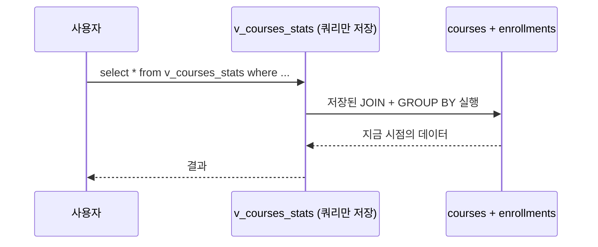

## 들어가며 (Situation)

`12_view.sql`의 시나리오는 실무 상황을 가정했다.

> LMS 데이터 분석팀은 '과정별 등록 학생 수' 통계를 매일 확인한다.
> LMS 마케팅 팀에게는 데이터분석 팀이 사용자의 전체 정보를 오픈하지 않고, 실제로 사용 될 정보인 이메일/이름만 전달하고자 한다.

매일 같은 집계 쿼리를 쓰는 건 번거롭고, 다른 팀에 테이블 전체를 보여주는 건 위험하다. 이때 쓰는 것이 **VIEW(뷰)**, 수업 표현으로는 "가상의 테이블"이다. 주석은 뷰를 쓰는 이유를 세 가지로 정리했다.

| 이유 | 수업 주석 |
|------|-----------|
| 편의성 | 복잡한 쿼리를 뷰로 만들면 하나의 간단한 테이블처럼 조회할 수 있다 |
| 보안성 | 민감한 정보를 숨기고 허용된 컬럼만 제공한다 |
| 가독성 & 속도 | 필요한 컬럼만 있어서 가독성이 높고, 조회 속도가 빨라진다 |

## 문제 상황 (Task)

"가상의 테이블"이라는 말이 모호했다. 데이터를 어딘가에 복사해 두는 것인지, 쿼리만 저장하는 것인지에 따라 세 번째 이유인 "속도"가 맞을 수도 틀릴 수도 있다. 확인할 것을 정리했다.

1. 뷰는 데이터를 저장하는가, 쿼리를 저장하는가?
2. 그렇다면 "조회 속도가 빨라진다"는 사실인가?
3. 마케팅팀용 뷰를 만들면 숨긴 열은 정말 볼 수 없는가?
4. 뷰를 통해 INSERT·UPDATE도 되는가?

## 해결 과정 (Action)

### 1. 뷰 만들고 조회하기

수업에서 만든 과정별 등록 학생 수 뷰다. [6편]({{ site.baseurl }})의 LEFT JOIN과 [5편]({{ site.baseurl }})의 GROUP BY를 합친 쿼리에 이름을 붙였다.

```sql
create view v_courses_stats as
select
    c.course_id,
    c.title,
    count(e.enrollment_id) as '등록 학생 수'
from courses as c
left join enrollments as e on c.course_id = e.course_id
group by c.course_id, c.title;
```

이후로는 테이블처럼 조회한다. 등록 학생이 3명 이상인 과정만 뽑았다.

```sql
select * from v_courses_stats where `등록 학생 수` >= 3;
```

```text
+-----------+--------------------------------------------------+-----------+-------------------+
| course_id | title                                            | status    | 등록 학생 수      |
+-----------+--------------------------------------------------+-----------+-------------------+
|         1 | 왕초보를 위한 Python 기초                        | published |                17 |
|         2 | Java와 Spring Boot로 시작하는 웹 개발            | published |                12 |
|         3 | SQL 기본부터 활용까지                            | published |                12 |
|         4 | React.js로 만드는 모던 웹 프론트엔드             | published |                 9 |
|         5 | 데이터 과학 입문 with Python                     | published |                 9 |
+-----------+--------------------------------------------------+-----------+-------------------+
5 rows in set (0.00 sec)
```

(수업 마지막에 `create or replace view`로 `status` 열을 추가했기 때문에 지금 뷰에는 `status`가 있다.)

LEFT JOIN 덕분에 수강생이 0명인 과정도 뷰에 들어 있어 뷰는 총 30행이다. 집계 쿼리를 다시 쓰지 않고 `where` 한 줄로 끝났다. 편의성은 확인됐다.

### 2. 뷰가 저장하는 것은 쿼리다

**1번 질문 확인**: `show create view`로 뷰의 정체를 봤다.

```sql
show create view v_courses_stats\G
```

```text
Create View: CREATE ALGORITHM=UNDEFINED DEFINER=`wanted`@`%` SQL SECURITY DEFINER
VIEW `v_courses_stats` AS select `c`.`course_id` AS `course_id`,`c`.`title` AS `title`,
`c`.`status` AS `status`,count(`e`.`enrollment_id`) AS `등록 학생 수`
from (`courses` `c` left join `enrollments` `e` on((`c`.`course_id` = `e`.`course_id`)))
group by `c`.`course_id`,`c`.`title`
```

나오는 건 데이터가 아니라 **내가 쓴 SELECT 문**이다. 정말 데이터를 안 갖고 있는지, 원본 테이블을 바꿔서 확인했다. 수강생이 1명인 6번 과정에 수강 기록을 하나 넣었다. (확인용 **예시 코드**, 롤백함)

```sql
start transaction;
insert into enrollments (user_id, course_id) values (1, 6);
select * from v_courses_stats where course_id = 6;   -- 2
rollback;
select * from v_courses_stats where course_id = 6;   -- 1
```

```text
+-----------+-------------------------------------------------+-----------+-------------------+
| course_id | title                                           | status    | 등록 학생 수      |
+-----------+-------------------------------------------------+-----------+-------------------+
|         6 | 파이썬 중급: 객체 지향 프로그래밍               | published |                 2 |
+-----------+-------------------------------------------------+-----------+-------------------+
...
|         6 | 파이썬 중급: 객체 지향 프로그래밍               | published |                 1 |
```

뷰를 다시 만들지 않았는데 숫자가 1 → 2 → 1로 따라 움직였다. 뷰는 조회할 때마다 저장된 쿼리를 **그 순간의 원본 테이블에 대해 다시 실행**한다. 공식 문서도 뷰를 "저장된 쿼리(stored query)"로 설명한다([MySQL 8.0 Reference - Using Views](https://dev.mysql.com/doc/refman/8.0/en/views.html)).



### 3. "속도가 빨라진다"는 사실이 아니었다

**2번 질문 확인**: 매번 쿼리를 다시 실행한다면 원본 쿼리보다 빠를 이유가 없다. `EXPLAIN`으로 확인했다.

```sql
explain select * from v_courses_stats where `등록 학생 수` >= 3;
```

```text
+----+-------------+------------+------+-----------+------+-----------------+
| id | select_type | table      | type | key       | rows | Extra           |
+----+-------------+------------+------+-----------+------+-----------------+
|  1 | PRIMARY     | <derived2> | ALL  | NULL      |  145 | NULL            |
|  2 | DERIVED     | c          | ALL  | NULL      |   31 | Using temporary |
|  2 | DERIVED     | e          | ref  | course_id |    4 | Using index     |
+----+-------------+------------+------+-----------+------+-----------------+
```

(주요 열만 남김)

`DERIVED`는 [7편]({{ site.baseurl }})에서 본 **파생 테이블**이다. 뷰 조회가 "`courses`와 `enrollments`를 조인해 집계하는 서브쿼리를 FROM에 넣은 쿼리"로 바뀌어 실행된 것이다. 원본 쿼리를 직접 쓴 것과 하는 일이 같다.

그래서 주석의 세 번째 이유를 이렇게 고쳐 적었다.

> → 뷰는 쿼리를 저장할 뿐 결과를 저장하지 않는다. 필요한 열만 보여주니 **읽기는 쉬워지지만, 실행 속도는 원본 쿼리와 같다.** 빨라지려면 인덱스([12편]({{ site.baseurl }}))처럼 원본 쿼리 자체를 개선해야 한다.

### 4. 보안 — 숨긴 열은 뷰로 볼 수 없다

**3번 질문 확인**: 수업 시나리오의 마케팅팀용 뷰는 코드가 없어서 직접 만들었다. (확인용 **예시 코드**)

```sql
create view v_marketing_users as
select name, email from users where status = 'active';

select * from v_marketing_users limit 3;
```

```text
+-----------+--------------------------+
| name      | email                    |
+-----------+--------------------------+
| 홍길동    | gildong.hong@example.com |
| 김철수    | cheolsu.kim@example.com  |
| 이영희    | younghee.lee@example.com |
+-----------+--------------------------+
```

`users`에 있는 `password_hash`를 뷰로 조회해봤다.

```sql
select password_hash from v_marketing_users;
```

```text
ERROR 1054 (42S22): Unknown column 'password_hash' in 'field list'
```

뷰 입장에서는 그런 열이 아예 없다. 단, 이것만으로 보안이 완성되지는 않는다. 마케팅팀 계정이 `users` 테이블도 직접 조회할 수 있다면 소용이 없다. 실제로는 그 계정에 **뷰에 대한 SELECT 권한만** 주고 원본 테이블 권한은 주지 않아야 한다(`GRANT`).

### 5. 뷰로 UPDATE — 되는 뷰와 안 되는 뷰

**4번 질문 확인**: `information_schema.views`에 뷰마다 수정 가능 여부가 나온다.

```sql
select table_name, is_updatable from information_schema.views where table_schema = 'wanted_lms';
```

```text
+-------------------+--------------+
| TABLE_NAME        | IS_UPDATABLE |
+-------------------+--------------+
| v_courses_stats   | NO           |
| v_marketing_users | YES          |
+-------------------+--------------+
```

수정 가능한 뷰로 이름을 바꿔봤다. (확인용 **예시 코드**, 롤백함)

```sql
start transaction;
update v_marketing_users set name = '뷰로수정' where email = 'gildong.hong@example.com';
select user_id, name from users where user_id = 1;
rollback;
```

```text
+---------+--------------+
| user_id | name         |
+---------+--------------+
|       1 | 뷰로수정     |
+---------+--------------+
```

**원본 `users` 테이블이 바뀌었다.** 뷰가 데이터를 갖고 있지 않으니 수정도 원본으로 간다. "읽기 전용으로 보여준다"고 생각하고 이런 뷰를 넘기면 원본이 수정될 수 있다는 뜻이다.

집계 뷰는 거부됐다.

```sql
update v_courses_stats set title = 'x' where course_id = 1;
```

```text
ERROR 1288 (HY000): The target table v_courses_stats of the UPDATE is not updatable
```

`등록 학생 수`는 여러 행을 센 값이라 어느 원본 행을 고쳐야 할지 정할 수 없다. 공식 문서는 `GROUP BY`, 집계 함수, `DISTINCT`, `UNION` 등이 들어간 뷰는 수정할 수 없다고 정리한다([MySQL 8.0 Reference - Updatable and Insertable Views](https://dev.mysql.com/doc/refman/8.0/en/view-updatability.html)).

| 뷰 | 구성 | IS_UPDATABLE | UPDATE 결과 |
|----|------|--------------|-------------|
| `v_marketing_users` | 단일 테이블, 열 선택 + where | YES | 원본 `users` 변경 |
| `v_courses_stats` | JOIN + GROUP BY + count | NO | ERROR 1288 |

### 6. 뷰 수정과 삭제

수업은 `drop view` 후 `create or replace view`로 `status` 열을 추가했다. `create or replace`는 뷰가 없으면 만들고 있으면 바꾸므로 `drop` 없이도 된다.

추가된 `c.status`는 `group by`에 없는데도 에러가 나지 않았다. [5편]({{ site.baseurl }})에서 본 `ONLY_FULL_GROUP_BY`가 켜져 있는데도 통과한 이유는, `course_id`가 기본 키라서 같은 `course_id` 그룹 안에서는 `status`가 하나로 정해지기 때문이다. MySQL은 이런 **함수적 종속**을 인식한다([MySQL 8.0 Reference - Detection of Functional Dependence](https://dev.mysql.com/doc/refman/8.0/en/group-by-functional-dependence.html)).

실험으로 만든 `v_marketing_users`는 `drop view`로 지웠다.

## 결과 (Result)

| 확인한 내용 | 결과 |
|-------------|------|
| `show create view` | 데이터가 아니라 SELECT 문이 저장됨 |
| 원본에 수강 기록 추가 → 롤백 | 뷰의 숫자 1 → 2 → 1 |
| 뷰 조회 실행 계획 | `DERIVED` — 원본 쿼리를 매번 실행 |
| 마케팅 뷰에서 `password_hash` | ERROR 1054 |
| 단순 뷰로 UPDATE | 원본 `users` 변경 |
| 집계 뷰로 UPDATE | ERROR 1288 |

배운 점은 다음과 같다.

- 뷰는 "이름 붙은 SELECT"다. 데이터를 복사하지 않으니 항상 최신이고, 그 대신 매번 원본 쿼리가 실행된다.
- 수업 주석의 "조회 속도가 빨라진다"는 실행 계획으로 확인해 보니 맞지 않았다. 편의성과 열 숨기기가 뷰의 진짜 장점이다.
- 단순한 뷰는 수정이 원본으로 전달된다. 다른 사람에게 줄 뷰라면 권한까지 같이 설계해야 한다.

## 더 학습하면 좋은 개념

- **`GRANT`와 권한 관리** — 뷰에만 SELECT 권한을 주고 원본 테이블 권한은 막아야 수업에서 말한 보안성이 완성된다.
- **`WITH CHECK OPTION`** — 뷰의 `where` 조건(`status = 'active'`)을 벗어나는 수정을 막는 옵션.
- **뷰 알고리즘 (MERGE / TEMPTABLE)** — `show create view`의 `ALGORITHM=UNDEFINED`가 무엇인지, 언제 파생 테이블로 실행되는지.
- **머티리얼라이즈드 뷰(Materialized View)** — 결과를 실제로 저장해서 조회를 빠르게 하는 뷰. MySQL에는 없어서 요약 테이블 + 주기적 갱신으로 흉내 낸다. 수업의 "매일 확인하는 통계"에 어울린다.

## 참고 자료

- [MySQL 8.0 Reference - Using Views](https://dev.mysql.com/doc/refman/8.0/en/views.html)
- [MySQL 8.0 Reference - CREATE VIEW Statement](https://dev.mysql.com/doc/refman/8.0/en/create-view.html)
- [MySQL 8.0 Reference - Updatable and Insertable Views](https://dev.mysql.com/doc/refman/8.0/en/view-updatability.html)
- [MySQL 8.0 Reference - View Processing Algorithms](https://dev.mysql.com/doc/refman/8.0/en/view-algorithms.html)
- [MySQL 8.0 Reference - Detection of Functional Dependence](https://dev.mysql.com/doc/refman/8.0/en/group-by-functional-dependence.html)

---

**요약**
1. 뷰는 데이터가 아니라 SELECT 문을 저장하며, 원본 테이블이 바뀌면 뷰 결과도 즉시 따라 바뀐다(등록 학생 수 1 → 2 → 1).
2. 뷰 조회는 실행 계획상 원본 쿼리를 파생 테이블로 매번 실행하므로, 수업 주석의 "조회 속도 향상"은 맞지 않고 편의성과 열 숨기기가 진짜 장점이다.
3. 단일 테이블 뷰는 UPDATE가 원본까지 바꾸고 집계 뷰는 ERROR 1288로 거부되므로, 남에게 줄 뷰는 GRANT 권한과 함께 설계해야 한다.
