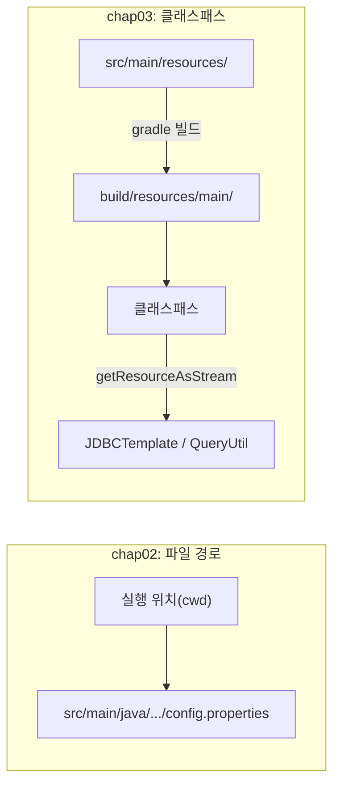

## 들어가며 (Situation)

`chap03-crud`를 만들면서 `chap02`의 공통 코드도 같이 바뀌었다. 연결을 만드는 `JDBCTemplate`, SQL을 읽는 `QueryUtil`(새로 추가), 설정 파일 위치가 대표적이다. 이 글은 두 프로젝트의 `JDBCTemplate`를 나란히 놓고 **무엇이 왜 바뀌었는지** 정리한 기록이다. 계층 분리는 [앞 글]()에서 다뤘으니, 여기서는 설정·자원 관리만 본다.

```text
chap02-statement                          chap03-crud
src/main/java/.../config/jdbc-config.properties   →   src/main/resources/db-info.properties
src/main/java/.../menu-query.xml                  →   src/main/resources/queries.xml
common/JDBCTemplate (getConnection + close x3)    →   global/config/JDBCTemplate (getConnection만)
                                                       global/common/QueryUtil (SQL 로딩)
```

## 문제 상황 (Task)

[XML 분리 글]()에서 `chap02`의 코드가 **상대 경로**(`src/main/java/...`)로 파일을 읽는 탓에 다른 폴더에서 실행하면 `FileNotFoundException`이 난다는 것을 확인했다. `chap02`의 `JDBCTemplate`에는 문제가 몇 가지 더 보였다.

1. `getConnection()`을 부를 때마다 설정 파일을 **매번 다시 읽는다**.
2. 디버깅용 출력에서 `System.out.println("prop = " + prop);`가 **비밀번호가 담긴 설정 전체**를 찍는다.
3. 자원을 닫는 `close()` 메서드가 `Connection`, `Statement`, `ResultSet`마다 하나씩 있고, 호출하는 쪽이 `finally`에서 일일이 불러야 한다.

## 해결 과정 (Action)

### 1. 설정 파일을 클래스패스로 옮기기

`chap03`의 설정과 SQL 파일은 `src/main/resources/` 아래에 있다. Gradle은 빌드할 때 이 폴더의 파일을 `build/resources/main/`으로 복사하고, 실행 시 **클래스패스**에 포함한다. 읽는 코드는 이렇게 바뀌었다.

| 항목 | chap02 | chap03 |
|------|--------|--------|
| 위치 | `src/main/java/.../jdbc-config.properties` | `src/main/resources/db-info.properties` |
| 읽는 방법 | `new FileReader("src/main/java/...")` (실행 위치 기준 상대 경로) | `getClassLoader().getResourceAsStream("db-info.properties")` |
| 실행 위치 의존 | 있음 | 없음 |

```java
// chap03 JDBCTemplate
prop.load(JDBCTemplate.class.getClassLoader().getResourceAsStream("db-info.properties"));
```

효과를 직접 확인했다. 컴파일한 결과물을 프로젝트 폴더가 **아닌 다른 폴더**에서 실행했다. (확인용 **예시 명령**)

```text
# chap03 (클래스패스) — 다른 폴더에서 실행
실습 TEST
1. 메뉴 전체 조회
메뉴를 입력해주세요 :  메뉴 전체 조회 리스트!
MenuDTO{menuCode=1, ...}
```

`chap02`는 같은 상황에서 `FileNotFoundException`이었지만 `chap03`은 정상 실행됐다. 파일이 프로젝트 폴더가 아니라 **클래스패스 안**에 있기 때문이다.



### 2. 실패 방식도 확인 — 리소스가 클래스패스에 없으면

클래스패스에 리소스를 넣지 않고 같은 프로그램을 실행해 봤다.

```text
Exception in thread "main" java.lang.ExceptionInInitializerError
Caused by: java.lang.NullPointerException: inStream parameter is null
```

`getResourceAsStream()`은 파일이 없을 때 예외 대신 **`null`을 반환**하고, 그 `null`을 `prop.load()`에 넘기면서 `NullPointerException`이 났다. `static` 블록 안에서 터졌기 때문에 `ExceptionInInitializerError`로 감싸져 나왔다. 코드의 `catch (IOException e)`는 이 경우를 잡지 못한다. 원인이 "파일 없음"이라는 것을 메시지만으로는 알아채기 어려워서, 설정 파일 이름 오타가 생겼을 때를 대비해 기억해 둘 만한 실패 모양이다.

### 3. 매번 읽던 설정을 한 번만 읽기 — `static` 블록

```java
private static final Properties prop = new Properties();

// static 블록은 정적 코드 블록으로서 클래스가 로드 될 때 한 번만 실행된다.
static {
    try {
        prop.load(JDBCTemplate.class.getClassLoader().getResourceAsStream("db-info.properties"));
    } catch (IOException e) {
        throw new RuntimeException(e);
    }
}

public static Connection getConnection() throws SQLException {
    return DriverManager.getConnection(
            prop.getProperty("db.url"), prop.getProperty("db.username"), prop.getProperty("db.password"));
}
```

`static` 블록은 클래스가 처음 로드될 때 한 번만 실행된다. 이제 `getConnection()`을 몇 번 불러도 파일은 한 번만 읽는다. `QueryUtil`도 같은 패턴으로 `queries.xml`을 한 번 읽어 두고 `getQuery(key)`로 꺼내 쓴다.

```java
public static String getQuery(String key) {
    return queries.getProperty(key).trim();
}
```

[XML 글]()에서 본 XML 값 앞뒤의 줄바꿈·공백을 `trim()`으로 정리하는 곳이 여기다. SQL 키도 `findMenuByMenuName`에서 `menu.findAll`처럼 **`도메인.동작`** 형태로 바뀌었다.

### 4. 연결을 새로 만든다는 점은 그대로

`chap03`의 `JDBCTemplate` 주석은 이렇게 명시한다. "커넥션 풀 없이 DriverManager 로 직접 커넥션을 생성한다. `getConnection()` 을 호출할 때마다 새로운 물리 연결이 만들어지고, `close()` 를 호출하면 실제로 DB 와의 연결이 끊어진다." 설정 파일은 한 번 읽지만 **연결은 요청마다 새로 맺는다.** 학습용 프로젝트에서는 단순해서 좋고, 요청이 많아지면 커넥션 풀이 필요한 부분이다.

### 5. 불필요해진 코드 정리

`chap02`의 `getConnection()`에 있던 두 가지가 `chap03`에서 사라졌다.

| 제거된 코드 | 이유 |
|-------------|------|
| `Class.forName(driver)` | JDBC 4.0 이후 드라이버는 클래스패스에서 자동 등록된다. `DriverManager` API 문서에도 명시적 로딩이 필요 없다고 되어 있다. |
| `System.out.println("prop = " + prop)` 등 디버깅 출력 | 설정 전체와 연결 정보를 콘솔에 남긴다. 비밀번호가 담긴 값이므로 제거하는 것이 맞다. |

특히 두 번째가 중요했다. `chap02`의 코드를 실제로 실행하면 `prop = {...}` 줄에 설정 파일의 비밀번호까지 그대로 찍힌다. 이 글의 실행 결과에서는 해당 줄을 제외했다.

### 6. `close()` 세 개를 try-with-resources로

`chap02`의 방식은 이랬다.

```java
Connection con = getConnection();
PreparedStatement pstmt = null;
ResultSet rset = null;
try {
    ...
} catch (SQLException e) {
    throw new RuntimeException(e);
} finally {
    close(con);
    close(rset);
    close(pstmt);
}
```

`chap03`의 `MenuService`는 이렇게 바뀌었다. 수업 주석은 이렇다. "try-catch 절은 사용한 자원을 finally 구문에서 수동 해제해야 한다. try() 소괄호 내부 자원을 자동 해제 해준다."

```java
try (Connection con = JDBCTemplate.getConnection()) {
    return new MenuDAO(con).findAll();
} catch (SQLException e) {
    throw new RuntimeException(e);
}
```

| 비교 | try-catch-finally + `close()` | try-with-resources |
|------|-------------------------------|--------------------|
| 닫는 코드 | 직접 작성 (`finally`) | 자동 (`AutoCloseable.close()`) |
| 닫는 순서 | 직접 맞춰야 함 (chap02는 con → rset → pstmt) | 선언의 **역순**으로 자동 |
| 닫기 깜빡할 가능성 | 있음 | 없음 |
| 공통 `close()` 헬퍼 | 필요 | 불필요 (그래서 chap03 `JDBCTemplate`에서 삭제) |

`Connection`, `PreparedStatement`, `ResultSet`이 모두 `AutoCloseable`을 구현하기 때문에 가능하다. `MenuDAO`에서도 `try (PreparedStatement pstmt = ...)`가 같은 방식으로 쓰였다.

### 7. 아직 남은 일: 비밀번호가 든 파일

`db-info.properties`에 DB 사용자와 비밀번호가 평문으로 들어 있다. 학습용 로컬 DB라 지금은 문제가 되지 않지만, 이 파일이 저장소에 올라가면 안 된다. 실제 프로젝트라면 이 파일을 `.gitignore`에 넣거나 환경 변수로 주입해야 한다. 이번에는 `.gitignore` 설정까지는 확인하지 않았고, 이 글의 설정 예시에는 비밀번호 값을 싣지 않았다.

```properties
db.url=jdbc:mysql://localhost:3306/menudb
db.username=...
db.password=...
```

## 결과 (Result)

| 항목 | chap02 (Before) | chap03 (After) |
|------|-----------------|----------------|
| 다른 폴더에서 실행 | `FileNotFoundException` | 정상 실행 |
| 설정 파일 읽기 횟수 | `getConnection()`마다 1회 | 클래스 로드 시 1회 |
| 비밀번호 콘솔 출력 | 있음 (`prop = {...}`) | 없음 |
| `Class.forName` | 있음 | 없음 |
| `close()` 헬퍼 | 3개 + 호출 코드 | 0개 (try-with-resources) |
| 리소스 누락 시 오류 | — | `ExceptionInInitializerError` (NPE) |

배운 점은 다음과 같다.

- 파일을 경로로 읽으면 **실행 위치**에 코드가 묶인다. 클래스패스로 읽으면 빌드 결과물과 함께 다닌다.
- 설정처럼 바뀌지 않는 값은 `static` 블록에서 한 번만 읽는다. 단, 실패하면 클래스 초기화 오류로 나타난다.
- "닫아야 한다"는 규칙을 사람이 기억하게 하는 대신 문법(try-with-resources)으로 강제하는 편이 안전하다.

## 더 학습하면 좋은 개념

- **클래스로더(ClassLoader)와 클래스패스** — `getResourceAsStream`이 어디서 파일을 찾는지. 리소스를 못 찾는 문제의 대부분이 여기서 풀린다.
- **커넥션 풀(HikariCP)** — 요청마다 물리 연결을 맺는 비용을 없애는 방법. Spring Boot의 기본 풀이기도 하다.
- **AutoCloseable과 suppressed exception** — try-with-resources에서 본문과 `close()` 둘 다 예외가 났을 때 어떻게 처리되는지.
- **설정 외부화(환경 변수, 프로파일)** — 비밀번호를 코드/저장소 밖에서 주입하는 방법. 이후 배포 단계에서 필수다.
- **`static` 초기화와 클래스 로딩 시점** — `ExceptionInInitializerError`가 왜 한 번 나면 같은 클래스를 다시 못 쓰는지.

## 참고 자료

- [Java SE 21 API - ClassLoader (getResourceAsStream)](https://docs.oracle.com/en/java/javase/21/docs/api/java.base/java/lang/ClassLoader.html)
- [Java SE 21 API - DriverManager](https://docs.oracle.com/en/java/javase/21/docs/api/java.sql/java/sql/DriverManager.html)
- [Java SE 21 API - Properties](https://docs.oracle.com/en/java/javase/21/docs/api/java.base/java/util/Properties.html)
- [The Java Tutorials - The try-with-resources Statement](https://docs.oracle.com/javase/tutorial/essential/exceptions/tryResourceClose.html)

---

**요약**
1. 설정과 SQL 파일을 `src/main/resources`로 옮겨 `getResourceAsStream`으로 읽으면 실행 위치와 상관없이 동작하고, `static` 블록으로 한 번만 읽는다.
2. `chap03`의 `JDBCTemplate`에서는 `Class.forName`과 비밀번호까지 찍던 디버깅 출력이 사라졌고, 연결은 여전히 요청마다 새로 맺는다.
3. try-with-resources가 `close()` 헬퍼 세 개와 `finally` 블록을 대체해 자원 해제를 문법으로 보장한다.
