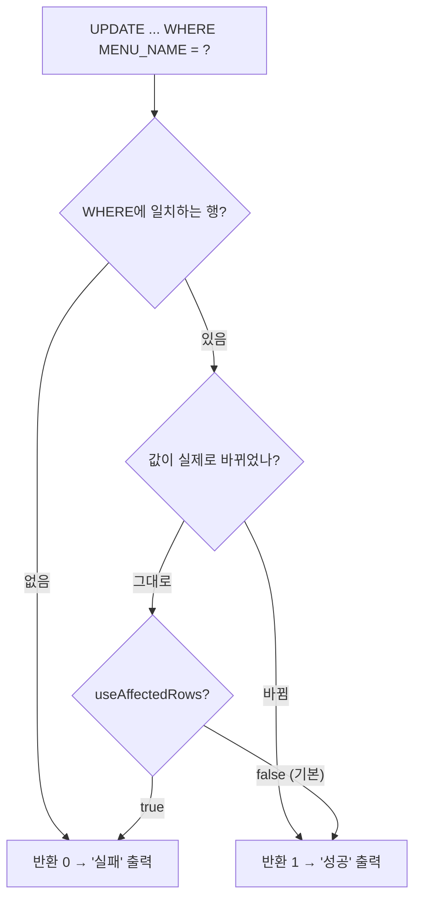

## 들어가며 (Situation)

`b_preparedstatements`의 마지막 파일 `Application04.java`는 처음으로 **데이터를 바꾸는** 실습이었다. 메뉴 이름과 새 가격을 입력받아 `TBL_MENU`의 가격을 수정한다. 수업 주석이 CRUD와 JDBC 메서드의 대응을 정리해 준다.

> CRUD (Create, Read, Update, Delete)
> - READ : 조회 - SELECT
> - DML : C , U , D 데이터 조작
> SELECT 의 경우 executeQuery() 메서드를 활용해서 조회의 결과를 ResultSet 으로 전달 받는다.
> DML 의 경우 executeUpdate() 메서드를 활용한다. DML 은 조회가 아니기 때문에 ResultSet 필요없다.

| 작업 | SQL | JDBC 메서드 | 반환 |
|------|-----|-------------|------|
| Read | `SELECT` | `executeQuery()` | `ResultSet` |
| Create / Update / Delete | `INSERT` / `UPDATE` / `DELETE` | `executeUpdate()` | `int` (영향 받은 행 수) |

SQL은 `menu-query.xml`의 `modifyMenuPriceByMenuName`이고, 핵심 코드는 이렇다.

```java
pstmt = con.prepareStatement(query);

pstmt.setInt(1, price);         // SET MENU_PRICE = ?
pstmt.setString(2, menuName);   // WHERE MENU_NAME = ?

// C U D 작업을 할 때 사용되는 메서드
// 반환 타입 int : DML 수행 후 영향을 받은 행의 수를 return
result = pstmt.executeUpdate();
```

```java
if (result > 0) {
    System.out.println(menuName + " 메뉴 가격 수정 성공! (영향 받은 행 : " + result + ")");
} else {
    System.out.println(menuName + "메뉴 가격 변경 실패! 메뉴 이름을 다시 확인해주세요");
}
```

수업 주석은 "UPDATE가 정상 실행되면 `result`가 0 초과, 비정상이면 0"이라고 설명한다.

## 문제 상황 (Task)

`result > 0`이면 "수정 성공"이라고 출력하는 로직에서 확인해 볼 지점이 보였다. 같은 값으로 다시 수정하면 **바뀐 게 없는데도** 1이 나올 수 있다는 점이다. 확인할 것은 다음과 같다.

1. `executeUpdate()`의 반환값은 정확히 무엇을 센 숫자인가?
2. 이름이 일치하지 않을 때, 같은 가격으로 수정할 때, 전체 행을 수정할 때는 각각 얼마가 나오는가?
3. `result > 0`은 성공 판단 기준으로 충분한가?

## 해결 과정 (Action)

### 1. 실험 환경 — 진짜 테이블을 건드리지 않기

`TBL_MENU`는 다음 수업에서도 쓰는 데이터라 직접 수정하지 않았다. `CREATE TEMPORARY TABLE tmp_menu AS SELECT * FROM tbl_menu`로 **같은 연결에서만 보이는 임시 복사본**을 만들어 수업 코드와 같은 형태의 UPDATE를 실행했다. 임시 테이블은 연결이 닫히면 사라지고, 실제 `TBL_MENU`는 변하지 않는다. (확인용 **예시 코드**)

```java
String upd = "UPDATE tmp_menu SET MENU_PRICE = ? WHERE MENU_NAME = ?";
try (PreparedStatement ps = c.prepareStatement(upd)) {
    ps.setInt(1, 9999); ps.setString(2, "열무김치라떼");
    System.out.println("update new price  -> " + ps.executeUpdate());
    ps.setInt(1, 9999); ps.setString(2, "열무김치라떼");
    System.out.println("update same price -> " + ps.executeUpdate());
    ps.setInt(1, 1);    ps.setString(2, "없는메뉴");
    System.out.println("update no match   -> " + ps.executeUpdate());
}
```

### 2. 기본 설정에서의 결과

```text
update new price   -> 1     (4500 → 9999, 실제로 바뀜)
update same price  -> 1     (9999 → 9999, 바뀐 값 없음!)
update no match    -> 0     (일치하는 행 없음)
update all rows    -> 36    (UPDATE tmp_menu SET MENU_PRICE = MENU_PRICE)
```

두 번째가 확인하려던 부분이다. **값이 하나도 바뀌지 않았는데 1이 반환됐다.** 마지막 줄도 `MENU_PRICE = MENU_PRICE`라 값이 전부 그대로인데 36이 나왔다. 따라서 이 숫자는 "실제로 값이 바뀐 행"이 아니라 **WHERE 조건에 일치한 행**의 수였다.

### 3. 원인: MySQL의 두 가지 "행 수"

MySQL은 UPDATE 후 두 숫자를 구분한다. 앞의 [트랜잭션 글]()에도 나온 `Rows matched: 1  Changed: 1` 출력이 바로 그것이다.

| 용어 | 의미 |
|------|------|
| matched (found rows) | WHERE 조건에 **일치한** 행 수 |
| changed (affected rows) | 값이 **실제로 바뀐** 행 수 |

JDBC가 어느 쪽을 돌려줄지는 Connector/J의 `useAffectedRows` 옵션이 정한다. [Connector/J 설정 문서](https://dev.mysql.com/doc/connector-j/en/connector-j-reference-configuration-properties.html)에서 기본값은 `false`다. 즉 기본 설정에서는 **일치한 행 수**를 돌려준다. 옵션을 켜고 같은 실험을 다시 했다.

```java
"jdbc:mysql://localhost/menudb?useAffectedRows=true"
```

```text
[useAffectedRows] first  -> 1   (값이 바뀜)
[useAffectedRows] same   -> 0   (같은 값 → 바뀐 행 없음)
```

| 상황 | 기본값 (`false`) | `useAffectedRows=true` |
|------|------------------|------------------------|
| 값이 바뀜 | 1 | 1 |
| 같은 값으로 수정 | **1** | **0** |
| 일치하는 행 없음 | 0 | 0 |



### 4. `result > 0` 판단은 충분한가

우리 코드의 "실패" 출력은 `result == 0`, 즉 **일치하는 행이 없을 때**만 일어난다. 이름 오타를 잡아내는 용도로는 정확히 맞는다. 실패 메시지가 "메뉴 이름을 다시 확인해주세요"인 것도 같은 이유다.

반면 "수정 성공!"은 정확히는 **"조건에 맞는 메뉴를 찾았다"**는 뜻이다. 같은 가격을 입력해도 성공으로 나온다. 이 실습 정도에서는 문제가 아니고, 오히려 사용자가 같은 값을 보낸 것을 실패로 볼 이유도 없다. 다만 "실제로 변경된 행 수"가 필요한 업무(변경 이력 기록 등)라면 `useAffectedRows`를 켜거나 UPDATE 전에 조회해 값을 비교해야 한다.

### 5. 커밋은 어디서 하나

`Application04`에는 `commit()`이 없는데도 수정이 DB에 반영된다. JDBC 연결은 기본이 **auto-commit 모드**라서 `executeUpdate()`가 끝나는 즉시 커밋되기 때문이다. 하나의 작업이 여러 UPDATE로 이뤄진다면 이 기본값이 위험해진다. [계좌이체 예제]()처럼 묶어야 하는 경우 `setAutoCommit(false)`로 바꾸고 직접 `commit()`/`rollback()`을 호출해야 한다. 이번 실습에서는 단일 UPDATE만 있어서 다루지 않았다.

### 6. 입력 순서 주의

`Application04`는 `sc.nextLine()`으로 메뉴 이름을 먼저 읽고 `sc.nextInt()`로 가격을 읽는다. 이 순서라서 문제없다. 반대 순서(`nextInt()` 후 `nextLine()`)로 읽으면 가격 입력 뒤의 줄바꿈이 `nextLine()`에 걸려 빈 문자열이 된다. 이번 코드는 순서가 맞아서 확인만 하고 넘어갔다.

## 결과 (Result)

| 상황 | 반환값 (기본) | 출력 메시지 |
|------|---------------|-------------|
| 이름 일치 + 값 변경 | 1 | 수정 성공 |
| 이름 일치 + 같은 값 | **1** | 수정 성공 (실제 변화 없음) |
| 이름 불일치 | 0 | 변경 실패 |
| 전체 행 대상, 값 동일 | 36 | — |

배운 점은 다음과 같다.

- `executeUpdate()`의 반환값은 Connector/J 기본 설정에서 **WHERE에 일치한 행 수**다. "값이 바뀐 행 수"가 아니다.
- 그래서 `result > 0`은 "대상을 찾았다"를 검사하는 데는 정확하지만, "실제로 바뀌었다"를 보장하지 않는다.
- 이 차이는 `useAffectedRows` 옵션으로 바꿀 수 있고, 오늘 임시 테이블로 두 경우를 모두 재현했다. 실제 `TBL_MENU`는 건드리지 않았다.

## 더 학습하면 좋은 개념

- **auto-commit과 트랜잭션 경계** — JDBC의 `setAutoCommit(false)`, `commit()`, `rollback()`. 여러 DML을 묶을 때 필수다.
- **`execute()`와 `executeBatch()`** — 쿼리 종류를 모를 때 쓰는 메서드와, 여러 DML을 한꺼번에 보내는 배치 방식이다.
- **`getGeneratedKeys()`** — `INSERT` 후 자동 증가 키(`MENU_CODE` 같은)를 돌려받는 방법. 다음 CRUD 단계에서 만나게 된다.
- **낙관적 락(Optimistic Lock)** — "내가 읽은 뒤 바뀌지 않았을 때만 UPDATE"를 `WHERE`와 반환 행 수로 검사하는 패턴이다. 오늘의 행 수 판단과 직접 연결된다.
- **`Scanner`의 줄바꿈 처리** — 입력 메서드 순서에 따라 값이 빈 문자열이 되는 이유.

## 참고 자료

- [Java SE 21 API - PreparedStatement (executeUpdate)](https://docs.oracle.com/en/java/javase/21/docs/api/java.sql/java/sql/PreparedStatement.html)
- [MySQL Connector/J Developer Guide - Configuration Properties](https://dev.mysql.com/doc/connector-j/en/connector-j-reference-configuration-properties.html)

---

**요약**
1. DML(INSERT/UPDATE/DELETE)은 `executeUpdate()`로 실행하고 영향 받은 행 수를 `int`로 돌려받으며, SELECT와 달리 `ResultSet`이 필요 없다.
2. Connector/J 기본 설정에서는 값이 그대로여도 WHERE에 일치하면 1이 반환되고, `useAffectedRows=true`일 때만 실제 변경된 행 수(0)가 반환된다.
3. `result > 0`은 "대상 메뉴를 찾았다"를 확인하는 용도로 충분하지만 "값이 바뀌었다"의 증거는 아니다.
