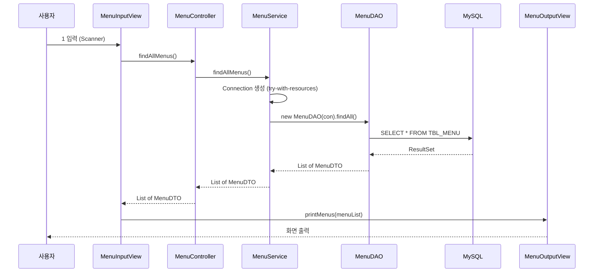

## 들어가며 (Situation)

오전까지의 실습(`chap02-statement`)은 `main()` 하나가 모든 일을 했다. 입력받고, 연결하고, SQL을 만들고, 실행하고, 결과를 출력했다. 오후에는 새 프로젝트 `chap03-crud`를 만들어 같은 일을 **역할별 클래스**로 나누는 구조를 배웠다. 첫 기능은 "메뉴 전체 조회" 하나뿐이다.

```text
com.wanted.restaurant
├── Application.java              ← 객체 조립 + 시작
├── global
│   ├── common/QueryUtil.java     ← XML에서 SQL 읽기
│   └── config/JDBCTemplate.java  ← Connection 생성
└── menu
    ├── controller/MenuController.java
    ├── model
    │   ├── dto/MenuDTO.java
    │   ├── service/MenuService.java
    │   └── dao/MenuDAO.java
    └── view
        ├── input/MenuInputView.java
        └── output/MenuOutputView.java
```

클래스마다 맨 위에 "이 계층이 해야 할 일 / 하면 안 되는 일"이 주석으로 적혀 있었다. 이 글은 그 주석을 코드와 대조하며 이해한 기록이다.

## 문제 상황 (Task)

`chap02`의 방식으로 기능을 계속 늘리면 어떻게 될지 먼저 생각해 봤다. 조회·등록·수정·삭제마다 `main()`에 Scanner, SQL, `ResultSet` 변환, 출력이 뒤섞이고, 메뉴 기능이 늘면 한 파일이 점점 길어진다. 그래서 확인할 질문은 다음과 같았다.

1. 각 계층은 정확히 무엇을 책임지고, 무엇을 하면 안 되는가?
2. 사용자의 입력 한 번이 계층 사이를 어떤 순서로 흐르는가?
3. 클래스를 나누면 서로를 어떻게 연결(조립)하는가?

## 해결 과정 (Action)

### 1. 계층별 책임 정리

각 클래스 주석을 표로 정리했다.

| 계층 | 클래스 | 해야 할 일 | 하면 안 되는 일 |
|------|--------|------------|-----------------|
| View (입력) | `MenuInputView` | Scanner로 입력받기, Controller 호출, OutputView에 출력 요청 | SQL 작성, 비즈니스 로직, commit/rollback |
| View (출력) | `MenuOutputView` | 결과를 화면에 출력 | (입력·DB 접근) |
| Controller | `MenuController` | View의 요청을 받아 알맞은 Service 호출, 필요시 DTO 조립·간단한 검증 | Scanner 입력, 비즈니스 로직, SQL |
| Service | `MenuService` | DAO 호출, 데이터 검증·가공, 여러 DAO 조합, **트랜잭션(commit/rollback)과 Connection 생성**, 예외 처리 | (화면·SQL 직접 작성) |
| DAO | `MenuDAO` | SQL 실행, Statement 생성, 파라미터 바인딩, `ResultSet` → 자바 객체 변환 | (비즈니스 로직) |
| DTO | `MenuDTO` | 데이터를 계층 사이로 나르는 그릇 | (동작 로직) |

"Controller는 View와 Service 사이를 연결하는 커맨드 센터"라는 주석이 인상적이었다. 지금 코드에서 `MenuController.findAllMenus()`는 `menuService.findAllMenus()`를 호출해 그대로 돌려주는 한 줄짜리다. 아직 검증할 로직이 없어서 얇은 것이고, 나중에 요청 검증이 생기면 이 자리에 들어간다고 이해했다.

### 2. 요청 한 번의 흐름

사용자가 `1`(메뉴 전체 조회)을 입력했을 때 코드를 따라가 보면 다음 순서다.



실제로 컴파일해서 `1`을 입력하며 실행한 결과다.

```text
실습 TEST
1. 메뉴 전체 조회
메뉴를 입력해주세요 :  메뉴 전체 조회 리스트!
MenuDTO{menuCode=1, menuName='열무김치라떼', menuPrice=4500, categoryCode=8, orderableStatus='Y'}
MenuDTO{menuCode=2, menuName='우럭스무디', menuPrice=5000, categoryCode=10, orderableStatus='Y'}
...
```

### 3. 객체 조립 — `Application`

클래스를 나누면 서로를 알아야 한다. `Application.main()`이 그 연결을 맡는다.

```java
MenuService service = new MenuService();
MenuController controller = new MenuController(service);
MenuOutputView outputView = new MenuOutputView();
MenuInputView inputView = new MenuInputView(controller, outputView);

inputView.displayMainView();
```

의존 방향은 `InputView → Controller → Service → DAO` 한 방향이다. 각 클래스는 필요한 객체를 **생성자로 전달받는다**(`private final MenuService menuService`). 직접 `new`하지 않고 밖에서 받는 이유는 수업 주석에 있었다. "추후 배울 Spring 에서는 Application 이 실행되면 모든 객체가 조립이 된다. 지금은 그 구조를 미리 맛보기 형태로 작성해본다." 지금은 우리가 손으로 하는 일을 Spring이 대신해 준다는 뜻이다.

### 4. DAO는 Connection을 받는다

`chap02`에서는 `getConnection()`을 `main()`이 직접 호출했다. 이번에는 이렇게 바뀌었다.

```java
// MenuService
try (Connection con = JDBCTemplate.getConnection()) {
    return new MenuDAO(con).findAll();
} catch (SQLException e) {
    throw new RuntimeException(e);
}

// MenuDAO
public MenuDAO(Connection connection) { this.connection = connection; }
```

**Connection을 만드는 곳은 Service, 쓰는 곳은 DAO**다. 이유는 Service의 책임 목록에 있다. "트랜잭션 처리(commit, rollback) & Connection 생성." 한 서비스 메서드 안에서 DAO를 여러 번 호출해도 **같은 Connection**을 쓰면 하나의 트랜잭션으로 묶을 수 있다. 예를 들어 "메뉴 등록 + 카테고리 등록"을 한 번에 commit/rollback하려면 DAO가 Connection을 스스로 만들면 안 된다.

### 5. DTO가 조금 바뀐 부분

`chap02`의 `MenuDTO`와 비교하니 `orderableStatus` 타입이 달랐다.

| 항목 | chap02 | chap03 |
|------|--------|--------|
| `orderableStatus` 타입 | `char` | `String` |
| DAO에서 변환 | `getString(...).charAt(0)` | `getString(...)` 그대로 |

`CHAR(1)` 컬럼을 `char`로 받으려면 `charAt(0)`이 필요했는데, `String`이면 변환이 필요 없다. 출력에서도 `orderableStatus='Y'`처럼 따옴표가 붙어 나오는 이유가 이것이다. 어느 쪽이 더 낫다고 단정하기보다, 이번 단계에서는 변환 코드를 줄인 선택으로 이해했다.

### 6. 확인한 빈틈 두 가지

**메뉴 번호 9를 입력하면?** `MenuInputView`의 `switch`에 `case 1`만 있고 `default`가 없다. 실제로 9를 입력하니 아무 메시지 없이 프로그램이 끝났다. 지금은 메뉴가 하나라 괜찮지만 기능이 늘면 `default`가 필요하다.

**ResultSet은 누가 닫나?** `MenuDAO.findAll()`은 `PreparedStatement`만 try-with-resources로 열고 `ResultSet`은 따로 닫지 않는다. [Statement API 문서](https://docs.oracle.com/en/java/javase/21/docs/api/java.sql/java/sql/Statement.html)에는 Statement를 닫으면 그 Statement의 현재 `ResultSet`도 닫힌다고 되어 있어서, 이 코드는 의도대로 동작한다고 이해했다.

## 결과 (Result)

| 항목 | chap02 (Before) | chap03 (After) |
|------|-----------------|----------------|
| 입력·SQL·출력 위치 | `main()` 한 곳 | View / DAO / OutputView로 분리 |
| Connection 생성·종료 | `main()`에서 수동 `close()` | Service에서 try-with-resources |
| 객체 연결 | 없음 | `Application`에서 생성자로 조립 |
| 클래스 수 | 예제당 1~2개 | 기능 하나에 9개 (설정·유틸 포함) |

- 기능 하나를 위한 클래스가 9개로 늘었다. 지금은 오히려 번거롭지만, 수정·삭제·등록이 같은 구조로 늘어날 때 **어디를 고쳐야 하는지 명확해지는** 것이 이득이다.
- "이 코드를 어느 계층에 둘까"를 판단할 때 주석의 "하면 안 되는 일" 목록이 기준이 된다.
- 실행 결과는 `chap02`와 같은 36개 메뉴가 `MenuDTO`로 출력됐다. 구조만 바뀌고 동작은 같다.

## 더 학습하면 좋은 개념

- **의존성 주입(DI)과 제어의 역전(IoC)** — `Application`이 생성자로 객체를 넘기는 것이 그 맛보기다. Spring이 이 조립을 자동화한다.
- **관심사의 분리(Separation of Concerns)** — 계층을 나누는 근본 이유. 입력·비즈니스·저장을 따로 바꿀 수 있게 한다.
- **MVC 패턴** — Model/View/Controller. 지금 구조는 콘솔 버전이고 웹에서는 Controller가 HTTP 요청을 받는다.
- **트랜잭션 경계와 Service 계층** — Service가 Connection을 만드는 이유. 여러 DAO 호출을 한 트랜잭션으로 묶는 단위다. [트랜잭션 글]()과 이어진다.
- **DTO vs Entity** — DB 행을 나르는 그릇과 도메인 객체의 차이. JPA를 배울 때 다시 만난다.

## 참고 자료

- [Java SE 21 API - Statement](https://docs.oracle.com/en/java/javase/21/docs/api/java.sql/java/sql/Statement.html)
- [Java SE 21 API - Connection](https://docs.oracle.com/en/java/javase/21/docs/api/java.sql/java/sql/Connection.html)

---

**요약**
1. `chap03-crud`는 `main()` 하나에 몰려 있던 코드를 View → Controller → Service → DAO 계층으로 나눠, 각 계층이 "해야 할 일 / 하면 안 되는 일"을 갖게 했다.
2. `Application`이 생성자로 객체를 조립하고, Connection은 Service가 만들어 DAO에 넘겨 나중에 여러 DAO 호출을 한 트랜잭션으로 묶을 수 있게 했다.
3. 구조는 바뀌었지만 실행 결과(메뉴 36개 출력)는 같고, `switch`에 `default`가 없어 잘못된 번호가 조용히 무시되는 빈틈이 남아 있다.
