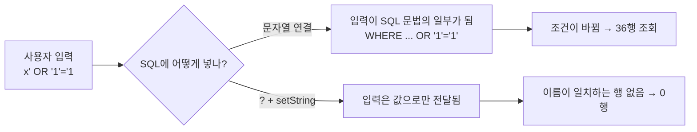

## 들어가며 (Situation)

오늘 두 번째 실습(`b_preparedstatements/Application02.java`)은 지난 시간에 풀었던 요구사항을 `PreparedStatement`로 다시 푸는 것이었다.

> Scanner 를 사용해서 메뉴 이름을 전달받아 그 메뉴의 메뉴번호, 메뉴가격, 판매상태를 출력하라.
> 출력예시 : 날치알스크류바 의 정보 : 1 , 3000 원 , Y

지난 시간(`a_statements/Application02`)의 풀이는 `SELECT * FROM TBL_MENU`로 **전체를 가져온 뒤 자바에서 `equals()`로 걸러내는** 방식이었다. 오늘 코드는 SQL 안에 조건을 넣는다.

```java
pstmt = con.prepareStatement(
        "SELECT MENU_CODE, MENU_PRICE, ORDERABLE_STATUS FROM TBL_MENU WHERE MENU_NAME = ?");
// ? 의 갯수에 따라 parameterIndex 가 결정된다.
// ? 는 반드시 set 메서드로 값을 채워주어야 한다.
pstmt.setString(1, menuName);

rset = pstmt.executeQuery();
```

수업 주석은 `?`(placeholder)가 필요한 이유를 이렇게 적었다.

> statement 는 sql 구문에 java 변수 삽입 시 불편한 점이 있다. ex) `"'" + menuName + "'"` 문자열 입력 시 '' 추가
> java 변수를 직접 삽입하는 것이 아닌 ? 로 두고 메서드로 채워준다.

## 문제 상황 (Task)

"따옴표 붙이기가 불편하다"는 말은 이해됐지만, 불편함 이상의 문제가 있을 것 같았다. 사용자가 입력한 문자열이 SQL 안으로 **그대로** 들어가기 때문이다. 확인할 질문은 세 가지였다.

1. 문자열을 이어 붙인 SQL에 특수한 입력(작은따옴표 등)이 들어가면 어떻게 되는가?
2. 같은 입력을 `?`로 넘기면 무엇이 달라지는가?
3. 전체 조회 후 자바에서 거르는 방식과 `WHERE ?`는 DB에서 무엇이 다른가?

## 해결 과정 (Action)

### 1. 정상 입력은 둘 다 똑같다

먼저 `Application02`를 `열무김치라떼`로 실행했다.

```text
메뉴 이름 : 열무김치라떼의 정보 : 1, 4500 원, Y
```

문자열 연결 방식 `"... WHERE menu_name = '" + in + "'"`과 `?` 방식 모두 1행이 나왔다. 정상 입력만 보면 차이를 알 수 없다. 이제부터는 **이상한 입력**을 넣어 비교했다. (확인용 **예시 코드**, 조회만 실행)

### 2. 입력에 작은따옴표를 넣으면

메뉴 이름이 `it's`라고 가정하고 두 방식을 실행했다.

```java
// 문자열 연결: SELECT * FROM tbl_menu WHERE menu_name = 'it's'
stmt.executeQuery("SELECT * FROM tbl_menu WHERE menu_name = '" + in + "'");

// 플레이스홀더
ps = c.prepareStatement("SELECT * FROM tbl_menu WHERE menu_name = ?");
ps.setString(1, "it's");
```

```text
Statement (문자열 연결)  -> SQLSyntaxErrorException: You have an error in your SQL syntax; ...
PreparedStatement (?)    -> 0 rows (에러 없이 "그런 메뉴 없음")
```

사용자가 입력한 `'`가 SQL의 문자열 끝 따옴표로 해석되어 **문법 오류**가 났다. `?`로 넘긴 쪽은 `it's` 전체를 하나의 값으로 취급해 정상적으로 "일치하는 행 없음"을 돌려줬다. 수업 주석이 말한 "따옴표 처리의 불편함"이 실제로는 **입력 값이 SQL 구조를 바꿔 버리는 문제**였다.

### 3. 입력이 SQL 구조를 바꾼다면

그렇다면 문법 오류를 넘어, 입력값이 의도적으로 SQL 조건을 바꾸면 어떻게 될까? 조회 전용 쿼리로 확인했다. 입력값은 `x' OR '1'='1`이다.

```text
[Statement]          SELECT * FROM tbl_menu WHERE menu_name = 'x' OR '1'='1'
                     -> 36 rows (메뉴 전체가 조회됨)
[PreparedStatement]  input = x' OR '1'='1
                     -> 0 rows
```

문자열 연결 방식에서는 `WHERE` 조건이 `menu_name = 'x'` **또는** `'1'='1'`(항상 참)이 되어 테이블 전체(36행)가 나왔다. 이것이 **SQL 인젝션**이다. 이번에는 SELECT라 데이터가 노출되는 정도지만, 로그인 검사나 UPDATE/DELETE 조건에서 같은 일이 생기면 훨씬 위험하다.

`?`를 쓴 쪽은 같은 문자열을 **"이름이 `x' OR '1'='1`인 메뉴"**라는 값 하나로만 취급해 0행이 나왔다.



| 입력 | 문자열 연결(Statement) | 플레이스홀더(`?`) |
|------|------------------------|-------------------|
| `열무김치라떼` | 1행 | 1행 |
| `it's` | 문법 오류 | 0행 |
| `x' OR '1'='1` | 36행 (조건 우회) | 0행 |

### 4. 전체 조회 후 걸러내기 vs WHERE

지난 시간 방식은 36행을 모두 자바로 가져와 `if (rset.getString("MENU_NAME").equals(menuName))`로 걸렀다. 지금은 36행이라 상관없지만, 행이 많아지면 **DB에서 앱으로 옮기는 데이터량**이 문제가 된다. 오늘 방식은 조건에 맞는 행만 네트워크를 건너온다.

| 방식 | 거르는 곳 | 네트워크로 오는 행 |
|------|-----------|--------------------|
| `a_statements/Application02` | 자바 (`equals`) | 36행 전부 |
| `b_preparedstatements/Application02` | DB (`WHERE`) | 일치하는 행만 |

### 5. 플레이스홀더 사용 규칙 정리

수업 코드 주석을 바탕으로 확인한 규칙이다.

- `?`의 개수가 `parameterIndex`의 범위를 정한다. 인덱스는 **1부터** 시작한다(`setString(1, ...)`).
- `?`는 실행 전에 반드시 `set` 메서드로 채워야 한다.
- 타입에 맞는 `setString`, `setInt` 등을 쓴다. 다음 글의 `Application04`는 `setInt(1, price)`, `setString(2, menuName)`을 쓴다.

참고로 이 글의 확인은 기본 설정(`useServerPrepStmts=false`)에서 했다. [앞의 글]({{ site.baseurl }})에서 본 대로 이 모드에서는 드라이버가 값을 이스케이프해서 채우는데, 서버 준비 구문 모드(`true`)에서도 같은 결과가 나오는지는 이번에 확인하지 않았다.

## 결과 (Result)

| 확인 항목 | 결과 |
|-----------|------|
| 정상 입력 | 두 방식 모두 1행 |
| 작은따옴표 포함 입력 | 문자열 연결은 문법 오류, `?`는 0행 |
| `x' OR '1'='1` 입력 | 문자열 연결은 **36행(전체)**, `?`는 0행 |
| 조건 처리 위치 | 자바 → DB(`WHERE`)로 이동 |

배운 점은 다음과 같다.

- `?`는 "따옴표를 편하게 붙이는 문법"이 아니라 **입력을 SQL 코드가 아닌 값으로 분리**하는 장치다.
- 사용자 입력을 받는 SQL은 `Statement` + 문자열 연결이 아니라 `PreparedStatement` + `?`가 기본이다.
- 거르는 일은 가능하면 DB(`WHERE`)에서 하는 것이 맞다.

## 더 학습하면 좋은 개념

- **SQL 인젝션** — 오늘 본 `OR '1'='1` 외에도 주석 처리(`--`)나 다중 쿼리 등 여러 변형이 있다. 웹 서비스 보안의 기본 항목이다.
- **입력값 검증(Validation)** — `?`가 막아 주는 것은 SQL 구조 변경뿐이다. 길이·형식 검사는 별개로 필요하다.
- **식별자 vs 값** — `?`는 값 자리에만 쓸 수 있고 테이블명·컬럼명을 바꾸는 용도는 아니다. 동적 정렬 같은 요구에서 부딪히게 된다.
- **ORM의 파라미터 바인딩** — JPA·MyBatis 같은 도구도 내부적으로 같은 원리를 쓴다. 이후 배울 때 연결된다.
- **인덱스와 WHERE 절** — `WHERE menu_name = ?`가 빨라지는 조건. [인덱스 글]({{ site.baseurl }})과 이어진다.

## 참고 자료

- [Java SE 21 API - PreparedStatement](https://docs.oracle.com/en/java/javase/21/docs/api/java.sql/java/sql/PreparedStatement.html)
- [MySQL Connector/J Developer Guide - Configuration Properties](https://dev.mysql.com/doc/connector-j/en/connector-j-reference-configuration-properties.html)

---

**요약**
1. `?` 플레이스홀더는 입력값을 SQL 문법이 아닌 값으로만 전달해, 문자열 연결에서 생기는 따옴표 오류와 인젝션을 막는다.
2. 같은 입력 `x' OR '1'='1`에 대해 문자열 연결은 36행 전체를, `?`는 0행을 돌려줬다.
3. 조건 처리를 자바의 `equals`에서 DB의 `WHERE`로 옮기면 DB에서 앱으로 가져오는 데이터량도 줄어든다.
