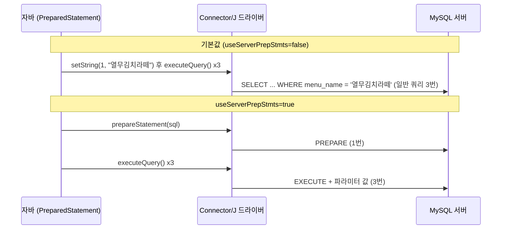

## 들어가며 (Situation)

JDBC 3일차의 첫 파일은 `b_preparedstatements/Application01.java`였다. 지난 시간(`a_statements`)에는 `Statement`로 `SELECT * FROM TBL_MENU`를 실행했는데, 오늘은 같은 조회를 `PreparedStatement`로 바꿔 보는 것이 출발점이었다.

```java
pstmt = con.prepareStatement("SELECT * FROM TBL_MENU");
rset = pstmt.executeQuery();

while (rset.next()) {
    System.out.println(
            rset.getString("MENU_NAME") + " 은/는 "
                    + rset.getString("MENU_PRICE") + "원 입니다. "
    );
}
```

코드 모양은 `Statement`와 거의 같다. 달라진 점은 **SQL을 `executeQuery()`가 아니라 `prepareStatement()`에 먼저 넘긴다**는 것 하나다. 파일 첫머리에는 이런 수업 주석이 있었다.

> Statement 는 SQL 쿼리문을 실행할 때마다 SQL 구문이 DB에 전송되어 DB에서 SQL 구문을 파싱(번역) 하고 컴파일 하는 과정을 거치게 된다.
> PreparedStatement 는 최초 1회 실행 시, SQL 구문을 파싱하고 컴파일 하는 것은 동일하지만, 동일한 SQL 을 재요청하면 최초에 컴파일 해둔 SQL 을 재사용하게 된다. 따라서 파싱 및 컴파일 과정이 생략되어 성능이 향상된다.

## 문제 상황 (Task)

주석은 "재사용해서 빠르다"고 말하는데, 눈으로 확인한 건 없었다. 그래서 두 가지를 확인해 보기로 했다.

1. 우리 `build.gradle`의 기본 설정(`mysql-connector-j:8.4.0`, URL에 옵션 없음)에서도 **정말 DB 서버가 SQL을 재사용**하고 있는가?
2. 재사용이 일어난다면, 그것을 **숫자로 볼 방법**이 있는가?

(성능 시간은 측정하지 않았다. 36행짜리 테이블에서 차이가 나올 리 없고, 이 글의 질문은 "재사용이 일어나는가"이기 때문이다.)

## 해결 과정 (Action)

### 1. 먼저 수업 코드를 그대로 실행

`Application01`을 실행하면 메뉴 36개가 한 줄씩 출력된다. 앞의 일부만 옮긴다.

```text
열무김치라떼 은/는 4500원 입니다.
우럭스무디 은/는 5000원 입니다.
생갈치쉐이크 은/는 6000원 입니다.
갈릭미역파르페 은/는 7000원 입니다.
앙버터김치찜 은/는 13000원 입니다.
```

결과만 보면 `Statement`와 똑같다. 즉 **출력만으로는 컴파일 재사용 여부를 알 수 없다.**

### 2. 서버가 알려주는 카운터를 보기

MySQL은 세션별로 실행한 명령 종류를 세는 상태 변수를 갖고 있다. `PreparedStatement`가 서버 쪽 준비된 구문(server-side prepared statement)을 쓴다면 `Com_stmt_prepare`(준비)와 `Com_stmt_execute`(실행) 카운터가 올라가야 한다. 같은 SQL을 3번 실행하고 그 차이를 읽었다. (확인용 **예시 코드**)

```java
try (Connection c = DriverManager.getConnection(url, "wanted", "wanted")) {
    long p0 = status(c, "Com_stmt_prepare"), e0 = status(c, "Com_stmt_execute");

    try (PreparedStatement ps = c.prepareStatement(
            "SELECT * FROM tbl_menu WHERE menu_name = ?")) {
        for (int i = 0; i < 3; i++) {
            ps.setString(1, "열무김치라떼");
            try (ResultSet r = ps.executeQuery()) { while (r.next()); }
        }
    }

    long p1 = status(c, "Com_stmt_prepare"), e1 = status(c, "Com_stmt_execute");
    System.out.println("prepare +" + (p1 - p0) + ", execute +" + (e1 - e0));
}
// status(): SHOW SESSION STATUS LIKE '이름' 결과의 2번째 컬럼을 읽는 헬퍼
```

첫 번째 결과는 예상과 달랐다.

```text
옵션 없음(우리 프로젝트와 동일)   Com_stmt_prepare +0, Com_stmt_execute +0
```

`PreparedStatement`를 3번 실행했는데 **서버는 "준비" 명령을 한 번도 받지 않았다.**

### 3. 원인: Connector/J의 기본값

[Connector/J 설정 문서](https://dev.mysql.com/doc/connector-j/en/connector-j-reference-configuration-properties.html)를 확인하니 `useServerPrepStmts`의 기본값이 `false`였다. 이 값이 `false`이면 드라이버가 `?` 자리에 값을 **자바 쪽에서 직접 채운 완성된 SQL 문자열**을 만들어 일반 쿼리로 보낸다(client-side prepared statement). 서버 입장에서는 `Statement`로 보낸 것과 구분되지 않는다.

그래서 옵션을 켜고 같은 실험을 다시 했다.

```java
String url = "jdbc:mysql://localhost/menudb?useServerPrepStmts=true";
```

```text
useServerPrepStmts=true           Com_stmt_prepare +1, Com_stmt_execute +3
```

이번에는 **준비 1번 + 실행 3번**이 찍혔다. 수업 주석이 설명한 "최초 1회 파싱·컴파일, 이후 재사용"은 이 모드에서 일어나는 일이다.



| 항목 | 기본값 (false) | `useServerPrepStmts=true` |
|------|----------------|---------------------------|
| `?` 채우는 곳 | 드라이버(자바 쪽) | 서버가 파라미터로 받음 |
| `Com_stmt_prepare` | 0 | 1 |
| `Com_stmt_execute` | 0 | 3 |
| 수업 주석의 "SQL 재사용" | 일어나지 않음 | 일어남 |

### 4. 그렇다면 PreparedStatement를 쓸 이유가 없나?

그렇지 않다. 기본값에서도 `PreparedStatement`는 `?` 바인딩으로 **입력값을 안전하게 처리**해 준다. 이 부분은 다음 글([플레이스홀더와 SQL 인젝션]({{ site.baseurl }}))에서 실험으로 확인한다. 정리하면 이렇다.

- **성능(컴파일 재사용)**: 서버 준비 구문 옵션을 켰을 때의 이야기이고, 같은 SQL을 반복 실행할 때 의미가 있다.
- **안전성·편의성(바인딩)**: 기본값에서도 얻을 수 있다.

수업 주석을 틀렸다고 단정하기보다는, **"옵션과 드라이버에 따라 달라진다"**가 정확한 설명이라고 이해했다. 다만 서버 준비 구문이 실제로 얼마나 빠른지, 켜는 것이 항상 이득인지는 측정하지 않았으므로 여기서는 결론을 내리지 않는다.

### 5. 곁가지로 본 `finally` 닫기 순서

`Application01`의 `finally`는 `close(con); close(rset); close(pstmt);` 순서다. 연결을 먼저 닫아도 실행은 문제없이 끝났다(`close()` 헬퍼가 `isClosed()`를 먼저 검사하기 때문이다). 하지만 보통은 **만든 순서의 반대(rset → pstmt → con)**로 닫는 편이 읽기에도 자연스럽다. 이 부분은 [chap03에서 try-with-resources로 바뀐다]({{ site.baseurl }}).

## 결과 (Result)

| 확인 항목 | 결과 |
|-----------|------|
| `Application01` 실행 | 메뉴 36개 출력 (Statement와 동일한 출력) |
| 기본 설정에서 서버 준비 구문 사용 | **사용 안 함** (`Com_stmt_prepare` +0) |
| `useServerPrepStmts=true` 설정 | 준비 +1, 실행 +3 |
| 환경 | MySQL 8.0.46, Connector/J 8.4.0, Java 21 |

배운 점은 다음과 같다.

- "PreparedStatement = 컴파일 재사용"은 **서버 준비 구문을 쓸 때만** 성립한다. 우리 프로젝트의 기본 설정에서는 서버 입장에서 `Statement`와 같은 쿼리가 간다.
- 주석이나 강의 설명도 **환경 설정에 따라 달라질 수 있고**, 서버 상태 변수(`SHOW SESSION STATUS`)로 직접 확인할 수 있다.
- 성능 얘기는 숫자로 재 보기 전에는 결론을 내리지 않는 편이 안전하다.

## 더 학습하면 좋은 개념

- **서버 사이드 vs 클라이언트 사이드 PreparedStatement** — 같은 `PreparedStatement` 인터페이스 뒤에서 드라이버가 서로 다른 방식으로 동작한다. 오늘 `Com_stmt_*` 카운터 차이가 그 증거다.
- **SQL 파싱과 실행 계획** — DB가 SQL을 받아 구문을 해석하고 실행 계획을 세우는 과정. "컴파일 재사용"이 무엇을 아끼는 것인지 알려 준다.
- **커넥션 풀(HikariCP 등)** — 연결 생성 비용은 SQL 파싱보다 훨씬 큰 경우가 많다. 성능을 따질 때 어디부터 봐야 하는지 알게 된다.
- **`EXPLAIN`** — 실행 계획을 눈으로 확인하는 방법. [MySQL 인덱스 글]({{ site.baseurl }})과 이어진다.
- **MySQL 상태 변수(`SHOW STATUS`)** — 서버가 실제로 무엇을 했는지 숫자로 확인하는 도구.

## 참고 자료

- [Java SE 21 API - PreparedStatement](https://docs.oracle.com/en/java/javase/21/docs/api/java.sql/java/sql/PreparedStatement.html)
- [MySQL Connector/J Developer Guide - Configuration Properties](https://dev.mysql.com/doc/connector-j/en/connector-j-reference-configuration-properties.html)

---

**요약**
1. `PreparedStatement`는 SQL을 먼저 `prepareStatement()`에 넘기고 `?`를 채워 실행하며, 출력 결과는 `Statement`와 같다.
2. 수업 주석의 "컴파일 재사용"은 `useServerPrepStmts=true`일 때만 일어나고, Connector/J 기본값(`false`)에서는 서버 준비 카운터가 0이었다.
3. 설명과 실제 동작이 다를 수 있으므로 `SHOW SESSION STATUS` 같은 도구로 직접 확인하는 습관이 중요하다.
