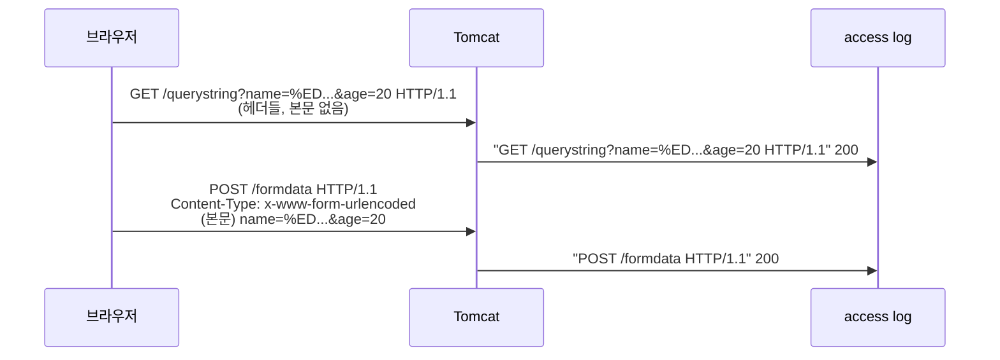

## 들어가며 (Situation)

[요청 파라미터 실습]()의 `FormDataServlet.java`에는 GET과 POST의 차이를 정리한 긴 수업 주석이 있다.

```java
/* comment.
    GET/POST 는 HTTP 요청에서 가장 많이 쓰이는 방식이다.
    이 둘의 가장 큰 차이는 URL 로 데이터를 전달하는 지에 대한 여부이다.
    - GET 요청
    URL에 데이터가 노출이 되며, 데이터의 크기도 한정된다.
    URL에 데이터가 노출되어 보안상 취약할 수 있다.
    또한 대략 200자 내의 데이터만 전달할 수 있기 때문에
    게시글 등을 Insert 하는 것에는 적합하지 않다.
    다만, GET 은 속도가 빠르기 때문에 조회 시 많이 사용된다.
    - POST 요청
    데이터가 URL 에 노출되지 않고 Payload (Body) 라고 불리는 영역에
    데이터를 담아서 Server 에 전달한다.
    전달할 수 있는 데이터의 크기가 GET 에 비해 압도적으로 크다.
    다만, 속도가 느리기 때문에 단순 조회 등에는 GET 을 사용한다.
 */
```

오늘 같은 폼을 GET(`/querystring`)과 POST(`/formdata`)로 여러 번 보내 봤는데, Tomcat access log를 열어 보니 두 방식의 기록이 확연히 달랐다. GET 줄에는 내가 입력한 이름과 생일이 퍼센트 인코딩된 채 그대로 남아 있었고, POST 줄 6개에는 `POST /formdata HTTP/1.1` 외에 아무것도 없었다.

## 문제 상황 (Task)

주석의 주장을 하나씩 확인하기로 했다.

| # | 주석의 주장 | 확인 방법 |
|---|-------------|-----------|
| 1 | GET은 대략 200자까지만 보낼 수 있다 | 길이를 늘려 가며 요청 |
| 2 | POST는 GET보다 압도적으로 많이 보낼 수 있다 | 본문 크기를 늘려 가며 요청 |
| 3 | GET은 URL에 노출되어 보안상 취약하다 | 서버 로그에 무엇이 남는지 확인 |
| 4 | GET은 빠르고 POST는 느리다 | 같은 데이터로 500번씩 응답 시간 측정 |

Tomcat 11.0.27을 별도 포트(18080)로 띄워 실험했다. 브라우저마다 다른 제한은 확인하지 않았고, **서버(Tomcat) 기준**의 결과만 다룬다.

## 해결 과정 (Action)

### 1. 데이터가 실려 가는 위치부터 확인

같은 데이터를 두 방식으로 보내고 서블릿에서 위치 정보를 찍었다(파라미터 확인용 서블릿은 [앞 글]()의 예시 코드).

```text
[probe] GET  queryString=name=%ED%99%8D%EA%B8%B8%EB%8F%99&age=20&hobbies=movie&..., contentType=null
[probe] POST queryString=null, contentType=application/x-www-form-urlencoded
```

GET은 **요청줄(URL)**에, POST는 **본문**에 `name=...&age=...`가 실린다. 데이터 모양(`이름=값&...`)은 똑같고 위치만 다르다.



### 2. 주장 1 확인: GET은 200자까지?

`name` 값의 길이를 늘려 가며 `/querystring`에 GET을 보냈다.

```bash
v=$(head -c 8090 /dev/zero | tr '\0' 'a')     # 'a'를 8090개 만든다
curl -s -o /dev/null -w "%{http_code}\n" "http://localhost:18080/querystring?age=1&name=$v"
```

| `name` 길이 | 응답 | `doGet()` 호출 |
|-------------|------|----------------|
| 200자 | 200 | O |
| 2,000자 | 200 | O |
| 8,000자 | 200 | O |
| **8,090자** | **200** | O |
| **8,091자** | **400** | X |
| 9,000자 | 400 | X |

200자가 아니라 **8,090자**까지 통과했다. 실패한 요청의 응답에는 `요청 헤더가 너무 큽니다.`라는 메시지가 있었고, 서블릿은 아예 호출되지 않았다. Tomcat이 HTTP 요청을 읽는 단계에서 잘라낸 것이다.

경계가 8,090자인 이유는 Tomcat 설정 문서에서 찾았다.

> **maxHttpRequestHeaderSize**: The maximum permitted size of the request line and headers associated with an HTTP request, specified in bytes. ... If not specified, this attribute is set to the value of the `maxHttpHeaderSize` attribute. (기본 8192 bytes)

제한 대상은 URL 길이가 아니라 **요청줄 + 헤더 전체**(8KB)다. URL 앞뒤의 `GET `, ` HTTP/1.1`, 그리고 `curl`이 붙이는 `Host`·`User-Agent`·`Accept` 헤더가 남은 백여 바이트를 차지해서 값은 8,090자에서 끝났다. 한글이라면 글자당 퍼센트 인코딩 9바이트(`%ED%99%8D`)를 차지하므로 900자 남짓이 된다.

HTTP 명세(RFC 9110)는 오히려 "최소 8000 옥텟 길이의 URI는 지원하라"고 권장한다.

> It is RECOMMENDED that all senders and recipients support, at a minimum, URIs with lengths of 8000 octets in protocol elements.
> — RFC 9110, 4.1 URI References

즉 "200자"는 HTTP의 규칙이 아니다. 길이 제한은 **서버·브라우저·프록시 각각의 설정**에서 생긴다.

### 3. 주장 2 확인: POST는 무제한인가?

POST 본문 크기를 늘려 `/formdata`로 보냈다.

```bash
head -c 3145728 /dev/zero | tr '\0' 'a' | sed 's/^/name=/' > body.txt   # 약 3MB
curl -s -o /dev/null -w "%{http_code}\n" --data-binary @body.txt \
     -H "Content-Type: application/x-www-form-urlencoded" http://localhost:18080/formdata
```

| 본문 크기 | 응답 | 콘솔 |
|-----------|------|------|
| 1MB | 200 | `doPost() 호출됨...`, `name = aaaa...` |
| 3MB | **413** | `doPost() 호출됨...` 까지만 |

POST에도 기본 제한이 있었다. Tomcat 문서의 `maxPostSize`(기본 2MiB)다.

> This is the maximum number of request body bytes that will be converted into request parameters by Tomcat. ... If not specified, this attribute is set to 2097152 (2 MiB).

3MB 요청에서 `doPost()`는 **호출됐다**는 점이 GET 실험과 달랐다. 본문은 `getParameter()`를 처음 부를 때 읽기 때문에, 서블릿이 시작된 뒤 `getParameter("name")` 줄에서 거절된 것이다. 문서에도 "If not already parsed, calling this method will trigger the parsing"이라고 되어 있다.

| 항목 | GET | POST (form) |
|------|-----|-------------|
| 데이터 위치 | 요청줄(URL) | 본문 |
| Tomcat 기본 제한 | 요청줄+헤더 8KB (`maxHttpRequestHeaderSize`) | 파라미터 변환 2MiB (`maxPostSize`) |
| 초과 시 | 400, 서블릿 호출 안 됨 | 413, `getParameter()`에서 거절 |

"POST가 훨씬 많이 보낼 수 있다"는 맞지만, **무제한은 아니고** 둘 다 서버 설정값이다.

### 4. 주장 3 확인: 어디에 노출되는가

같은 데이터를 보낸 뒤 실험 서버의 access log를 봤다.

```text
"GET /querystring?name=%ED%99%8D%EA%B8%B8%EB%8F%99&age=20&birthday=2021-01-08&gender=M&national=ko&hobbies=movie&hobbies=music&hobbies=sleep HTTP/1.1" 200 -
"POST /formdata HTTP/1.1" 200 -
```

GET은 **이름·나이·생일이 전부 서버 로그에 남았다.** 기본 설정 그대로인데도 그렇다. 브라우저 방문 기록, 북마크, 공유한 링크에도 URL이 그대로 남으니 비밀번호 같은 값을 GET으로 보내면 안 된다는 주석의 경고는 맞다.

다만 POST가 "암호화"되는 것은 아니다. `curl --trace-ascii`로 본 POST 본문은 그냥 텍스트였다.

```text
0000: name=%ED%99%8D%EA%B8%B8%EB%8F%99&age=20
```

HTTPS가 아니면 네트워크 위에서는 GET의 URL이든 POST의 본문이든 똑같이 읽힌다. POST가 막아 주는 것은 **로그·기록·주소창 같은 "남는 곳"**이고, 전송 중 보호는 HTTPS의 몫이다.

### 5. 주장 4 확인: GET이 빠르고 POST는 느린가

같은 8개 파라미터를 GET(쿼리스트링)과 POST(본문)로 **각 500번씩, 3라운드** 보내고 `curl`의 `time_total`을 평균 냈다. 연결을 재사용하도록 URL 500개를 한 번의 `curl` 실행에 넣었다.

```bash
# get.cfg: url = "http://localhost:18080/param-probe?name=...&age=..." 를 500줄
curl -s -w "%{time_total}\n" -K get.cfg
# post.cfg: url = "http://localhost:18080/param-probe" 를 500줄
curl -s -w "%{time_total}\n" -d "name=...&age=..." -K post.cfg
```

| 라운드 | GET 평균 | POST 평균 | GET 중앙값 | POST 중앙값 |
|--------|----------|-----------|------------|-------------|
| 1 | 0.245ms | 0.225ms | 0.213ms | 0.208ms |
| 2 | 0.254ms | 0.214ms | 0.236ms | 0.196ms |
| 3 | 0.248ms | 0.225ms | 0.197ms | 0.197ms |

차이는 0.02~0.04ms 수준이고, 오히려 POST 평균이 조금 낮았다. 로컬 환경의 작은 데이터라는 한계는 있지만, 적어도 **"POST라서 느리다"는 현상은 관찰되지 않았다.**

그럼 "조회는 GET"이라는 관례는 어디서 왔을까? RFC 9110을 보면 이유는 속도가 아니라 **의미**다.

> Of the request methods defined by this specification, the GET, HEAD, OPTIONS, and TRACE methods are defined to be safe.
> — 9.2.1 Safe Methods

> Responses to POST requests are only cacheable when they include explicit freshness information and a Content-Location header field that has the same value as the POST's target URI.
> — 9.3.3 POST

GET은 "서버 상태를 바꾸지 않는 요청"으로 정의되어 있어서 브라우저와 프록시가 **응답을 캐시하고 재사용**할 수 있다. 실제 서비스에서 GET이 "빠르게 느껴지는" 것은 요청 자체가 빨라서가 아니라 **아예 요청을 안 보내도 되는 경우(캐시)**가 생기기 때문이다.

### 6. 덤으로 만난 시행착오: 한글 이름이 400이 됐다

처음에는 `curl --data-urlencode "name=홍길동"`으로 POST를 보냈는데 **400**이 났다. `--trace-ascii`로 실제 전송 내용을 보니 원인이 보였다.

```text
0000: name=%C8%AB%B1%E6%B5%BF          ← Git Bash의 curl이 보낸 값 (EUC-KR 바이트)
      name=%ED%99%8D%EA%B8%B8%EB%8F%99 ← 브라우저가 보내는 값 (UTF-8 바이트)
```

Windows의 Git Bash가 한글을 **EUC-KR(CP949)** 바이트로 넘겼고, UTF-8로 해석하려던 Tomcat은 잘못된 바이트로 보고 거절했다. GET으로 같은 바이트를 보내도 400이었다. 둘 다 `doGet()`/`doPost()`의 첫 줄은 찍히고 `getParameter()`에서 멈췄다. UTF-8 바이트로 바꿔 보내자 200과 `name = 홍길동`이 나왔다.

그렇다면 Tomcat은 POST 본문을 왜 UTF-8로 읽었을까? 설치 폴더의 `conf/web.xml`에 이 설정이 기본으로 들어 있었다.

```xml
<!-- Set the default request and response character encodings to UTF-8.   -->
<request-character-encoding>UTF-8</request-character-encoding>
<response-character-encoding>UTF-8</response-character-encoding>
```

실험 서버에서 이 줄만 주석 처리하고 같은 UTF-8 데이터를 다시 보냈다.

| 설정 | GET 쿼리스트링 | POST 본문 | `getCharacterEncoding()` |
|------|----------------|-----------|--------------------------|
| 기본 (`request-character-encoding` UTF-8) | `홍길동` | `홍길동` | `UTF-8` |
| 설정 주석 처리 | `홍길동` | **`í길ë`** | `null` |
| 주석 처리 + `req.setCharacterEncoding("UTF-8")` | — | `홍길동` | — |

설정을 끄자 **POST만 깨졌다.** UTF-8 바이트를 한 바이트씩 서유럽 문자로 읽은 모양이다. GET이 멀쩡했던 것은 URL을 해석하는 인코딩이 별도 설정(커넥터의 `URIEncoding`, 기본 UTF-8)이기 때문이다. 이것도 GET과 POST의 차이다. 데이터 위치가 다르니 **해석 규칙도 따로 간다.**

설정이 없는 환경에서는 본문을 읽기 전에 직접 인코딩을 지정하면 된다. (확인용 **예시 코드**)

```java
@Override
protected void doPost(HttpServletRequest req, HttpServletResponse resp) throws ServletException, IOException {
    req.setCharacterEncoding("UTF-8");                 // getParameter()보다 먼저
    System.out.println("[fix] name = " + req.getParameter("name"));
}
```

> This method must be called prior to reading request parameters or reading input using getReader(). Otherwise, it has no effect.
> — `ServletRequest.setCharacterEncoding()` 문서

옛날 자료에서 서블릿마다 `setCharacterEncoding("UTF-8")`을 넣거나 인코딩 필터를 만드는 이유가 이것이었다. Tomcat 11에서 수업 코드가 이 줄 없이도 한글을 잘 받은 것은 위 기본 설정 덕분이다.

## 결과 (Result)

| 주석의 주장 | 실험 결과 (Tomcat 11 기본 설정) | 판정 |
|-------------|----------------------------------|------|
| GET은 대략 200자까지 | 값 **8,090자**까지 200, 8,091자부터 400 (요청줄+헤더 8KB 제한) | 숫자는 틀림, "제한이 있다"는 맞음 |
| POST가 압도적으로 큼 | 1MB 200, 3MB **413** (`maxPostSize` 2MiB) | 맞음, 단 무제한은 아님 |
| GET은 URL에 노출 | access log에 이름·생일까지 그대로 기록, POST는 기록 없음 | 맞음 (POST도 HTTPS 없이는 평문) |
| GET은 빠르고 POST는 느림 | 500번×3라운드 평균 GET 0.245~0.254ms, POST 0.214~0.225ms | 관찰되지 않음, 차이의 핵심은 캐시 가능 여부 |
| (추가) 한글 인코딩 | POST 본문은 `request-character-encoding`, URL은 `URIEncoding`이 따로 결정 | 설정 끄면 POST만 깨짐 |

배운 점은 다음과 같다.

- GET과 POST의 본질적인 차이는 **데이터의 위치**이고, 길이·노출·인코딩 차이는 모두 거기서 나온다.
- "200자", "느리다" 같은 숫자와 성능 주장은 HTTP 규칙이 아니라 **환경과 설정**에 달려 있다. 확인할 수 있는 숫자는 직접 재 보는 편이 정확하다.
- 조회에 GET을 쓰는 이유는 속도가 아니라 **안전한 메서드 → 캐시 가능**이라는 의미 때문이다.

## 더 학습하면 좋은 개념

- **HTTP 캐싱 (`Cache-Control`, `ETag`)** — GET 응답이 재사용되는 원리. "GET이 빠르다"의 진짜 이유를 이해할 수 있다.
- **안전(Safe)과 멱등(Idempotent) 메서드** — 새로고침이나 재전송을 해도 되는 요청과 안 되는 요청을 가르는 기준.
- **HTTPS(TLS)** — URL 경로·쿼리와 본문이 전송 중 어떻게 보호되는지. "POST라서 안전하다"는 오해를 정리해 준다.
- **PRG 패턴 (Post/Redirect/Get)** — POST 후 새로고침하면 다시 전송되는 문제를 피하는 방법.
- **문자 인코딩 (UTF-8, EUC-KR, ISO-8859-1)** — 오늘 본 `%C8%AB...`와 `í길ë`가 왜 생기는지 바이트 단위로 이해할 수 있다.

## 참고 자료

- [RFC 9110 - HTTP Semantics](https://www.rfc-editor.org/rfc/rfc9110.html) — 4.1 URI References, 9.2.1 Safe Methods, 9.3.3 POST
- [Apache Tomcat 11 Configuration Reference - The HTTP Connector](https://tomcat.apache.org/tomcat-11.0-doc/config/http.html)
- [Jakarta Servlet 6.1 API - ServletRequest](https://jakarta.ee/specifications/servlet/6.1/apidocs/jakarta.servlet/jakarta/servlet/ServletRequest.html)
- [MDN - GET](https://developer.mozilla.org/en-US/docs/Web/HTTP/Methods/GET)
- [MDN - POST](https://developer.mozilla.org/en-US/docs/Web/HTTP/Methods/POST)

---

**요약**
1. GET은 Tomcat 11 기본 설정에서 200자가 아니라 값 8,090자까지 통과했고(요청줄+헤더 8KB), POST도 2MiB를 넘긴 3MB 본문은 413으로 거절됐다.
2. GET 데이터는 access log에 그대로 남지만 POST도 HTTPS 없이는 평문이며, 500번×3라운드 측정에서 POST가 느리다는 현상은 보이지 않았다.
3. URL과 본문은 인코딩 설정도 따로라서, Tomcat 기본 `request-character-encoding`을 끄자 POST의 한글만 깨졌다.
