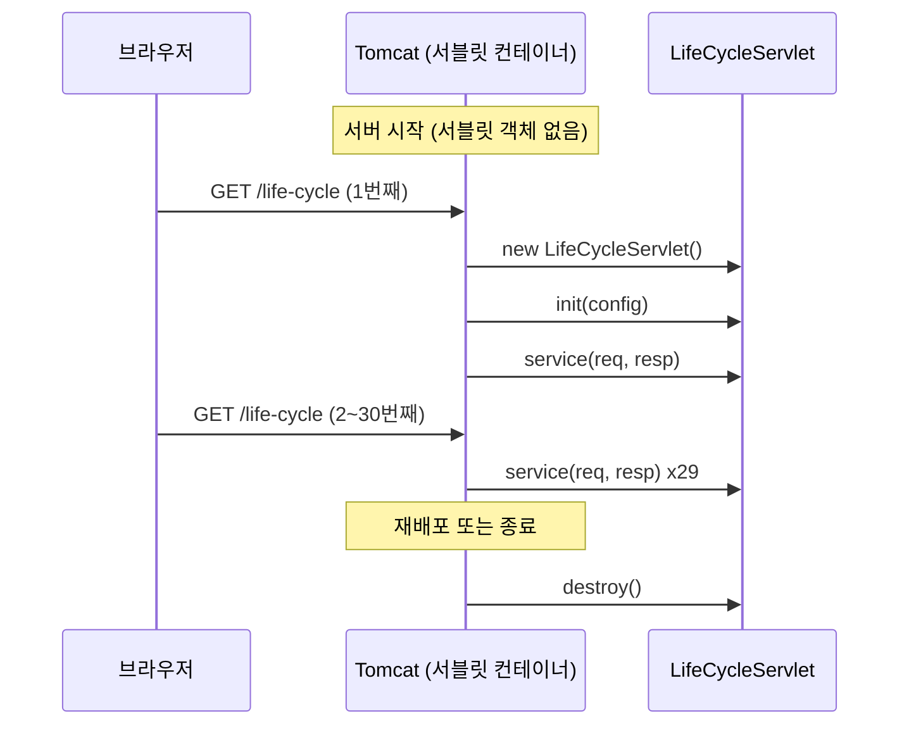

## 들어가며 (Situation)

서블릿 1일차의 첫 실습은 `a_lifecycle/LifeCycleServlet.java`였다. 생성자, `init()`, `service()`, `destroy()`에 출력문과 카운터만 넣은 클래스다.

```java
@WebServlet(value = "/life-cycle")
public class LifeCycleServlet extends HttpServlet {

    private int initCount = 1;
    private int serviceCount = 1;
    private int destroyCount = 1;

    public LifeCycleServlet() {
        System.out.println("기본생성자 호출됨...");
    }

    @Override
    protected void service(HttpServletRequest req, HttpServletResponse resp) throws ServletException, IOException {
        System.out.println("service() 호출됨... : " + serviceCount++);
    }

    @Override
    public void init(ServletConfig config) throws ServletException {
        System.out.println("init() 호출됨... : " + initCount++);
    }

    @Override
    public void destroy() {
        System.out.println("destory() 호출됨... : " + destroyCount++);
    }
}
```

`main()`도 없고, 이 메서드들을 부르는 코드도 없다. 그런데 브라우저로 `/life-cycle`에 들어가면 콘솔에 출력이 찍힌다. 오늘 Tomcat access log를 보면 이 페이지를 꽤 여러 번 열었다.

| 시각 | 요청 | 응답 |
|------|------|------|
| 12:37 ~ 12:38 | `GET /lifecycle` 4번 | 404 |
| 12:38 | `GET /life-cycle` | 404 |
| 14:04 | `GET /life-cycle` | **200** (처음 성공) |
| 14:18:59 ~ 14:19:03 | `GET /life-cycle` **29번** | 200 |

4초 동안 29번 새로고침한 기록도 남아 있다. 그리고 catalina 로그를 세어 보니 오늘 Tomcat을 **12번** 재시작했다.

## 문제 상황 (Task)

출력은 봤지만 정리되지 않은 질문이 남았다.

1. 새로고침을 30번 하면 생성자와 `init()`도 30번 불리는가?
2. `destroy()`는 **언제** 불리는가? 브라우저를 닫으면 불리는가?
3. 처음에 났던 404는 왜 났는가?
4. 수업 코드처럼 `init(ServletConfig)`를 재정의하면서 `super.init(config)`를 안 불러도 괜찮은가?

강의 IDE 콘솔은 매번 재시작하면 사라지기 때문에, 같은 Tomcat 11.0.27을 **별도 포트(18080)**로 띄우고 수업 코드를 그대로 배포해 출력을 파일로 모았다.

## 해결 과정 (Action)

### 1. 요청 전에는 아무것도 만들어지지 않는다

Tomcat이 다 뜬 직후, 아직 요청을 하나도 보내지 않은 상태에서 서블릿 출력을 세어 보니 **0줄**이었다. 서버가 켜졌다고 서블릿 객체가 바로 만들어지는 것은 아니었다.

첫 요청을 보내자 세 줄이 한꺼번에 나왔다.

```bash
curl http://localhost:18080/life-cycle
```

```text
기본생성자 호출됨...
init() 호출됨... : 1
service() 호출됨... : 1
```

이어서 29번을 더 보냈다.

```bash
for i in $(seq 2 30); do curl -s -o /dev/null http://localhost:18080/life-cycle; done
```

```text
service() 호출됨... : 2
service() 호출됨... : 3
...
service() 호출됨... : 30
```

새로 찍힌 줄은 정확히 29줄이고 **전부 `service()`**였다. 생성자와 `init()`은 한 번도 다시 나오지 않았다. 카운터가 2, 3, … 30으로 이어진다는 것은 **같은 객체의 필드**를 계속 쓰고 있다는 뜻이다.

서블릿 스펙도 같은 내용을 말한다.

> For a servlet not hosted in a distributed environment (the default), the servlet container must use only one instance per servlet declaration.
> — Jakarta Servlet 6.1 Specification, 2.2 Number of Instances

그리고 객체를 언제 만들지는 컨테이너가 정한다.

> Loading and instantiation can occur when the container is started, or delayed until the container determines the servlet is needed to service a request.
> — 2.3.1 Loading and Instantiation

Tomcat은 기본적으로 **첫 요청이 올 때까지 미뤘다**는 것이 1번 실험의 0줄이 보여준 결과다.

### 2. 누가 이 메서드들을 부르는가

`main()`이 없는데 메서드가 불리는 이유는, 호출하는 쪽이 내 코드가 아니라 **서블릿 컨테이너(Tomcat)**이기 때문이다. 오늘 실험을 시간 순으로 그리면 이렇다.



### 3. 하나의 객체를 여러 스레드가 동시에 쓴다

객체가 하나라면, 요청이 **동시에** 들어올 때는 어떻게 될까? 수업 코드로는 알 수 없어서 객체 번호와 스레드 이름을 찍는 서블릿을 따로 만들었다. (확인용 **예시 코드**)

```java
@WebServlet(value = "/thread", loadOnStartup = 1)
public class ThreadServlet extends HttpServlet {
    public ThreadServlet() {
        System.out.println("[thread] 생성자 호출됨");
    }

    @Override
    public void init() throws ServletException {
        System.out.println("[thread] init() 호출됨, servletName = " + getServletName());
    }

    @Override
    protected void doGet(HttpServletRequest req, HttpServletResponse resp) throws ServletException, IOException {
        System.out.println("[thread] instance=" + System.identityHashCode(this)
                + ", thread=" + Thread.currentThread().getName());
    }
}
```

요청을 하나 보낸 뒤, 6개를 동시에 보냈다.

```bash
curl -s -o /dev/null http://localhost:18080/thread
for i in 1 2 3 4 5 6; do curl -s -o /dev/null http://localhost:18080/thread & done; wait
```

```text
[thread] instance=100817497, thread=http-nio-18080-exec-6    ← 단건 요청
[thread] instance=100817497, thread=http-nio-18080-exec-5    ← 여기부터 동시 요청 6개
[thread] instance=100817497, thread=http-nio-18080-exec-8
[thread] instance=100817497, thread=http-nio-18080-exec-9
[thread] instance=100817497, thread=http-nio-18080-exec-7
[thread] instance=100817497, thread=http-nio-18080-exec-4
[thread] instance=100817497, thread=http-nio-18080-exec-2
```

**객체 번호는 전부 같고 스레드 이름은 전부 다르다.** 요청마다 객체를 새로 만드는 것이 아니라, 스레드 풀의 스레드가 하나의 서블릿 객체를 같이 쓴다. `HttpServlet` 문서에도 같은 경고가 있다.

> Servlets typically run on multithreaded servers, so be aware that a servlet must handle concurrent requests and be careful to synchronize access to shared resources.

그래서 수업 코드의 `serviceCount++` 같은 **인스턴스 필드**는 동시 요청이 몰리면 안전하지 않다. 오늘 실험에서 숫자가 꼬이는 것까지 재현하지는 않았지만, 서블릿에 요청별 데이터를 필드로 두면 안 되는 이유는 여기서 나온다.

### 4. `loadOnStartup`을 주면 요청 전에 만들어진다

위 예시 코드에는 `loadOnStartup = 1`을 줬다. 이 서블릿은 **요청을 하나도 보내지 않았는데** 배포되는 순간 출력이 나왔다.

```text
[thread] 생성자 호출됨
[thread] init() 호출됨, servletName = probe.ThreadServlet
```

| 설정 | 생성자·`init()` 호출 시점 | 첫 요청에서 하는 일 |
|------|---------------------------|---------------------|
| 기본 (`LifeCycleServlet`) | 첫 요청이 왔을 때 | 생성 + 초기화 + `service()` |
| `loadOnStartup = 1` | 애플리케이션 배포 시 | `service()`만 |

초기화가 무거운 서블릿이라면 첫 사용자가 그 시간을 기다리지 않도록 미리 만들어 둘 수 있다는 뜻이다.

### 5. `destroy()`는 브라우저가 아니라 서버가 정한다

`destroy()`는 요청을 아무리 보내도, 브라우저를 닫아도 찍히지 않았다. 찍힌 것은 두 경우였다.

**(1) 애플리케이션을 다시 로드할 때** — `WEB-INF/web.xml`의 수정 시각을 바꿔 Tomcat이 앱을 다시 올리게 했다.

```text
... HostConfig.reload 컨텍스트 []을(를) 다시 로드합니다.
destory() 호출됨... : 1
```

다시 로드한 뒤 `/life-cycle`에 들어가니 **생성자, `init() : 1`, `service() : 1`**이 처음부터 다시 찍혔다. 카운터가 30에서 이어지지 않고 1로 돌아왔다. 옛 객체가 버려지고 새 객체가 만들어졌다는 증거다.

**(2) 서버를 종료할 때**

```text
... StandardServer.await 셧다운 포트를 통해 유효한 셧다운 명령을 받았습니다.
... StandardService.stopInternal 서비스 [Catalina]을(를) 중지시킵니다.
destory() 호출됨... : 1
```

`destroyCount`가 늘 1인 이유도 여기서 이해됐다. `destroy()`는 객체 하나당 한 번만 불리고, 그 객체는 바로 버려지기 때문에 2가 찍힐 기회가 없다. 재시작할 때마다 객체가 새로 만들어지니 `serviceCount`도 매번 1부터 다시 시작한다. (출력의 `destory`는 수업 코드의 오타를 그대로 둔 것이다.)

### 6. 처음 났던 404 재현하기

access log의 404는 로그만으로 당시 원인을 확정할 수 없다. 그래서 **같은 404를 만드는 경우**를 직접 만들어 봤다.

**(1) URL이 `@WebServlet` 값과 다를 때** — `/lifecycle`(하이픈 없음)은 404, `/life-cycle`은 200이었다. 매핑은 글자 하나까지 정확히 맞아야 한다.

**(2) 새 서블릿 클래스를 추가하고 재배포하지 않았을 때** — 서버가 떠 있는 상태에서 3번의 예시 서블릿을 컴파일해 `WEB-INF/classes`에 넣고 바로 요청했다.

```text
새 클래스 추가 직후 (재배포 없음): /thread → 404
web.xml 수정 시각 변경 → 다시 로드 후:  /thread → 200
```

`.class` 파일이 있어도 404였다. Tomcat은 **애플리케이션을 배포할 때** `@WebServlet`이 붙은 클래스를 찾아 URL과 연결하기 때문에, 그 뒤에 추가된 클래스는 다시 배포하기 전까지 모르는 상태다. 오늘 access log에서 `/life-cycle`, `/request-service`, `/querystring`이 모두 **처음엔 404였다가 몇 분 뒤 200**으로 바뀐 것도 같은 모양이다. (당시 IDE에서 정확히 무엇을 눌렀는지는 로그에 남지 않아 확인하지 못했다.)

### 7. `init(ServletConfig)`를 재정의하면서 `super`를 안 부르면

수업 코드는 `init(ServletConfig config)`를 재정의하고 `super.init(config)`를 부르지 않는다. 이 상태에서 설정 객체를 쓰면 어떻게 되는지 확인했다. (확인용 **예시 코드**)

```java
@WebServlet(value = "/no-super")
public class NoSuperInitServlet extends HttpServlet {
    @Override
    public void init(ServletConfig config) throws ServletException {
        System.out.println("[no-super] init(config) 호출됨 (super.init 호출 안 함)");
    }

    @Override
    protected void doGet(HttpServletRequest req, HttpServletResponse resp) throws ServletException, IOException {
        System.out.println("[no-super] getServletConfig() = " + getServletConfig());
        System.out.println("[no-super] getServletName() = " + getServletName());
    }
}
```

```text
[no-super] getServletConfig() = null
java.lang.NullPointerException: Cannot invoke "jakarta.servlet.ServletConfig.getServletName()" because "this.config" is null
    at jakarta.servlet.GenericServlet.getServletName(GenericServlet.java:203)
```

응답은 **500**이었다. 설정 객체를 저장하는 일은 부모 클래스 `GenericServlet.init(ServletConfig)`가 하는데, 그걸 덮어쓰고 부르지 않았으니 `config`가 비어 있는 것이다. 공식 문서에도 그대로 적혀 있다.

> This implementation stores the ServletConfig object it receives from the servlet container for later use. When overriding this form of the method, call super.init(config).

수업 코드가 문제없이 돌았던 건 설정 객체를 쓰지 않았기 때문이다. 반면 3번 예시처럼 **매개변수 없는 `init()`**을 재정의하면 `super`를 신경 쓸 필요가 없고, `getServletName()`도 정상 동작했다.

| 재정의한 메서드 | `super` 호출 | `getServletConfig()` | 결과 |
|-----------------|--------------|----------------------|------|
| `init(ServletConfig)` | 안 함 | `null` | 설정을 쓰는 순간 NPE (500) |
| `init(ServletConfig)` | `super.init(config)` | 정상 | 정상 |
| `init()` | 필요 없음 | 정상 | 정상 (`probe.ThreadServlet` 출력) |

## 결과 (Result)

| 확인 항목 | 결과 |
|-----------|------|
| 요청 30번 | 생성자 **1번**, `init()` **1번**, `service()` **30번** |
| 서버 시작 직후 (요청 전) | 서블릿 출력 0줄 (첫 요청 때 생성) |
| 요청 7개 (단건 1 + 동시 6) | 객체 번호 1개, 스레드 이름 7개 |
| `loadOnStartup = 1` | 요청 없이 배포 시점에 생성·초기화 |
| `destroy()` 호출 | 다시 로드 1번, 서버 종료 1번 (브라우저 종료와 무관) |
| 새 클래스 추가 후 재배포 전 | 404 → 재배포 후 200 |
| `init(ServletConfig)` + `super` 없음 | `getServletConfig()` = null, `getServletName()` NPE |
| 환경 | Tomcat 11.0.27, Java 21 (Temurin), Jakarta Servlet API 6.1 |

배운 점은 다음과 같다.

- 서블릿 객체는 **선언 하나당 하나**만 만들어지고, 요청마다 새로 만들어지는 것은 `service()` 호출(과 그걸 실행하는 스레드)이다.
- 생명주기 메서드를 부르는 주체는 컨테이너다. `destroy()`는 사용자 행동이 아니라 **재배포·종료**에 묶여 있다.
- 한 객체를 여러 스레드가 같이 쓰므로, 인스턴스 필드에 요청별 상태를 두면 안 된다.
- `init(ServletConfig)`를 재정의할 거라면 `super.init(config)`를 부르고, 아니면 `init()`을 재정의하는 편이 안전하다.

## 더 학습하면 좋은 개념

- **스레드 풀과 Tomcat Executor** — 실험에서 본 `http-nio-18080-exec-N` 스레드가 어디서 오고 몇 개까지 늘어나는지 알면, 동시 요청 처리 한계를 이해할 수 있다.
- **스레드 안전성(Thread Safety)과 경쟁 조건** — `serviceCount++`가 왜 안전하지 않은지, `AtomicInteger`나 지역 변수로 바꾸면 무엇이 달라지는지 이어서 볼 만하다.
- **`ServletConfig`와 `ServletContext`** — 서블릿 하나의 설정과 애플리케이션 전체가 공유하는 정보의 차이. `super.init(config)`가 저장하는 것이 무엇인지 알게 된다.
- **싱글톤 패턴** — "인스턴스 하나"를 컨테이너가 보장해 주는 구조. [static·싱글톤 글]()과 비교해 보면 좋다.
- **Spring의 빈 생명주기** — 컨테이너가 객체를 만들고 초기화·소멸 메서드를 부르는 방식은 이후 Spring에서도 같은 모양으로 반복된다.

## 참고 자료

- [Jakarta Servlet 6.1 Specification](https://jakarta.ee/specifications/servlet/6.1/jakarta-servlet-spec-6.1.html) — 2.2 Number of Instances, 2.3 Servlet Life Cycle
- [Jakarta Servlet 6.1 API - GenericServlet](https://jakarta.ee/specifications/servlet/6.1/apidocs/jakarta.servlet/jakarta/servlet/GenericServlet.html)
- [Jakarta Servlet 6.1 API - HttpServlet](https://jakarta.ee/specifications/servlet/6.1/apidocs/jakarta.servlet/jakarta/servlet/http/HttpServlet.html)
- [Jakarta Servlet 6.1 API - @WebServlet](https://jakarta.ee/specifications/servlet/6.1/apidocs/jakarta.servlet/jakarta/servlet/annotation/WebServlet.html)

---

**요약**
1. 새로고침 30번에 생성자·`init()`은 1번, `service()`는 30번 불렸다. 서블릿 객체는 하나이고 여러 스레드가 함께 쓴다.
2. 객체 생성은 기본적으로 첫 요청 때(`loadOnStartup`이면 배포 때), `destroy()`는 재배포나 서버 종료 때 컨테이너가 호출한다.
3. 새 서블릿은 재배포 전까지 404이고, `init(ServletConfig)`를 재정의하면 `super.init(config)`를 불러야 설정 객체가 살아 있다.
