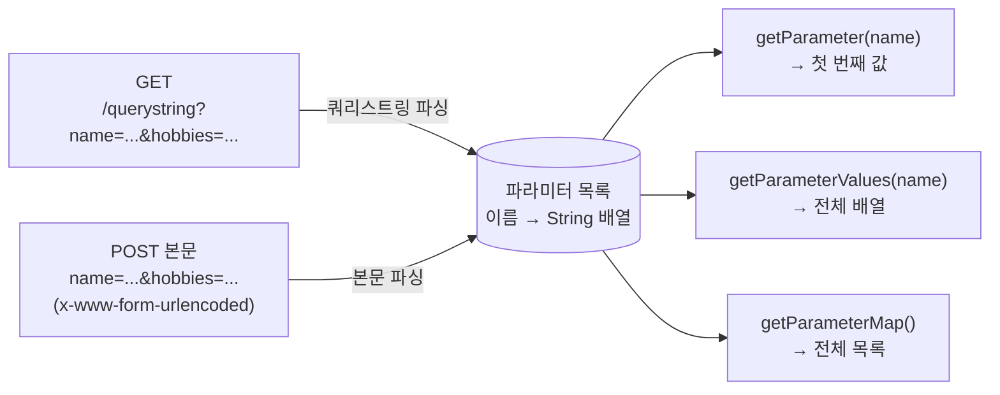

## 들어가며 (Situation)

서블릿 1일차 마지막 실습은 `c_parameter/parameter.html`의 폼 값을 서블릿에서 꺼내는 것이었다. 폼에는 이름, 나이, 생일, 성별(라디오), 국적(셀렉트), 취미(체크박스 3개)가 있다.

```html
<form action="/querystring" method="get">
    <label>이름 : </label><input type="text" name="name">
    <label>나이 : </label><input type="number" name="age">
    <label>생일 : </label><input type="date" name="birthday">
    <input type="radio" name="gender" id="male" value="M"><label for="male">남자</label>
    <input type="radio" name="gender" id="female" value="F"><label for="female">여자</label>
    <select name="national"> ... </select>
    <input type="checkbox" name="hobbies" id="movie" value="movie"><label for="movie">영화</label>
    <input type="checkbox" name="hobbies" id="music" value="music"><label for="music">음악</label>
    <input type="checkbox" name="hobbies" id="sleep" value="sleep"><label for="sleep">취침</label>
    <input type="submit" value="GET 요청">
</form>
```

받는 쪽 `QueryStringServlet`은 이름과 나이만 꺼낸다.

```java
@WebServlet(value = "/querystring")
public class QueryStringServlet extends HttpServlet {

    @Override
    protected void doGet(HttpServletRequest req, HttpServletResponse resp) throws ServletException, IOException {
        System.out.println("doGet() called...");

        String name = req.getParameter("name");
        System.out.println("name = " + name);

        /* comment.
            URL 로 전달되는 데이터는 모두 String 타입이다.
            따라서 원하는 자료형으로 담기 위해서는 파싱이 필요하다.
         */
        int age = Integer.parseInt(req.getParameter("age"));
        System.out.println("age = " + age);
    }
}
```

POST 폼을 받는 `FormDataServlet`도 `req.getParameter("name")` 한 줄로 이름을 꺼낸다.

## 문제 상황 (Task)

수업에서는 `name`과 `age`만 확인했다. 나머지 필드는 직접 꺼내 보지 않아서 다음이 궁금했다.

1. 같은 이름(`hobbies`)으로 값이 **3개** 오면 `getParameter("hobbies")`는 무엇을 돌려주는가?
2. 성별을 **선택하지 않으면**, 나이를 **비워 두면** 서블릿에는 무엇이 오는가?
3. GET(쿼리스트링)과 POST(요청 본문)는 데이터 위치가 다른데, 왜 **같은 `getParameter()`**로 꺼낼 수 있는가?

Tomcat 11.0.27을 별도 포트(18080)로 띄우고 수업 서블릿과 확인용 서블릿에 요청을 보내 출력을 비교했다.

## 해결 과정 (Action)

### 1. 수업 URL 그대로 보내기

`parameter.html`의 a 태그에 들어 있는 URL을 그대로 요청했다. 한글 `홍길동`은 브라우저가 보내는 것과 같은 UTF-8 퍼센트 인코딩(`%ED%99%8D...`)으로 바꿔 넣었다.

```bash
curl "http://localhost:18080/querystring?name=%ED%99%8D%EA%B8%B8%EB%8F%99&age=20&birthday=2021-01-08&gender=M&national=ko&hobbies=movie&hobbies=music&hobbies=sleep"
```

```text
doGet() called...
name = 홍길동
age = 20
```

`?` 뒤의 `이름=값&이름=값` 묶음이 **쿼리스트링**이고, `getParameter("name")`이 그중 `name`의 값을 꺼냈다. `%ED%99%8D...`도 자동으로 `홍길동`으로 복원돼 있었다.

### 2. 모든 파라미터를 들여다보는 서블릿 만들기

수업 서블릿은 두 값만 찍기 때문에, 들어온 파라미터를 전부 출력하는 서블릿을 따로 만들었다. GET과 POST를 같은 코드로 보려고 `service()`를 재정의했다. (확인용 **예시 코드**)

```java
@WebServlet(value = "/param-probe")
public class ParamProbeServlet extends HttpServlet {
    @Override
    protected void service(HttpServletRequest req, HttpServletResponse resp) throws ServletException, IOException {
        System.out.println("[probe] " + req.getMethod() + " queryString=" + req.getQueryString()
                + ", contentType=" + req.getContentType() + ", charset=" + req.getCharacterEncoding());
        System.out.println("[probe] getParameter(\"hobbies\") = " + req.getParameter("hobbies"));
        System.out.println("[probe] getParameterValues(\"hobbies\") = " + Arrays.toString(req.getParameterValues("hobbies")));
        System.out.println("[probe] getParameter(\"gender\") = " + req.getParameter("gender"));
        for (Map.Entry<String, String[]> e : req.getParameterMap().entrySet()) {
            System.out.println("[probe]   " + e.getKey() + " = " + Arrays.toString(e.getValue()));
        }
    }
}
```

성별은 빼고, 취미는 3개를 모두 고른 상황으로 보냈다.

```bash
curl "http://localhost:18080/param-probe?name=%ED%99%8D%EA%B8%B8%EB%8F%99&age=20&hobbies=movie&hobbies=music&hobbies=sleep"
```

```text
[probe] GET queryString=name=%ED%99%8D%EA%B8%B8%EB%8F%99&age=20&hobbies=movie&hobbies=music&hobbies=sleep, contentType=null, charset=UTF-8
[probe] getParameter("hobbies") = movie
[probe] getParameterValues("hobbies") = [movie, music, sleep]
[probe] getParameter("gender") = null
[probe]   name = [홍길동]
[probe]   age = [20]
[probe]   hobbies = [movie, music, sleep]
```

### 3. 체크박스: `getParameter()`는 첫 번째 값만 준다

취미를 3개 보냈는데 `getParameter("hobbies")`는 **`movie` 하나**만 돌려줬다. 나머지 두 개는 에러도 없이 조용히 사라졌다. 공식 문서에 이 동작이 명시돼 있다.

> You should only use this method when you are sure the parameter has only one value. If the parameter might have more than one value, use getParameterValues(java.lang.String). If you use this method with a multivalued parameter, the value returned is equal to the first value in the array returned by getParameterValues.

값이 여러 개일 수 있는 체크박스는 `getParameterValues()`로 **배열**을 받아야 한다. (예시 코드)

```java
String[] hobbies = req.getParameterValues("hobbies");
if (hobbies != null) {
    for (String hobby : hobbies) {
        System.out.println("hobby = " + hobby);
    }
}
```

`getParameterMap()`의 값 타입이 `String`이 아니라 **`String[]`**인 것도 같은 이유다. 서블릿 입장에서 모든 파라미터는 원래 "값이 여러 개일 수 있는 이름"이다.

### 4. 선택 안 한 라디오는 `null`, 비워 둔 칸은 `""`

성별을 고르지 않으면 `getParameter("gender")`는 `null`이었다. `getParameterMap()` 목록에도 `gender`가 아예 없다. 체크되지 않은 라디오·체크박스는 **이름 자체가 전송되지 않기** 때문이다. MDN의 체크박스 문서도 같은 내용을 적고 있다.

> If a checkbox is unchecked when its form is submitted, neither the name nor the value is submitted to the server.

반대로 텍스트·숫자 입력칸은 비워 둬도 `age=`처럼 **이름은 가고 값만 빈 문자열**로 간다. 이 차이가 수업 코드의 `Integer.parseInt()`에서 바로 문제가 됐다.

```bash
curl "http://localhost:18080/querystring?name=a&age=&gender=M"   # 나이 칸을 비운 경우
curl "http://localhost:18080/querystring?name=a"                  # age 자체가 없는 경우
```

| 상황 | `getParameter("age")` | 결과 |
|------|-----------------------|------|
| 나이 입력 (`age=20`) | `"20"` | 200, `age = 20` |
| 나이 칸 비움 (`age=`) | `""` | **500**, `NumberFormatException: For input string: ""` |
| `age` 파라미터 없음 | `null` | **500**, `NumberFormatException: Cannot parse null string` |

두 실패 모두 콘솔에는 `doGet() called...`와 `name = a`까지 찍힌 뒤 멈췄다. 즉 서블릿은 실행됐고, `parseInt()` 줄에서 예외가 나 Tomcat이 500 에러 페이지로 바꿔 응답한 것이다.

수업 주석의 "모두 String 타입이라 파싱이 필요하다"는 맞는 설명이고, 한 걸음 더 나가면 **"파싱 전에 `null`과 빈 문자열을 먼저 확인해야 한다"**가 된다. (예시 코드)

```java
String ageParam = req.getParameter("age");
if (ageParam == null || ageParam.isBlank()) {
    resp.sendError(HttpServletResponse.SC_BAD_REQUEST, "나이를 입력해 주세요.");
    return;
}
int age = Integer.parseInt(ageParam);
```

(숫자가 아닌 값이 오는 경우까지 막으려면 `NumberFormatException`도 잡아야 한다. 이 부분은 실험하지 않았다.)

### 5. GET과 POST를 같은 메서드로 꺼낼 수 있는 이유

같은 데이터를 POST 본문으로 보내 봤다.

```bash
curl -d "name=%ED%99%8D%EA%B8%B8%EB%8F%99&age=20&hobbies=movie&hobbies=music&hobbies=sleep" http://localhost:18080/param-probe
```

```text
[probe] POST queryString=null, contentType=application/x-www-form-urlencoded, charset=UTF-8
[probe] getParameter("hobbies") = movie
[probe] getParameterValues("hobbies") = [movie, music, sleep]
[probe] getParameter("gender") = null
[probe]   name = [홍길동]
[probe]   age = [20]
[probe]   hobbies = [movie, music, sleep]
```

`queryString`은 `null`이고 `contentType`이 `application/x-www-form-urlencoded`로 바뀌었다. 데이터 위치는 달라졌지만 **꺼낸 값은 GET과 한 글자도 다르지 않았다.** 컨테이너가 두 곳을 모두 읽어 같은 파라미터 목록으로 만들어 주기 때문이다.

> For HTTP servlets, parameters are contained in the query string or posted form data.
> — `ServletRequest.getParameter()` 문서



두 방식이 실제로 어떻게 다른지(길이 제한, 로그 노출, 한글 인코딩)는 [다음 글]()에서 따로 확인했다.

## 결과 (Result)

| 필드 (폼 요소) | 보낸 상황 | 꺼낸 값 |
|----------------|-----------|---------|
| `name` (text) | `홍길동` | `getParameter` → `"홍길동"` (퍼센트 인코딩 자동 복원) |
| `age` (number) | `20` / 비움 / 없음 | `"20"` / `""` / `null` → 뒤의 두 경우 `parseInt` 500 |
| `gender` (radio) | 선택 안 함 | `null` (이름 자체가 전송 안 됨) |
| `hobbies` (checkbox) | 3개 선택 | `getParameter` → `"movie"` 1개, `getParameterValues` → 3개 |
| GET ↔ POST | 같은 데이터 | 꺼낸 값 6줄 모두 동일 (`queryString`·`contentType`만 다름) |
| 환경 | | Tomcat 11.0.27, Java 21 (Temurin), Jakarta Servlet API 6.1 |

배운 점은 다음과 같다.

- 요청 파라미터는 항상 **문자열**이고, 이름 하나에 값이 **여러 개**일 수 있다. 체크박스는 `getParameterValues()`로 받아야 값을 잃지 않는다.
- "선택 안 함"은 `null`, "비워 둠"은 `""`으로 서로 다르게 온다. 숫자로 바꾸기 전에 둘 다 확인해야 500을 피할 수 있다.
- GET과 POST는 데이터 위치가 다르지만 `getParameter()` 계열은 둘을 같은 방식으로 다룬다.

## 더 학습하면 좋은 개념

- **`application/x-www-form-urlencoded`와 `multipart/form-data`** — 폼이 본문을 만드는 두 방식. 파일 업로드를 하려면 왜 후자가 필요한지 알게 된다.
- **퍼센트 인코딩(URL 인코딩)** — `홍길동`이 `%ED%99%8D...`로 바뀌는 규칙. 한글이 깨지는 문제를 이해하는 출발점이다.
- **입력값 검증(Validation)** — `null`·빈 값·형식 오류를 어디서 어떻게 막을지. 이후 Spring의 `@Valid`, Bean Validation으로 이어진다.
- **HTTP 상태 코드 400 vs 500** — 사용자의 잘못된 입력은 서버 오류(500)가 아니라 잘못된 요청(400)으로 응답하는 편이 맞다.

## 참고 자료

- [Jakarta Servlet 6.1 API - ServletRequest](https://jakarta.ee/specifications/servlet/6.1/apidocs/jakarta.servlet/jakarta/servlet/ServletRequest.html)
- [MDN - `<input type="checkbox">`](https://developer.mozilla.org/en-US/docs/Web/HTML/Element/input/checkbox)
- [MDN - Sending form data](https://developer.mozilla.org/en-US/docs/Learn/Forms/Sending_and_retrieving_form_data)
- [Java SE 21 API - Integer.parseInt](https://docs.oracle.com/en/java/javase/21/docs/api/java.base/java/lang/Integer.html)

---

**요약**
1. `getParameter()`는 값이 여러 개여도 첫 번째 값만 돌려줘서, 체크박스 3개 중 `movie`만 나왔다. 여러 값은 `getParameterValues()`로 받는다.
2. 선택 안 한 라디오는 `null`, 비운 입력칸은 `""`으로 와서, 수업 코드의 `Integer.parseInt()`는 두 경우 모두 500이 났다.
3. GET 쿼리스트링과 POST 본문은 위치가 다르지만, 컨테이너가 같은 파라미터 목록으로 만들어 주기 때문에 같은 메서드로 꺼낼 수 있다.
