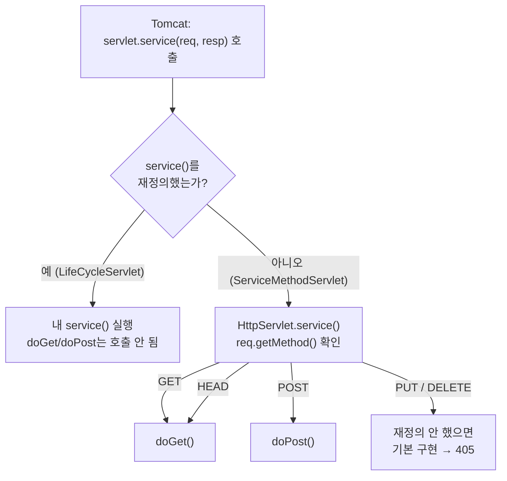

## 들어가며 (Situation)

[생명주기 실습]() 다음은 `b_service/ServiceMethodServlet.java`였다. 파일 안에는 처음에 작성했다가 **주석 처리한 `service()`**와, 지금 동작하는 `doGet()`/`doPost()`가 함께 남아 있다.

```java
@WebServlet(value = "/request-service")
public class ServiceMethodServlet extends HttpServlet {

//    @Override
//    protected void service(HttpServletRequest req, HttpServletResponse resp) throws ServletException, IOException {
//        System.out.println("req : " + req);
//        String httpMethod = req.getMethod();
//        System.out.println("httpMethod = " + httpMethod);
//        System.out.println("resp : " + resp);
//    }

    @Override
    protected void doGet(HttpServletRequest req, HttpServletResponse resp) throws ServletException, IOException {
        System.out.println("GET 요청을 처리할 메소드 호출됨.");
    }

    @Override
    protected void doPost(HttpServletRequest req, HttpServletResponse resp) throws ServletException, IOException {
        System.out.println("POST 요청을 처리할 메소드 호출됨.");
    }
}
```

요청을 보내는 `service.html`에는 세 가지 방법이 있다.

```html
<a href="/request-service">서비스 메소드 요청하기</a>

<form action="/request-service" method="get">
    <input type="submit" value="GET 방식 요청!!">
</form>

<form action="/request-service" method="post">
    <input type="submit" value="POST 방식 요청!!">
</form>
```

오늘 access log에는 이 세 버튼을 눌러 본 흔적이 남아 있다.

```text
14:41:15 "GET /request-service"     200   ← ? 없음 (a 태그 또는 주소창)
14:46:46 "POST /request-service"    200   ← form method="post"
14:50:05 "GET /request-service?"    200   ← ?만 붙음 (입력칸 없는 form method="get")
```

## 문제 상황 (Task)

`doGet()`과 `doPost()`를 내가 부른 적이 없는데 요청 방식에 맞춰 정확히 하나씩 불렸다. 궁금한 점을 정리하면 이렇다.

1. 누가 GET과 POST를 **구분해서** `doGet()`/`doPost()`로 보내 주는가?
2. 주석 처리한 `service()`를 다시 살리면 `doGet()`/`doPost()`는 어떻게 되는가?
3. 재정의하지 않은 방식(PUT, DELETE 등)으로 요청하면 어떻게 되는가?

Tomcat 11.0.27을 별도 포트(18080)로 띄우고, `curl`로 HTTP 메서드를 바꿔 가며 확인했다.

## 해결 과정 (Action)

### 1. 같은 URL에 메서드만 바꿔 보내기

`curl -X`로 메서드를 지정할 수 있다.

```bash
curl -X GET    http://localhost:18080/request-service
curl -X POST   http://localhost:18080/request-service
curl -X PUT    http://localhost:18080/request-service
curl -X DELETE http://localhost:18080/request-service
```

비교를 위해 `service()`를 직접 재정의한 [`LifeCycleServlet`]()(`/life-cycle`)에도 똑같이 보냈다.

| 메서드 | `/request-service` (`doGet`/`doPost`만 재정의) | `/life-cycle` (`service()` 재정의) |
|--------|-----------------------------------------------|------------------------------------|
| GET | 200, `GET 요청을 처리할 메소드 호출됨.` | 200, `service() 호출됨... : 1` |
| POST | 200, `POST 요청을 처리할 메소드 호출됨.` | 200, `service() 호출됨... : 2` |
| PUT | **405**, 출력 없음 | 200, `service() 호출됨... : 3` |
| DELETE | **405**, 출력 없음 | 200, `service() 호출됨... : 4` |

결과가 두 갈래로 나뉘었다.

- `service()`를 재정의한 서블릿은 **메서드가 무엇이든** 전부 `service()`로 들어왔다.
- `doGet`/`doPost`만 재정의한 서블릿은 GET·POST만 받고, 나머지는 **405**로 거절됐다.

405 응답 본문에는 Tomcat이 만든 안내가 들어 있다. `doGet()`만 있는 `/querystring`에 POST를 보냈을 때의 본문이다.

```text
HTTP 상태 405 – 허용되지 않는 메소드
메시지 HTTP 메소드인 POST는 이 URL에 의해 지원되지 않습니다.
```

### 2. 분기를 하는 주체는 부모 클래스의 `service()`

`doGet()`을 부르는 코드는 내 클래스가 아니라 부모 `HttpServlet` 안에 있다. 공식 문서의 `service(HttpServletRequest, HttpServletResponse)` 설명이다.

> Receives standard HTTP requests from the public service method and dispatches them to the do*XXX* methods defined in this class. There's no need to override this method.

정리하면 컨테이너는 늘 `service()`만 부르고, `HttpServlet`의 `service()`가 `req.getMethod()` 값을 보고 알맞은 `doXxx()`로 넘긴다.



수업 코드에서 처음 작성했던 `service()`가 `req.getMethod()`로 `"GET"`/`"POST"`를 찍어 본 것은, 사실 부모 클래스가 분기할 때 쓰는 값과 같은 값을 들여다본 것이다.

### 3. `service()`와 `doGet()`을 둘 다 재정의하면

주석을 풀었을 때 어떻게 되는지 직접 확인하려고, 두 메서드를 모두 가진 서블릿을 만들었다. 하나는 `super.service()`를 부르지 않고, 다른 하나는 부른다. (확인용 **예시 코드**)

```java
@WebServlet(value = "/shadow-service")
public class ShadowServiceServlet extends HttpServlet {
    @Override
    protected void service(HttpServletRequest req, HttpServletResponse resp) throws ServletException, IOException {
        System.out.println("[Shadow] service() 호출됨, method = " + req.getMethod());
    }

    @Override
    protected void doGet(HttpServletRequest req, HttpServletResponse resp) throws ServletException, IOException {
        System.out.println("[Shadow] doGet() 호출됨");
    }
}

// /super-service 는 service() 안에서 super.service(req, resp); 를 추가로 호출한다.
```

| 요청 | `/shadow-service` (`super` 없음) | `/super-service` (`super.service()` 호출) |
|------|-----------------------------------|-------------------------------------------|
| GET | 200, `service()`만 출력 | 200, `service()` → **`doGet()`** 출력 |
| POST | 200, `service()`만 출력 | **405** (`doPost()`가 없어서) |

`super.service()`를 부르지 않으면 **`doGet()`은 절대 불리지 않는다**. 분기 로직을 가진 부모 메서드를 덮어썼기 때문이다. 반대로 `super.service()`를 부르면 공통 처리(예: 로그)를 먼저 하고 원래 분기로 넘길 수 있다. 다만 이때는 분기 결과도 그대로 따라와서, `doPost()`가 없으면 POST는 405가 된다.

결국 수업 코드에서 `service()`를 주석 처리한 것은 선택의 문제였다. 둘을 같이 두면 `doGet()`/`doPost()`는 죽은 코드가 된다.

### 4. 재정의하지 않은 HEAD와 OPTIONS

`doHead()`와 `doOptions()`는 재정의하지 않았는데도 동작했다.

```bash
curl -I http://localhost:18080/request-service          # HEAD
curl -i -X OPTIONS http://localhost:18080/request-service
curl -i -X OPTIONS http://localhost:18080/querystring    # doGet만 있는 서블릿
```

```text
HEAD /request-service    → 200, 콘솔: GET 요청을 처리할 메소드 호출됨.
OPTIONS /request-service → Allow: GET, HEAD, POST, OPTIONS
OPTIONS /querystring     → Allow: GET, HEAD, OPTIONS
```

- **HEAD**는 `doGet()`을 그대로 불렀다. 문서에도 "Overriding this method to support a GET request also automatically supports an HTTP HEAD request."라고 되어 있다.
- **OPTIONS**의 `Allow` 헤더는 **내가 재정의한 `doXxx()`를 반영**했다. `doPost()`가 있는 `/request-service`에만 POST가 들어 있다.

부모 클래스가 "어떤 `doXxx()`가 재정의되었는가"를 알고 그에 맞춰 응답한다는 점이 흥미로웠다.

### 5. a 태그와 form GET은 같은 요청이다

`service.html`의 a 태그와 `method="get"` 폼은 둘 다 `doGet()`으로 들어갔다. 수업 주석의 설명대로 a 태그의 `href`는 URL을 바꾸는 GET 요청이다. 차이는 폼 쪽 URL에 `?`가 붙는다는 것뿐이었다(access log의 `GET /request-service?`). 입력칸이 없는 폼을 GET으로 보내면 빈 쿼리스트링이 붙는다.

| 요청 방법 | HTTP 메서드 | 호출된 메서드 |
|-----------|-------------|---------------|
| `<a href="/request-service">` | GET | `doGet()` |
| `<form method="get">` | GET (`?` 붙음) | `doGet()` |
| `<form method="post">` | POST | `doPost()` |
| 주소창 직접 입력 | GET | `doGet()` |

## 결과 (Result)

| 확인 항목 | 결과 |
|-----------|------|
| `doGet`/`doPost`만 재정의 + PUT·DELETE | **405** (2개 메서드 모두) |
| `service()` 재정의 + GET·POST·PUT·DELETE | 4개 모두 200, 전부 `service()`로 들어옴 |
| `service()` + `doGet()` 둘 다 재정의, `super` 없음 | `doGet()` 호출 **0번** |
| 위에서 `super.service()` 추가 | GET → `service()` 후 `doGet()`, POST → 405 |
| HEAD 요청 | `doGet()` 호출 |
| OPTIONS 요청 | `Allow`에 재정의한 메서드만 표시 |
| 환경 | Tomcat 11.0.27, Java 21 (Temurin), Jakarta Servlet API 6.1 |

배운 점은 다음과 같다.

- 컨테이너는 언제나 `service()`를 부르고, **GET/POST 분기는 `HttpServlet.service()`가 한다**. 그래서 보통은 `doXxx()`만 재정의한다.
- `service()`를 재정의하면 분기 자체를 내가 맡게 된다. `super.service()`를 빼면 `doXxx()`는 불리지 않는다.
- 처리하지 않는 메서드는 따로 막지 않아도 405로 거절된다. 필요한 `doXxx()`만 열어 두는 방식이다.

## 더 학습하면 좋은 개념

- **템플릿 메서드 패턴** — 부모가 흐름(`service()`)을 정하고 자식이 일부 단계(`doGet()`)만 채우는 구조. `HttpServlet`이 대표적인 예다.
- **HTTP 메서드의 의미 (RFC 9110)** — GET·POST·PUT·DELETE가 각각 어떤 의도를 갖는지. 어떤 `doXxx()`를 열지 정하는 기준이 된다.
- **HTTP 상태 코드 405와 `Allow` 헤더** — 405 응답은 허용 메서드를 알려 줘야 한다는 규칙과 OPTIONS의 쓰임새.
- **프론트 컨트롤러 패턴** — 하나의 서블릿이 모든 요청을 받아 다시 나눠 주는 구조. Spring MVC의 `DispatcherServlet`으로 이어진다.

## 참고 자료

- [Jakarta Servlet 6.1 API - HttpServlet](https://jakarta.ee/specifications/servlet/6.1/apidocs/jakarta.servlet/jakarta/servlet/http/HttpServlet.html)
- [RFC 9110 - HTTP Semantics, 9. Methods](https://www.rfc-editor.org/rfc/rfc9110.html#name-methods)
- [MDN - 405 Method Not Allowed](https://developer.mozilla.org/en-US/docs/Web/HTTP/Status/405)
- [MDN - OPTIONS](https://developer.mozilla.org/en-US/docs/Web/HTTP/Methods/OPTIONS)

---

**요약**
1. 컨테이너는 항상 `service()`를 부르고, `HttpServlet.service()`가 `getMethod()` 값으로 `doGet()`/`doPost()`를 골라 호출한다.
2. `service()`를 재정의하고 `super.service()`를 부르지 않으면 `doGet()`/`doPost()`는 한 번도 불리지 않았다.
3. 재정의하지 않은 PUT·DELETE는 405로 거절되고, HEAD는 `doGet()`으로, OPTIONS는 재정의한 메서드 목록으로 응답했다.
