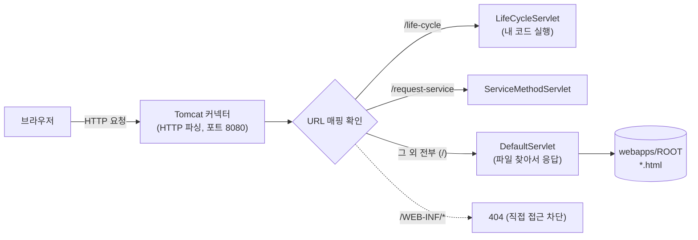
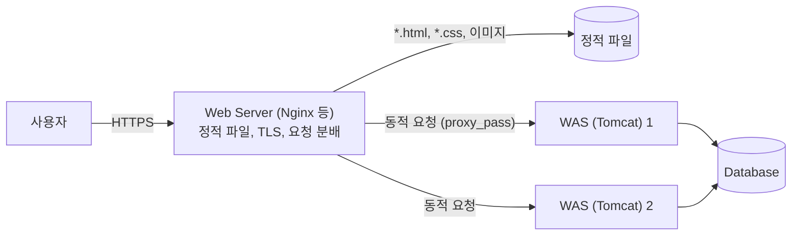

## 들어가며 (Situation)

서블릿 수업에서는 Tomcat을 **WAS(Web Application Server)**라고 불렀다. 그런데 오늘 실습을 돌아보면 Tomcat 하나가 두 종류의 요청을 모두 처리했다.

- `index.html`, `b_service/service.html`, `c_parameter/parameter.html` 같은 **HTML 파일**
- `/life-cycle`, `/request-service`, `/querystring` 같은 **서블릿**

Tomcat access log에서도 둘은 다르게 보였다. HTML 파일은 `304`가 자주 찍혔고, 서블릿 URL은 몇십 번을 불러도 늘 `200`이었다.

```text
14:37:43 "GET /"                           304
14:41:08 "GET /b_service/service.html"     304
14:18:59 "GET /life-cycle"                 200   (29번 연속, 전부 200)
```

그리고 하루의 시작은 404였다. IntelliJ가 처음 배포한 주소는 `/Gradle___com_wanted___chap01_servlet_1_0_SNAPSHOT_war/`였고, `GET /`는 404가 났다. 배포 설정의 컨텍스트 경로를 `/`로 바꾼 12:33부터 `GET /`가 200이 됐다.

## 문제 상황 (Task)

"Web Server는 정적, WAS는 동적"이라는 한 줄 정의는 들어 봤지만, 그렇다면 정적 파일도 내주는 Tomcat은 웹 서버인가 WAS인가? 정의를 외우는 대신 **같은 폴더를 두 종류의 서버로 띄워 같은 URL을 보내 보기로** 했다.

- **WAS**: Tomcat 11.0.27 (포트 18080), 수업 프로젝트 배포
- **정적 파일만 내주는 웹 서버**: Ruby 표준 라이브러리 WEBrick (포트 18081), Tomcat에 배포된 **같은 폴더**(`webapps/ROOT`)를 문서 루트로 지정

WEBrick은 이 블로그를 로컬에서 띄울 때 쓰는 `bundle exec jekyll serve`가 사용하는 것과 같은 Ruby 웹 서버다. 실무용 웹 서버(Nginx, Apache HTTP Server)는 아니지만, "URL을 파일로 바꿔 내주는 서버"라는 점에서 비교 대상으로 충분하다고 판단했다.

## 해결 과정 (Action)

### 1. 같은 폴더, 같은 URL, 다른 결과

정적 서버는 한 줄로 띄웠다. (확인용 **예시 명령**)

```bash
ruby -rwebrick -e 's = WEBrick::HTTPServer.new(Port: 18081, DocumentRoot: ARGV[0]); s.start' webapps/ROOT
```

두 서버에 같은 경로를 요청했다.

```bash
curl -s -o /dev/null -w "%{http_code}\n" http://localhost:18080/life-cycle   # Tomcat
curl -s -o /dev/null -w "%{http_code}\n" http://localhost:18081/life-cycle   # 정적 서버
```

| 요청 경로 | Tomcat (WAS) | 정적 웹 서버 |
|-----------|--------------|--------------|
| `/index.html` | 200 | 200 (482B) |
| `/b_service/service.html` | 200 | 200 (739B) |
| `/life-cycle` | 200 | **404** |
| `/request-service` | 200 | **404** |
| `/querystring?name=a&age=1` | 200 | **404** |
| `/WEB-INF/web.xml` | **404** | **200 (307B)** |
| `/WEB-INF/classes/.../LifeCycleServlet.class` | **404** | **200 (1,434B)** |

결과가 세 갈래로 나뉘었다.

1. **HTML 파일**은 둘 다 내줬다.
2. **서블릿 URL**은 정적 서버에서 전부 404였다. 정적 서버는 `/life-cycle`이라는 **파일**을 찾았고, 그런 파일은 폴더에 없다. `LifeCycleServlet.class`라는 파일은 있지만, 그것을 **실행해야 한다는 것을 모른다.**
3. **`WEB-INF` 아래 파일**은 반대로 정적 서버만 내줬다. 설정 파일 `web.xml`과 컴파일된 `.class` 파일이 그대로 다운로드됐다.

```text
$ curl http://localhost:18081/WEB-INF/web.xml
<?xml version="1.0" encoding="UTF-8"?>
<web-app xmlns="https://jakarta.ee/xml/ns/jakartaee"
         xmlns:xsi="http://www.w3.org/2001/XMLSchema-instance"
...
```

정적 서버에게 `WEB-INF`는 그냥 폴더 이름이다. 반면 Tomcat은 서블릿 스펙에 따라 `WEB-INF`를 애플리케이션 내부 영역으로 다루고 클라이언트에게 직접 내주지 않는다. DB 접속 정보 같은 설정이 여기에 들어간다고 생각하면, 이 차이는 단순한 기능 차이가 아니라 **보안 차이**다.

### 2. Tomcat은 정적 파일을 어떻게 내주는가

그렇다면 Tomcat은 HTML 파일을 누가 내주는 걸까? Tomcat 설치 폴더의 `conf/web.xml`(모든 애플리케이션에 공통 적용되는 설정)에 답이 있었다.

```xml
<servlet>
    <servlet-name>default</servlet-name>
    <servlet-class>org.apache.catalina.servlets.DefaultServlet</servlet-class>
    ...
</servlet>

<servlet-mapping>
    <servlet-name>default</servlet-name>
    <url-pattern>/</url-pattern>
</servlet-mapping>
```

Tomcat 문서의 설명이다.

> The default servlet is the servlet which serves static resources as well as serves the directory listings (if directory listings are enabled).

즉 Tomcat에서는 **정적 파일도 `DefaultServlet`이라는 서블릿이 처리**한다. 내 서블릿에 매핑되지 않은 모든 요청(`/`)이 이 서블릿으로 가고, 이 서블릿이 파일을 찾아 내준다. Tomcat의 정적 파일 기능은 "서블릿 컨테이너 위에 올린 서블릿 하나"인 셈이다.



### 3. 정적 응답과 동적 응답의 헤더 차이

access log의 `304`가 어디서 왔는지 보려고 Tomcat의 응답 헤더를 비교했다.

```bash
curl -I http://localhost:18080/b_service/service.html
curl -i http://localhost:18080/request-service
```

```text
# 정적 파일 (DefaultServlet)
HTTP/1.1 200
Accept-Ranges: bytes
ETag: W/"739-1792567507272"
Last-Modified: Wed, 21 Oct 2026 07:25:07 GMT
Content-Type: text/html
Content-Length: 739

# 서블릿 (ServiceMethodServlet)
HTTP/1.1 200
Content-Length: 0
```

정적 파일 응답에는 `ETag`와 `Last-Modified`가 붙었다. 파일은 수정 시각과 크기가 있으니 "지난번과 같은 파일인가"를 판단할 근거가 있다. 받은 `ETag`를 그대로 돌려보내면 본문 없이 **304**가 왔다.

```bash
curl -s -o /dev/null -w "%{http_code}\n" -H 'If-None-Match: W/"739-1792567507272"' \
     http://localhost:18080/b_service/service.html
# 304
```

서블릿 응답에는 이런 헤더가 없다. 서블릿은 요청마다 **코드를 실행해서 그 자리에서 결과를 만드는** 것이라, 내가 직접 넣지 않는 한 "같은 결과인지" 판단할 근거가 없다. 오늘 access log에서 HTML은 304가 섞이고 서블릿은 늘 200이었던 이유다.

### 4. 오늘 아침의 404: 컨텍스트 경로

WAS는 하나의 서버에 **여러 웹 애플리케이션**을 올릴 수 있고, 각 애플리케이션을 URL 앞부분(**컨텍스트 경로**)으로 구분한다. 오늘 처음 상태가 바로 그 모습이었다.

| 시각 | 요청 | 응답 | 의미 |
|------|------|------|------|
| 12:20 | `GET /Gradle___com_wanted___chap01_servlet_1_0_SNAPSHOT_war/` | 200 | 애플리케이션이 이 경로에 배포됨 |
| 12:20 | `GET /` | 404 | 루트(`/`)에는 아무 애플리케이션도 없음 |
| 12:33 | 컨텍스트 [`/Gradle___...war`] 배치 제거 (catalina 로그) | — | 설정 변경으로 재배포 |
| 12:33 | `GET /` | 200 | 컨텍스트 경로 `/`로 배포됨 |

정적 서버에는 이런 개념이 없다. 폴더 하나를 문서 루트로 정하면 끝이다. 반면 WAS는 "어느 애플리케이션의, 어느 서블릿인가"를 URL로 두 번 찾아간다. 수업 HTML의 링크가 `/life-cycle`처럼 `/`로 시작하는 절대 경로라서, 컨텍스트 경로가 `/`가 아니면 링크가 전부 어긋난다는 점도 이때 알게 됐다.

### 5. 실무에서는 둘을 같이 쓴다

실험으로 정리하면 Tomcat은 "웹 서버 기능(HTTP 처리 + `DefaultServlet`)을 가진 WAS"다. 그런데도 실무에서는 앞에 Nginx 같은 웹 서버를 따로 두는 구성이 흔하다. 이 부분은 오늘 직접 띄워 보지 않았고, 공식 문서를 기준으로 정리했다.



| 구분 | Web Server | WAS |
|------|------------|-----|
| 하는 일 | 요청 URL에 해당하는 **파일**을 응답 | 요청 URL에 해당하는 **코드**를 실행해 응답 생성 |
| 오늘 실험에서 | `/life-cycle` 404, `web.xml` 노출 | `/life-cycle` 실행, `WEB-INF` 차단 |
| 응답 특성 | 파일 기반이라 `ETag`/`Last-Modified` → 304 | 요청마다 새로 만듦 (캐시는 직접 설계) |
| 대표 예 | Nginx, Apache HTTP Server | Tomcat, Jetty |
| 앞단에 두는 이유 | 정적 파일 처리, HTTPS 처리, 여러 WAS로 분배 | 비즈니스 로직과 DB 접근에 집중 |

Nginx의 `proxy_pass`는 받은 요청을 뒤쪽 서버로 넘기는 설정이고, Tomcat 문서에도 이런 프록시 뒤에서 동작할 때의 설정 안내(Proxy Support HOW-TO)가 따로 있다.

용어도 하나 짚고 넘어간다. Tomcat 공식 소개는 스스로를 Jakarta Servlet·Pages 등 **일부 스펙의 구현체**라고 설명한다. 그래서 엄밀히는 "서블릿 컨테이너(웹 컨테이너)"이고, Jakarta EE 전체 스펙을 구현한 서버(WildFly, GlassFish 등)와 구분하기도 한다. 국내 수업과 실무에서는 Tomcat을 보통 WAS라고 부른다.

## 결과 (Result)

| 확인 항목 | Tomcat (WAS) | 정적 웹 서버 |
|-----------|--------------|--------------|
| HTML 2개 | 200 | 200 |
| 서블릿 URL 3개 | 200 (코드 실행) | **404 3건** |
| `WEB-INF` 파일 2개 | 404 (차단) | **200, 설정·클래스 파일 노출** |
| 정적 파일 재요청 (`If-None-Match`) | 304 | — |
| 서블릿 응답 헤더 | `ETag`/`Last-Modified` 없음 | — |
| 환경 | Tomcat 11.0.27 | Ruby 4.0.6 / WEBrick 1.9.2 |

배운 점은 다음과 같다.

- 웹 서버와 WAS를 가르는 기준은 "정적 파일을 내주느냐"가 아니라 **"요청을 받아 코드를 실행할 수 있느냐"**다. 정적 서버는 `.class` 파일을 갖고 있어도 실행하지 못했다.
- Tomcat은 정적 파일도 `DefaultServlet`이라는 서블릿으로 처리한다. 그래서 웹 서버 역할도 할 수 있다.
- WAS는 `WEB-INF` 보호, 컨텍스트 경로처럼 **애플리케이션 단위의 규칙**을 갖고 있고, 정적 서버는 폴더를 그대로 공개한다.

## 더 학습하면 좋은 개념

- **리버스 프록시(Reverse Proxy)** — Nginx가 Tomcat 앞에서 요청을 대신 받아 넘기는 구조. 로드 밸런싱과 HTTPS 처리로 이어진다.
- **HTTP 조건부 요청 (`ETag`, `If-None-Match`, 304)** — 오늘 access log에 찍힌 304의 정체. 정적 파일이 빠른 이유를 설명해 준다.
- **WAR 파일과 웹 애플리케이션 디렉터리 구조** — `WEB-INF/classes`, `WEB-INF/lib`, `web.xml`이 각각 무슨 역할인지, 왜 `WEB-INF`는 외부에서 안 보이는지.
- **내장 톰캣(Embedded Tomcat)** — Spring Boot는 Tomcat을 따로 설치하지 않고 애플리케이션 안에 넣어 실행한다. 오늘의 "Tomcat에 배포한다"는 구조와 비교해 볼 만하다.
- **CGI** — 웹 서버가 외부 프로그램을 실행해 동적 응답을 만들던 이전 방식. 서블릿이 요청마다 프로세스를 만들지 않고 객체 하나를 재사용하는 이유([생명주기 글]())와 연결된다.

## 참고 자료

- [Apache Tomcat 11 - Default Servlet Reference](https://tomcat.apache.org/tomcat-11.0-doc/default-servlet.html)
- [Apache Tomcat 11 - Proxy Support HOW-TO](https://tomcat.apache.org/tomcat-11.0-doc/proxy-howto.html)
- [Apache Tomcat 공식 홈페이지](https://tomcat.apache.org/)
- [Jakarta Servlet 6.1 Specification](https://jakarta.ee/specifications/servlet/6.1/jakarta-servlet-spec-6.1.html) — Web Applications, Directory Structure
- [NGINX - ngx_http_proxy_module (proxy_pass)](https://nginx.org/en/docs/http/ngx_http_proxy_module.html)
- [MDN - What is a web server?](https://developer.mozilla.org/en-US/docs/Learn/Common_questions/Web_mechanics/What_is_a_web_server)
- [MDN - HTTP conditional requests](https://developer.mozilla.org/en-US/docs/Web/HTTP/Conditional_requests)

---

**요약**
1. 같은 폴더를 띄웠을 때 정적 웹 서버는 서블릿 URL 3개를 모두 404로 응답했고, Tomcat은 해당 서블릿 코드를 실행했다.
2. 정적 서버는 `WEB-INF/web.xml`과 `.class` 파일까지 그대로 내줬지만, Tomcat은 `WEB-INF`를 차단하고 정적 파일은 `DefaultServlet`으로 처리했다.
3. 웹 서버와 WAS의 핵심 차이는 코드를 실행해 동적 응답을 만들 수 있느냐이며, 실무에서는 Nginx 같은 웹 서버를 WAS 앞에 함께 둔다.
