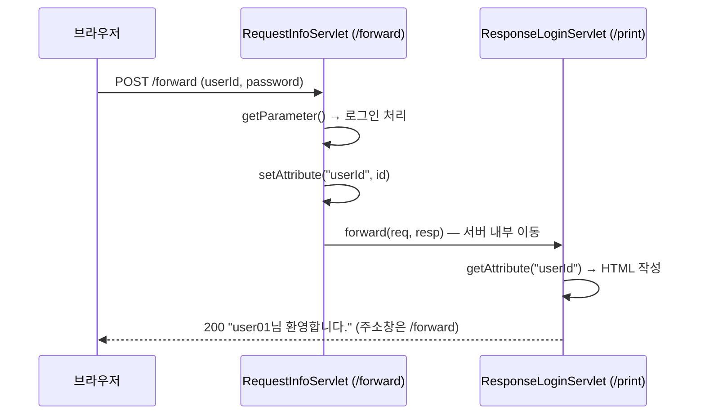

## 들어가며 (Situation)

세 번째 실습 `f_forward`는 로그인 폼에서 시작한다. `forward.html`이 아이디와 비밀번호를 `POST /forward`로 보낸다.

```html
<form action="/forward" method="post">
    아이디 : <input type="text" name="userId">
    비밀번호 : <input type="password" name="password">
    <button type="submit">로그인</button>
</form>
```

요청을 받는 `RequestInfoServlet`은 주석에 자기 역할을 이렇게 적어 뒀다.

```java
/* comment. 해당 서블릿의 역할
    1. 사용자의 로그인 요청을 전달 받는다.
    2. 요청 객체에서 값을 꺼내어 로그인 처리를 진행한다.
    --
    하지 않을 것.
    1. 로그인 처리 완료 후 응답 HTML return
 */
```

로그인은 처리하되 응답 화면은 만들지 않겠다는 것이다. 대신 마지막에 요청을 다른 서블릿으로 넘긴다.

```java
@WebServlet("/forward")
public class RequestInfoServlet extends HttpServlet {
    @Override
    protected void doPost(HttpServletRequest req, HttpServletResponse resp) throws ServletException, IOException {
        String id = req.getParameter("userId");
        String pwd = req.getParameter("password");
        // memberService.login(id, pwd);
        System.out.println("로그인 성공");

        // 전달해줄 값을 설정하는 setter 메소드
        req.setAttribute("userId", id);

        RequestDispatcher rd = req.getRequestDispatcher("/print");
        rd.forward(req, resp);
    }
}
```

`/print`에 매핑된 `ResponseLoginServlet`이 `"~님 환영합니다."` 화면을 만든다.

```java
@WebServlet("/print")
public class ResponseLoginServlet extends HttpServlet {
    @Override
    protected void doPost(HttpServletRequest req, HttpServletResponse resp) throws ServletException, IOException {
        // 이전 서블릿이 전달해준 id 꺼내기
        String id = req.getAttribute("userId").toString();
        // ... "<h3>" + id + "님 환영합니다.</h3>" 응답
    }
}
```

## 문제 상황 (Task)

`RequestInfoServlet` 끝에는 forward의 특징이 "중요!" 표시와 함께 세 가지로 정리돼 있었다.

```text
1. forward 방식은 서로 다른 서블릿들이 req, resp 를 공유한다.
2. forward 를 위임 받은 서블릿은 client 에게 존재가 노출되지 않는다. == url 의 변화가 없다.
3. 새로고침 시 동일한 요청을 반복해서 DB 에 INSERT, UPDATE, DELETE 하는 행위가 발생할 수 있다.
```

`ResponseLoginServlet`에는 하나가 더 있었다.

```text
forward 를 요청한 서블릿에서 처리하는 메소드가 get 이면
forward 를 받은 서블릿도 get 메소드를 오버라이딩 한다.
```

오늘 access log에는 `POST /forward`가 **7번** 기록돼 있고, `/print`는 **한 번도** 없다. 화면에는 분명히 `/print`가 만든 환영 문구가 나왔는데 말이다. 주석의 네 가지 설명이 실제로 어떻게 나타나는지 하나씩 확인해 보기로 했다.

이번에도 같은 Tomcat 11.0.27을 별도 포트(18080)로 띄워 수업 코드와 확인용 서블릿을 함께 배포했다.

## 해결 과정 (Action)

### 1. 요청은 몇 번 오가는가

`curl`로 폼과 같은 요청을 보냈다. `-d`는 폼 데이터를 POST 본문으로 보내고, `-L`은 리다이렉트가 있으면 따라가라는 옵션이다.

```bash
curl -s -i -L -d "userId=user01&password=pass01" \
     -w "\n[url_effective=%{url_effective} num_redirects=%{num_redirects}]\n" \
     http://localhost:18080/forward
```

```text
HTTP/1.1 200
Content-Type: text/html;charset=UTF-8

<h3 align="center">user01님 환영합니다.</h3>

[url_effective=http://localhost:18080/forward num_redirects=0]
```

응답은 한 번이고, 리다이렉트도 0번이었다. 최종 주소는 `/forward` 그대로였다. 서버 콘솔에서는 두 서블릿이 이어서 실행됐다.

```text
사용자의 로그인 요청을 처리하는 서블릿 호출됨...
id = user01
pwd = pass01
로그인 성공
/print 서블릿 호출됨...
```

Chrome에서도 폼을 제출해 봤다. 화면에는 `user01님 환영합니다.`가 나왔고, `location.href`는 `http://localhost:18080/forward`였다. 주석 2번의 "url의 변화가 없다"는 그대로 맞았다. access log에 `/print`가 없던 이유도 이것이다. 브라우저는 `/print`에 요청한 적이 없다.



### 2. 정말 같은 req를 공유하는가

주석 1번을 확인하려고 forward 전후의 request를 비교하는 서블릿 두 개를 만들었다. (확인용 **예시 코드**)

```java
@WebServlet("/forward-probe")
public static class ForwardProbe extends HttpServlet {
    @Override
    protected void doPost(HttpServletRequest req, HttpServletResponse resp) throws ServletException, IOException {
        System.out.println("[forward-probe] req=" + req.getClass().getSimpleName() + "@" + System.identityHashCode(req)
                + ", requestURI=" + req.getRequestURI());
        req.setAttribute("userId", req.getParameter("userId"));
        req.getRequestDispatcher("/forward-dump").forward(req, resp);
        System.out.println("[forward-probe] forward() 리턴 후, committed=" + resp.isCommitted());
    }
}

@WebServlet("/forward-dump")
public static class ForwardDump extends HttpServlet {
    @Override
    protected void doPost(HttpServletRequest req, HttpServletResponse resp) throws IOException {
        System.out.println("[forward-dump] req=" + req.getClass().getSimpleName() + "@" + System.identityHashCode(req)
                + ", dispatcherType=" + req.getDispatcherType() + ", method=" + req.getMethod()
                + ", requestURI=" + req.getRequestURI()
                + ", forward.request_uri=" + req.getAttribute("jakarta.servlet.forward.request_uri"));
        System.out.println("[forward-dump] getParameter(userId)=" + req.getParameter("userId")
                + ", getAttribute(userId)=" + req.getAttribute("userId"));
        // ... 응답 작성
    }
}
```

```text
[forward-probe] req=RequestFacade@499709240, requestURI=/forward-probe
[forward-dump] req=ApplicationHttpRequest@1388865541, dispatcherType=FORWARD, method=POST, requestURI=/forward-dump, forward.request_uri=/forward-probe
[forward-dump] getParameter(userId)=user01, getAttribute(userId)=user01
[forward-probe] forward() 리턴 후, committed=true
```

결과에서 세 가지를 알 수 있었다.

| 관찰 | 의미 |
|------|------|
| `getParameter`와 `getAttribute` 모두 `user01` | 같은 요청이라 폼 데이터와 앞에서 넣은 속성이 둘 다 보인다 |
| 객체 클래스가 `RequestFacade` → `ApplicationHttpRequest` | Tomcat이 원래 요청을 **감싼** 객체를 넘긴다. 내용은 공유하지만 경로 정보는 바뀐다 |
| `requestURI`가 `/forward-dump`, 원래 주소는 `forward.request_uri`에 | 서버 안에서는 대상 경로로 보이고, 원래 주소는 속성으로 남는다 |

"req를 공유한다"는 주석은 맞았다. 다만 완전히 같은 객체는 아니고, 경로만 대상 서블릿 기준으로 바꾼 포장지를 씌운 것이었다. 명세 9.4절도 이렇게 적고 있다.

> The path elements of the request object exposed to the target servlet must reflect the path used to obtain the RequestDispatcher.

그리고 원래 주소는 `jakarta.servlet.forward.request_uri` 같은 속성으로 반드시 남겨야 한다고 규정한다. [에러 페이지 실습]()에서 `ExceptionServlet`이 꺼낸 바로 그 속성이다.

마지막 줄 `committed=true`도 눈여겨볼 만했다. `forward()`가 돌아왔을 때 응답은 이미 브라우저로 나간 상태였다. 명세는 "Before the forward method of the RequestDispatcher interface returns without exception, the response content must be sent and committed"라고 적고 있다. forward 다음 줄에서 응답을 더 쓰는 것은 의미가 없다.

### 3. 받는 쪽 메서드는 보내는 쪽을 따라간다

위 출력에서 대상 서블릿의 `method`가 `POST`였다. 그러면 대상 서블릿에 `doPost()`가 없으면 어떻게 될까. POST를 받아 `doGet()`만 있는 서블릿으로 forward하는 서블릿을 만들었다. (확인용 **예시 코드**)

```java
@WebServlet("/forward-to-get")
public static class ForwardToGet extends HttpServlet {
    @Override
    protected void doPost(HttpServletRequest req, HttpServletResponse resp) throws ServletException, IOException {
        req.getRequestDispatcher("/get-only").forward(req, resp);
    }
}
// /get-only 는 doGet() 만 재정의
```

```bash
curl -s -o /dev/null -w "status=%{http_code}\n" -d "userId=user01" http://localhost:18080/forward-to-get
```

```text
status=405
```

[어제 확인한 405]()가 그대로 나왔다. forward는 요청 메서드를 바꾸지 않으므로, 대상 서블릿의 `HttpServlet.service()`가 POST를 보고 `doPost()`를 찾다가 없어서 거절한 것이다. 수업 코드에서 `/forward`와 `/print`가 둘 다 `doPost()`인 이유이고, 주석의 "get이면 받는 쪽도 get"이 맞다는 확인이었다.

### 4. "노출되지 않는다" = 접근할 수 없다?

주소창에 `/print`가 안 보인다고 해서 접근을 막아 주는 것은 아니다. `/print`도 `@WebServlet("/print")`로 매핑된 URL이기 때문이다. 직접 요청해 봤다.

```bash
curl -s -o /dev/null -w "status=%{http_code}\n" http://localhost:18080/print
curl -s -i -d "userId=user01" http://localhost:18080/print
```

| 요청 | 결과 | 이유 |
|------|------|------|
| `GET /print` | 405 | `doGet()`이 없음 |
| `POST /print` (userId를 폼 데이터로) | **500** | `getAttribute("userId")`가 `null` → `.toString()`에서 NPE |

POST로 직접 들어오면 서블릿은 실행됐다. 다만 앞 서블릿이 넣어 준 속성이 없으니 33번째 줄에서 터졌다.

```text
java.lang.NullPointerException: Cannot invoke "Object.toString()" because the return value of
"jakarta.servlet.http.HttpServletRequest.getAttribute(String)" is null
	at com.wanted.servlet.f_forward.ResponseLoginServlet.doPost(ResponseLoginServlet.java:33)
```

폼 데이터 `userId=user01`을 보냈는데도 NPE였다. 이 서블릿은 파라미터가 아니라 속성만 보기 때문이다. 주석의 "노출되지 않는다"는 **주소창에 보이지 않는다**는 뜻이고, 외부에서 부를 수 없다는 뜻은 아니었다.

### 5. 같은 POST를 다시 보내면

주석 3번은 forward의 가장 큰 주의점이다. forward 후에도 주소창에는 `/forward`가, 브라우저 기록에는 **POST 요청**이 남는다. 새로고침은 이 마지막 요청을 다시 보내는 것이므로 로그인 처리도 다시 실행된다. 같은 요청을 `curl`로 3번 보내 재현했다.

```bash
for i in 1 2 3; do curl -s -o /dev/null -d "userId=user01&password=pass01" http://localhost:18080/forward; done
```

콘솔의 `로그인 성공`은 정확히 3번 찍혔다. 로그인이라면 큰 문제가 없지만, 이 자리에 회원가입 INSERT나 결제가 있었다면 3건이 생겼을 것이다.

오늘 IDE의 access log에도 비슷한 흔적이 있다. 7번의 `POST /forward` 중 2번은 바로 앞에 폼 페이지(`forward.html`) 요청이 없다. 14:44:41의 `GET /` 두 줄은 서버 재시작 때 IDE가 보낸 요청(`127.0.0.1`)이고, 브라우저(`::1`)는 폼을 다시 열지 않고 POST부터 보냈다. 결과 화면에서 새로고침해 같은 POST를 다시 보낸 것으로 보인다.

```text
0:0:0:0:0:0:0:1 [14:44:05] "GET /f_forward/forward.html HTTP/1.1" 304
0:0:0:0:0:0:0:1 [14:44:08] "POST /forward HTTP/1.1" 200
127.0.0.1       [14:44:41] "GET / HTTP/1.1" 200          ← 서버 재시작
127.0.0.1       [14:44:41] "GET / HTTP/1.1" 200
0:0:0:0:0:0:0:1 [14:44:44] "POST /forward HTTP/1.1" 200  ← 폼 없이 다시 보낸 POST
0:0:0:0:0:0:0:1 [15:00:34] "POST /forward HTTP/1.1" 200  ← 폼 없이 다시 보낸 POST
```

수업 주석이 "조회(SELECT)는 forward, DML은 forward로 구현하면 큰일"이라고 한 이유다. DML 뒤에 어떻게 응답해야 하는지가 다음 실습인 [redirect]()의 주제다.

## 결과 (Result)

| 주석의 설명 | 확인 결과 | 판정 |
|-------------|-----------|------|
| req, resp를 공유한다 | 파라미터·속성 모두 보임. 단 Tomcat이 감싼 객체(`ApplicationHttpRequest`)로 전달 | 맞음 |
| URL 변화가 없다 | 요청 1번, 리다이렉트 0번, 주소창 `/forward` 유지 | 맞음 |
| 받는 쪽도 같은 메서드를 재정의 | POST를 `doGet()`만 있는 서블릿으로 forward → 405 | 맞음 |
| client에게 존재가 노출되지 않는다 | 주소창엔 안 보이지만 `POST /print` 직접 호출 시 실행됨(NPE 500) | 절반만 맞음 |
| 새로고침 시 DML 반복 | 같은 POST 3번 → `로그인 성공` 3번 | 맞음 |
| 환경 | Tomcat 11.0.27, Java 21 (Temurin), Jakarta Servlet API 6.1, Chrome | |

배운 점은 다음과 같다.

- forward는 **서버 안에서** 처리 담당을 바꾸는 것이다. 브라우저 입장에서는 요청 한 번, 응답 한 번뿐이다.
- 넘겨줄 값은 `setAttribute()`로 request에 담는다. 이 값은 그 요청이 끝나면 사라진다.
- 주소가 숨겨진다고 보호되는 것은 아니다. forward 대상 서블릿도 직접 호출될 수 있으므로 `null` 처리가 필요하다.
- forward 후의 새로고침은 원래 요청(POST)을 반복한다. 데이터를 바꾸는 요청에는 쓰지 않는다.

## 더 학습하면 좋은 개념

- **`RequestDispatcher.include()`** — 다른 서블릿의 출력을 내 응답 중간에 끼워 넣는 방식. forward와 달리 처리 후 원래 서블릿으로 돌아온다.
- **MVC 패턴과 JSP** — 오늘 구조에서 `/forward`는 Controller, `/print`는 View 역할이었다. 보통 View는 JSP로 만들고 `WEB-INF` 아래에 두어 직접 접근을 막는다.
- **request scope와 session scope** — `setAttribute()`로 담은 값이 언제까지 살아 있는지의 차이. 요청 한 번을 넘어 정보를 유지하는 방법으로 이어진다.
- **프론트 컨트롤러 패턴** — 한 서블릿이 모든 요청을 받고 forward로 처리 담당에게 나눠 주는 구조. Spring MVC의 `DispatcherServlet`이 이 방식이다.

## 참고 자료

- [Jakarta Servlet 6.1 Specification](https://jakarta.ee/specifications/servlet/6.1/jakarta-servlet-spec-6.1.html) — 9.4 The Forward Method
- [Jakarta Servlet 6.1 API - RequestDispatcher](https://jakarta.ee/specifications/servlet/6.1/apidocs/jakarta.servlet/jakarta/servlet/RequestDispatcher.html)
- [Jakarta Servlet 6.1 API - HttpServlet](https://jakarta.ee/specifications/servlet/6.1/apidocs/jakarta.servlet/jakarta/servlet/http/HttpServlet.html)

---

**요약**
1. `forward()`는 서버 안에서 처리 담당만 바꾸므로 요청·응답은 1번이고, 주소창은 `/forward`로 남으며 access log에도 `/print`는 기록되지 않았다.
2. 대상 서블릿은 Tomcat이 감싼 같은 요청을 받아 파라미터와 `setAttribute()` 값을 모두 읽었고, 메서드도 그대로라 `doGet()`만 있는 대상은 405가 났다.
3. 대상 서블릿도 URL로 직접 호출될 수 있었고(NPE 500), 같은 POST를 3번 보내자 로그인 처리도 3번 실행돼 DML에는 forward가 맞지 않음을 확인했다.
