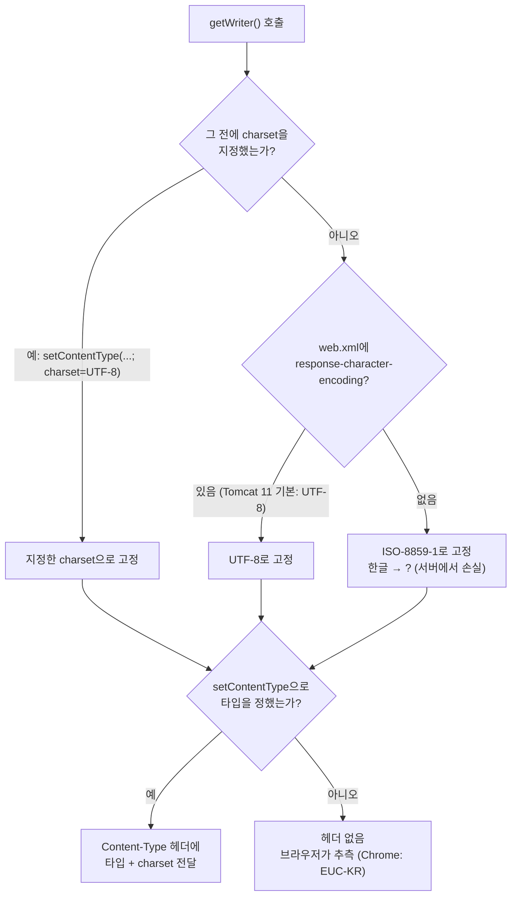

## 들어가며 (Situation)

Servlet 2일차 첫 실습은 `d_response/ResponseServlet.java`였다. 1일차에는 요청을 **받는** 쪽만 다뤘다면, 오늘은 서블릿이 HTML을 직접 만들어 브라우저에 **돌려주는** 쪽이다. 수업 주석은 서블릿의 역할을 세 가지로 정리하고 있었다.

```java
/* comment. Servlet 의 역할
*   1. 요청 전달 받기
*   2. MVC 패턴 중 Controller 의 역할을 수행
*   3. 응답 전달 하기
*   - Response 객체를 활용해서 사용자에게 응답한다.
* */
```

응답 코드는 이렇다.

```java
@WebServlet("/response")
public class ResponseServlet extends HttpServlet {
    @Override
    protected void doGet(HttpServletRequest req, HttpServletResponse resp) throws ServletException, IOException {
        StringBuilder response = new StringBuilder();
        response.append("<!doctype html>\n")
                .append("<html>\n")
                .append("<body>\n")
                .append("<h1>Servlet 의 응답 결과</h1>")
                .append("</body>\n")
                .append("</html>\n");

        System.out.println("response type : " + resp.getContentType());

        // 서버에서 응답하는 데이터의 형태는 html 형태이다.
        resp.setContentType("text/html; charset=UTF-8");

        // 브라우저 화면에 노출 시키는 객체
        PrintWriter out = resp.getWriter();
        out.print(response);
        out.flush();
        out.close();
    }
}
```

같은 날 작성한 `ExceptionServlet`에는 `setContentType` 줄 위에 이런 주석도 달았다.

```java
// 해당 코드는 응답 시에 항상 해주어야
// 한글이 깨지지 않게 된다.
// == 계속 반복되는 코드
resp.setContentType("text/html; charset=UTF-8");
```

## 문제 상황 (Task)

오늘 IDE의 Tomcat access log를 보면 `/response`를 5번 요청했다. 첫 번째(11:15)는 서버를 다시 띄우기 전이라 404였고, 나머지 4번은 200이었다. 콘솔에는 매번 이 줄이 찍혔다.

```text
response type : null
```

그리고 오늘 응답 코드를 쓴 서블릿 4개(`ResponseServlet`, `ExceptionServlet`, `ResponseLoginServlet`, `RedirectServlet`)에 모두 같은 `setContentType` 줄이 들어갔다. 그래서 궁금한 점이 생겼다.

1. `getContentType()`은 왜 `null`인가?
2. 주석대로 `setContentType`을 **빼면** 정말 한글이 깨지는가? 깨진다면 서버가 잘못 보내는 건가, 브라우저가 잘못 읽는 건가?
3. `getWriter()`를 먼저 부르고 `setContentType`을 나중에 부르면 어떻게 되는가?

IDE와 같은 Tomcat 11.0.27을 별도 포트(18080)로 띄우고, 수업 코드와 확인용 서블릿을 함께 배포해서 확인했다.

## 해결 과정 (Action)

### 1. 확인용 서블릿: 네 가지 방식으로 "응답"을 보내기

`<h1>응답</h1>`이라는 같은 내용을 네 가지 방식으로 보내는 서블릿을 만들었다. (확인용 **예시 코드**)

```java
@WebServlet("/resp-probe")
public static class RespProbe extends HttpServlet {
    @Override
    protected void doGet(HttpServletRequest req, HttpServletResponse resp) throws IOException {
        String mode = req.getParameter("mode");
        System.out.println("before: contentType=" + resp.getContentType() + ", charset=" + resp.getCharacterEncoding());
        PrintWriter out;
        switch (mode) {
            case "full":      // 수업 코드와 같은 방식
                resp.setContentType("text/html; charset=UTF-8");
                out = resp.getWriter();
                break;
            case "nocharset": // charset 없이 타입만
                resp.setContentType("text/html");
                out = resp.getWriter();
                break;
            case "late":      // getWriter() 먼저, setContentType 나중
                out = resp.getWriter();
                resp.setContentType("text/html; charset=UTF-8");
                break;
            default:          // none: setContentType 아예 없음
                out = resp.getWriter();
        }
        System.out.println("after : contentType=" + resp.getContentType() + ", charset=" + resp.getCharacterEncoding());
        out.print("<h1>응답</h1>");
        out.flush();
        out.close();
    }
}
```

응답 헤더와 본문 바이트는 `curl`로 확인했다. `-D -`는 응답 헤더를 화면에 찍고, 본문은 파일로 저장해 16진수로 본다.

```bash
for m in full nocharset none late; do
  curl -s -D - -o body_$m.bin "http://localhost:18080/resp-probe?mode=$m" | grep -i "^content-type"
  xxd -p body_$m.bin
done
```

"응답"을 UTF-8로 인코딩하면 `ec9d91 eb8bb5` 6바이트가 나와야 한다.

### 2. 첫 결과: 서버는 네 경우 모두 UTF-8로 보냈다

Tomcat 기본 설정 그대로의 결과다. 브라우저 열은 Chrome(언어 설정 `ko-KR`)으로 같은 주소를 열고 `document.characterSet`과 `<h1>` 내용을 읽은 값이다.

| mode | `Content-Type` 헤더 | 본문 바이트 ("응답" 부분) | Chrome 표시 |
|------|---------------------|---------------------------|-------------|
| full | `text/html;charset=UTF-8` | `ec9d91 eb8bb5` | UTF-8, `응답` |
| nocharset | `text/html;charset=UTF-8` | `ec9d91 eb8bb5` | (확인 안 함) |
| none | **헤더 없음** | `ec9d91 eb8bb5` | **EUC-KR, `�묐떟`** |
| late | `text/html;charset=UTF-8` | `ec9d91 eb8bb5` | (확인 안 함) |

예상과 달랐다. `setContentType`을 아예 부르지 않은 `none`도 **서버는 UTF-8 바이트를 정확히 보냈다.** 그런데 브라우저에서는 한글이 깨졌다.

차이는 헤더 한 줄이었다. `none`은 응답에 `Content-Type` 헤더가 없었다. 브라우저는 이 바이트가 HTML인지, 어떤 인코딩인지 들은 게 없으니 스스로 추측했다. Chrome은 내용을 보고 `text/html`로 판단했고, 인코딩은 한국어 환경의 기본값인 **EUC-KR**로 골랐다. UTF-8 바이트 6개를 EUC-KR로 읽으니 `�묐떟`이 됐다.

결국 주석의 "한글이 깨진다"는 맞았지만, 깨지는 위치는 서버가 아니라 **브라우저의 해석 단계**였다.

### 3. 설정하지 않았는데 왜 UTF-8이었을까

콘솔 출력에 단서가 있었다. `setContentType`을 부르기 **전**인데도 인코딩이 이미 UTF-8이었다.

```text
[resp-probe] mode=none before: contentType=null, charset=UTF-8
[resp-probe] mode=none after : contentType=null, charset=UTF-8
```

Tomcat 설치 폴더의 `conf/web.xml`을 열어 보니 이 설정이 기본으로 들어 있었다.

```xml
<!-- Set the default request and response character encodings to UTF-8.   -->
<request-character-encoding>UTF-8</request-character-encoding>
<response-character-encoding>UTF-8</response-character-encoding>
```

[어제 GET/POST 실험]()에서 POST 한글을 살려 준 `request-character-encoding` 바로 아랫줄이다. 응답 쪽도 Tomcat이 기본 인코딩을 UTF-8로 정해 두고 있었다.

1번 질문의 답도 여기서 나왔다. `getContentType()`이 `null`인 이유는 **타입을 아직 아무도 정하지 않았기 때문**이다. 인코딩(UTF-8)은 Tomcat 설정으로 정해져 있었지만, `text/html` 같은 타입은 서블릿이 `setContentType`으로 정해야 생긴다.

### 4. Tomcat 기본 설정을 끄면

그렇다면 이 설정이 없는 환경에서는 어떨까. 실험용 Tomcat의 `conf/web.xml`에서 `response-character-encoding` 줄만 주석 처리하고 다시 띄웠다.

```xml
<request-character-encoding>UTF-8</request-character-encoding>
<!-- <response-character-encoding>UTF-8</response-character-encoding> -->
```

같은 요청을 다시 보냈다.

| mode | `Content-Type` 헤더 | 본문 바이트 ("응답" 부분) | 결과 |
|------|---------------------|---------------------------|------|
| full | `text/html;charset=UTF-8` | `ec9d91 eb8bb5` | 정상 |
| nocharset | `text/html;charset=ISO-8859-1` | **`3f 3f`** | `??` |
| none | 헤더 없음 | **`3f 3f`** | `??` |
| late | `text/html;charset=ISO-8859-1` | **`3f 3f`** | `??` |

이번에는 서버 단계에서 망가졌다. `3f`는 `?` 문자다. 한글 두 글자가 6바이트가 아니라 `??` 2바이트로 바뀌어 나갔다. 라틴 문자만 담는 ISO-8859-1에는 한글이 없어서, 서버가 변환하지 못한 글자를 `?`로 바꿔 버린 것이다. 이렇게 되면 브라우저가 어떤 인코딩으로 읽어도 원래 글자를 되살릴 수 없다.

콘솔에서도 기본값이 바뀐 것이 보였다.

```text
[resp-probe] mode=late before: contentType=null, charset=ISO-8859-1
[resp-probe] mode=late after : contentType=text/html;charset=ISO-8859-1, charset=ISO-8859-1
```

`late`가 흥미로웠다. 분명히 `charset=UTF-8`을 넘겼는데 결과는 ISO-8859-1이었다. **`getWriter()`를 부르는 순간 인코딩이 고정**되고, 그 뒤의 charset 지정은 무시된 것이다. 타입(`text/html`)만 반영됐다.

수업 코드 `/response`는 이 환경에서도 `charset=UTF-8` 헤더와 정상 바이트(`ec9d91 eb8bb5`)로 응답했다. `setContentType`을 `getWriter()`보다 **먼저** 부르고, charset까지 명시했기 때문이다.

### 5. 공식 문서로 확인한 규칙

실험 결과는 Jakarta Servlet 6.1 명세의 응답 인코딩 규칙과 그대로 맞았다.

> If the servlet does not specify a character encoding before the getWriter method of the ServletResponse interface is called or the response is committed, the default ISO-8859-1 is used.

> Calls made after the servlet response's getWriter method has been called or after the response is committed have no effect on the character encoding. Calls to setContentType set the character encoding only if the given content type string provides a value for the charset attribute.

> Note that the character encoding cannot be communicated via HTTP headers if the servlet does not specify a content type; however, it is still used to encode text written via the servlet response's writer.

마지막 문장이 `none` 모드의 상황 그대로다. 인코딩은 Writer에 쓰이지만, 타입을 정하지 않으면 그 인코딩을 헤더로 알려 줄 방법이 없다.

정리하면 인코딩이 정해지는 흐름은 이렇다.



한글이 깨지는 길은 두 가지였다. 서버가 ISO-8859-1로 써서 **바이트 자체가 사라지는 경우**와, 바이트는 맞는데 **헤더가 없어 브라우저가 잘못 읽는 경우**다. `resp.setContentType("text/html; charset=UTF-8")`을 `getWriter()`보다 먼저 부르면 두 길을 한 번에 막는다.

## 결과 (Result)

| 상황 | 서버가 보낸 "응답" 바이트 | 헤더 | 화면 |
|------|---------------------------|------|------|
| 수업 코드 (`setContentType` → `getWriter`) | 6바이트 (UTF-8) | `text/html;charset=UTF-8` | 정상 |
| `setContentType` 없음, Tomcat 기본 설정 | 6바이트 (UTF-8) | 없음 | Chrome이 EUC-KR로 읽어 `�묐떟` |
| `setContentType` 없음, 기본 설정 끔 | 2바이트 (`??`) | 없음 | `??` |
| `getWriter` 후 `setContentType`, 기본 설정 끔 | 2바이트 (`??`) | `charset=ISO-8859-1` | `??` |
| 환경 | Tomcat 11.0.27, Java 21 (Temurin), Jakarta Servlet API 6.1, Chrome (ko-KR) | | |

배운 점은 다음과 같다.

- `getContentType()`이 `null`인 것은 정상이다. 타입은 서블릿이 정해야 생기고, 정하지 않으면 `Content-Type` 헤더 자체가 빠진다.
- Tomcat 11은 응답 인코딩 기본값이 UTF-8이라 바이트는 맞게 나가지만, 헤더가 없으면 **브라우저가 추측**해서 깨질 수 있다.
- 순서가 중요하다. `getWriter()`가 불리는 순간 인코딩이 고정되므로 `setContentType`은 반드시 그 전에 부른다.
- 주석의 "계속 반복되는 코드"는 실제로 오늘 서블릿 4개에 같은 줄이 들어갔다. 이런 공통 처리를 한곳에 모으는 방법(필터)은 다음에 배울 내용으로 남겨 둔다.

## 더 학습하면 좋은 개념

- **서블릿 필터(Filter)** — 모든 요청과 응답 앞뒤에 공통 코드를 끼워 넣는 기능. 서블릿마다 반복한 `setContentType` 같은 코드를 한곳으로 모을 수 있다.
- **MIME 스니핑과 `X-Content-Type-Options: nosniff`** — 헤더가 없을 때 브라우저가 내용을 보고 타입을 추측하는 동작. 오늘 `none` 모드에서 본 현상이며, 보안상 이를 막는 헤더도 있다.
- **문자 인코딩 (UTF-8, EUC-KR, ISO-8859-1)** — 같은 글자가 인코딩마다 다른 바이트가 되는 원리. `ec9d91`이 왜 `�묐`로 보였는지 이해할 수 있다.
- **JSP와 템플릿 엔진** — `StringBuilder`로 HTML을 한 줄씩 붙이는 방식의 불편함을 해결하는 다음 단계. 응답 화면을 HTML 파일처럼 작성할 수 있다.

## 참고 자료

- [Jakarta Servlet 6.1 Specification](https://jakarta.ee/specifications/servlet/6.1/jakarta-servlet-spec-6.1.html) — 5.6 Internationalization
- [Jakarta Servlet 6.1 API - ServletResponse](https://jakarta.ee/specifications/servlet/6.1/apidocs/jakarta.servlet/jakarta/servlet/ServletResponse.html)
- [MDN - Content-Type](https://developer.mozilla.org/en-US/docs/Web/HTTP/Headers/Content-Type)
- [MDN - MIME types](https://developer.mozilla.org/en-US/docs/Web/HTTP/Basics_of_HTTP/MIME_types)

---

**요약**
1. `setContentType` 없이 응답하면 `Content-Type` 헤더가 빠지고, 서버가 UTF-8 바이트를 보내도 Chrome(ko-KR)은 EUC-KR로 추측해 `응답`을 `�묐떟`으로 표시했다.
2. Tomcat 11은 `conf/web.xml`의 `response-character-encoding`이 UTF-8이라 바이트는 맞았지만, 이 설정을 끄면 기본값 ISO-8859-1 때문에 한글이 서버에서 `??`로 바뀌었다.
3. `getWriter()`를 부른 뒤의 charset 지정은 무시되므로, `setContentType("text/html; charset=UTF-8")`은 반드시 `getWriter()` 전에 호출한다.
