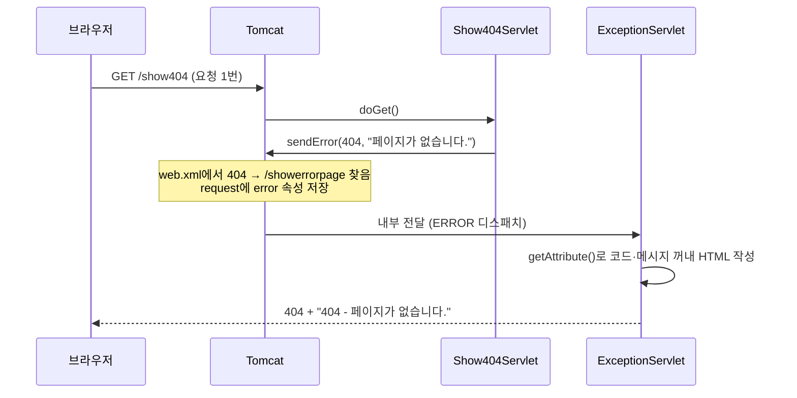

## 들어가며 (Situation)

두 번째 실습은 `e_exception` 패키지였다. 링크 두 개짜리 `exception.html`에서 각각 404와 500 에러를 일부러 일으킨다.

```java
@WebServlet("/show404")
public class Show404Servlet extends HttpServlet {
    @Override
    protected void doGet(HttpServletRequest req, HttpServletResponse resp) throws ServletException, IOException {
        System.out.println("404 Servlet 호출됨...");
        // throw new Exception(); 에러 터진다는 가정

        resp.sendError(404, "페이지가 없습니다.");
    }
}
```

`Show500Servlet`도 같은 모양이고, `resp.sendError(500, "500번대 Error 는 순전히 개발자의 잘못.")`만 다르다. 그리고 `WEB-INF/web.xml`에 이 설정을 넣었다.

```xml
<error-page>
    <error-code>404</error-code>
    <location>/showerrorpage</location>
</error-page>
<error-page>
    <error-code>500</error-code>
    <location>/showerrorpage</location>
</error-page>
```

`/showerrorpage`에 매핑된 `ExceptionServlet`이 실제 에러 화면을 만든다.

```java
@WebServlet("/showerrorpage")
public class ExceptionServlet extends HttpServlet {
    @Override
    protected void doGet(HttpServletRequest req, HttpServletResponse resp) throws ServletException, IOException {
        System.out.println("showerrorpage 서블릿 호출됨...");

        String forwardUrl = req.getAttribute("jakarta.servlet.forward.request_uri").toString();
        System.out.println("forwardUrl = " + forwardUrl);

        int statusCode = (int) req.getAttribute("jakarta.servlet.error.status_code");
        String msg = req.getAttribute("jakarta.servlet.error.message").toString();

        // ... "<h1>" + statusCode + " - " + msg + "</h1>" 형태의 HTML 응답
    }
}
```

수업 주석은 이것을 "forward의 개념으로, 1개의 서블릿이 책임이 많아질 때 다른 서블릿을 만들어서 마치 요청을 받은 서블릿이 응답까지 하는 것처럼 보여주는 것"이라고 설명했다.

## 문제 상황 (Task)

오늘 access log를 세어 보니 `/show404`를 **27번**, `/show500`을 **13번** 눌렀다. 상태 코드는 모두 404와 500이었다. 그런데 몇 가지가 이해되지 않았다.

1. `Show404Servlet`은 `sendError()`만 불렀고 HTML을 만든 적이 없다. 화면은 누가 언제 만들었나?
2. `ExceptionServlet`은 상태 코드와 메시지를 `getAttribute()`로 꺼낸다. 이 값은 **누가** 넣어 줬나?
3. 주석의 가정처럼 `sendError()` 대신 예외가 터지면 화면은 어떻게 나오나?
4. `/showerrorpage`도 결국 URL이다. 누가 직접 들어오면 어떻게 되나?

[어제처럼]() 같은 Tomcat 11.0.27을 별도 포트(18080)로 띄워 수업 코드를 배포하고, `curl`로 요청을 보내며 콘솔과 로그를 확인했다.

## 해결 과정 (Action)

### 1. `web.xml` 설정이 없으면 어떤 화면이 나오나

먼저 비교 기준이 필요했다. 수업 코드를 그대로 복사하되 `web.xml`에서 `<error-page>`만 지운 앱을 하나 더 배포했다.

```bash
curl -s -o noerr.html -w "status=%{http_code} size=%{size_download}\n" http://localhost:18080/noerr/show500
```

| 항목 | `<error-page>` 없음 | `<error-page>` 있음 (수업 코드) |
|------|---------------------|----------------------------------|
| `/show404` 상태 코드 | 404 | 404 |
| `/show404` 화면 | Tomcat 기본 에러 페이지 (772바이트) | `<h1>404 - 페이지가 없습니다.</h1>` |
| `/show500` 상태 코드 | 500 | 500 |
| `/show500` 화면 | Tomcat 기본 에러 페이지 (760바이트) | `<h1>500 - 500번대 Error 는 순전히 개발자의 잘못.</h1>` |

설정이 없을 때는 Tomcat이 직접 만든 페이지가 나왔다. 제목은 `HTTP 상태 500 – 내부 서버 오류`였고, 본문에 `sendError()`로 넘긴 메시지가 `메시지` 항목으로 들어 있었다.

```text
타입    상태 보고
메시지  500번대 Error 는 순전히 개발자의 잘못.
설명    서버가, 해당 요청을 충족시키지 못하게 하는 예기치 않은 조건을 맞닥뜨렸습니다.
```

즉 `sendError()`는 "에러가 났다"는 신호와 메시지만 넘기고, 화면은 컨테이너가 고른다. `<error-page>`는 그 화면을 **내 서블릿으로 바꿔 끼우는** 설정이었다. 공식 API 문서의 `sendError` 설명도 같다.

> If an error-page declaration has been made for the web application corresponding to the status code passed in, it will be served back the error page

### 2. 요청은 한 번, 서블릿은 두 개

수업 코드가 배포된 상태에서 `/show404`를 요청했다.

```bash
curl -s -i http://localhost:18080/show404
```

```text
HTTP/1.1 404
Content-Type: text/html;charset=UTF-8

<h1>404 - 페이지가 없습니다.</h1>
```

콘솔에는 두 서블릿의 출력이 순서대로 찍혔다.

```text
404 Servlet 호출됨...
showerrorpage 서블릿 호출됨...
forwardUrl = /show404
```

반면 access log에는 `GET /show404 404` **한 줄만** 남았다. 브라우저가 `/showerrorpage`로 다시 요청한 것이 아니라, Tomcat이 서버 안에서 요청을 넘긴 것이다. 그리고 `ExceptionServlet`은 상태 코드를 설정한 적이 없는데 응답은 200이 아니라 404였다. 처음 `sendError(404)`로 정해진 상태가 그대로 유지됐다.



### 3. `getAttribute()`의 값은 누가 넣었나: 속성 전부 찍어 보기

`ExceptionServlet`이 꺼내는 이름 외에 무엇이 들어 있는지 보려고, request 속성을 모두 출력하는 서블릿을 만들고 에러 페이지 위치를 그쪽으로 바꾼 앱을 따로 배포했다. (확인용 **예시 코드**)

```java
@WebServlet("/errordump")
public static class ErrorDump extends HttpServlet {
    @Override
    protected void doGet(HttpServletRequest req, HttpServletResponse resp) {
        System.out.println("dispatcherType=" + req.getDispatcherType() + ", method=" + req.getMethod()
                + ", requestURI=" + req.getRequestURI() + ", status=" + resp.getStatus());
        for (String name : Collections.list(req.getAttributeNames())) {
            if (name.startsWith("jakarta.servlet.")) {
                System.out.println("  " + name + " = " + req.getAttribute(name));
            }
        }
    }
}
```

`/show404` 요청 때 찍힌 값이다. (이 앱은 `/dump` 경로에 배포했다.)

```text
dispatcherType=ERROR, method=GET, requestURI=/dump/errordump, status=404
  jakarta.servlet.forward.request_uri = /dump/show404
  jakarta.servlet.forward.context_path = /dump
  jakarta.servlet.forward.servlet_path = /show404
  jakarta.servlet.forward.mapping = MappingImpl[matchValue=show404, pattern=/show404, ...]
  jakarta.servlet.error.message = 페이지가 없습니다.
  jakarta.servlet.error.servlet_name = com.wanted.servlet.e_exception.Show404Servlet
  jakarta.servlet.error.method = GET
  jakarta.servlet.error.request_uri = /dump/show404
  jakarta.servlet.error.status_code = 404
```

값은 **Tomcat이 에러 페이지로 넘기기 직전에** 넣은 것이었다. 두 묶음이 함께 들어 있다.

| 속성 묶음 | 내용 | 넣는 이유 |
|-----------|------|-----------|
| `jakarta.servlet.error.*` | 상태 코드, 메시지, 원래 URI, 서블릿 이름, 원래 메서드 | 에러 페이지 전용 정보 |
| `jakarta.servlet.forward.*` | 원래 URI, 경로 정보 | forward와 같은 방식으로 넘겼기 때문 |

수업 코드가 `forward.request_uri`로 원래 주소를 꺼낼 수 있었던 이유는 명세에 있었다. Jakarta Servlet 6.1 명세 10.9.1절은 에러 페이지가 서블릿일 때 이렇게 규정한다.

> The request path and attributes are set as if a RequestDispatcher.forward to the error resource had been performed.

수업 주석이 이것을 "forward의 개념"이라고 부른 것과 정확히 맞는다. 다만 에러 페이지 용도로 명세가 정의한 속성은 `jakarta.servlet.error.request_uri`이고, 값도 같았다.

### 4. 없는 주소로 요청하면

서블릿이 `sendError()`를 부르지 않아도 같은 페이지가 나오는지 궁금했다. 매핑이 없는 주소로 요청했다.

```bash
curl -s http://localhost:18080/nothing-here
```

```text
<h1>404 - 요청된 리소스 [/nothing-here]은(는) 가용하지 않습니다.</h1>
```

수업 코드의 에러 페이지가 그대로 나왔다. 속성을 찍어 보니 `error.servlet_name`이 `default`였다. 매핑이 없는 요청을 받은 Tomcat의 기본 서블릿이 내부에서 `sendError(404)`를 부른 것이다. 명세에도 "The default servlet and container will use the sendError method to send 4xx and 5xx status responses"라고 되어 있다. 그래서 `<error-code>404</error-code>` 하나로 **오타 난 주소까지** 같은 화면으로 처리된다.

### 5. 주석의 가정: `throw new Exception()`

`Show404Servlet`의 주석 `// throw new Exception(); 에러 터진다는 가정`을 실제로 풀어 보려 했다. 그런데 주석을 그대로 살리면 컴파일부터 안 된다.

```bash
javac -cp servlet-api.jar ThrowChecked.java
```

```text
ThrowChecked.java:7: error: unreported exception Exception; must be caught or declared to be thrown
        throw new Exception();
        ^
```

`doGet()`의 선언은 `throws ServletException, IOException`뿐이라, 그보다 넓은 `Exception`은 던질 수 없다. 그래서 컴파일 검사가 없는 런타임 예외로 바꿨다. (확인용 **예시 코드**)

```java
@WebServlet("/throw-probe")
public static class ThrowProbe extends HttpServlet {
    @Override
    protected void doGet(HttpServletRequest req, HttpServletResponse resp) {
        System.out.println("[throw-probe] 호출됨");
        throw new IllegalStateException("DB 연결 실패");
    }
}
```

상태 코드는 500이었고, `500`용 `<error-page>`가 그대로 적용됐다. 그런데 화면이 이상했다.

```text
<h1>500 - </h1>
```

메시지가 비어 있었다. 속성을 찍어 보니 이유가 보였다.

```text
jakarta.servlet.error.message =
jakarta.servlet.error.exception = java.lang.IllegalStateException: DB 연결 실패
jakarta.servlet.error.status_code = 500
```

예외가 터진 경우 메시지는 `error.message`가 아니라 **`error.exception`에 예외 객체째로** 들어 있었다. 명세도 "exception type and error message attributes are redundant. They are retained for backwards compatibility"라고 적고 있다. 예외 정보는 예외 객체에서 꺼내는 것이 기본이라는 뜻이다. (명세 표에는 `error.exception_type`도 있지만, 이번 실험에서 `getAttribute()`로 직접 조회한 값은 `null`이었다.)

예외의 전체 스택 트레이스는 화면이 아니라 Tomcat의 `logs/localhost.<날짜>.log`에 남았다.

```text
심각 [http-nio-18080-exec-4] ...StandardWrapperValve.invoke 경로가 []인 컨텍스트의 서블릿 [probe.Probes$ThrowProbe]을(를) 위한 Servlet.service() 호출이 예외를 발생시켰습니다.
	java.lang.IllegalStateException: DB 연결 실패
```

| 에러 발생 방식 | 상태 코드 | `error.message` | `error.exception` |
|----------------|-----------|-----------------|-------------------|
| `sendError(404, "페이지가 없습니다.")` | 404 | `페이지가 없습니다.` | 없음 |
| `sendError(500, "...개발자의 잘못.")` | 500 | 넘긴 메시지 | 없음 |
| 없는 주소 | 404 | Tomcat이 만든 안내 문구 | 없음 |
| `throw new IllegalStateException(...)` | 500 | **빈 문자열** | 예외 객체 |

### 6. 에러 페이지를 직접 열면

`/showerrorpage`도 `@WebServlet`으로 매핑된 평범한 URL이다. 주소창에 바로 치면 어떻게 될까.

```bash
curl -s -i http://localhost:18080/showerrorpage
```

응답은 `500`과 `<h1>500 - </h1>`이었고, 콘솔에는 서블릿이 **두 번** 호출된 흔적이 남았다.

```text
showerrorpage 서블릿 호출됨...
showerrorpage 서블릿 호출됨...
forwardUrl = /showerrorpage
```

localhost 로그를 보니 첫 번째 호출에서 `NullPointerException`이 났다.

```text
java.lang.NullPointerException: Cannot invoke "Object.toString()" because the return value of
"jakarta.servlet.http.HttpServletRequest.getAttribute(String)" is null
	at com.wanted.servlet.e_exception.ExceptionServlet.doGet(ExceptionServlet.java:30)
```

직접 들어오면 Tomcat이 넣어 주는 속성이 없으니 `getAttribute(...)`가 `null`이고, 바로 `.toString()`을 부른 30번째 줄에서 터졌다. 이 예외가 다시 500 에러가 되어 **같은 에러 페이지로** 넘어갔고, 두 번째 호출에서는 속성이 채워져 있어 `500 - `가 그려졌다. 에러 페이지 서블릿 안에서 속성이 없을 때를 대비해야 하는 이유다.

### 7. POST 요청에서 에러가 나면 `doGet()`이 불린다

마지막으로 의외였던 점이다. `ExceptionServlet`에는 `doGet()`만 있다. 그런데 POST 요청에서 에러가 났을 때도 에러 화면이 정상으로 나왔다. 속성을 찍어 보니 메서드가 바뀌어 있었다.

```text
dispatcherType=ERROR, method=GET, ...
  jakarta.servlet.error.method = POST
```

원래 요청은 POST였지만 에러 페이지에는 **GET으로** 들어왔고, 원래 메서드는 `error.method`에 따로 담겨 있었다. Servlet 6.1에서 새로 생긴 규칙이다.

> To avoid unexpected behaviour, the container must dispatch all error dispatches to error pages as HTTP GET requests. The original HTTP method must be provided to the dispatched request via the request attribute 'RequestDispatcher.ERROR_METHOD'.

덕분에 에러 페이지 서블릿은 `doGet()` 하나만 있으면 된다.

## 결과 (Result)

| 확인 항목 | 결과 |
|-----------|------|
| `<error-page>` 유무 | 없으면 Tomcat 기본 페이지(760~772바이트), 있으면 수업 코드 화면 |
| `/show404` 한 번 요청 시 호출된 서블릿 | 2개 (`Show404Servlet` → `ExceptionServlet`), access log는 1줄 |
| 에러 페이지 응답 상태 코드 | `sendError`로 정한 404/500 유지 |
| 없는 주소 | 같은 404 에러 페이지, `servlet_name=default` |
| 런타임 예외 | 500, `error.message`는 빈 값, 예외는 `error.exception`에 |
| 에러 페이지 직접 접근 | NPE → 같은 페이지 재호출, 서블릿 2번 실행 |
| POST 요청의 에러 | 에러 페이지에는 GET으로 전달, `error.method=POST` |
| 환경 | Tomcat 11.0.27, Java 21 (Temurin), Jakarta Servlet API 6.1 |

배운 점은 다음과 같다.

- `sendError()`는 화면을 만드는 메서드가 아니라 **"에러가 났다"는 신호**다. 화면은 컨테이너가 `<error-page>` 설정을 보고 고른다.
- 에러 페이지는 서버 안에서 forward하듯 넘어가므로 요청은 한 번이고, 정보는 request 속성으로 전달된다.
- 예외가 원인일 때는 `error.message`가 비어 있을 수 있다. 에러 페이지는 속성이 없거나 비어 있는 경우까지 고려해서 작성해야 한다.

## 더 학습하면 좋은 개념

- **`<exception-type>` 에러 페이지** — 상태 코드가 아니라 예외 클래스로 에러 페이지를 고르는 설정. 명세상 가장 가까운 상위 클래스가 선택된다.
- **`DispatcherType` (REQUEST, FORWARD, INCLUDE, ERROR, ASYNC)** — 같은 서블릿이라도 어떤 경로로 호출됐는지 구분하는 값. 오늘 에러 페이지에서 `ERROR`를 봤다.
- **에러 메시지와 로그의 분리** — 스택 트레이스는 로그로, 사용자에게는 짧은 안내만 보내는 원칙. 내부 정보 노출을 막는 보안 관점과 이어진다.
- **Spring의 전역 예외 처리 (`@ControllerAdvice`)** — 서블릿의 에러 페이지 메커니즘을 프레임워크가 감싼 형태로, 나중에 비교해 보면 좋다.

## 참고 자료

- [Jakarta Servlet 6.1 Specification](https://jakarta.ee/specifications/servlet/6.1/jakarta-servlet-spec-6.1.html) — 10.9 Error Handling
- [Jakarta Servlet 6.1 API - HttpServletResponse](https://jakarta.ee/specifications/servlet/6.1/apidocs/jakarta.servlet/jakarta/servlet/http/HttpServletResponse.html)
- [Jakarta Servlet 6.1 API - RequestDispatcher](https://jakarta.ee/specifications/servlet/6.1/apidocs/jakarta.servlet/jakarta/servlet/RequestDispatcher.html)
- [MDN - HTTP response status codes](https://developer.mozilla.org/en-US/docs/Web/HTTP/Status)

---

**요약**
1. `sendError(404)`는 신호일 뿐이고, Tomcat이 `web.xml`의 `<error-page>`를 보고 `/showerrorpage`로 서버 안에서 넘겨 화면을 그렸다(요청 1번, 서블릿 2개).
2. 상태 코드·메시지는 Tomcat이 넘기기 직전에 `jakarta.servlet.error.*` 속성으로 넣어 주며, 예외가 원인이면 메시지는 비고 예외 객체가 `error.exception`에 담겼다.
3. 에러 페이지를 직접 열면 속성이 없어 NPE가 났고, POST 요청의 에러도 Servlet 6.1 규칙에 따라 에러 페이지에는 GET으로 전달됐다.
