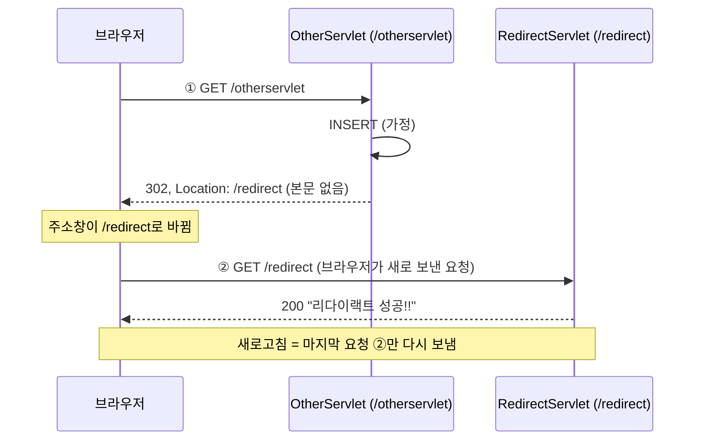
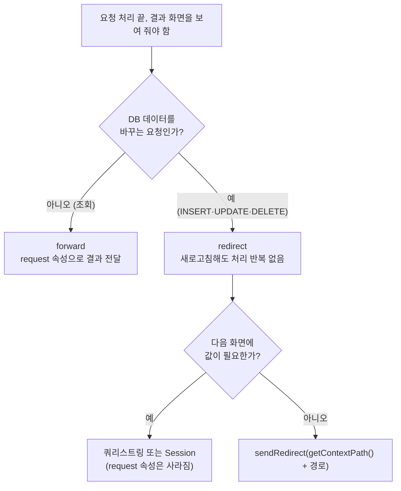

## 들어가며 (Situation)

[forward 실습]()의 마지막 주의점은 "새로고침하면 같은 요청이 반복된다"였다. 오늘 마지막 실습 `g_redirect`는 그 문제를 다른 방식으로 푼다.

`redirect.html`의 링크를 누르면 `/otherservlet`이 회원가입을 처리했다고 가정하고, 응답으로 다른 주소를 알려 준다.

```java
@WebServlet("/otherservlet")
public class OtherServlet extends HttpServlet {
    @Override
    protected void doGet(HttpServletRequest req, HttpServletResponse resp) throws ServletException, IOException {
        System.out.println("/otherservlet 요청됨...");

        // 회원가입 로직 동작..
        // memberService.signUp();
        System.out.println("회원정보 DB 에 INSERT 완료");

        /* comment.
            Redirect 는 요청을 수신하고
            응답 시에 어디로 재요청을 보내야 될지를
            응답 해준다.
         */
        resp.sendRedirect("/redirect");
    }
}
```

`/redirect`의 `RedirectServlet`은 `리다이랙트 성공!!` 화면을 만들고, 주석으로 redirect의 성질을 정리했다.

```java
/* comment.
    Redirect 를 하게 되면, URL 이 강제로 재정의 된다.
    따라서 새로고침 시 재정의 된 페이지에 대한 요청만 반복된다.
    즉, 이전 요청에 포함된 정보는 더이상 남아있지 않고,
    DML 구문 실행 시 반복 실행이 안된다.
    ---
    Redirect 는 이전 요청을 아예 모른다가 장점이자 단점이 될 수 있다.
    단점을 극복하기 위해 나오는 개념이 Cookie / Session
 */
```

## 문제 상황 (Task)

오늘 IDE의 access log를 세어 보니 이 실습 기록이 꽤 많았다.

| 요청 | 횟수 | 상태 코드 |
|------|------|-----------|
| `GET /otherservlet` | 12 | 404 ×4, **302 ×8** |
| `GET /redirect` | 38 | 200 ×38 |

처음 4번은 서버를 다시 띄우기 전이라 404였고, 15:36에 재시작한 뒤부터 302가 찍혔다. 흥미로운 것은 `/redirect`가 38번인데, 그중 바로 앞에 `/otherservlet`이 없는 요청이 **30번**이라는 점이다. 결과 화면에서 새로고침을 30번 한 것이다. 그런데 INSERT 역할의 `/otherservlet`은 302 응답 기준으로 8번만 실행됐다.

```text
15:36:35 "GET /otherservlet HTTP/1.1" 302
15:36:35 "GET /redirect HTTP/1.1" 200      ← 링크 클릭 1번에 요청 2줄
...
15:39:25 "GET /redirect HTTP/1.1" 200      ← 새로고침: /redirect 만 반복
15:39:25 "GET /redirect HTTP/1.1" 200
15:39:25 "GET /redirect HTTP/1.1" 200
```

이 숫자를 보고 정리하고 싶은 질문이 생겼다.

1. 302 응답에는 실제로 무엇이 들어 있나? 왜 요청이 2줄씩 찍히나?
2. 주석의 "이전 요청 정보가 남아 있지 않다"는 구체적으로 무엇이 사라진다는 뜻인가?
3. 회원가입처럼 원래 POST인 요청을 redirect하면 어떻게 되나?
4. `sendRedirect("/redirect")`의 `/`는 어디를 기준으로 하나?

이번에도 Tomcat 11.0.27을 별도 포트(18080)로 띄우고 `curl`과 Chrome으로 확인했다.

## 해결 과정 (Action)

### 1. 302 응답 들여다보기

`curl`은 기본적으로 리다이렉트를 따라가지 않는다. 그래서 `/otherservlet`의 응답만 그대로 볼 수 있다.

```bash
curl -s -i http://localhost:18080/otherservlet
```

```text
HTTP/1.1 302
Location: /redirect
Content-Length: 0
```

응답에는 화면이 없었다. 본문 0바이트에 **"`/redirect`로 다시 요청하라"는 `Location` 헤더 하나**가 전부였다. 수업 주석의 "어디로 재요청을 보내야 될지를 응답해 준다"가 이 헤더다. `-L`을 붙이면 `curl`도 브라우저처럼 따라간다.

```bash
curl -s -L -o /dev/null -w "final=%{url_effective} status=%{http_code} num_redirects=%{num_redirects}\n" \
     http://localhost:18080/otherservlet
```

```text
final=http://localhost:18080/redirect status=200 num_redirects=1
```

Chrome에서 `/otherservlet`을 열었을 때도 결과는 같았다. 주소창은 `http://localhost:18080/redirect`로 바뀌었고, 탐색 기록의 `redirectCount`는 1이었다.



[forward]()는 서버 안에서 처리 담당을 바꿨지만, redirect는 **브라우저에게 다시 요청하라고 시키는** 방식이다. 그래서 access log에 요청이 2줄씩 남았다.

### 2. 새로고침하면 무엇이 반복되나

새로고침은 브라우저가 **마지막으로 보낸 요청**을 다시 보내는 것이다. redirect 뒤의 마지막 요청은 `GET /redirect`다. 결과 화면에서 새로고침하는 상황을 `curl`로 5번 재현했다.

```bash
for i in 1 2 3 4 5; do curl -s -o /dev/null http://localhost:18080/redirect; done
```

콘솔에는 `/redirect 요청됨...`만 5번 찍혔고, `회원정보 DB 에 INSERT 완료`는 한 번도 늘지 않았다. 오늘 IDE 기록의 "새로고침 30번, INSERT 8번"과 같은 결과다.

| 방식 | 새로고침 시 다시 가는 요청 | 처리 로직 반복 |
|------|----------------------------|----------------|
| forward (`POST /forward`) | `POST /forward` | 반복됨 (같은 POST 3번 → `로그인 성공` 3번) |
| redirect (`/otherservlet` → `/redirect`) | `GET /redirect` | 반복 안 됨 (새로고침 5번 → INSERT 0번) |

### 3. "이전 요청을 모른다": 속성은 사라진다

forward에서는 `setAttribute()`로 다음 서블릿에 값을 넘겼다. redirect에서도 될까? 속성을 넣고 redirect하는 서블릿을 만들었다. (확인용 **예시 코드**)

```java
@WebServlet("/redirect-attr")
public static class RedirectAttr extends HttpServlet {
    @Override
    protected void doGet(HttpServletRequest req, HttpServletResponse resp) throws IOException {
        req.setAttribute("userId", "user01");
        resp.sendRedirect("/redirect-dump");
    }
}

@WebServlet("/redirect-dump")
public static class RedirectDump extends HttpServlet {
    @Override
    protected void doGet(HttpServletRequest req, HttpServletResponse resp) {
        System.out.println("[redirect-dump] method=" + req.getMethod()
                + ", getAttribute(userId)=" + req.getAttribute("userId")
                + ", queryString=" + req.getQueryString());
    }
}
```

```text
[redirect-attr] setAttribute(userId=user01) 후 sendRedirect
[redirect-dump] method=GET, getAttribute(userId)=null, queryString=null
```

`null`이었다. request 객체는 요청 하나가 끝나면 사라진다. redirect의 두 번째 요청은 브라우저가 새로 보낸 **별개의 요청**이므로, 첫 요청에 넣은 속성은 남아 있지 않다. 주석의 "이전 요청을 아예 모른다"는 이 뜻이었다.

값을 넘기려면 두 번째 요청에 실어 보내야 한다. 가장 단순한 방법은 `sendRedirect("/redirect-dump?userId=user01")`처럼 주소에 쿼리스트링을 붙이는 것이지만, [GET처럼]() 주소창과 access log에 값이 그대로 남는다. 주석이 다음 주제로 예고한 Cookie와 Session이 이 문제를 다루는 방법이다.

### 4. POST 요청을 redirect하면 GET이 된다

수업 코드의 `/otherservlet`은 링크로 들어오는 GET이다. 하지만 실제 회원가입은 폼 POST로 들어온다. POST를 받아 redirect하는 서블릿을 만들어 보냈다. (확인용 **예시 코드**)

```java
@WebServlet("/signup-probe")
public static class SignupProbe extends HttpServlet {
    @Override
    protected void doPost(HttpServletRequest req, HttpServletResponse resp) throws IOException {
        System.out.println("[signup-probe] POST 수신, INSERT 1회 (가정)");
        resp.sendRedirect("/redirect");
    }
}
```

```bash
curl -s -L -o /dev/null -w "final=%{url_effective} status=%{http_code}\n" -d "userId=user01" http://localhost:18080/signup-probe
```

```text
final=http://localhost:18080/redirect status=200
```

`/redirect`에는 `doGet()`만 있다. 그런데 405가 아니라 200이 나왔다. 두 번째 요청이 **GET으로 바뀌었다**는 뜻이다. 수업 주석의 "URL 변경은 곧 a 태그를 누르는 것과 마찬가지의 효과를 가지기 때문에 get 방식이다"가 이것이다.

이 동작은 HTTP 명세(RFC 9110)의 302 설명에 근거가 있다.

> For historical reasons, a user agent MAY change the request method from POST to GET for the subsequent request.

"MAY", 즉 해도 된다는 허용이다. 브라우저와 `curl`(옵션 없이 `-d`만 쓴 경우)은 실제로 GET으로 바꿨다. 반드시 GET으로 바꾸라고 명시하려면 **303 See Other**를 쓰고, 메서드를 유지하려면 307을 쓴다. Servlet 6.1에는 상태 코드를 직접 고르는 `sendRedirect(String location, int sc)`가 추가됐다.

이렇게 **POST로 데이터를 바꾸고 → redirect → GET으로 결과 화면을 보여 주는** 흐름을 PRG(Post/Redirect/Get) 패턴이라고 부른다. 오늘 실습 구조가 바로 이 패턴의 축소판이었다.

### 5. 시행착오: 앱 경로가 바뀌면 redirect만 깨진다

수업에서는 IDE가 앱을 루트(`/`)에 배포했다. 실제 서버에서는 `/chap01`처럼 앱 이름이 주소 앞에 붙는 경우가 많다. 같은 코드를 `/chap01` 경로로 배포해 오늘 실습한 세 가지 이동을 비교했다.

```bash
curl -s -o /dev/null -w "status=%{http_code} final=%{url_effective}\n" -d "userId=user01&password=pass01" http://localhost:18080/chap01/forward
curl -s -w "\nstatus=%{http_code}\n" http://localhost:18080/chap01/show404
curl -s -i http://localhost:18080/chap01/otherservlet
curl -s -L -o /dev/null -w "final=%{url_effective} status=%{http_code}\n" http://localhost:18080/chap01/otherservlet
```

| 이동 방식 | 코드 속 경로 | `/chap01` 배포 결과 |
|-----------|--------------|---------------------|
| forward | `getRequestDispatcher("/print")` | 200, `user01님 환영합니다.` |
| 에러 페이지 | `<location>/showerrorpage</location>` | 404, `404 - 페이지가 없습니다.` |
| redirect | `sendRedirect("/redirect")` | **302 → `Location: /redirect` → 404** |

forward와 에러 페이지의 `/`는 **앱 안에서의 경로**라 `/chap01`이 알아서 붙었다. 반면 redirect의 `/redirect`는 브라우저가 그대로 요청하는 주소라 **서버의 루트**를 가리켰다. 앱 밖으로 나가 버린 것이다. INSERT 로그는 정상으로 찍히고 사용자만 404를 보게 되니, 놓치기 쉬운 버그다.

앱 경로를 붙여 주도록 한 줄을 고쳐 다시 배포했다. (확인용 **예시 코드**)

```java
resp.sendRedirect(req.getContextPath() + "/redirect");
```

```text
HTTP/1.1 302
Location: /chap01fix/redirect
final=http://localhost:18080/chap01fix/redirect status=200
```

`getContextPath()`가 앱 경로를 돌려주므로 어디에 배포해도 맞는 주소가 된다. 수업 HTML의 `href="/response"`, `action="/forward"` 같은 링크도 같은 이유로 루트 배포에서만 동작한다.

### 6. forward와 redirect 한눈에 비교

오늘 두 실습에서 확인한 결과를 모았다.

| 항목 | forward | redirect |
|------|---------|----------|
| 누가 이동시키나 | 서버 (`RequestDispatcher`) | 브라우저 (`Location` 헤더를 보고) |
| HTTP 요청 수 | 1 | 2 (302 + 200) |
| 주소창 | 처음 주소 유지 (`/forward`) | 새 주소로 바뀜 (`/redirect`) |
| request 속성 | 그대로 전달 | 사라짐 (`null`) |
| 두 번째 처리의 메서드 | 원래 메서드 유지 (POST → `doPost`) | GET으로 바뀜 (302 기준) |
| 새로고침 시 | 처리 로직까지 반복 | 결과 화면만 반복 |
| 경로의 `/` 기준 | 앱 경로 | 서버 루트 |
| 어울리는 곳 | 조회 결과 화면 | INSERT·UPDATE·DELETE 후 결과 화면 |



## 결과 (Result)

| 확인 항목 | 결과 |
|-----------|------|
| 오늘 IDE 기록 | 새로고침 30번, INSERT 역할 서블릿 실행 8번 (= 링크 클릭 수) |
| 302 응답 | 본문 0바이트, `Location: /redirect` 헤더만 |
| 링크 1번 클릭 시 요청 수 | 2 (`num_redirects=1`, Chrome `redirectCount=1`) |
| 결과 화면 새로고침 5번 | `/redirect`만 5번, INSERT 0번 |
| redirect 전 `setAttribute` | 다음 요청에서 `null` |
| POST → 302 | 두 번째 요청은 GET (`doGet`만 있는 `/redirect`가 200) |
| `/chap01` 배포 시 `sendRedirect("/redirect")` | 404 → `getContextPath()` 추가 후 200 |
| 환경 | Tomcat 11.0.27, Java 21 (Temurin), Jakarta Servlet API 6.1, Chrome |

배운 점은 다음과 같다.

- `sendRedirect()`는 화면 대신 "여기로 다시 요청하라"는 302 응답을 보낸다. 실제 이동은 브라우저가 한다.
- 새로고침은 마지막 요청만 반복하므로, 데이터를 바꾼 뒤 redirect하면 처리 로직이 반복되지 않는다. 이것이 PRG 패턴이다.
- 대가로 request 속성은 사라지고, 경로의 `/`가 서버 루트 기준이 된다. `getContextPath()`를 붙이는 습관이 필요하다.

## 더 학습하면 좋은 개념

- **PRG(Post/Redirect/Get) 패턴** — 오늘 실습의 이름. 폼 중복 제출을 막는 표준적인 방법이다.
- **리다이렉트 상태 코드 301·302·303·307·308** — 영구/임시 여부와 메서드 유지 여부가 각각 다르다. 상황에 맞는 코드를 고르는 기준이 된다.
- **Cookie와 Session** — 수업 주석이 예고한 다음 주제. redirect처럼 요청이 끊겨도 사용자 정보를 이어 가는 방법이다.
- **오픈 리다이렉트(Open Redirect) 취약점** — 사용자 입력을 그대로 `sendRedirect()`에 넣으면 피싱 사이트로 보내는 데 악용될 수 있다.
- **Flash Attribute** — Spring MVC가 redirect 후 한 번만 값을 넘기려고 Session을 잠깐 쓰는 방식. 오늘 본 "속성이 사라지는 문제"의 해결책이다.

## 참고 자료

- [Jakarta Servlet 6.1 API - HttpServletResponse](https://jakarta.ee/specifications/servlet/6.1/apidocs/jakarta.servlet/jakarta/servlet/http/HttpServletResponse.html)
- [Jakarta Servlet 6.1 Specification](https://jakarta.ee/specifications/servlet/6.1/jakarta-servlet-spec-6.1.html) — 5.5 Convenience Methods
- [RFC 9110 - 15.4.3. 302 Found](https://www.rfc-editor.org/rfc/rfc9110.html#name-302-found)
- [MDN - Redirections in HTTP](https://developer.mozilla.org/en-US/docs/Web/HTTP/Redirections)
- [MDN - 303 See Other](https://developer.mozilla.org/en-US/docs/Web/HTTP/Status/303)
- [MDN - Location](https://developer.mozilla.org/en-US/docs/Web/HTTP/Headers/Location)

---

**요약**
1. `sendRedirect("/redirect")`는 본문 없는 302 응답에 `Location` 헤더만 담아 보내고, 브라우저가 그 주소로 새 GET 요청을 보내 요청이 2번 오갔다.
2. 새로고침은 마지막 요청(`GET /redirect`)만 반복하므로 오늘 기록에서 새로고침 30번에도 INSERT 역할 서블릿은 클릭한 8번만 실행됐고, 대신 request 속성은 `null`로 사라졌다.
3. redirect의 `/`는 서버 루트 기준이라 `/chap01`에 배포하면 404가 났고, `req.getContextPath()`를 붙여 해결했다.
