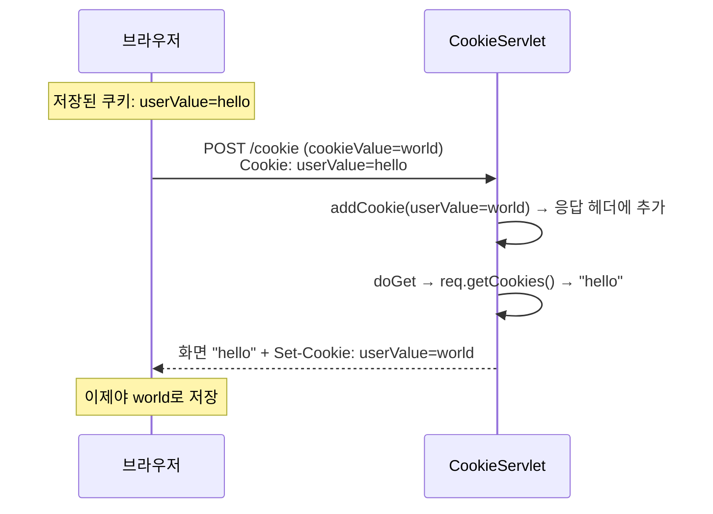

## 들어가며 (Situation)

[redirect 실습]()의 마지막 주석은 "Redirect 는 이전 요청을 아예 모른다. 단점을 극복하기 위해 나오는 개념이 Cookie / Session"이었다. Servlet 3일차 첫 실습 `h_cookie_session`이 바로 그 내용이다.

`cookie_session.html`의 입력창에 값을 적고 "쿠키에 값 넣기"를 누르면 `/cookie`로 POST가 간다.

```java
@WebServlet("/cookie")
public class CookieServlet extends HttpServlet {

    @Override
    protected void doPost(HttpServletRequest req, HttpServletResponse resp) throws ServletException, IOException {
        // 쿠키에 담을 사용자의 입력값 추출
        String cookieValue = req.getParameter("cookieValue");

        // 쿠키 객체 생성
        Cookie cookie = new Cookie("userValue", cookieValue);
        cookie.setMaxAge(60 * 60); // 만료 1 시간 설정

        // 브라우저에게 보내줄 쿠키 add
        resp.addCookie(cookie);

        doGet(req, resp);
    }

    @Override
    protected void doGet(HttpServletRequest req, HttpServletResponse resp) throws ServletException, IOException {
        String savedValue = "없음!";

        Cookie[] cookies = req.getCookies();
        if(cookies != null) {
            for (Cookie cookie : cookies) {
                if ("userValue".equals(cookie.getName())) {
                    savedValue = cookie.getValue();
                    break;
                }
            }
        }

        req.setAttribute("savedValue", savedValue);

        RequestDispatcher rd = req.getRequestDispatcher(
                "/h_cookie_session/cookie-result.jsp"
        );
        rd.forward(req, resp);
    }
}
```

결과 화면 `cookie-result.jsp`는 `${savedValue}` 한 줄로 값을 보여 준다. 화면을 그리는 일을 서블릿이 아니라 JSP에 맡긴 것도 오늘 처음이다.

## 문제 상황 (Task)

오늘 IDE의 access log에는 `POST /cookie`가 29번 남아 있었다. 오전에 404가 3번 나고, 09:37부터 200이 26번 이어졌다. 응답 크기가 199, 195, 198바이트처럼 매번 달랐다. 입력한 값의 길이에 따라 화면 크기가 바뀐 것이다.

```text
10:18:26 "POST /cookie HTTP/1.1" 200 199
10:18:32 "POST /cookie HTTP/1.1" 200 195
10:18:38 "POST /cookie HTTP/1.1" 200 195
...
```

실습을 다시 따라 하다가 이상한 점을 발견했다. **방금 입력한 값이 아니라 그 전에 입력한 값이 화면에 나온다.** 그래서 다음 질문을 정리했다.

1. `addCookie()`를 부르면 실제로 무엇이 오가나?
2. 왜 방금 넣은 값이 아니라 이전 값이 보이나?
3. `setMaxAge(60 * 60)`은 응답에 어떻게 표시되나? 0이나 -1이면?
4. 쿠키 값에는 아무 문자나 넣을 수 있나?

이번에도 Tomcat 11.0.27을 별도 포트(18080)로 띄우고 수업 코드를 그대로 올려 `curl`로 확인했다.

## 해결 과정 (Action)

### 1. addCookie는 Set-Cookie 헤더 한 줄이다

쿠키가 없는 상태에서 `hello`를 보냈다.

```bash
curl -s -i -d cookieValue=hello http://localhost:18080/cookie
```

```text
HTTP/1.1 200
Set-Cookie: userValue=hello; Expires=Fri, 23 Oct 2026 07:14:37 GMT; Max-Age=3600
Set-Cookie: JSESSIONID=7982A5DCB72F6EA37D13CB7D9F3D6919; Path=/; HttpOnly
Content-Type: text/html;charset=UTF-8
Content-Length: 199
```

`resp.addCookie(cookie)`는 응답에 **`Set-Cookie` 헤더를 한 줄 추가**하는 것이 전부다. 브라우저는 이 헤더를 보고 쿠키를 저장한다. 그리고 다음 요청부터 `Cookie: userValue=hello` 헤더를 붙여 보낸다. 서버는 값을 기억하지 않는다. 기억하는 쪽은 브라우저다.

`JSESSIONID`라는 쿠키도 하나 더 왔다. 수업 코드에는 세션 코드가 없는데 생긴 이 쿠키는 [다음 글]()에서 따로 다룬다.

### 2. 한 박자 늦게 보이는 이유

같은 브라우저로 `hello` → `world` → `java`를 차례로 제출하는 상황을 `curl`의 쿠키 저장 기능(`-c`, `-b`)으로 재현했다.

```bash
for v in hello world java; do
  curl -s -c jar -b jar -d cookieValue=$v http://localhost:18080/cookie | grep -o '저장 된 값 : [^<]*'
done
```

| 제출한 값 | 화면에 나온 값 |
|-----------|----------------|
| `hello` | `없음!` |
| `world` | `hello` |
| `java` | `world` |

정말로 한 칸씩 밀렸다. 첫 제출 화면의 크기는 199바이트였는데, 오늘 IDE 기록에서 JSP 결과 화면이 처음 나온 응답(10:18:26)도 199바이트였다.

원인은 `doPost()`가 `doGet()`을 부를 때 넘기는 `req`에 있다. `getCookies()`는 **이번 요청에 브라우저가 실어 보낸 쿠키**를 읽는다. 새 값은 아직 응답 헤더(`Set-Cookie`)에만 있고 브라우저에 도착하지도 않았다.



RFC 6265도 같은 순서를 설명한다. 서버가 `Set-Cookie`로 상태를 보내면, 브라우저는 **이후 요청**에 `Cookie` 헤더로 돌려준다.

### 3. redirect로 한 번 더 요청하게 만들기

새 값을 바로 보려면 브라우저가 새 쿠키를 들고 한 번 더 요청하게 하면 된다. 어제 배운 [PRG 패턴]()을 그대로 썼다. (확인용 **예시 코드**)

```java
resp.addCookie(cookie);

// doGet(req, resp); 대신
resp.sendRedirect(req.getContextPath() + "/cookie");
```

| 제출한 값 | 화면에 나온 값 | 오간 요청 |
|-----------|----------------|-----------|
| `hello` | `hello` | POST 302 → GET 200 |
| `world` | `world` | POST 302 → GET 200 |
| `java` | `java` | POST 302 → GET 200 |

302 응답에 `Set-Cookie`가 함께 실려 가므로, 이어지는 `GET /cookie`에는 새 쿠키가 들어 있다. 새로고침을 해도 POST가 다시 가지 않는다는 장점도 함께 얻는다.

### 4. setMaxAge 값에 따라 달라지는 헤더

`setMaxAge()`에 다른 값을 넣고 헤더를 비교했다.

| 코드 | Tomcat 11이 보낸 헤더 | 의미 (Cookie API 문서) |
|------|------------------------|------------------------|
| `setMaxAge(3600)` | `Expires=…07:25:40 GMT; Max-Age=3600` | 3600초 뒤 만료 |
| `setMaxAge(0)` | `Expires=Thu, 01 Jan 1970 00:00:10 GMT` | 즉시 삭제 |
| `setMaxAge(-1)` | 속성 없음 | 브라우저를 닫으면 삭제 |

`Expires`는 GMT라서 한국 시간보다 9시간 이르게 찍힌다. `07:14:37 GMT`는 요청 시각 15:14:37에서 정확히 1시간 뒤다. 0을 넣으면 1970년이라는 이미 지난 날짜를 보내 브라우저가 쿠키를 지우게 한다. 로그아웃처럼 쿠키를 지울 때는 **같은 이름으로 `setMaxAge(0)` 쿠키를 다시 보내면** 된다.

### 5. 시행착오: 쿠키 값에 넣을 수 없는 문자

입력창은 아무 글자나 받는다. 공백이나 특수문자를 넣으면 어떻게 될지 확인했다. 처음에는 한글을 `curl`에 그대로 넣었다가 400이 나왔다.

```text
=> Send data, 24 bytes (0x18)
0000: cookieValue=%BE%C8%B3%E7
```

`--trace-ascii`로 확인하니 Windows 터미널이 `안녕`을 UTF-8이 아니라 CP949(EUC-KR 계열) 바이트로 보내고 있었다. Tomcat 11은 기본 설정(`conf/web.xml`의 `request-character-encoding`)이 UTF-8이라 "문자 디코딩이 실패했습니다"라며 400을 돌려준 것이다. 서블릿 문제가 아니라 내 테스트 방법의 문제였다. UTF-8 바이트(`%EC%95%88%EB%85%95`)로 다시 보낸 결과는 다음과 같다.

| 입력값 | 상태 코드 | 결과 |
|--------|-----------|------|
| `a=b` | 200 | `userValue=a=b` |
| `"quoted"` | 200 | `userValue="quoted"` |
| `안녕` | 200 | UTF-8 바이트 그대로 `Set-Cookie`에 실림 |
| `hello world` | **500** | `쿠키 값에 유효하지 않은 문자 [32]` |
| `a;b` | **500** | `쿠키 값에 유효하지 않은 문자 [59]` |
| `a,b` | **500** | `쿠키 값에 유효하지 않은 문자 [44]` |

500의 원인은 Tomcat의 `Rfc6265CookieProcessor`가 던진 `IllegalArgumentException`이었다. 32는 공백, 59는 `;`, 44는 `,`의 문자 코드다. RFC 6265는 쿠키 값에 쓸 수 있는 문자(`cookie-octet`)를 이렇게 정한다.

> US-ASCII characters excluding CTLs, whitespace DQUOTE, comma, semicolon, and backslash

`;`는 쿠키 속성의 구분자이고 `,`와 공백도 헤더 해석을 어지럽힌다. 그래서 막힌다. 한글은 이 범위 밖인데도 Tomcat 11은 막지 않고 UTF-8 바이트를 그대로 보냈다. `curl`로는 저장했다 돌려받는 것까지 정상이었다. 하지만 명세 밖의 값이라 클라이언트마다 다르게 처리할 수 있다. 사용자가 입력한 값을 쿠키에 넣을 때는 인코딩해서 넣는 편이 안전하다. (확인용 **예시 코드**)

```java
String encoded = URLEncoder.encode("안녕 world", StandardCharsets.UTF_8);
// %EC%95%88%EB%85%95+world → 공백도 + 로 바뀌어 cookie-octet 범위 안에 들어온다
Cookie cookie = new Cookie("userValue", encoded);
```

꺼낼 때는 `URLDecoder.decode(cookie.getValue(), StandardCharsets.UTF_8)`로 되돌린다.

## 결과 (Result)

| 확인 항목 | 결과 |
|-----------|------|
| `addCookie()`의 실체 | 응답 헤더 `Set-Cookie: userValue=hello; Expires=…; Max-Age=3600` |
| `hello → world → java` 제출 | 화면은 `없음! → hello → world` (한 칸씩 밀림) |
| 오늘 IDE 기록의 첫 JSP 화면 (10:18:26) | 199바이트 (`없음!` 화면과 같은 크기) |
| `doGet()` 대신 `sendRedirect()` | 화면 `hello → world → java` (바로 반영) |
| `setMaxAge(0)` / `setMaxAge(-1)` | 1970년 `Expires` / 만료 속성 없음 |
| 공백·`;`·`,` 입력 | 500 (`IllegalArgumentException`) |
| 환경 | Tomcat 11.0.27, Java 21 (Temurin), Jakarta Servlet API 6.1, curl |

배운 점은 다음과 같다.

- 쿠키는 서버가 `Set-Cookie`로 "저장하라"고 알려 주면 브라우저가 들고 다니는 값이다. 서버는 다음 요청에서야 그 값을 받는다.
- 그래서 같은 요청 안에서 `addCookie()` 뒤에 `getCookies()`를 읽으면 이전 값이 나온다. redirect로 요청을 한 번 더 받게 하면 해결된다.
- 쿠키 값은 문자 제한이 있다. 사용자 입력은 `URLEncoder`로 인코딩해서 넣는다.

## 더 학습하면 좋은 개념

- **HttpSession** — 쿠키에는 ID만 두고 실제 값은 서버에 두는 방식. 오늘 응답에 함께 온 `JSESSIONID`가 그 ID다.
- **쿠키 보안 속성 (HttpOnly, Secure, SameSite)** — 자바스크립트 접근 차단, HTTPS 전용, 다른 사이트 요청 시 전송 제한. 로그인 쿠키라면 반드시 알아야 한다.
- **퍼센트 인코딩(URL 인코딩)** — `%EC%95%88`이 왜 `안`인지, 공백이 왜 `+`가 되는지 이해하면 쿠키·쿼리스트링·폼 데이터를 모두 읽을 수 있다.
- **Web Storage (localStorage, sessionStorage)** — 브라우저에 값을 저장하는 다른 방법. 서버로 자동 전송되지 않는다는 점이 쿠키와 다르다.

## 참고 자료

- [Jakarta Servlet 6.1 API - Cookie](https://jakarta.ee/specifications/servlet/6.1/apidocs/jakarta.servlet/jakarta/servlet/http/Cookie.html)
- [Jakarta Servlet 6.1 API - HttpServletRequest](https://jakarta.ee/specifications/servlet/6.1/apidocs/jakarta.servlet/jakarta/servlet/http/HttpServletRequest.html)
- [RFC 6265 - HTTP State Management Mechanism](https://www.rfc-editor.org/rfc/rfc6265.html) — 4.1.1 Syntax
- [Apache Tomcat 11 - The Cookie Processor Component](https://tomcat.apache.org/tomcat-11.0-doc/config/cookie-processor.html)
- [MDN - Using HTTP cookies](https://developer.mozilla.org/en-US/docs/Web/HTTP/Cookies)
- [MDN - Set-Cookie](https://developer.mozilla.org/en-US/docs/Web/HTTP/Headers/Set-Cookie)

---

**요약**
1. `resp.addCookie()`는 응답에 `Set-Cookie` 헤더를 붙일 뿐이고, 브라우저는 그 값을 저장했다가 다음 요청부터 `Cookie` 헤더로 보낸다.
2. 그래서 `doPost()`에서 쿠키를 넣고 바로 `doGet()`의 `req.getCookies()`를 읽으면 이전 값이 보였고(`hello → 없음!`), `sendRedirect()`로 바꾸자 방금 넣은 값이 바로 보였다.
3. 쿠키 값에 공백·`;`·`,`를 넣으면 Tomcat이 `IllegalArgumentException`으로 500을 냈으므로, 사용자 입력은 `URLEncoder`로 인코딩해서 넣는다.
