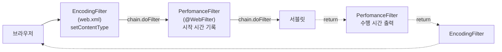

## 들어가며 (Situation)

어제 [응답 인코딩 실습]()의 결론은 "`setContentType("text/html; charset=UTF-8")`을 서블릿마다 반복하고 있다"였다. 수업 주석에도 "== 계속 반복되는 코드"라고 적혀 있었다. 오늘 `i_filter` 실습에서 그 반복을 없앴다. 14:21~14:22 사이에 서블릿 다섯 개의 `setContentType` 줄을 주석 처리했다.

```java
// ResponseServlet, ExceptionServlet, ResponseLoginServlet, RedirectServlet, CookieServlet
//        resp.setContentType("text/html; charset=UTF-8");
```

대신 **필터**가 그 일을 맡는다. 필터는 서블릿보다 먼저 요청을 받아서 앞뒤에 공통 코드를 끼워 넣는다. 인코딩 필터는 `web.xml`에 등록하고, 설정값은 `init-param`으로 넘겼다.

```java
/* comment.
    Filter 를 등록하는 방법은 총 2가지이다.
    1. @WebFilter : 어노테이션 방식
    2. xml
 */
@WebFilter
public class EncodingFilter implements Filter {

    private String encodingType;

    @Override
    public void init(FilterConfig filterConfig) throws ServletException {
        System.out.println("인코딩 필터의 init() 호출됨...");
        encodingType = filterConfig.getInitParameter("encoding-type");
    }

    @Override
    public void doFilter(ServletRequest request, ServletResponse response, FilterChain chain) throws IOException, ServletException {
        response.setContentType(encodingType);
        chain.doFilter(request, response);
    }
}
```

```xml
<filter>
    <filter-name>encoding</filter-name>
    <filter-class>com.wanted.servlet.i_filter.EncodingFilter</filter-class>
    <init-param>
        <param-name>encoding-type</param-name>
        <param-value>text/html; charset=UTF-8</param-value>
    </init-param>
</filter>
<filter-mapping>
    <filter-name>encoding</filter-name>
    <url-pattern>/*</url-pattern>
</filter-mapping>
```

모든 요청의 처리 시간을 재는 필터도 하나 만들었다.

```java
@WebFilter("/*")
public class PerfomanceFilter implements Filter {
    @Override
    public void doFilter(ServletRequest request, ServletResponse response, FilterChain chain) throws IOException, ServletException {
        long startTime = System.currentTimeMillis();

        HttpServletRequest req = (HttpServletRequest) request;
        System.out.println("[요청 된 URL] : " + req.getRequestURI());

        // 다음 서블릿 OR 필터 호출
        chain.doFilter(request, response);

        long endTime = System.currentTimeMillis();
        System.out.println("[" + req.getRequestURI() + "의 최종 수행 시간] : " + (endTime - startTime) + "(ms)");
    }
}
```

## 문제 상황 (Task)

실험 서버에 수업 코드를 올리자 콘솔에 이렇게 찍혔다.

```text
Performance 필터 생성됨...
인코딩 필터의 init() 호출됨...
로그인 관련 필터 초기화됨...
인코딩 필터의 init() 호출됨...
```

필터는 세 개인데 `init()`은 네 번이다. **인코딩 필터가 두 번** 초기화됐다. [생명주기 실습]()에서 서블릿 `init()`은 딱 한 번이었는데, 필터는 왜 두 번일까? 확인할 질문을 정리했다.

1. `setContentType`을 지워도 정말 필터가 대신해 주나?
2. 인코딩 필터는 왜 두 번 만들어졌나?
3. 필터가 여러 개면 어떤 순서로 실행되나?
4. forward로 JSP에 넘어갈 때도 필터를 다시 지나나?
5. 시간 측정 필터는 언제나 시간을 찍나?

이번에도 Tomcat 11.0.27을 별도 포트(18080)로 띄워 확인했다. 수정본은 원본과 섞이지 않게 `/fix3`, `/noenc` 같은 다른 경로에 따로 올렸다.

## 해결 과정 (Action)

### 1. 필터가 있을 때와 없을 때의 헤더

필터 등록(`web.xml`의 `<filter>`)과 `EncodingFilter` 클래스를 뺀 앱을 `/noenc`에 올려 같은 주소의 `Content-Type`을 비교했다.

| 요청 | 수업 코드 (필터 있음) | 필터 없음 (`/noenc`) |
|------|------------------------|----------------------|
| `/response` | `text/html;charset=UTF-8` | **헤더 없음** |
| `/redirect` | `text/html;charset=UTF-8` | **헤더 없음** |
| `/index.html` | `text/html;charset=UTF-8` | `text/html` |
| `/h_cookie_session/cookie_session.html` | `text/html;charset=UTF-8` | `text/html` |

필터가 없으면 `setContentType`을 지운 서블릿은 어제 본 것처럼 `Content-Type` 헤더 없이 응답한다. Chrome이 인코딩을 추측해 한글이 깨지는 그 상태다. 필터를 켜면 다섯 서블릿이 한 줄도 없이 다시 `charset=UTF-8`을 받는다. 정적 HTML 파일에도 `charset=UTF-8`이 붙었다. `/*`에 걸었으니 서블릿이 아닌 요청도 필터를 지나기 때문이다.

### 2. init()이 두 번 불린 이유: 같은 클래스, 다른 이름

컨테이너가 실제로 등록한 필터 목록을 보려고 확인용 서블릿을 하나 넣었다. (확인용 **예시 코드**)

```java
for (FilterRegistration r : getServletContext().getFilterRegistrations().values()) {
    out.println(r.getName() + " | url=" + r.getUrlPatternMappings()
            + " | encoding-type=" + r.getInitParameter("encoding-type"));
}
```

```text
com.wanted.servlet.i_filter.PerfomanceFilter | url=[/*] | encoding-type=null
com.wanted.servlet.i_filter.EncodingFilter   | url=[]   | encoding-type=null
Tomcat WebSocket (JSR356) Filter              | url=[/*] | encoding-type=null
com.wanted.servlet.i_filter.LoginFilter      | url=[/auth/*] | encoding-type=null
encoding                                      | url=[/*] | encoding-type=text/html; charset=UTF-8
```

(`Tomcat WebSocket` 필터는 Tomcat이 스스로 넣는 것이라 이번 주제와는 관계없다.)

`EncodingFilter` 클래스로 만든 필터가 **이름이 다른 두 개**로 등록돼 있었다.

| 등록 경로 | 필터 이름 | URL | `encoding-type` |
|-----------|-----------|-----|-----------------|
| `web.xml` | `encoding` | `/*` | `text/html; charset=UTF-8` |
| `@WebFilter` | `com.wanted.servlet.i_filter.EncodingFilter` | 없음 | `null` |

Servlet 명세 8.1.2절이 이유를 알려 준다.

> The default name of the Filter if not specified is the fully qualified class name. The urlPatterns attribute, servletNames attribute or the value attribute of the annotation MUST be specified.

`@WebFilter`에 이름을 주지 않으면 클래스 전체 이름이 필터 이름이 된다. `web.xml`의 이름은 `encoding`이라 둘은 **서로 다른 필터**로 취급됐다. 명세 8.2.3절에 따르면 `web.xml`이 어노테이션 설정을 덮어쓰려면 이름이 같아야 한다. 게다가 어노테이션에 URL이 없어서, 이 두 번째 인스턴스는 `init()`만 불리고 어떤 요청에도 실행되지 않는다. 명세는 URL을 반드시 쓰라고(MUST) 하는데, Tomcat은 오류 없이 그냥 등록했다.

수업 주석대로 등록 방법은 두 가지 중 **하나만** 쓰면 된다. `init-param`이 필요한 인코딩 필터는 `web.xml`로 등록하고, `@WebFilter` 한 줄을 지운 앱을 `/fix3`에 올렸다.

```text
Performance 필터 생성됨...
로그인 관련 필터 초기화됨...
인코딩 필터의 init() 호출됨...
```

`init()`이 한 번만 불렸고, 등록 목록에서도 `encoding` 하나만 남았다.

### 3. 실행 순서: web.xml 먼저, 어노테이션은 순서 보장 없음

같은 확인용 서블릿에서 호출 스택을 거꾸로 따라가 필터 순서를 찍었다.

```text
chain: EncodingFilter.doFilter -> PerfomanceFilter.doFilter -> ProbeServlet.doGet
```



`chain.doFilter()`는 "다음 필터(마지막이면 서블릿)를 불러라"는 뜻이다. 그 줄 **앞**의 코드는 요청이 들어갈 때, **뒤**의 코드는 서블릿이 끝나고 돌아올 때 실행된다. 시간 측정 필터가 `chain.doFilter()` 앞뒤로 시간을 재는 이유다.

순서 규칙은 명세에 있다. 6.2.4절은 `web.xml`의 `<filter-mapping>`을 **적힌 순서대로** 체인에 넣는다고 하고, 8.2.3절은 어노테이션끼리의 순서를 정하지 않는다.

> when using annotations to define the listeners, servlets and filters, the order in which they are invoked is unspecified.

오늘은 `PerfomanceFilter`와 `LoginFilter`가 둘 다 어노테이션이다. 지금은 둘이 같은 요청에 걸리는 일이 `/auth`뿐이라 순서가 문제 되지 않는다. 하지만 "로그인 검사 → 로그 기록"처럼 순서가 중요해지면 `web.xml`에 순서대로 적어야 한다.

### 4. forward와 에러 페이지는 필터를 다시 지나지 않는다

`/cookie`는 서블릿이 처리한 뒤 `cookie-result.jsp`로 forward한다. 콘솔에는 한 줄만 찍혔다.

```text
[요청 된 URL] : /cookie
[/cookie의 최종 수행 시간] : 1(ms)
```

JSP로 넘어간 forward는 필터를 다시 지나지 않았다. 명세 6.2.5절에 따르면 `<dispatcher>`를 쓰지 않은 필터는 **브라우저에서 직접 온 요청(REQUEST)** 에만 적용된다. forward(FORWARD)나 에러 페이지(ERROR)에도 걸려면 `dispatcherTypes`를 따로 지정해야 한다. 그래서 수행 시간에는 JSP 처리까지 포함되지만, 로그는 한 번만 찍힌다.

수행 시간은 처음 실행되는 JSP에서 크게 차이가 났다.

| 요청 | 1번째 | 2번째 |
|------|-------|-------|
| `POST /fix3/cookie` (→ `cookie-result.jsp`) | 256ms | 1ms |
| `GET /fix3/session` (→ `session-result.jsp`) | 74ms | 0ms |

첫 요청 때 Tomcat이 JSP를 자바 코드로 바꾸고 컴파일하기 때문이다. 두 번째부터는 컴파일된 클래스를 그대로 쓴다.

### 5. 시행착오: 예외가 나면 시간이 안 찍힌다

[세션 글]()에서 본 500(`GET /session` 두 번)을 일으키고 콘솔을 봤다.

```text
[요청 된 URL] : /session
[/session의 최종 수행 시간] : 1(ms)
[요청 된 URL] : /session
showerrorpage 서블릿 호출됨...
forwardUrl = /session
```

두 번째 요청은 시작 줄만 있고 **수행 시간 줄이 없다.** 서블릿에서 난 `NullPointerException`이 `chain.doFilter()`를 뚫고 필터 밖으로 나가면서 그 아래 줄을 건너뛴 것이다. 오류가 난 요청이야말로 시간을 알고 싶은 요청인데, 정작 그때 기록이 빠진다. `try-finally`로 감싸 `/fix3`에 올렸다. (확인용 **예시 코드**)

```java
try {
    chain.doFilter(request, response);
} finally {
    long endTime = System.currentTimeMillis();
    System.out.println("[" + req.getRequestURI() + "의 최종 수행 시간] : " + (endTime - startTime) + "(ms)");
}
```

```text
[요청 된 URL] : /fix3/session
[/fix3/session의 최종 수행 시간] : 74(ms)
[요청 된 URL] : /fix3/session
[/fix3/session의 최종 수행 시간] : 0(ms)
showerrorpage 서블릿 호출됨...
forwardUrl = /fix3/session
```

이제 예외가 나도 시간이 찍힌다. 수행 시간 줄이 `showerrorpage`보다 **먼저** 나온 것도 눈여겨볼 만하다. 에러 페이지는 필터 체인이 완전히 끝난 뒤에 Tomcat이 따로 호출한다. 그리고 4번에서 본 대로 필터를 다시 지나지 않는다.

## 결과 (Result)

| 확인 항목 | 결과 |
|-----------|------|
| `setContentType` 지운 서블릿 5개 | 필터 있으면 `text/html;charset=UTF-8`, 없으면 헤더 없음 |
| `EncodingFilter` 등록 수 | 2개 (`encoding` + 클래스 전체 이름) → `@WebFilter` 삭제 후 1개 |
| 두 번째 인스턴스 | URL 없음, `encoding-type=null`, 요청에 실행되지 않음 |
| 실행 순서 | `EncodingFilter`(web.xml) → `PerfomanceFilter`(어노테이션) → 서블릿 |
| forward 후 JSP | 필터 로그 1번 (다시 지나지 않음) |
| JSP 첫 실행 / 두 번째 | 256ms / 1ms |
| 예외 발생 시 수행 시간 | 원본은 출력 안 됨 → `try-finally` 후 출력 |
| 환경 | Tomcat 11.0.27, Java 21 (Temurin), Jakarta Servlet API 6.1, curl |

배운 점은 다음과 같다.

- 필터는 서블릿 앞에서 공통 처리를 맡는다. 서블릿 다섯 곳에 흩어진 `setContentType`을 한곳으로 모을 수 있었다.
- 등록 방법은 하나만 쓴다. `@WebFilter`와 `web.xml`을 함께 쓰면 이름이 달라 같은 클래스의 필터가 두 번 만들어진다.
- `chain.doFilter()` 뒤에 꼭 실행해야 하는 코드는 `finally`에 넣는다.

## 더 학습하면 좋은 개념

- **책임 연쇄(Chain of Responsibility) 패턴** — 요청을 여러 처리기에 차례로 넘기는 설계. `FilterChain`이 이 패턴 그대로다.
- **`DispatcherType`과 `dispatcherTypes` 속성** — 필터를 forward·include·error에도 걸고 싶을 때 쓰는 설정.
- **Spring의 `CharacterEncodingFilter`와 `HandlerInterceptor`** — 오늘 만든 인코딩 필터를 Spring이 기본으로 제공하는 형태. 필터와 인터셉터는 실행 위치가 다르다.
- **AOP(관점 지향 프로그래밍)** — 로그·시간 측정처럼 여러 곳에 흩어진 공통 관심사를 분리하는 더 일반적인 방법.

## 참고 자료

- [Jakarta Servlet 6.1 Specification](https://jakarta.ee/specifications/servlet/6.1/jakarta-servlet-spec-6.1.html) — 6.2.4 Configuration of Filters, 6.2.5 Filters and the RequestDispatcher, 8.1.2 @WebFilter, 8.2.3 Assembling the Descriptor
- [Jakarta Servlet 6.1 API - Filter](https://jakarta.ee/specifications/servlet/6.1/apidocs/jakarta.servlet/jakarta/servlet/Filter.html)
- [Jakarta Servlet 6.1 API - FilterChain](https://jakarta.ee/specifications/servlet/6.1/apidocs/jakarta.servlet/jakarta/servlet/FilterChain.html)
- [Jakarta Servlet 6.1 API - WebFilter](https://jakarta.ee/specifications/servlet/6.1/apidocs/jakarta.servlet/jakarta/servlet/annotation/WebFilter.html)

---

**요약**
1. `EncodingFilter`를 `/*`에 걸자 `setContentType`을 지운 서블릿 다섯 개가 다시 `text/html;charset=UTF-8`로 응답했고, 필터를 빼면 `Content-Type` 헤더가 사라졌다.
2. `@WebFilter`(이름 = 클래스 전체 이름)와 `web.xml`(이름 = `encoding`)로 같은 클래스를 두 번 등록해 `init()`이 두 번 불렸으며, `@WebFilter`를 지우자 한 번으로 줄었다.
3. 필터는 `web.xml` 순서대로 먼저 실행되고 forward·에러 페이지에는 다시 걸리지 않았으며, 예외가 나면 `chain.doFilter()` 뒤 코드가 건너뛰어져 `try-finally`가 필요했다.
