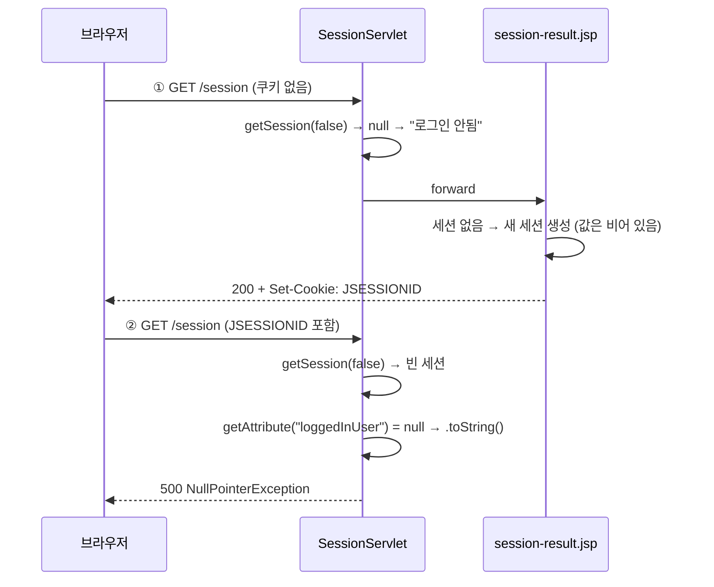

## 들어가며 (Situation)

[쿠키 실습]()에서는 값을 브라우저에 저장했다. 같은 페이지의 두 번째 폼은 **세션**이다. 아이디와 비밀번호를 `/session`으로 POST하면 서버가 세션에 저장하고, "세션 확인" 링크(GET)로 다시 꺼내 본다.

```java
@WebServlet("/session")
public class SessionServlet extends HttpServlet {

    @Override
    protected void doGet(HttpServletRequest req, HttpServletResponse resp) throws ServletException, IOException {
        // true : 세션 만든다.
        // false : 기존의 세션을 활용하며, 없다면 null 반환
        HttpSession session = req.getSession(false);

        String loggedInUser = null;
        String pwd = null;

        if (session != null) {
            loggedInUser = session.getAttribute("loggedInUser").toString();   // 32행
            pwd = session.getAttribute("userPwd").toString();
        }

        req.setAttribute("loggedInUser", loggedInUser != null ? loggedInUser : "로그인 안됨");
        req.setAttribute("userPwd", pwd != null ? pwd : "비밀번호 없음..");

        RequestDispatcher rd = req.getRequestDispatcher("/h_cookie_session/session-result.jsp");
        rd.forward(req, resp);
    }

    @Override
    protected void doPost(HttpServletRequest req, HttpServletResponse resp) throws ServletException, IOException {
        String userId = req.getParameter("userId");
        String userPwd = req.getParameter("userPwd");

        if(userId != null && !userPwd.isEmpty()) {
            HttpSession session = req.getSession(true);
//            String existUser = session.getAttribute("loggedInUser").toString();   // 59행
            // null 발생 여부가 존재하는 변수를 형변환 시 메소드로 형변환 하는 것보다는
            // () : 캐스트 연산자 == 형변환 연산자를 사용하는 것이 안정적이다.
            String existUser = (String) session.getAttribute("loggedInUser");
            // ... loggedInUser, userPwd 저장
            session.setMaxInactiveInterval(30); // session 의 유효 기간 설정 30초!
            doGet(req, resp);
        }
    }
}
```

결과 화면 `session-result.jsp`에는 "세션 만료 시키기" 링크가 있다. 이 링크는 `/expire`로 가서 `session.invalidate()` 후 `/session`으로 redirect한다.

## 문제 상황 (Task)

오늘 IDE의 로그에는 `/session` 500이 세 번 있었다.

| 시각 | 요청 | 예외 위치 |
|------|------|-----------|
| 11:17:23 | `POST /session` 500 | `SessionServlet.doPost(SessionServlet.java:59)` |
| 11:17:50 | `POST /session` 500 | `SessionServlet.doPost(SessionServlet.java:59)` |
| 11:35:37 | `GET /session` 500 | `SessionServlet.doGet(SessionServlet.java:32)` |

세 번 모두 같은 예외였다.

```text
java.lang.NullPointerException: Cannot invoke "Object.toString()" because the return value of
"jakarta.servlet.http.HttpSession.getAttribute(String)" is null
```

59행은 지금 주석 처리된 `existUser` 줄이다. 수업에서 이 NPE를 보고 `.toString()` 대신 `(String)` 캐스트로 바꿨고, 그 이유가 주석으로 남아 있다. 그런데 11:35:37에는 **`doGet()`의 32행**에서 같은 예외가 다시 났다. `doGet()`은 `if (session != null)` 안에서만 꺼내는데도 터졌다. 세션은 있는데 값은 없는 상태가 있었다는 뜻이다.

1. `getSession(false)`만 쓰는 `doGet()`에서, 로그인도 안 했는데 세션은 누가 만들었나?
2. 세션에 저장한 값은 실제로 어디에 있나?
3. `setMaxInactiveInterval(30)`의 30초는 언제부터 세나?

## 해결 과정 (Action)

### 1. 세션은 서버에, 브라우저에는 ID만

먼저 정상 흐름부터 확인했다.

```bash
curl -s -i -c jar -b jar -d 'userId=user01&userPwd=pass01' http://localhost:18080/session
```

```text
HTTP/1.1 200
Set-Cookie: JSESSIONID=138A44BF732F69A01A831AE87CFE07F9; Path=/; HttpOnly
        <p>로그인 된 사용자 ID : user01</p>
        <p>PWD : pass01</p>
```

브라우저가 받은 쿠키는 `JSESSIONID` 하나다. `user01`이나 `pass01`은 쿠키 어디에도 없다. 값은 서버 메모리의 세션 객체에 있고, 브라우저는 그 세션을 찾을 **번호표**만 들고 다닌다. Servlet 명세도 세션 추적 쿠키의 표준 이름을 `JSESSIONID`로 정해 둔다.

> The container sends a cookie to the client. The client will then return the cookie on each subsequent request to the server, unambiguously associating the request with a session.

| 항목 | 쿠키 (`userValue`) | 세션 (`HttpSession`) |
|------|--------------------|----------------------|
| 값이 있는 곳 | 브라우저 | 서버 메모리 |
| 브라우저가 가진 것 | 값 자체 (`hello`) | ID (`JSESSIONID=138A…`) |
| 사용자가 값을 볼 수 있나 | 볼 수 있고 고칠 수도 있음 | ID만 보임 |
| 만료 기준 | `Max-Age` (저장 후 3600초) | 마지막 요청 후 30초 |

### 2. 500 재현: "세션 확인"을 두 번 누르기

새 브라우저(쿠키 없음)로 "세션 확인" 링크를 두 번 누르는 상황을 만들었다.

```bash
curl -s -i -c jar -b jar http://localhost:18080/session   # 1번째
curl -s -i -c jar -b jar http://localhost:18080/session   # 2번째
```

```text
HTTP/1.1 200
Set-Cookie: JSESSIONID=E5724E49B5466C2ADABC76B579456902; Path=/; HttpOnly
        <p>로그인 된 사용자 ID : 로그인 안됨</p>
---
HTTP/1.1 500
java.lang.NullPointerException: ... at SessionServlet.doGet(SessionServlet.java:32)
```

두 번째에 500이 났다. 단서는 첫 번째 응답의 `Set-Cookie: JSESSIONID`다. 서블릿은 `getSession(false)`라 세션을 만들지 않는다. 그런데 응답에는 새 세션 ID가 왔다.

범인은 forward 대상인 `session-result.jsp`였다. JSP를 직접 요청해도 세션이 생겼다.

```bash
curl -s -i http://localhost:18080/h_cookie_session/session-result.jsp
```

```text
HTTP/1.1 200
Set-Cookie: JSESSIONID=93C9A2705C2164170FCD4A823E9DD5F6; Path=/; HttpOnly
```

Tomcat이 JSP를 변환한 자바 코드(`work` 폴더의 `session_002dresult_jsp.java`)를 열어 보니 이유가 보였다.

```java
pageContext = _jspxFactory.getPageContext(this, request, response,
        null, true, 8192, true);   // 두 번째 true = needsSession
...
session = pageContext.getSession();
```

JSP는 기본적으로 **세션이 필요하다고 선언된 페이지**다. Jakarta Pages 명세의 `page` 지시어 `session` 속성 설명은 이렇다.

> If true then the implicit script language variable named session of type jakarta.servlet.http.HttpSession references the current/new session for the page. ... Default is true.

"current/new", 즉 세션이 없으면 새로 만든다. 그래서 첫 번째 요청에서 JSP가 **빈 세션**을 만들었다. 두 번째 요청에서는 `getSession(false)`가 그 빈 세션을 돌려줬고, `getAttribute("loggedInUser")`는 `null`이었다. 거기에 `.toString()`을 부르니 NPE가 났다.



오늘 기록의 흐름도 이것으로 설명된다. 11:33:47~48에 `/expire → /session`이 8번 연속 찍혀 있었다. `/expire`가 세션을 없애도 redirect된 `/session`이 JSP로 forward하면서 **빈 세션을 다시 만든다.** 그래서 만료를 눌러도 세션이 남았고, 약 2분 뒤 11:35:37의 `GET /session`이 500이 됐다. JSP가 만든 빈 세션에는 `setMaxInactiveInterval(30)`이 적용되지 않으므로 Tomcat 기본값인 30**분** 동안 살아 있다.

11:17의 `doPost` 500은 더 단순하다. 그때의 59행은 로그인 직후 `getAttribute("loggedInUser").toString()`을 불렀다. 처음 로그인하는 세션에는 아직 `loggedInUser`가 없으니 `null`이 나올 수밖에 없었다.

### 3. 두 가지 수정 비교

고칠 곳은 두 군데로 볼 수 있다. 각각 적용한 앱을 따로 올려 "세션 확인"을 세 번 눌렀다. (확인용 **예시 코드**)

**① 서블릿: `doPost`처럼 캐스트로 꺼내기**

```java
if (session != null) {
    loggedInUser = (String) session.getAttribute("loggedInUser");
    pwd = (String) session.getAttribute("userPwd");
}
```

**② JSP: 세션에 참여하지 않겠다고 선언하기**

```jsp
<%@ page contentType="text/html;charset=UTF-8" language="java" session="false" %>
```

| | 1번째 | 2번째 | 3번째 | 빈 세션 생성 |
|---|---|---|---|---|
| 수업 코드 | 200 | **500** | **500** | O |
| ① 캐스트 | 200 | 200 | 200 | O (1번째에 `Set-Cookie`) |
| ② `session="false"` | 200 | 200 | 200 | X (`Set-Cookie` 없음) |

①은 NPE를 막지만 빈 세션은 계속 만든다. ②는 결과 화면이 `${loggedInUser}`처럼 request 속성만 읽으므로 세션이 필요 없다. 그래서 세션을 아예 만들지 않는다. ② 상태에서 로그인하면 `user01`이 정상으로 보였다. 다만 `<% session.getAttribute(...) %>`처럼 JSP 안에서 `session` 변수를 쓰는 페이지에는 ②를 쓸 수 없다. 명세상 번역 오류가 난다.

두 수정이 막는 지점이 다르다. ①은 "값이 없을 수도 있다"는 사실을 코드가 받아들이게 하고, ②는 필요 없는 세션이 생기지 않게 한다. 둘 다 적용해도 된다.

### 4. 30초는 "마지막 요청 이후" 30초

`setMaxInactiveInterval(30)`은 로그인 시점부터 30초일까, 마지막 요청부터 30초일까? 20초 간격으로 계속 확인하다가 간격을 31초로 벌렸다.

| 경과 시간 | 마지막 요청 후 | 결과 |
|-----------|----------------|------|
| 0초 | - | 로그인, `JSESSIONID=F9BE…` |
| 21초 | 20초 | `user01` |
| 41초 | 20초 | `user01` |
| 70초 | 29초 | `user01` (로그인 70초 뒤에도 유지) |
| 101초 | **31초** | `로그인 안됨` + 새 `JSESSIONID` |

로그인한 지 70초가 지나도 살아 있었다. 요청이 올 때마다 30초가 다시 시작된다. API 문서의 설명도 같다.

> Specifies the time, in seconds, between client requests before the servlet container will invalidate this session.

마지막 줄에는 새 `JSESSIONID`도 보인다. 만료된 세션 대신 JSP가 또 빈 세션을 만든 것이다. 이 상태에서 "세션 확인"을 한 번 더 누르면 역시 500이다.

### 5. 함께 발견한 것들

- **로그인해도 세션 ID가 바뀌지 않는다.** JSP가 만든 빈 세션이 있는 상태에서 로그인하자, 로그인 전후 `JSESSIONID`가 `D032CC63…`로 같았다. 로그인 전에 받은 ID가 로그인 후에도 그대로 쓰인다는 뜻이다. 이를 노리는 공격이 **세션 고정(Session Fixation)** 이고, 로그인 직후 `req.changeSessionId()`로 ID를 바꿔 막는다.
- **비밀번호를 비우면 빈 화면이 나온다.** `if(userId != null && !userPwd.isEmpty())`가 거짓이면 아무 응답도 쓰지 않아 `200`, `Content-Length: 0`이 왔다.
- **비밀번호를 세션에 넣고 있다.** 실습이라 화면에 보여 주려고 넣은 것이다. 실제 서비스에서는 인증이 끝나면 비밀번호를 세션에 남기지 않는다.

## 결과 (Result)

| 확인 항목 | 결과 |
|-----------|------|
| 로그인 후 브라우저가 가진 것 | `JSESSIONID` 쿠키 하나 (아이디·비밀번호 없음) |
| 새 브라우저로 "세션 확인" 2번 | 200 → **500** (오늘 11:35:37 기록과 같은 32행 NPE) |
| 빈 세션을 만든 곳 | `session-result.jsp` (`needsSession = true`) |
| `/expire` 직후 `/session` | 새 `JSESSIONID` 발급 (만료해도 빈 세션이 다시 생김) |
| ① 캐스트 / ② `session="false"` | 둘 다 500 해결, ②는 빈 세션도 안 만듦 |
| `setMaxInactiveInterval(30)` | 마지막 요청 후 29초 유지, 31초 만료 |
| 환경 | Tomcat 11.0.27, Java 21 (Temurin), Jakarta Servlet API 6.1, curl |

배운 점은 다음과 같다.

- `getSession(false)`가 `null`이 아니라고 해서 로그인한 것은 아니다. JSP가 기본값(`session="true"`)으로 만든 **빈 세션**일 수 있다.
- 세션에서 꺼낸 값은 언제든 `null`일 수 있다. `.toString()`보다 `(String)` 캐스트가 안전하다는 수업 주석은 `doGet()`에도 똑같이 적용해야 했다.
- 세션 만료 시간은 "마지막 요청 이후" 기준이다.

## 더 학습하면 좋은 개념

- **세션 고정 공격과 `changeSessionId()`** — 로그인 전후 세션 ID가 같으면 생기는 취약점. 오늘 직접 같은 ID를 확인했다.
- **Filter로 로그인 검사 모으기** — 서블릿마다 세션을 검사하는 대신 한곳에서 검사하는 방법. 오늘 다음 실습인 `i_filter`의 주제다.
- **세션 클러스터링과 외부 세션 저장소 (Redis 등)** — 세션은 서버 메모리에 있으므로 서버가 여러 대면 공유 문제가 생긴다.
- **토큰 기반 인증 (JWT)** — 서버가 상태를 저장하지 않는 다른 로그인 방식. 세션과 장단점을 비교해 볼 만하다.

## 참고 자료

- [Jakarta Servlet 6.1 Specification](https://jakarta.ee/specifications/servlet/6.1/jakarta-servlet-spec-6.1.html) — 7.1.1 Cookies
- [Jakarta Servlet 6.1 API - HttpSession](https://jakarta.ee/specifications/servlet/6.1/apidocs/jakarta.servlet/jakarta/servlet/http/HttpSession.html)
- [Jakarta Servlet 6.1 API - HttpServletRequest](https://jakarta.ee/specifications/servlet/6.1/apidocs/jakarta.servlet/jakarta/servlet/http/HttpServletRequest.html) — `getSession(boolean)`, `changeSessionId()`
- [Jakarta Server Pages 4.0 Specification](https://jakarta.ee/specifications/pages/4.0/jakarta-server-pages-spec-4.0.html) — page 지시어의 `session` 속성
- [OWASP - Session Fixation](https://owasp.org/www-community/attacks/Session_fixation)
- [OWASP - Session Management Cheat Sheet](https://cheatsheetseries.owasp.org/cheatsheets/Session_Management_Cheat_Sheet.html)

---

**요약**
1. 세션 값은 서버 메모리에 있고 브라우저는 `JSESSIONID` 쿠키만 들고 다니며, `setMaxInactiveInterval(30)`은 마지막 요청 이후 30초를 센다.
2. `getSession(false)`만 쓰는 서블릿에서도 forward 대상 JSP가 기본값 `session="true"`로 빈 세션을 만들어, 두 번째 "세션 확인"에서 `getAttribute(...).toString()`이 NPE(500)를 냈다.
3. 꺼낸 값을 `(String)` 캐스트로 받거나 JSP에 `session="false"`를 주면 500이 사라졌고, 후자는 불필요한 세션 생성까지 막았다.
