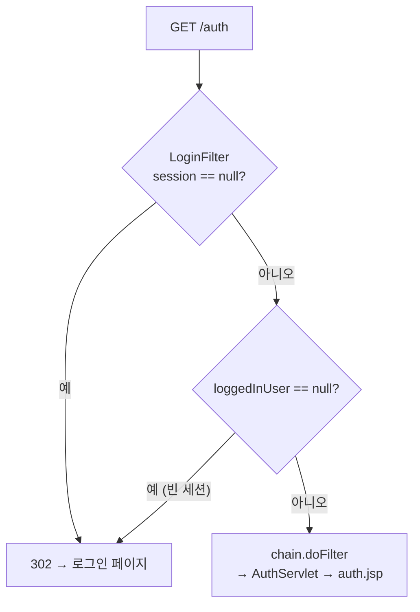

## 들어가며 (Situation)

[세션 실습]()에서 로그인한 사용자를 세션에 넣었다. 이번 실습 `i_filter`는 그 세션을 이용해 **로그인한 사람만 들어갈 수 있는 페이지**를 만든다. 메인 페이지의 "filter 기능 확인하기" 링크는 `/auth`로 간다.

```java
@WebServlet("/auth")
public class AuthServlet extends HttpServlet {
    @Override
    protected void doGet(HttpServletRequest req, HttpServletResponse resp) throws ServletException, IOException {
        HttpSession session = req.getSession(false);
        // 로그인 유저 정보 세션에서 꺼내오기
        String existUser = (String) session.getAttribute("loggedInUser");   // 21행

        session.setAttribute("loggedInUser", existUser);

        RequestDispatcher rd = req.getRequestDispatcher("/i_filter/auth.jsp");
        rd.forward(req, resp);
    }
}
```

`auth.jsp`는 JSP 안에 자바 코드를 쓰는 스크립틀릿(`<% %>`)으로 세션 값을 꺼내 보여 준다.

```jsp
<%
    // JSP 파일은 HTML 처럼 보이지만
    // 실제로는 Java 로 이루어진 Servlet 이다.
    // 태그는 내부에서 Java 소스코드를 입력할 수 있다.
    String user = (String) session.getAttribute("loggedInUser");
%>
<h3> <%= user %> </h3>
```

## 문제 상황 (Task)

오늘 IDE 기록에서 `GET /auth`는 16번이었다. 시간 순으로 보면 실습이 어떻게 흘러갔는지 보인다.

| 시각 | 결과 | 원인 |
|------|------|------|
| 12:10:54 | 500 | `NullPointerException: ... because "session" is null` (21행) |
| 12:13:00 ×2, 12:13:02 | 500 ×3 | 같은 NPE |
| 12:14:25 | 500 | `auth.jsp` 컴파일 실패: `user cannot be resolved to a variable` |
| 12:37:55 | **302** | 로그인 페이지로 이동 (`LoginFilter` 추가 후) |
| 14:18:28 | 200 | 14:18:00 로그인 28초 뒤 |
| 14:19:53 | 302 | 14:18:28 접근 85초 뒤 (세션 30초 만료) |

처음 500 네 번은 로그인하지 않고 `/auth`에 들어간 경우다. `getSession(false)`가 `null`을 돌려줬는데 바로 `session.getAttribute()`를 불렀다. 서블릿에 `if (session == null)` 검사를 넣을 수도 있다. 하지만 로그인이 필요한 페이지가 열 개라면 열 곳에 같은 검사를 넣어야 한다. 수업은 이 검사를 **필터**로 옮겼다.

```java
@WebFilter("/auth/*")
public class LoginFilter implements Filter {
    @Override
    public void doFilter(ServletRequest request, ServletResponse response, FilterChain chain) throws IOException, ServletException {
        System.out.println("Login 필터 호출됨...");

        HttpServletRequest req = (HttpServletRequest) request;
        HttpServletResponse resp = (HttpServletResponse) response;

        /* comment.
            해당 필터는 session 에 loggedInUser 값이 없으면
            null || 500-error 에러를 발생 시키는 것이 아닌,
            로그인을 할 수 있는 페이지로 redirect 시킬 것이다.
         */
        HttpSession session = req.getSession(false);

        if (session == null || session.getAttribute("loggedInUser") == null ) {
            resp.sendRedirect("/h_cookie_session/cookie_session.html");
        } else {
            chain.doFilter(req, resp);
        }
    }
}
```

확인하고 싶은 질문은 이렇다.

1. 필터가 있을 때와 없을 때, 사용자 상태별로 결과가 어떻게 다른가?
2. `@WebFilter("/auth/*")`인데 왜 `/auth`(슬래시 없음)에도 걸리나?
3. 이 필터로 로그인 화면이 정말 보호되나?
4. 12:14:25의 JSP 컴파일 오류는 왜 났나?

이번에도 Tomcat 11.0.27을 별도 포트(18080)로 띄웠다. `LoginFilter.class`만 뺀 앱은 `/nofilter`에, 수정본은 `/fix4`에 따로 올려 비교했다.

## 해결 과정 (Action)

### 1. 필터가 막아 준 세 가지 상태

| 사용자 상태 | 필터 없음 (`/nofilter/auth`) | 수업 코드 (`/auth`) |
|-------------|------------------------------|---------------------|
| 세션 없음 (처음 방문) | **500** NPE (21행) | 302 → `cookie_session.html` |
| JSP가 만든 빈 세션 | **200 `<h3> null </h3>`** | 302 → `cookie_session.html` |
| 로그인 후 | 200 `<h3> user01 </h3>` | 200 `<h3> user01 </h3>` |
| 마지막 접근 31초 뒤 | - | 302 → `cookie_session.html` |

두 번째 줄이 중요하다. 세션 글에서 본 것처럼 JSP를 한 번이라도 거치면 값이 빈 세션이 생긴다. 필터 없이 `session == null`만 검사했다면 이 사용자는 통과해서 `null`이라는 이름을 봤을 것이다. 수업 필터는 **세션이 있는지**와 **로그인 값이 있는지**를 함께 검사해서 이 경우도 막았다.



필터를 통과했다는 것은 세션과 로그인 값이 모두 있다는 뜻이다. 그래서 `AuthServlet`은 `null` 검사 없이 바로 값을 꺼내도 안전해졌다.

### 2. `/auth/*`는 `/auth`에도 걸린다

필터 경로를 `/auth/*`로 적었는데 메인 페이지의 링크는 `/auth`다. 로그인 전에 여러 경로를 보내 봤다.

| 요청 경로 | 로그인 전 | 로그인 후 |
|-----------|-----------|-----------|
| `/auth` | 302 | 200 (`user01`) |
| `/auth/` | 302 | - |
| `/auth/abc` | 302 | 404 (필터 통과, 담당 서블릿 없음) |
| `/authx` | 404 (필터 안 걸림) | - |

`/auth/*`는 `/auth` 자체와 그 아래 경로를 모두 포함했다. `/authx`처럼 글자만 이어진 경로는 포함하지 않았다. Servlet 명세 12장의 예시 표(Table 12-2)도 `/baz/*` 패턴이 `/baz` 요청을 처리한다고 보여 준다. 한편 로그인 후 `/auth/abc`가 404인 것은 필터가 문을 열어 줬지만 그 경로를 맡은 서블릿이 없었기 때문이다. 필터는 서블릿이 없는 경로에도 걸린다.

### 3. 시행착오: JSP 주소로 직접 들어가면 필터가 없다

필터는 `/auth/*`만 지킨다. 그런데 화면을 그리는 `auth.jsp`는 `/i_filter/auth.jsp`라는 자기 주소가 따로 있다. 로그인하지 않은 상태로 그 주소를 직접 열어 봤다.

```bash
curl -s -i http://localhost:18080/i_filter/auth.jsp
```

```text
HTTP/1.1 200
    <h3> null </h3>
```

필터를 거치지 않고 그대로 열렸다. 지금은 `null`만 보이지만, 이 JSP가 회원 정보를 보여 주는 페이지였다면 로그인 검사가 뚫린 셈이다.

해결 방법은 JSP를 브라우저가 직접 요청할 수 없는 곳으로 옮기는 것이다. 명세 10.5절은 `WEB-INF` 폴더를 이렇게 정의한다.

> any requests from the client to access the resources in WEB-INF/ directory must be returned with a SC_NOT_FOUND (404) response.

`auth.jsp`를 `WEB-INF/views/`로 옮기고 forward 경로만 바꿨다. (확인용 **예시 코드**)

```java
RequestDispatcher rd = req.getRequestDispatcher("/WEB-INF/views/auth.jsp");
```

| 요청 (`/fix4`) | 결과 |
|----------------|------|
| `/i_filter/auth.jsp` (옛 주소) | 404 |
| `/WEB-INF/views/auth.jsp` (직접) | 404 |
| 로그인 후 `/auth` (forward) | 200 `<h3> user01 </h3>` |

브라우저는 `WEB-INF` 안을 볼 수 없다. 서버 안에서 하는 forward로는 열 수 있다. 화면 JSP를 `WEB-INF` 아래 두고 서블릿을 거쳐서만 보여 주는 구조가 MVC에서 흔히 쓰는 방식이다.

### 4. 시행착오: 주석 속 `%>`가 스크립틀릿을 닫았다

12:14:25의 오류 메시지는 이랬다.

```text
JSP 파일 [/i_filter/auth.jsp]의 [20] 행에서 오류가 발생했습니다.
user cannot be resolved to a variable
17:         // <%%> 태그는 내부에서 Java 소스코드를 입력할 수 있다.
18:         String user = (String) session.getAttribute("loggedInUser");
19:     %>
20:     <h3> <%= user %> </h3>
```

18행에서 `user`를 분명히 선언했는데 20행에서 찾지 못했다. 그 시각의 17행 주석에는 `<%%>`가 들어 있었고, 10초 뒤(12:14:35) 저장된 지금 파일에서는 이 부분이 빠져 있다. 같은 내용을 실험 서버에 올려 Tomcat이 만든 자바 코드를 열어 봤다.

```java
        // JSP 파일은 HTML 처럼 보이지만
        // 실제로는 Java 로 이루어진 Servlet 이다.
        // <%
      out.write(" 태그는 내부에서 Java 소스코드를 입력할 수 있다.\n");
      out.write("        String user = (String) session.getAttribute(\"loggedInUser\");\n");
      out.write("    %>\n");
```

JSP는 자바 문법보다 먼저 `<%`와 `%>`를 찾아 코드와 HTML을 나눈다. 주석 안의 `<%%>`에 있는 `%>`가 **스크립틀릿의 끝**으로 읽혔다. 그 뒤의 선언문은 HTML 글자로 바뀌어 `out.write()`로 출력될 뿐이었다. 자바의 `//` 주석은 JSP 해석 단계에서는 아무 의미가 없었다. 스크립틀릿 안에서는 주석에도 `%>`를 쓰면 안 된다.

### 5. 함께 확인한 것: redirect 경로

필터의 `sendRedirect("/h_cookie_session/cookie_session.html")`는 서버 루트 기준 경로다. `/fix4`처럼 다른 경로에 올린 앱에서도 `Location: /h_cookie_session/cookie_session.html`이 나와 앱 밖으로 나갔다. [redirect 글]()에서 정리한 대로 `req.getContextPath()`를 앞에 붙여야 어디에 배포해도 맞는 주소가 된다.

## 결과 (Result)

| 확인 항목 | 결과 |
|-----------|------|
| 오늘 IDE 기록의 `/auth` | 500 ×5 (NPE 4, JSP 컴파일 1) → 필터 추가 후 302 ×3, 200 ×7 |
| 세션 없음 / 빈 세션 | 필터 없음: 500 / `null` 표시 → 필터: 둘 다 302 |
| `/auth/*` 매칭 | `/auth`, `/auth/`, `/auth/abc` 포함, `/authx` 제외 |
| JSP 직접 접근 | `/i_filter/auth.jsp` 200 (필터 우회) → `WEB-INF` 이동 후 404 |
| JSP 컴파일 오류 | 주석 속 `<%%>`의 `%>`가 스크립틀릿을 닫음 |
| 환경 | Tomcat 11.0.27, Java 21 (Temurin), Jakarta Servlet API 6.1, curl |

배운 점은 다음과 같다.

- 로그인 검사를 필터로 모으면 서블릿마다 `null` 검사를 반복하지 않아도 되고, 필터 뒤의 서블릿은 "로그인된 상태"를 전제로 작성할 수 있다.
- 세션은 "있는지"와 "로그인 값이 있는지"를 둘 다 검사해야 한다. JSP가 만든 빈 세션 때문이다.
- 필터는 URL을 지킨다. 화면 파일이 따로 주소를 가지면 우회로가 되므로 `WEB-INF` 아래에 둔다.

## 더 학습하면 좋은 개념

- **Spring Security의 필터 체인** — 오늘 만든 로그인 필터를 여러 단계로 확장한 것. 인증·인가·CSRF 방어가 모두 서블릿 필터로 구현돼 있다.
- **인증(Authentication)과 인가(Authorization)** — "누구인가"와 "무엇을 할 수 있는가"의 구분. 오늘 필터는 인증만 검사했다.
- **로그인 후 원래 페이지로 돌려보내기와 오픈 리다이렉트** — 로그인 페이지로 보낼 때 원래 주소를 함께 넘기는 패턴과, 그 주소를 검증하지 않으면 생기는 취약점.
- **EL과 JSTL** — 스크립틀릿 대신 `${sessionScope.loggedInUser}`처럼 쓰는 방법. 오늘 같은 `%>` 실수가 생길 여지가 줄어든다.

## 참고 자료

- [Jakarta Servlet 6.1 Specification](https://jakarta.ee/specifications/servlet/6.1/jakarta-servlet-spec-6.1.html) — 10.5 Directory Structure, 12.2 Specification of Mappings
- [Jakarta Servlet 6.1 API - Filter](https://jakarta.ee/specifications/servlet/6.1/apidocs/jakarta.servlet/jakarta/servlet/Filter.html)
- [Jakarta Servlet 6.1 API - WebFilter](https://jakarta.ee/specifications/servlet/6.1/apidocs/jakarta.servlet/jakarta/servlet/annotation/WebFilter.html)
- [Jakarta Servlet 6.1 API - HttpServletRequest](https://jakarta.ee/specifications/servlet/6.1/apidocs/jakarta.servlet/jakarta/servlet/http/HttpServletRequest.html) — `getSession(boolean)`
- [Jakarta Server Pages 4.0 Specification](https://jakarta.ee/specifications/pages/4.0/jakarta-server-pages-spec-4.0.html) — Scriptlets

---

**요약**
1. 로그인하지 않고 `/auth`에 들어가면 `getSession(false)`가 `null`이라 500이 났고, `LoginFilter`가 세션과 `loggedInUser`를 함께 검사해 302로 로그인 페이지에 보내도록 바꿨다.
2. `@WebFilter("/auth/*")`는 `/auth`와 그 하위 경로에는 걸렸지만 `/authx`에는 걸리지 않았고, `/i_filter/auth.jsp`처럼 JSP 주소로 직접 들어오는 요청은 막지 못해 JSP를 `WEB-INF` 아래로 옮겨 404로 만들었다.
3. `auth.jsp` 컴파일 오류는 스크립틀릿 주석에 쓴 `<%%>`의 `%>`가 코드 블록을 닫아 버려 생긴 것이었다.
