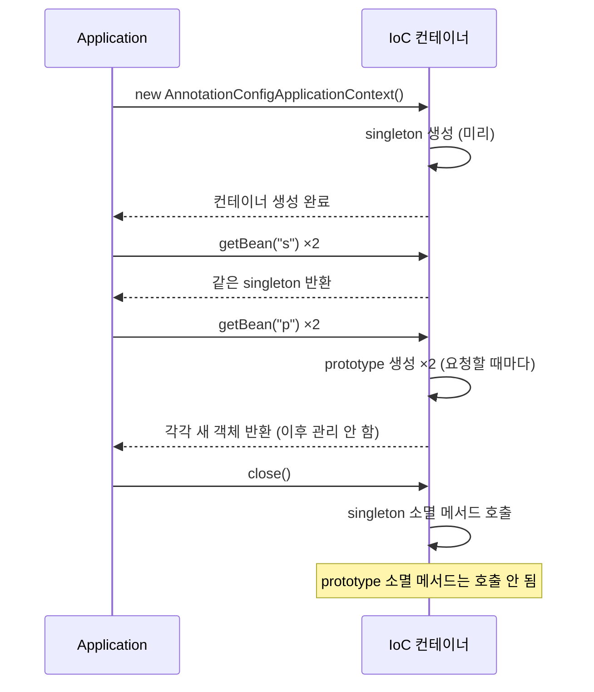

## 들어가며 (Situation)

[IoC 컨테이너 실습]()의 `section03`은 **빈 스코프**를 다룬다. 같은 `PaymentService`를 이름만 다르게 두 번 등록했다.

```java
@Bean("single")          // default 메서드명이지만, 직접 이름 지정 가능
@Scope("singleton")      // default 설정은 싱글톤이다.
public PaymentService paymentService() { return new PaymentService(kakaoPayGateway()); }

@Bean("proto")
@Scope("prototype")      // prototype 으로 지정하면 요청 시마다 매번 새로운 인스턴스를 반환하게 된다.
public PaymentService paymentService2() { return new PaymentService(kakaoPayGateway()); }
```

비교를 위해 `PaymentService`에는 마지막 주문 ID를 저장하는 필드가 추가됐다. 그 위의 주석이 이 수업의 핵심이다.

```java
/* Bean 은 기본적으로 Singleton 이다.
   가장 주의!!
   - Bean 이 상태(필드) 값을 가지게 되면 모든 요청이 해당 필드 값을 공유하게 된다.
   - 따라서 필드에는 행위 위주의 클래스(ex) service, dao) 만 작성하고
   - 데이터 저장이 필요한 경우에는 각 요청별로 DTO 를 통해서 데이터를 저장한다. */
private String orderId;
```

## 문제 상황 (Task)

수업 코드를 실행한 결과는 이랬다.

```text
===========singleton 확인===========
single 의 주문 ID : order-001
single2 의 주문 ID : order-001
===========prototype 확인===========
proto 의 주문 ID : order-002
proto 의 주문 ID : order-002
```

싱글톤은 `single2`가 결제를 하지 않았는데도 `order-001`이 나왔다. 같은 객체라는 증거다. 그런데 prototype 쪽은 **두 줄이 똑같았다.** 다시 보니 코드에 실수가 있었다.

```java
PaymentService proto2 = context.getBean("proto", PaymentService.class);
System.out.println("proto 의 주문 ID : " + proto.getOrderId());   // proto2가 아니라 proto를 출력
```

`proto2`를 꺼내 놓고 `proto`를 다시 출력했다. 그래서 prototype이 정말 매번 새 객체인지는 이 출력으로 알 수 없었다. 확인할 것을 정했다.

1. prototype은 정말 매번 다른 객체일까?
2. 각 스코프의 빈은 **언제 만들어지고 언제 사라질까?**
3. 수업 주석의 경고("모든 요청이 필드 값을 공유")가 실제로 어떤 버그가 될까?

## 해결 과정 (Action)

### 1. `proto2`를 제대로 출력하기

코드를 고치고, 객체의 동일성(`==`)과 `identityHashCode`도 함께 찍었다. (확인용 **예시 코드**, 이하 같음)

```java
System.out.println("single==single2 " + (s1 == s2) + ", proto==proto2 " + (p1 == p2));
p1.processPay("order-002", 3);
System.out.println("proto.getOrderId()=" + p1.getOrderId() + ", proto2.getOrderId()=" + p2.getOrderId());
```

```text
[1] single==single2 true, proto==proto2 false
[2] proto.getOrderId()=order-002, proto2.getOrderId()=null
[3] hash single 198099809/198099809, proto 645482568/807752428
```

`proto2`의 주문 ID는 `null`이었다. 결제를 한 적 없는 **새 객체**이기 때문이다. 싱글톤은 해시값이 같고, 프로토타입은 다르다.

| | `single` (singleton) | `proto` (prototype) |
|---|---------------------|---------------------|
| `getBean` 2번 | 같은 객체 (`true`) | 다른 객체 (`false`) |
| 두 번째 객체의 `orderId` | `order-001` (공유) | `null` (새 객체) |

Spring 문서의 정의와 같다.

> Only one shared instance of a singleton bean is managed, and all requests for beans with an ID or IDs that match that bean definition result in that one specific bean instance being returned by the Spring container.

> The non-singleton prototype scope of bean deployment results in the creation of a new bean instance every time a request for that specific bean is made.

### 2. 만들어지는 시점과 사라지는 시점

생성자와 소멸 메서드에서 출력하는 빈을 두 스코프로 등록하고, 컨테이너를 만들고, `getBean`을 두 번씩 부르고, 컨테이너를 닫았다.

```java
@Bean(name="s", destroyMethod="bye") Bean1 s() { return new Bean1("singleton"); }
@Bean(name="p", destroyMethod="bye") @Scope("prototype") Bean1 p() { return new Bean1("prototype"); }
```

```text
---- 생성 시점 ----
  singleton 생성 187472540
컨테이너 생성 완료
  prototype 생성 1882349076
  prototype 생성 936292831
---- 컨테이너 종료 ----
  singleton 소멸
```



| | singleton | prototype |
|---|-----------|-----------|
| 생성 시점 | **컨테이너 생성 시** (미리) | `getBean` 호출 시 |
| `getBean` 2번에 생성 횟수 | 0번 (이미 있음) | 2번 |
| 컨테이너 종료 시 소멸 메서드 | 호출됨 | **호출 안 됨** |

prototype의 소멸 메서드가 불리지 않은 것은 문서에 적힌 그대로다.

> Spring does not manage the complete lifecycle of a prototype bean. The container instantiates, configures, and otherwise assembles a prototype object and hands it to the client, with no further record of that prototype instance.

컨테이너는 prototype 빈을 만들어서 건네주고 **잊어버린다.** 파일이나 연결 같은 자원을 가진 prototype 빈이라면, 정리는 받아 간 쪽의 책임이다.

### 3. 상태를 가진 싱글톤의 버그 재현

수업 주석의 경고를 장면으로 만들었다. 사용자 A와 B가 같은 싱글톤 서비스로 번갈아 결제한다. A는 결제 직후 자기 주문 ID를 확인한다.

```java
PaymentService userA = ctx.getBean("single", PaymentService.class);
PaymentService userB = ctx.getBean("single", PaymentService.class);
userA.processPay("A-100", 1);
userB.processPay("B-200", 1);
System.out.println("A가 확인한 자기 주문 ID = " + userA.getOrderId());
```

```text
[4] A가 확인한 자기 주문 ID = B-200
```

A가 결제했는데 **B의 주문 ID가 나왔다.** `userA`와 `userB`는 이름만 다를 뿐 같은 객체다. B의 결제가 `orderId` 필드를 덮어썼다. 지금은 한 줄씩 순서대로 실행해서 재현했지만, 웹 서버에서는 여러 요청이 **여러 스레드에서 동시에** 같은 싱글톤을 쓴다. 그래서 이런 덮어쓰기가 언제 일어날지 예측할 수 없다. [Servlet 수업]()에서 본 "서블릿 객체는 하나, 요청은 여러 스레드"와 같은 구조다.

### 4. 해결: 상태를 빈 밖으로

방법은 두 가지다.

| 방법 | 내용 | 평가 |
|------|------|------|
| prototype으로 바꾸기 | 요청마다 새 `PaymentService` | 가능하지만 결제 서비스까지 매번 새로 만들 이유가 없음 |
| **상태를 필드에서 빼기** | `orderId`는 매개변수와 반환값(DTO)으로 주고받음 | 수업 주석과 문서가 권하는 방식 |

Spring 문서의 원칙도 같다.

> As a rule, you should use the prototype scope for all stateful beans and the singleton scope for stateless beans.

서비스는 "행위"만 가진 **무상태(stateless)** 객체로 두고, 요청마다 달라지는 데이터는 지역 변수, 매개변수, DTO로 다룬다. 그러면 싱글톤 하나를 모든 요청이 안전하게 같이 쓸 수 있다. 수업 주석의 "필드에는 행위 위주의 클래스(service, dao)만"은 `PaymentInterface` 같은 **다른 빈에 대한 참조**는 필드로 둬도 된다는 뜻이다. 그 빈들도 무상태이기 때문이다.

자바 수업에서 직접 만든 [싱글톤 패턴]()은 `private` 생성자와 `static` 필드로 객체를 하나로 제한했다. Spring 싱글톤은 클래스는 평범하게 두고, **컨테이너가 하나만 만들어 관리**한다. `new PaymentService(...)`로 직접 만들면 몇 개든 만들 수 있다. "컨테이너 안에서 하나"라는 점이 다르다.

## 결과 (Result)

| 확인 항목 | 결과 |
|-----------|------|
| 수업 코드의 prototype 출력 | `proto2` 대신 `proto`를 두 번 출력하는 실수 |
| 고친 뒤 `proto2.getOrderId()` | `null` (새 객체) |
| singleton 생성 시점 | 컨테이너 생성 시 1번 |
| prototype 생성 시점 | `getBean`마다 (2번 호출 → 2개) |
| 컨테이너 종료 | singleton만 소멸 메서드 호출 |
| 상태 있는 싱글톤에서 A의 주문 ID | `B-200` (B가 덮어씀) |
| 환경 | Java 21, spring-context 7.0.8 |

배운 점은 다음과 같다.

- 기본 스코프인 싱글톤은 컨테이너가 미리 하나 만들어 모두에게 나눠 준다. 그래서 필드에 요청별 데이터를 두면 서로 덮어쓴다.
- prototype은 컨테이너가 만들어 주기만 하고 관리하지 않는다. 소멸 콜백도 호출되지 않는다.

## 더 학습하면 좋은 개념

- **스레드 안전성(thread safety)과 경쟁 조건** — 상태 있는 싱글톤 버그가 실제 서버에서 동시에 일어나는 원리.
- **웹 스코프 (`request`, `session`)** — 요청 하나, 세션 하나마다 빈을 만드는 스코프. Spring MVC에서 쓰인다.
- **싱글톤 빈에 prototype 빈 주입하기 (`ObjectProvider`)** — 주입은 한 번만 일어나서 prototype이 사실상 하나가 되는 문제와 해결 방법.
- **빈 생명주기 콜백 (`@PostConstruct`, `@PreDestroy`)** — 이번 실험의 `destroyMethod`를 어노테이션으로 지정하는 방법.

## 참고 자료

- [Spring Framework Reference - Bean Scopes](https://docs.spring.io/spring-framework/reference/core/beans/factory-scopes.html)
- [Spring Framework Reference - Customizing the Nature of a Bean (Lifecycle Callbacks)](https://docs.spring.io/spring-framework/reference/core/beans/factory-nature.html)
- [Spring Framework Javadoc - @Scope](https://docs.spring.io/spring-framework/docs/current/javadoc-api/org/springframework/context/annotation/Scope.html)
- [Spring Framework Javadoc - @Bean (destroyMethod)](https://docs.spring.io/spring-framework/docs/current/javadoc-api/org/springframework/context/annotation/Bean.html)

---

**요약**
1. 수업 코드는 `proto2`를 꺼내 놓고 `proto`를 출력하는 실수가 있었다. 고쳐 보니 `proto2`의 주문 ID는 `null`로, prototype은 매번 새 객체였다.
2. singleton은 컨테이너를 만들 때 미리 생성되고 종료 때 소멸 메서드가 불렸지만, prototype은 `getBean`마다 생성되고 소멸 메서드는 불리지 않았다.
3. 상태 필드를 가진 싱글톤에서 A가 결제한 직후 주문 ID를 확인하자 B의 `B-200`이 나왔다. 서비스 빈은 무상태로 두고 요청 데이터는 매개변수와 DTO로 다룬다.
