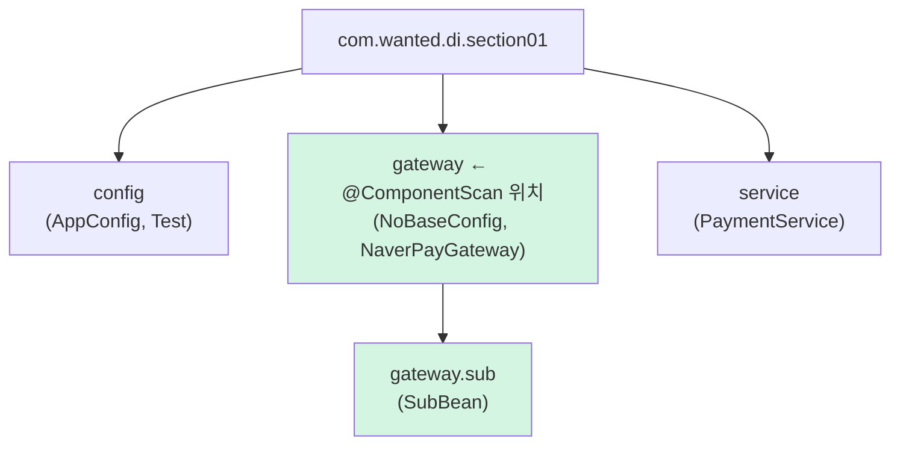
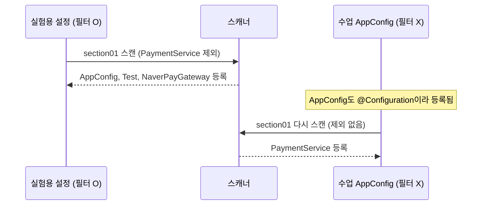

## 들어가며 (Situation)

[IoC 컨테이너 실습]()에서는 `AppConfig`에 `@Bean` 메서드를 하나씩 써서 빈을 등록했다. `chap02-dependency-injection/section01`은 이렇게 문제를 던진다.

> AppConfig 파일 하위에 Bean 들을 정의해서 IoC 컨테이너에 등록했었다. 문제 제기! : 만약 Bean 이 100개라면?

답은 **컴포넌트 스캔**이다. 클래스에 `@Component`를 붙이고, 설정 클래스에는 어디를 뒤질지만 알려 준다.

```java
@Component
public class NaverPayGateway implements PaymentInterface { ... }

@Service   // @Component 의 특수한 형태. Service 계층에 해당하는 Bean에 붙인다.
public class PaymentService { ... }

@Component
public class Test { }   // config 패키지 안의 빈 클래스
```

```java
@Configuration
@ComponentScan(basePackages = "com.wanted.di.section01",
    excludeFilters = @ComponentScan.Filter(
            // 1. 클래스명 제외
//            type = FilterType.ASSIGNABLE_TYPE, classes = {PaymentService.class}
            // 2. 어노테이션 제외
//            type = FilterType.ANNOTATION, classes = {org.springframework.stereotype.Service.class}
            // 3. 정규표현식 제외
//            type = FilterType.REGEX, pattern = {"com.wanted.di.section01.service.*"}
    )
)
public class AppConfig { }
```

`AppConfig` 본문은 비어 있다. `@Bean` 메서드가 하나도 없다.

## 문제 상황 (Task)

수업 주석에는 이런 설명이 있다.

> basePackages 지정을 하지 않으면 스캔의 범위가 @ComponentScan 달려있는 클래스와 동일한 레벨(같은 패키지)까지만 스캔이 가능하다.

"같은 패키지까지만"이라면 하위 패키지는 스캔하지 않는다는 뜻일까? 그리고 세 가지 필터는 주석 처리돼 있어서 실제로 무엇이 빠지는지 수업 중에는 보지 못했다.

1. 스캔으로 등록된 빈의 이름은 무엇일까?
2. 모든 줄이 주석 처리된 빈 `Filter()`는 무엇을 제외할까?
3. 필터 세 가지는 각각 무엇을 빼고, 빠진 빈을 꺼내면 어떻게 될까?
4. `basePackages`가 없으면 정말 같은 패키지까지만 볼까?

## 해결 과정 (Action)

### 1. 스캔 결과: 클래스 이름이 빈 이름

컨테이너에 등록된 빈 중 Spring 내부 빈을 빼고 출력하는 작은 프로그램을 만들었다. (확인용 **예시 코드**, 이하 같음)

```java
for (String n : ctx.getBeanDefinitionNames())
    if (!n.startsWith("org.springframework")) l.add(n);
```

```text
lecture as-is: [appConfig, test, naverPayGateway, paymentService]
```

- 빈 이름은 **클래스 이름의 첫 글자를 소문자로** 바꾼 것이다(`NaverPayGateway` → `naverPayGateway`).
- `config` 패키지의 `Test`도 `@Component`가 붙어 있어 빈이 됐다.
- `AppConfig`도 빈이다. `@Configuration` 자체가 `@Component`를 품고 있기 때문이다.
- `PaymentService`의 생성자는 `PaymentInterface`를 받는다. `@Bean` 메서드에서 `new PaymentService(naverPayGateway())`처럼 직접 넣지 않았는데도, 컨테이너가 `PaymentInterface` 타입의 빈(`naverPayGateway`)을 찾아 생성자에 넣었다. 이것이 [다음 글]()의 의존성 자동 주입이다.

| 어노테이션 | 정체 | 쓰는 곳 |
|------------|------|---------|
| `@Component` | 스캔 대상 표시 | 일반 빈 |
| `@Service` | `@Component` + "서비스 계층" 의미 | 비즈니스 로직 |
| `@Repository` | `@Component` + 데이터 접근 예외 변환 | DAO |
| `@Controller` | `@Component` + 웹 요청 처리 | 컨트롤러 |
| `@Configuration` | `@Component` + 설정 클래스(CGLIB 처리) | 설정 |

### 2. 빈 `Filter()`는 아무것도 제외하지 않는다

수업 코드의 `excludeFilters`에는 `@ComponentScan.Filter( )`가 **내용 없이** 들어 있다. 위 결과처럼 빈 4개가 모두 등록됐다. `Filter`의 `type` 기본값은 `ANNOTATION`이고 `classes` 기본값은 빈 배열이다. "어노테이션 목록이 비어 있는 어노테이션 필터"라서 걸리는 클래스가 없다. 오류는 나지 않지만 의미도 없는 코드다.

세 줄 중 **두 줄을 함께** 주석 해제하면 컴파일되지 않았다.

```text
AppConfig.java:24: error: ')' expected
            type = FilterType.ASSIGNABLE_TYPE, classes = {PaymentService.class}
```

`Filter` 하나에는 `type`이 하나뿐이다. 여러 조건으로 빼려면 `excludeFilters = { @Filter(...), @Filter(...) }`처럼 필터를 여러 개 배열로 준다.

### 3. 필터 세 가지를 하나씩 켜기

수업 `AppConfig`에서 한 줄씩만 주석을 풀어 각각 실행했다.

```text
filter line 24 (ASSIGNABLE_TYPE): [appConfig, test, naverPayGateway]
filter line 26 (ANNOTATION):      [appConfig, test, naverPayGateway]
filter line 28 (REGEX):           [appConfig, test, naverPayGateway]
```

세 경우 모두 `paymentService`가 빠졌다. 결과는 같지만 **기준이 다르다.**

| `FilterType` | 기준 | 수업 코드 | 이 방식으로 함께 빠지는 것 |
|--------------|------|-----------|---------------------------|
| `ASSIGNABLE_TYPE` | 그 클래스 **또는 그 자식·구현체** | `PaymentService.class` | `PaymentService`를 상속한 클래스 |
| `ANNOTATION` | 그 어노테이션이 붙은 클래스 | `@Service` | `@Service`가 붙은 모든 클래스 |
| `REGEX` | 클래스 전체 이름이 정규식과 일치 | `com.wanted.di.section01.service.*` | `service` 패키지의 모든 클래스 |

지금은 `service` 패키지에 `@Service` 클래스가 하나뿐이라 결과가 같았다. 클래스가 늘어나면 세 필터의 결과는 달라진다.

빠진 빈을 꺼내는 수업 `Application`을 실행하면 바로 실패했다.

```text
Exception in thread "main" org.springframework.beans.factory.NoSuchBeanDefinitionException: No bean named 'paymentService' available
```

`REGEX`의 `.`은 정규식에서 "아무 글자 하나"라는 뜻이다. `com.wanted...`의 점도 정확히는 아무 글자와 맞는다. 엄밀하게 쓰려면 `com\\.wanted\\.di\\.section01\\.service\\..*`처럼 점을 이스케이프해야 한다. 실습 수준에서는 결과가 같지만 알아 둘 만하다. 그리고 `section02`의 같은 주석에는 패턴이 `section01`로 남아 있었다. 복사한 코드를 그대로 켜면 아무것도 제외되지 않았을 것이다.

### 4. `basePackages`가 없으면: 하위 패키지까지

수업 주석을 확인하려고 `basePackages` 없이 `@ComponentScan`만 붙인 설정 클래스를 `gateway` 패키지에 두었다. 그리고 그 **하위 패키지** `gateway.sub`에 `@Component` 클래스를 하나 만들었다.

```java
package com.wanted.di.section01.gateway;
@Configuration @ComponentScan
public class NoBaseConfig {}

package com.wanted.di.section01.gateway.sub;
@Component public class SubBean {}
```

```text
no-base(gateway pkg): [noBaseConfig, subBean, naverPayGateway]
```

**하위 패키지의 `subBean`도 등록됐다.** 같은 레벨의 `config`, `service` 패키지는 보지 않았다(`paymentService`, `test` 없음). `@ComponentScan` 문서의 설명은 이렇다.

> If specific packages are not defined, scanning will occur recursively beginning with the package of the class that declares this annotation.

"같은 패키지까지만"이 아니라 **선언한 클래스의 패키지부터 그 아래 전부**(recursively)가 정확한 설명이다.



초록색 두 패키지만 스캔됐다. Spring Boot의 `@SpringBootApplication`이 보통 **최상위 패키지**에 있는 이유가 여기 있다. 그 아래 모든 패키지를 스캔 범위에 넣기 위해서다.

### 5. 스캔 범위에 설정 클래스가 있으면 필터가 무력해진다

실험 중에 예상하지 못한 일도 있었다. 필터를 시험하려고 `exp2` 패키지에 **별도 설정 클래스**를 만들고, `basePackages = "com.wanted.di.section01"`에 `PaymentService`를 제외하는 필터를 걸었다. 그런데 `paymentService`가 빠지지 않았다.

```text
[ASSIGNABLE_TYPE PaymentService] [scanExp.A, noBaseConfig, subBean, appConfig, test, naverPayGateway, paymentService]
```

원인은 스캔 범위 안에 있던 수업의 `AppConfig`였다. `AppConfig`도 `@Configuration`이라 스캔으로 등록됐다. 등록된 `AppConfig`의 `@ComponentScan`(필터 없음)이 **다시 실행되면서** `PaymentService`를 등록해 버렸다.



`@ComponentScan`을 가진 설정 클래스가 다른 스캔 범위 안에 들어가면, 각자의 규칙으로 따로 스캔한다. 필터가 안 먹는 것처럼 보일 때는 **스캔 범위 안에 다른 `@Configuration`이 없는지** 확인해야 한다. 수업 코드는 `AppConfig` 하나뿐이라 이 문제가 없었다.

## 결과 (Result)

| 확인 항목 | 결과 |
|-----------|------|
| 수업 `AppConfig` 스캔 결과 | `appConfig`, `test`, `naverPayGateway`, `paymentService` |
| 내용 없는 `Filter()` | 제외 0개 |
| 필터 두 줄 동시 해제 | 컴파일 오류 (`')' expected`) |
| `ASSIGNABLE_TYPE` / `ANNOTATION` / `REGEX` | 셋 다 `paymentService` 제외 (기준은 각각 다름) |
| 제외 후 `getBean("paymentService")` | `NoSuchBeanDefinitionException` |
| `basePackages` 없이 `gateway` 패키지에서 스캔 | `gateway`와 하위 `gateway.sub`까지 등록 |
| 환경 | Java 21, spring-context 7.0.8 |

배운 점은 다음과 같다.

- `basePackages`를 생략하면 선언한 클래스의 패키지와 **모든 하위 패키지**를 스캔한다.
- 필터는 "무엇을 기준으로 뺄 것인가"(타입, 어노테이션, 이름 패턴)를 고르는 것이다. 지금 결과가 같아도 클래스가 늘면 달라진다.

## 더 학습하면 좋은 개념

- **스테레오타입 어노테이션과 메타 어노테이션** — `@Service` 안에 `@Component`가 들어 있는 구조. 직접 만든 어노테이션도 스캔 대상으로 만들 수 있다.
- **`includeFilters`와 `useDefaultFilters = false`** — 반대로 "이것만 등록"하는 방법.
- **Spring Boot의 `@SpringBootApplication`** — 컴포넌트 스캔을 포함한 어노테이션. 패키지 위치가 중요한 이유.
- **빈 이름 충돌 (`ConflictingBeanDefinitionException`)** — 다른 패키지에 같은 이름의 클래스가 있을 때 생기는 문제.

## 참고 자료

- [Spring Framework Reference - Classpath Scanning and Managed Components](https://docs.spring.io/spring-framework/reference/core/beans/classpath-scanning.html)
- [Spring Framework Javadoc - @ComponentScan](https://docs.spring.io/spring-framework/docs/current/javadoc-api/org/springframework/context/annotation/ComponentScan.html)
- [Spring Framework Javadoc - FilterType](https://docs.spring.io/spring-framework/docs/current/javadoc-api/org/springframework/context/annotation/FilterType.html)
- [Spring Boot Reference - Structuring Your Code](https://docs.spring.io/spring-boot/reference/using/structuring-your-code.html)

---

**요약**
1. 컴포넌트 스캔은 `@Component` 계열 클래스를 찾아 클래스 이름 첫 글자를 소문자로 바꾼 이름으로 등록했고, 수업의 내용 없는 `Filter()`는 아무것도 제외하지 않았다.
2. `ASSIGNABLE_TYPE`, `ANNOTATION`, `REGEX` 필터는 각각 타입, 어노테이션, 이름 패턴으로 `paymentService`를 뺐고, 빠진 빈을 꺼내면 `NoSuchBeanDefinitionException`이 났다.
3. `basePackages` 없이 스캔하면 선언한 클래스의 패키지와 하위 패키지까지 스캔했다. 수업 주석의 "같은 패키지까지만"과 달랐다.
