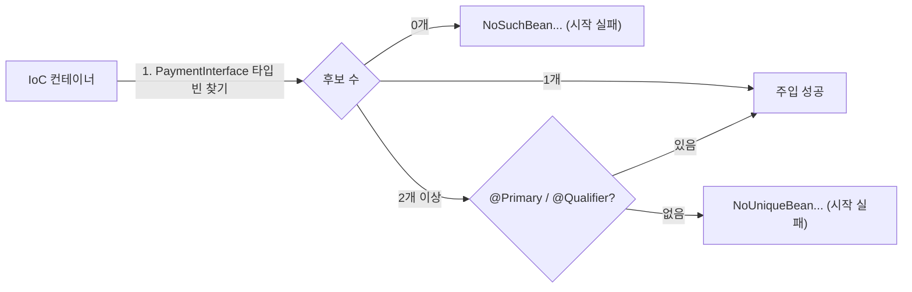

## 들어가며 (Situation)

`chap02-dependency-injection/section02`의 주제는 **의존성 주입(DI)**이다. 수업 주석의 정의는 이렇다.

> Spring 은 IoC 컨테이너 기능을 통해서 개발자가 직접 객체와 객체 간의 결합을 관리하는 것이 아닌, IoC 컨테이너가 자동으로 객체 간의 의존성을 주입하는 것을 의미한다. == (new X)

같은 결제 서비스를 주입 방식만 바꿔 세 개 만들었다. 모두 [컴포넌트 스캔]()으로 등록되고, `PaymentInterface`의 구현체는 `NaverPayGateway` 하나다.

```java
@Service("field")
public class PaymentServiceField {
    @Autowired
    private PaymentInterface paymentInterface;
}

@Service("setter")
public class PaymentServiceSetter {
    private PaymentInterface paymentInterface;

    @Autowired
    public void setPaymentInterface(PaymentInterface paymentInterface) {
        this.paymentInterface = paymentInterface;
    }
}

@Service("constructor")
public class PaymentServiceConstructor {
    private final PaymentInterface paymentInterface;

    @Autowired
    public PaymentServiceConstructor(PaymentInterface paymentInterface) {
        this.paymentInterface = paymentInterface;
    }
}
```

수업 `Application`은 `field`와 `setter`만 꺼내 실행했고, 둘 다 네이버페이로 결제됐다.

## 문제 상황 (Task)

수업 주석에는 방식마다 장단점이 적혀 있다.

| 방식 | 수업 주석의 단점 / 장점 |
|------|--------------------------|
| 필드 | final 키워드를 사용할 수 없다. 필드에 직접 객체를 생성해서 대입해도 컴파일 에러가 발생하지 않는다. |
| setter | final 키워드를 사용할 수 없다. setter 메서드가 호출되지 않으면 null 인 상태이다. / 선택적 의존관계를 가질 수 있다. |
| 생성자 | final로 불변성 보장, 필수 의존성 강제화 → Spring 공식 권장 방식. 생성자가 1개 뿐이라면 `@Autowired`를 생략해도 된다. |

컨테이너 안에서는 세 방식 모두 잘 동작했다. 그래서 차이가 보이지 않았다. 차이는 **컨테이너 밖**이나 **코드를 잘못 고쳤을 때** 드러날 것이라고 생각했다. 그래서 주석의 주장을 하나씩 실험했다.

1. 컨테이너 없이 `new`로 만들면 각각 어떻게 될까? (예: 단위 테스트에서 직접 만드는 경우)
2. 주입받은 필드를 실수로 다시 대입하면 컴파일러가 막아 줄까?
3. `@Autowired`를 지워도 생성자 주입이 정말 동작할까?
4. 구현체가 두 개가 되면?

## 해결 과정 (Action)

### 1. 컨테이너 밖에서 `new` 하기

```java
new PaymentServiceField().processPay("order-x", 1);
new PaymentServiceSetter().processPay("order-y", 1);
// new PaymentServiceConstructor();
```

(확인용 **예시 코드**, 이하 같음)

```text
결제 비즈니스 로직 시작! 주문 ID = order-x, 수량 = 1
[1] field new: java.lang.NullPointerException: Cannot invoke "com.wanted.di.section02.gateway.PaymentInterface.processPay(String, int)" because "this.paymentInterface" is null
결제 비즈니스 로직 시작! 주문 ID = order-y, 수량 = 1
[2] setter new: java.lang.NullPointerException: Cannot invoke ... because "this.paymentInterface" is null
```

필드 주입과 setter 주입은 **객체는 만들어졌고**, 메서드가 절반쯤 실행된 뒤 NPE로 죽었다. `@Autowired`는 컨테이너가 읽는 표시일 뿐이다. 컨테이너가 없으면 아무도 값을 넣지 않는다.

생성자 주입은 `new PaymentServiceConstructor()`라고 쓰는 순간 컴파일이 안 됐다.

```text
error: constructor PaymentServiceConstructor in class PaymentServiceConstructor cannot be applied to given types;
  required: PaymentInterface
  found:    no arguments
```

| 방식 | `new`로 생성 | 문제가 드러나는 시점 |
|------|-------------|----------------------|
| 필드 | 성공 | 실행 중 NPE (메서드 호출 시) |
| setter | 성공 | 실행 중 NPE (setter를 안 불렀다면) |
| 생성자 | **컴파일 오류** | 코드를 쓰는 순간 |

생성자 주입은 "이 객체는 `PaymentInterface` 없이는 만들 수 없다"는 사실을 **타입 시스템으로** 표현한다. 테스트에서 직접 만들 때도 가짜 구현체를 넣어 주면 된다. `new PaymentServiceConstructor(new FakeGateway())`처럼 쓰면 되므로 Spring이 필요 없다.

### 2. 다시 대입하면?

주입받은 필드를 메서드 안에서 다시 `new`로 바꾸는 실수를 넣었다. 수업 코드에도 이 줄이 주석으로 남아 있다.

```java
//        paymentInterface = new NaverPayGateway();
```

생성자 주입 클래스에서 주석을 풀었다.

```text
PaymentServiceConstructor.java:42: error: cannot assign a value to final variable paymentInterface
        paymentInterface = new NaverPayGateway();
        ^
```

필드 주입 클래스에 같은 줄을 넣었더니 **아무 경고 없이 컴파일됐다**(종료 코드 0). 컨테이너가 넣어 준 빈은 버려지고, 매번 새 `NaverPayGateway`가 쓰인다. 수업 주석("필드에 직접 객체를 생성해서 대입해도 컴파일 에러가 발생하지 않는다")이 그대로 재현됐다. `final`은 생성자에서만 값을 넣을 수 있기 때문에, 필드 주입과 setter 주입에는 붙일 수 없다.

### 3. `@Autowired`를 지운 생성자

`PaymentServiceConstructor`에서 `@Autowired` 줄만 지우고 컨테이너에서 꺼냈다.

```text
결제 비즈니스 로직 시작! 주문 ID = order-005, 수량 = 1
네이버페이로 결제 시작! : 주문 ID = order-005, 수량 = 1
결제 성공!
no @Autowired -> true
```

생성자가 하나뿐이면 Spring은 그 생성자로 객체를 만들면서 매개변수 타입에 맞는 빈을 넣는다. [컴포넌트 스캔 글]()의 `PaymentService`도 `@Autowired` 없이 주입됐던 이유다.

### 4. 구현체가 두 개가 되면

`PaymentInterface`를 구현한 `KakaoPayGateway`에 `@Component`를 붙여 스캔 범위에 추가했다.

```text
UnsatisfiedDependencyException: Error creating bean with name 'constructor' ...:
Unsatisfied dependency expressed through constructor parameter 0:
No qualifying bean of type 'com.wanted.di.section02.gateway.PaymentInterface' available:
expected single matching bean but found 2: naverPayGateway,kakaoPayGateway
```

**컨테이너 생성 단계에서** 실패했다. `@Autowired`는 기본적으로 **타입**으로 빈을 찾는데, 후보가 둘이면 고를 수 없다. [IoC 글]()에서 `getBean(PaymentInterface.class)`가 실패한 것과 같은 이유다. 차이는 시점이다. 그때는 `getBean`을 부를 때 실패했고, 이번에는 애플리케이션이 **시작할 때** 실패했다. 잘못된 설정이 실제 요청이 오기 전에 드러나는 것은 장점이다. 해결은 `@Primary`(기본 후보 지정)나 `@Qualifier("kakaoPayGateway")`(이름 지정)로 한다.



### 5. Spring 문서의 권장

Spring 레퍼런스의 "Constructor-based or setter-based DI?" 절은 이렇게 말한다.

> The Spring team generally advocates constructor injection, as it lets you implement application components as immutable objects and ensures that required dependencies are not `null`.

> Setter injection should primarily only be used for optional dependencies that can be assigned reasonable default values within the class.

생성자는 필수 의존성, setter는 **기본값이 있는 선택적 의존성**에 쓰라는 것이다. 문서는 필드 주입을 DI 방식으로 따로 다루지 않는다. 실험 결과를 합치면 이렇다.

| | 필드 | setter | 생성자 |
|---|------|--------|--------|
| `final` | 불가 | 불가 | **가능** |
| 의존성 없이 생성 | 가능 → NPE | 가능 → NPE | **컴파일 오류** |
| 다시 대입하는 실수 | 컴파일 통과 | 컴파일 통과 | **컴파일 오류** |
| Spring 없이 테스트 | 리플렉션 필요 | setter 호출 | 생성자에 가짜 객체 전달 |
| 적합한 용도 | (권장 안 함) | 선택적 의존성 | 필수 의존성 (기본 선택) |

## 결과 (Result)

| 확인 항목 | 결과 |
|-----------|------|
| 필드 주입 클래스를 `new` | 실행 중 NPE (`this.paymentInterface is null`) |
| setter 주입 클래스를 `new` | 실행 중 NPE |
| 생성자 주입 클래스를 `new` | 컴파일 오류 (`required: PaymentInterface`) |
| 주입 필드 재대입 | 생성자: `cannot assign a value to final variable` / 필드: 컴파일 통과 |
| 생성자 1개 + `@Autowired` 제거 | 정상 주입 |
| 구현체 2개 | 컨테이너 시작 시 `UnsatisfiedDependencyException` |
| 환경 | Java 21, spring-context 7.0.8 |

배운 점은 다음과 같다.

- 세 방식은 컨테이너 안에서는 똑같이 동작한다. 차이는 **실수가 컴파일 시점에 잡히는지, 실행 중에 터지는지**에 있다.
- 생성자 주입은 "필수 의존성"을 타입과 `final`로 표현해서, 컨테이너 없이도 올바른 객체만 만들 수 있게 한다.

## 더 학습하면 좋은 개념

- **`@Primary`와 `@Qualifier`** — 같은 타입의 빈이 여러 개일 때 하나를 고르는 방법.
- **Lombok `@RequiredArgsConstructor`** — `final` 필드만 받는 생성자를 자동으로 만들어 생성자 주입 코드를 줄인다. AOP 실습에서 Lombok을 처음 썼다.
- **순환 참조** — A가 B를, B가 A를 생성자로 받으면 생기는 문제. 생성자 주입은 이것을 시작 시점에 알려 준다.
- **테스트 대역(Mock, Fake)** — 생성자 주입 덕분에 가짜 결제 모듈을 넣어 테스트하는 방법.

## 참고 자료

- [Spring Framework Reference - Dependency Injection (Constructor-based or setter-based DI?)](https://docs.spring.io/spring-framework/reference/core/beans/dependencies/factory-collaborators.html)
- [Spring Framework Reference - Using @Autowired](https://docs.spring.io/spring-framework/reference/core/beans/annotation-config/autowired.html)
- [Spring Framework Reference - Fine-tuning Annotation-based Autowiring with @Primary or @Fallback](https://docs.spring.io/spring-framework/reference/core/beans/annotation-config/autowired-primary.html)
- [Spring Framework Reference - Fine-tuning Annotation-based Autowiring with Qualifiers](https://docs.spring.io/spring-framework/reference/core/beans/annotation-config/autowired-qualifiers.html)

---

**요약**
1. 컨테이너 밖에서 `new`로 만들면 필드·setter 주입은 실행 중 NPE가 났고, 생성자 주입은 `required: PaymentInterface` 컴파일 오류로 아예 만들 수 없었다.
2. 주입받은 필드를 다시 대입하는 실수는 `final`인 생성자 주입만 컴파일 오류로 막았다. 생성자가 하나면 `@Autowired`를 지워도 주입됐다.
3. 구현체가 두 개가 되자 컨테이너 시작 단계에서 `expected single matching bean but found 2`로 실패했다. Spring 팀은 필수 의존성에 생성자 주입을 권장한다.
