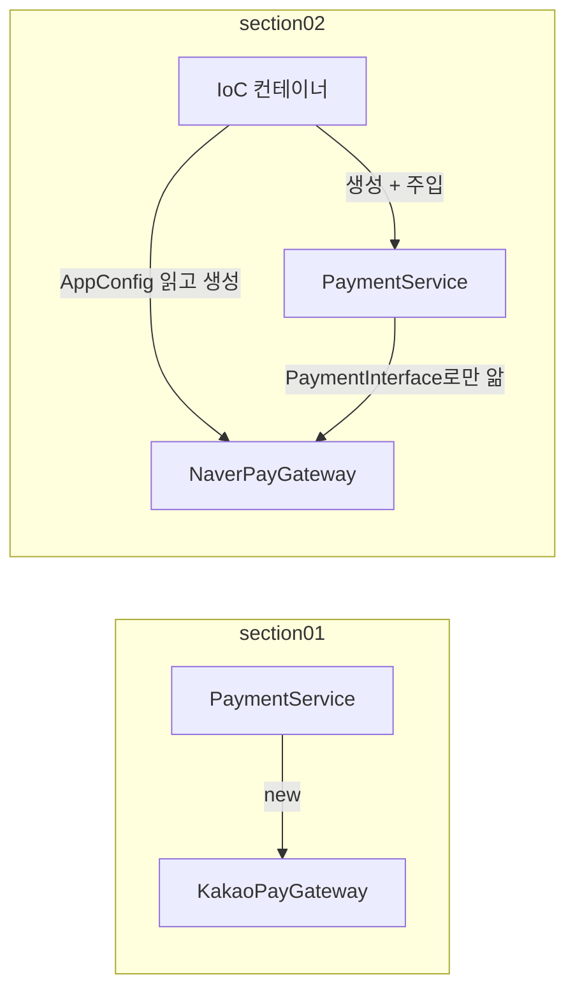

## 들어가며 (Situation)

Servlet 다음으로 Spring Core 수업이 시작됐다. 첫 프로젝트 `chap01-IoC-container`는 결제 시스템 예제다. `build.gradle`에 의존성 하나를 추가하는 것으로 시작한다.

```groovy
/* comment. spring-context
    : Spring 프레임 워크의 핵심 의존성. IoC Container 생성 */
implementation 'org.springframework:spring-context:7.0.8'
```

수업 시나리오는 이렇다.

> 우리 프로젝트는 결제 시스템이 있으며, KakaoPay, NaverPay 가 있다. Application 에서는 PaymentService 를 호출하면 상황에 맞는 Pay 를 호출해서 결제가 되는 시나리오를 구성한다.

같은 기능을 두 번 만들었다.

| 패키지 | 방식 |
|--------|------|
| `section01` | Spring 없이 `PaymentService`가 결제 객체를 직접 `new` |
| `section02` | `PaymentInterface` + `AppConfig`(`@Configuration`, `@Bean`) + IoC 컨테이너 |

## 문제 상황 (Task)

`section01`에서 "네이버페이를 카카오페이로 바꾸자"는 요구사항을 반영한 흔적이 주석으로 남아 있다.

```java
public class PaymentService {
//    private NaverPayGateway naverPayGateway;
    private KakaoPayGateway kakaoPayGateway;

    public PaymentService() {
//        this.naverPayGateway = new NaverPayGateway();
        this.kakaoPayGateway = new KakaoPayGateway();
    }

    public boolean processPay(String orderId, int amount) {
//        boolean result = naverPayGateway.pay(orderId, amount);
        boolean result = kakaoPayGateway.pay(orderId, amount);
        ...
```

결제 수단 하나를 바꾸는데 `PaymentService`의 **필드, 생성자, 호출부 세 곳**을 고쳤다. 게다가 두 결제 클래스의 메서드 모양도 달랐다.

```java
public boolean pay(String orderId, double amount)  // NaverPayGateway
public boolean pay(String orderId, int amount)     // KakaoPayGateway
```

수업 주석은 이것을 SOLID의 **개방-폐쇄 원칙(OCP) 위반**이라고 정리했다. "확장에는 열려 있고 변경에는 닫혀 있어야 한다"는 원칙이다. `section02`가 이 문제를 어떻게 해결하는지, 그리고 그 과정에서 컨테이너가 실제로 무엇을 하는지 확인하고 싶었다.

1. 컨테이너 안에는 실제로 무엇이 들어 있을까?
2. `AppConfig`의 `paymentService()`는 `naverPayGateway()`를 **직접 호출**한다. 그렇다면 `NaverPayGateway`가 두 개 만들어지지 않을까?
3. 결제 구현체가 두 개인데 `PaymentInterface` 타입으로 꺼내면 어떻게 될까?

## 해결 과정 (Action)

### 1. 첫 단계는 인터페이스

`section02`는 Spring보다 먼저 **인터페이스**를 도입한다.

```java
/* section01 에서 발생한 각 구현체 별로 메서드 이름, 매개변수 타입 / 순서 문제를
   interface 의 특징을 활용해서 해결 */
public interface PaymentInterface {
    boolean processPay(String orderId, int amount);
}

public class PaymentService {
    private final PaymentInterface paymentInterface;

    public PaymentService(PaymentInterface paymentInterface) {
        this.paymentInterface = paymentInterface;
    }
    ...
}
```

`PaymentService`는 이제 `NaverPayGateway`도 `KakaoPayGateway`도 모른다. `PaymentInterface`만 안다. 어떤 구현체를 쓸지는 **밖에서 생성자로 넣어 준다.** [다형성 수업]()의 "부모 타입 변수에 자식 객체 담기"가 여기서 쓰인다.

### 2. 객체 조립은 AppConfig가

```java
@Configuration
public class AppConfig {
    @Bean
    public KakaoPayGateway kakaoPayGateway() { return new KakaoPayGateway(); }

    @Bean
    public NaverPayGateway naverPayGateway() { return new NaverPayGateway(); }

    @Bean
    public PaymentService paymentService() {
        return new PaymentService(naverPayGateway());
    }
}
```

```java
ApplicationContext context = new AnnotationConfigApplicationContext(AppConfig.class);
PaymentService paymentService = context.getBean("paymentService", PaymentService.class);
```

이제 카카오페이로 바꾸려면 `naverPayGateway()`를 `kakaoPayGateway()`로 **한 단어만** 바꾸면 된다. `PaymentService`는 손대지 않는다.

| | section01 | section02 |
|---|-----------|-----------|
| 결제 수단 변경 시 수정 | `PaymentService` 3곳 | `AppConfig` 1단어 |
| `PaymentService`가 아는 것 | `KakaoPayGateway` (구체 클래스) | `PaymentInterface` (인터페이스) |
| 객체를 만드는 쪽 | `PaymentService`가 직접 `new` | 컨테이너 (`AppConfig` 설정대로) |

**IoC(제어의 역전)**는 이 마지막 줄을 가리킨다. 객체를 만들고 연결하는 제어권이 내 코드에서 컨테이너로 넘어갔다. 그래서 "역전"이다.



실행 결과는 기대대로 네이버페이였다.

```text
결제 비즈니스 로직 시작! 주문 ID = order-001, 수량 = 3
네이버페이로 결제 시작! : 주문 ID = order-001, 수량 = 3
결제 성공!
결제 결과 : true
```

### 3. 컨테이너 안을 들여다보기

컨테이너에 등록된 빈(Bean) 이름을 전부 출력했다. (확인용 **예시 코드**, 이하 같음)

```java
System.out.println(String.join(", ", ctx.getBeanDefinitionNames()));
```

```text
org.springframework.context.annotation.internalConfigurationAnnotationProcessor,
org.springframework.context.annotation.internalAutowiredAnnotationProcessor,
org.springframework.context.event.internalEventListenerProcessor,
org.springframework.context.event.internalEventListenerFactory,
appConfig, kakaoPayGateway, naverPayGateway, paymentService
```

- 수업 주석대로 빈 이름은 **메서드 이름**(`kakaoPayGateway`, `paymentService`)이다.
- `AppConfig` 자신도 `appConfig`라는 빈이다.
- 앞의 네 개는 Spring이 `@Configuration`, `@Autowired` 같은 어노테이션을 처리하려고 스스로 등록한 내부 빈이다.

빈 이름은 대소문자를 구분했다. `getBean("paymentservice")`는 `NoSuchBeanDefinitionException: No bean named 'paymentservice' available`이었다.

### 4. `naverPayGateway()`를 직접 불러도 객체는 하나

2번 질문이다. 컨테이너가 `naverPayGateway()`를 한 번 불러 빈을 만들고, `paymentService()` 안에서 또 한 번 부른다. 평범한 자바라면 `NaverPayGateway`가 두 개 생겨야 한다. `PaymentService` 안의 필드를 리플렉션으로 꺼내 컨테이너의 빈과 비교했다.

```text
[2] AppConfig class: com.wanted.container.section02.config.AppConfig$$SpringCGLIB$$0
[3] inside == container naver bean ? true
```

**같은 객체였다.** 단서는 [2]의 클래스 이름이다. 컨테이너에 등록된 것은 내가 쓴 `AppConfig`가 아니라 Spring이 실행 중에 만든 **자식 클래스** `AppConfig$$SpringCGLIB$$0`이다. 이 자식 클래스가 `@Bean` 메서드 호출을 가로채서, 이미 만든 빈이 있으면 새로 만들지 않고 그것을 돌려준다.

`@Configuration`을 빼면 어떻게 될까. 같은 내용의 설정 클래스에서 `@Configuration`만 빼고, `naverPayGateway()`가 호출될 때마다 출력하게 했다.

```text
  naverPayGateway() 호출
  naverPayGateway() 호출
[7] LiteConfig class: exp1.IocExp$LiteConfig
[8] lite: inside == container naver bean ? false
```

메서드가 **두 번** 호출됐고, `PaymentService` 안의 객체와 컨테이너의 빈이 **다른 객체**가 됐다. 클래스 이름에도 `$$SpringCGLIB`가 없다. Spring 문서는 이것을 "lite" 모드라고 부른다.

> A custom Java call to such a method will not get intercepted by the container and therefore behaves just like a regular method call, creating a new instance every time rather than reusing an existing singleton (or scoped) instance for the given bean.

| | `@Configuration` (full) | `@Configuration` 없음 (lite) |
|---|-------------------------|------------------------------|
| 등록된 클래스 | `AppConfig$$SpringCGLIB$$0` | 원래 클래스 |
| `@Bean` 메서드 간 호출 | 가로채서 기존 빈 반환 | 일반 메서드 호출 |
| `NaverPayGateway` 개수 | 1개 | 2개 |

`@Configuration`은 단순한 표시가 아니라 이 가로채기를 켜는 스위치였다.

### 5. 구현체가 두 개면 타입으로 꺼낼 수 없다

```java
ctx.getBean(PaymentInterface.class);
```

```text
NoUniqueBeanDefinitionException: No qualifying bean of type 'com.wanted.container.section02.gateway.PaymentInterface'
available: expected single matching bean but found 2: kakaoPayGateway,naverPayGateway
```

`PaymentInterface`를 구현한 빈이 두 개라서 컨테이너가 하나를 고를 수 없다. 수업 코드는 `getBean("paymentService", PaymentService.class)`처럼 이름까지 줬기 때문에 문제가 없었다. 이 오류는 다음 시간의 [자동 주입]()에서 다시 만난다.

## 결과 (Result)

| 확인 항목 | 결과 |
|-----------|------|
| 결제 수단 변경 범위 | section01 `PaymentService` 3곳 → section02 `AppConfig` 1단어 |
| 등록된 사용자 빈 | `appConfig`, `kakaoPayGateway`, `naverPayGateway`, `paymentService` (+ 내부 빈 4개) |
| `AppConfig` 실제 클래스 | `AppConfig$$SpringCGLIB$$0` |
| `paymentService()` 안의 `naverPayGateway()` | 컨테이너 빈과 같은 객체 (`true`) |
| `@Configuration` 제거 시 | 메서드 2번 호출, 다른 객체 (`false`) |
| `getBean(PaymentInterface.class)` | `NoUniqueBeanDefinitionException` (후보 2개) |
| 환경 | Java 21, spring-context 7.0.8 |

배운 점은 다음과 같다.

- 변경을 한 곳에 모은 핵심은 Spring 이전에 **인터페이스와 생성자 주입**이다. 컨테이너는 그 조립을 대신해 준다.
- `@Configuration`은 CGLIB 자식 클래스로 `@Bean` 메서드 호출을 가로채서, 메서드끼리 서로 불러도 빈이 하나로 유지되게 한다.

## 더 학습하면 좋은 개념

- **SOLID 원칙 (OCP, DIP)** — 수업 주석의 개방-폐쇄 원칙과, "구체 클래스가 아니라 추상에 의존하라"는 의존 역전 원칙.
- **프록시 패턴과 CGLIB** — `$$SpringCGLIB$$0` 클래스를 만드는 기술. 나중에 AOP에서 같은 구조를 다시 만난다.
- **`BeanFactory` vs `ApplicationContext`** — 수업 주석은 둘을 같다고 했지만, `ApplicationContext`는 이벤트, 국제화 등을 더한 확장판이다.
- **`@Primary`, `@Qualifier`** — 같은 타입의 빈이 여러 개일 때 하나를 고르는 방법.

## 참고 자료

- [Spring Framework Reference - Introduction to the Spring IoC Container and Beans](https://docs.spring.io/spring-framework/reference/core/beans/introduction.html)
- [Spring Framework Reference - Basic Concepts: @Bean and @Configuration](https://docs.spring.io/spring-framework/reference/core/beans/java/basic-concepts.html)
- [Spring Framework Reference - Using the @Configuration annotation](https://docs.spring.io/spring-framework/reference/core/beans/java/configuration-annotation.html)
- [Spring Framework Javadoc - AnnotationConfigApplicationContext](https://docs.spring.io/spring-framework/docs/current/javadoc-api/org/springframework/context/annotation/AnnotationConfigApplicationContext.html)

---

**요약**
1. section01은 결제 수단 하나를 바꾸는 데 `PaymentService` 세 곳을 고쳐야 했고, section02는 인터페이스와 `AppConfig` 덕분에 한 단어만 바꾸면 됐다.
2. 컨테이너에는 메서드 이름으로 된 빈 4개와 Spring 내부 빈 4개가 있었고, `AppConfig`는 `AppConfig$$SpringCGLIB$$0`이라는 자식 클래스로 등록돼 있었다.
3. 이 CGLIB 클래스가 `@Bean` 메서드 호출을 가로채서 `naverPayGateway()`를 두 번 불러도 객체는 하나였다. `@Configuration`을 빼자 다른 객체 두 개가 생겼다.
