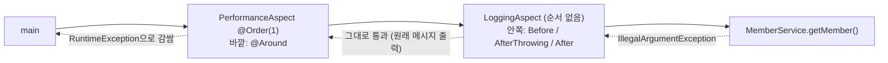

## 들어가며 (Situation)

[AOP 첫 실습]()에서 로깅과 성능 측정을 Aspect로 옮겼다. 성능 측정은 `@Around` 하나로 만들었다.

```java
@Component
@Aspect
@Order(1)
public class PerformanceAspect {

    /* @Around : Advice 중 가장 강력한 어노테이션이다.
       Pointcut 으로 지정한 메서드의 앞/뒤에 모두 동작한다. */
    @Around("execution(* com.wanted.aop.section02.MemberService.*(..))")
    public Object performance(ProceedingJoinPoint joinPoint) {
        long startTime = System.currentTimeMillis();
        // ProceedingJoinPoint : 타겟 메소드의 실행을 직접 제어할 수 있다.
        try {
            Object result = joinPoint.proceed();
            return result;
        } catch (Throwable e) {
            throw new RuntimeException(e);
        } finally {
            long endTime = System.currentTimeMillis();
            System.out.println("[Around 성능 측정] " + joinPoint.getSignature().getName()
                    + " 메소드 실행 시간 : " + (endTime - startTime) + "(ms)");
        }
    }
}
```

`LoggingAspect`에는 `@Order`가 없다.

## 문제 상황 (Task)

AOP 적용 전후의 테스트 5(존재하지 않는 회원 조회) 결과를 비교하다가 이상한 점을 발견했다.

```text
=== section01 (AOP 적용 전) ===
예외 발생!! : 존재하지 않는 회원입니다: user@example.com

=== section02 (AOP 적용 후) ===
[AfterThrowing 로그] getMember 메소드 실행 중 예외 발생 : 존재하지 않는 회원입니다: user@example.com
...
예외 발생!! : java.lang.IllegalArgumentException: 존재하지 않는 회원입니다: user@example.com
```

`MemberService.getMember()`의 코드는 두 버전이 같다. 그런데 AOP를 붙인 쪽은 `main`이 받은 예외 메시지 앞에 **`java.lang.IllegalArgumentException: `**이 붙었다. 같은 실행에서 `@AfterThrowing`이 찍은 메시지에는 붙지 않았다.

AOP는 "비즈니스 코드를 건드리지 않고 부가 기능만 더한다"고 배웠다. 그런데 실제로는 **호출한 쪽이 받는 예외가 달라졌다.**

1. 누가 메시지를 바꿨을까?
2. 같은 예외인데 `@AfterThrowing`과 `main`이 본 메시지는 왜 다를까?
3. 어떻게 고칠 수 있을까?

## 해결 과정 (Action)

### 1. 범인은 `catch (Throwable e) { throw new RuntimeException(e); }`

`joinPoint.proceed()`는 `throws Throwable`로 선언돼 있다. 진짜 메서드가 어떤 예외든 던질 수 있기 때문이다. 수업 코드의 `performance()` 메서드는 `throws`를 선언하지 않았다. 그래서 checked 예외인 `Throwable`을 밖으로 내보낼 수 없어, `RuntimeException`으로 **감싸서** 던졌다.

`new RuntimeException(e)`처럼 원인(cause)만 넘기면, 새 예외의 메시지는 원인의 `toString()`이 된다. Java API 문서의 `RuntimeException(Throwable cause)` 설명이 그렇다.

> Constructs a new runtime exception with the specified cause and a detail message of `(cause==null ? null : cause.toString())`

`IllegalArgumentException`의 `toString()`은 `"클래스이름: 메시지"`다. 그래서 `getMessage()`가 `java.lang.IllegalArgumentException: 존재하지 않는 회원입니다: ...`가 됐다.

| | 원래 예외 | `@Around`가 던진 예외 |
|---|-----------|----------------------|
| 타입 | `IllegalArgumentException` | **`RuntimeException`** |
| `getMessage()` | `존재하지 않는 회원입니다: user@example.com` | `java.lang.IllegalArgumentException: 존재하지 않는 회원입니다: …` |
| `getCause()` | `null` | 원래 예외 |

메시지만 바뀐 것이 아니라 **타입도 바뀌었다.** `main`이 `catch (Exception e)`로 넓게 잡았기 때문에 눈치채기 어려웠다. 만약 `catch (IllegalArgumentException e)`로 잡았다면 **잡히지 않고** 프로그램이 죽었을 것이다. [사용자 정의 예외 실습]()에서 본 것처럼, 예외 타입으로 처리를 나누는 코드가 AOP 하나 때문에 깨질 수 있다.

### 2. 메시지가 다른 이유: Aspect의 순서

같은 예외인데 `@AfterThrowing`은 원래 메시지를 봤다. 두 Aspect가 **양파 껍질처럼** 겹쳐 있기 때문이다.

`PerformanceAspect`는 `@Order(1)`이고, `LoggingAspect`는 `@Order`가 없다. 순서를 지정하지 않으면 가장 낮은 우선순위(`Ordered.LOWEST_PRECEDENCE`)로 취급된다. 숫자가 작을수록 우선순위가 높고, 우선순위가 높은 Aspect가 **바깥쪽**을 감싼다. Spring 문서의 설명이다.

> The highest precedence advice runs first "on the way in" (so, given two pieces of before advice, the one with highest precedence runs first). "On the way out" from a join point, the highest precedence advice runs last.



예외는 안쪽에서 바깥쪽으로 올라온다. 안쪽의 `LoggingAspect`는 **감싸기 전의** 원래 예외를 봤다. 바깥쪽의 `PerformanceAspect`가 그 뒤에 감쌌고, `main`은 감싼 예외를 받았다.

이 설명이 맞는지 확인하려고, `LoggingAspect`에 `@Order(0)`을 붙여 순서를 뒤집었다.

```text
[테스트 1] 회원 가입
[Before 로그] registerMember 메소드 실행 시작됨, ...
회원 정보 저장 완료: user@example.com
[Around 성능 측정] registerMember 메소드 실행 시간 : 1(ms)
[AfterReturn 로그] registerMember 메소드 정상 종료, 종료 시 반환값 : null
[After 로그] registerMember 메서드 실행 완료!

[테스트 5] 존재하지 않는 회원 조회
[Before 로그] getMember 메소드 실행 시작됨, 매개변수 : user@example.com ,
[Around 성능 측정] getMember 메소드 실행 시간 : 0(ms)
[AfterThrowing 로그] getMember 메소드 실행 중 예외 발생 : java.lang.IllegalArgumentException: 존재하지 않는 회원입니다: user@example.com
[After 로그] getMember 메서드 실행 완료!
예외 발생!! : java.lang.IllegalArgumentException: 존재하지 않는 회원입니다: user@example.com
```

| | 원래 (`Performance` 바깥) | `Logging @Order(0)` (`Logging` 바깥) |
|---|---------------------------|--------------------------------------|
| 성능 측정 출력 위치 | 맨 마지막 | `AfterReturn`/`AfterThrowing`보다 먼저 |
| `@AfterThrowing`이 본 메시지 | 원래 메시지 | **감싼 메시지** |

순서를 바꾸자 `@AfterThrowing`도 감싼 예외를 봤다. 측정 범위도 달라진다. `@Around`가 안쪽에 있으면 로깅 Advice 실행 시간은 성능 측정에서 빠진다. Aspect 순서는 출력 모양만이 아니라 **누가 무엇을 보는지**를 바꾼다.

문서는 순서를 지정하지 않은 서로 다른 Aspect의 실행 순서는 **정해지지 않는다**(undefined)고 한다. 수업 코드처럼 하나에만 `@Order`를 주기보다, Aspect가 여러 개면 모두에 순서를 명시하는 편이 안전하다.

### 3. 고치기: `throws Throwable`로 그대로 던지기

Spring 문서의 `@Around` 예제는 메서드에 `throws Throwable`을 선언하고, `proceed()`의 결과를 그대로 돌려준다.

```java
@Around("execution(* com.xyz..service.*.*(..))")
public Object doBasicProfiling(ProceedingJoinPoint pjp) throws Throwable {
    // start stopwatch
    Object retVal = pjp.proceed();
    // stop stopwatch
    return retVal;
}
```

수업 코드를 이렇게 바꿨다. (**예시 코드**)

```java
@Around("execution(* com.wanted.aop.section02.MemberService.*(..))")
public Object performance(ProceedingJoinPoint joinPoint) throws Throwable {
    long startTime = System.currentTimeMillis();
    try {
        return joinPoint.proceed();      // 예외는 감싸지 않고 그대로 위로
    } finally {
        long endTime = System.currentTimeMillis();
        System.out.println("[Around 성능 측정] " + joinPoint.getSignature().getName()
                + " 메소드 실행 시간 : " + (endTime - startTime) + "(ms)");
    }
}
```

```text
[테스트 5] 존재하지 않는 회원 조회
[Before 로그] getMember 메소드 실행 시작됨, 매개변수 : user@example.com ,
[AfterThrowing 로그] getMember 메소드 실행 중 예외 발생 : 존재하지 않는 회원입니다: user@example.com
[After 로그] getMember 메서드 실행 완료!
[Around 성능 측정] getMember 메소드 실행 시간 : 0(ms)
예외 발생!! : 존재하지 않는 회원입니다: user@example.com
```

`main`이 받은 메시지가 **AOP 적용 전과 같아졌다.** 성능 측정은 `finally`에 있으므로 예외가 나도 그대로 출력된다. `catch`가 필요 없었다.

### 4. `@Around`의 책임

`@Around`는 진짜 메서드를 **부를지 말지, 무엇을 돌려줄지, 예외를 어떻게 할지**를 모두 결정한다. 그래서 강력한 만큼 실수의 여지도 크다.

| `@Around`에서 하는 일 | 결과 |
|-----------------------|------|
| `proceed()`를 안 부름 | 진짜 메서드가 실행되지 않음 |
| `proceed()` 결과를 `return` 안 함 | 반환값이 사라짐 (`getMember`가 `null` 반환) |
| 예외를 감싸서 던짐 | 호출한 쪽이 받는 예외 타입·메시지가 바뀜 (이번 사례) |
| 예외를 잡고 안 던짐 | 실패가 성공처럼 보임 |

Spring 문서에는 이런 조언도 있다.

> Always use the least powerful form of advice that meets your requirements. For example, do not use around advice if before advice is sufficient for your needs.

성능 측정은 시작과 끝을 모두 알아야 하므로 `@Around`가 맞다. 하지만 로그 한 줄이면 `@Before`나 `@AfterThrowing`으로 충분하다. 수업의 `LoggingAspect`가 그렇게 나뉘어 있는 이유다.

## 결과 (Result)

| 확인 항목 | 결과 |
|-----------|------|
| AOP 전 `main`의 예외 메시지 | `존재하지 않는 회원입니다: user@example.com` |
| AOP 후 (수업 코드) | `java.lang.IllegalArgumentException: 존재하지 않는 회원입니다: …` (타입도 `RuntimeException`) |
| 원인 | `@Around`의 `throw new RuntimeException(e)`, 메시지 = `cause.toString()` |
| `@AfterThrowing`이 본 메시지 | 원래 메시지 (`LoggingAspect`가 안쪽이라서) |
| `LoggingAspect`에 `@Order(0)` | `@AfterThrowing`도 감싼 메시지를 봄, 성능 출력 위치 변경 |
| `throws Throwable` + 그대로 던지기 | AOP 전과 같은 메시지로 복구 |
| 환경 | Java 21, spring-aop 7.0.8, aspectjweaver 1.9.25.1 |

배운 점은 다음과 같다.

- `@Around`는 진짜 메서드의 반환값과 예외를 직접 다룬다. 예외를 감싸면 **호출한 쪽이 받는 예외가 바뀐다.** 감쌀 이유가 없으면 `throws Throwable`로 그대로 던진다.
- 여러 Aspect는 `@Order` 숫자가 작은 쪽이 바깥을 감싼다. 순서에 따라 각 Advice가 보는 예외와 측정 범위가 달라진다.

## 더 학습하면 좋은 개념

- **예외 체이닝 (`getCause()`)** — 감싼 예외에서 원래 예외를 꺼내는 방법. 감싸야 한다면 원인을 반드시 넘긴다.
- **`@Transactional`의 롤백 규칙** — 기본적으로 unchecked 예외에만 롤백한다. 예외 타입이 바뀌면 트랜잭션 동작도 바뀔 수 있다.
- **Pointcut 재사용 (`@Pointcut`)** — 같은 `execution(...)` 문자열을 네 번 반복하지 않고 이름을 붙여 재사용하는 방법.
- **`Ordered` 인터페이스와 `@Order`** — Aspect뿐 아니라 필터, 인터셉터 순서에도 쓰이는 Spring의 공통 순서 규칙.

## 참고 자료

- [Spring Framework Reference - Declaring Advice (Around Advice, Advice Ordering)](https://docs.spring.io/spring-framework/reference/core/aop/ataspectj/advice.html)
- [Spring Framework Javadoc - @Order](https://docs.spring.io/spring-framework/docs/current/javadoc-api/org/springframework/core/annotation/Order.html)
- [AspectJ API - ProceedingJoinPoint](https://javadoc.io/doc/org.aspectj/aspectjrt/latest/org/aspectj/lang/ProceedingJoinPoint.html)
- [Java SE 21 API - RuntimeException(Throwable)](https://docs.oracle.com/en/java/javase/21/docs/api/java.base/java/lang/RuntimeException.html#%3Cinit%3E(java.lang.Throwable))

---

**요약**
1. AOP를 붙이자 `main`이 받은 예외 메시지 앞에 `java.lang.IllegalArgumentException: `이 붙고 타입도 `RuntimeException`으로 바뀌었다. `@Around`가 `new RuntimeException(e)`로 감쌌기 때문이다.
2. `@Order(1)`인 `PerformanceAspect`가 바깥, 순서 없는 `LoggingAspect`가 안쪽이라 `@AfterThrowing`은 감싸기 전 메시지를 봤다. `LoggingAspect`에 `@Order(0)`을 주자 감싼 메시지를 봤다.
3. `performance()`에 `throws Throwable`을 선언하고 `proceed()` 결과와 예외를 그대로 넘기자 AOP 적용 전과 같은 메시지로 돌아왔다.
