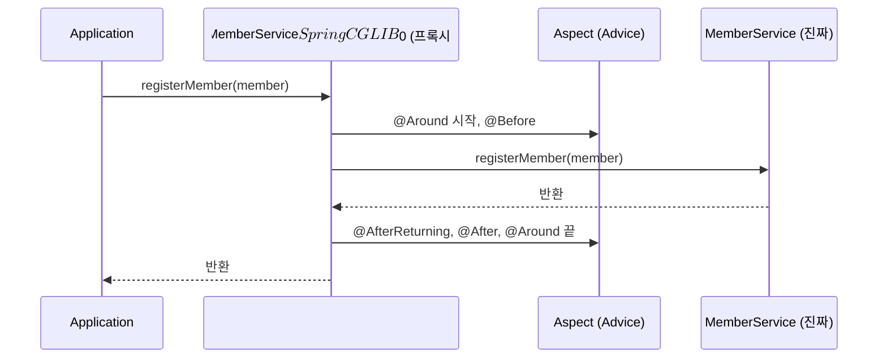

## 들어가며 (Situation)

Spring Core 세 번째 프로젝트 `chap03-aop`는 회원 관리 프로그램이다.

> 주제 : 회원 관리 프로그램 / 기능 : 회원가입, 회원조회, 비밀번호 수정, 탈퇴 / 비기능 : 로깅, 성능측정

`section01`은 AOP 없이, `section02`는 AOP로 같은 프로그램을 만든다. `section01`의 `registerMember()`는 이렇게 생겼다.

```java
public void registerMember(MemberDTO member) {
    // 성능 측정 시작 - 횡단 관심사 #1
    long startTime = System.currentTimeMillis();
    try {
        // 로깅 - 횡단 관심사 #2
        System.out.println("[로그] 회원 가입 시작: " + member.getEmail());
        // 트랜잭션 시작 (의사코드) - 횡단 관심사 #3

        // ----- 핵심 비즈니스 로직 시작 -----
        if (member.getEmail() == null || member.getEmail().isEmpty()) { throw new IllegalArgumentException("이메일은 필수입니다."); }
        ...
        memberRepository.put(member.getEmail(), member);
        // ----- 핵심 비즈니스 로직 종료 -----

        System.out.println("[로그] 회원 가입 성공: " + member.getEmail());
    } catch (Exception e) {
        System.out.println("[로그] 회원 가입 실패: " + e.getMessage());
        throw e;
    } finally {
        long endTime = System.currentTimeMillis();
        System.out.println("[성능] 회원 가입 처리 시간: " + (endTime - startTime) + "ms");
    }
}
```

`getMember()`, `updatePassword()`, `deleteMember()`도 똑같은 `try-catch-finally` 틀 안에 핵심 로직만 다르게 들어 있다.

## 문제 상황 (Task)

수업 주석은 `section01`의 문제를 세 가지로 정리했다.

> 1. 코드의 중복 - 모든 메소드 마다 로깅, 성능측정, 트랜잭션 관련 코드가 반복된다.
> 2. 낮은 응집도 - 각 메소드가 핵심 비즈니스 로직 외에 다른 코드들을 실행한다.
> 3. 유지보수의 어려움 - 로그 출력 양식의 변화, 성능 측정 기준치 변화 시 여러 메소드 내부에 있는 내용을 전부 수정해야 된다.

`section02`는 로깅과 성능 측정을 `LoggingAspect`, `PerformanceAspect`로 옮겼다. `MemberService`에는 핵심 로직만 남았다. 확인할 것을 정했다.

1. 실제로 얼마나 줄었고, 출력은 그대로일까?
2. `MemberService`는 Aspect를 전혀 모르는데 어떻게 로그가 찍힐까?
3. Advice 다섯 종류(`@Before`, `@After`, `@AfterReturning`, `@AfterThrowing`, `@Around`)는 어떤 순서로 실행될까?

## 해결 과정 (Action)

### 1. 코드 줄 수와 출력 비교

```bash
wc -l section01/MemberService.java section02/MemberService.java section02/aspect/*.java
```

```text
  214 section01/MemberService.java
  120 section02/MemberService.java
  102 section02/aspect/LoggingAspect.java
   43 section02/aspect/PerformanceAspect.java
```

`MemberService`는 214줄에서 120줄로 줄었다. 남은 120줄에는 주석과 메서드 설명도 포함되어 있다. Aspect 두 파일을 합치면 오히려 전체 줄 수는 늘었다. 하지만 메서드가 4개에서 40개로 늘어도 Aspect는 그대로다. 반복이 메서드 수만큼 늘지 않고 **한 곳에 고정된다.**

두 버전을 실행해 테스트 1(회원 가입) 출력을 비교했다.

```text
=== section01 (AOP 적용 전) ===
[로그] 회원 가입 시작: user@example.com
회원 정보 저장 완료: user@example.com
[로그] 회원 가입 성공: user@example.com
[성능] 회원 가입 처리 시간: 1ms

=== section02 (AOP 적용 후) ===
[Before 로그] registerMember 메소드 실행 시작됨, 매개변수 : MemberDTO(email=user@example.com, password=pass0123, ...) ,
회원 정보 저장 완료: user@example.com
[AfterReturn 로그] registerMember 메소드 정상 종료, 종료 시 반환값 : null
[After 로그] registerMember 메서드 실행 완료!
[Around 성능 측정] registerMember 메소드 실행 시간 : 3(ms)
```

`MemberService` 코드에는 로그 출력이 한 줄도 없는데 로그가 찍혔다. 메서드 이름(`registerMember`)과 매개변수도 Aspect가 `JoinPoint`에서 직접 꺼냈다.

### 2. 정체는 프록시

컨테이너에서 꺼낸 `MemberService`의 실제 클래스를 출력했다. (확인용 **예시 코드**)

```java
Object s = c.getBean(MemberService.class);
System.out.println("proxy class: " + s.getClass().getName() + " / super: " + s.getClass().getSuperclass().getSimpleName());
```

```text
proxy class: com.wanted.aop.section02.MemberService$$SpringCGLIB$$0 / super: MemberService
```

[IoC 글]()의 `AppConfig$$SpringCGLIB$$0`과 같은 구조다. 컨테이너는 진짜 `MemberService` 대신, 그것을 **상속한 프록시**를 빈으로 등록했다. `Application`이 `service.registerMember()`를 부르면 프록시가 먼저 받아 Advice를 실행하고, 중간에 진짜 메서드를 부른다.



이 프록시를 켜는 스위치가 `AppConfig`의 `@EnableAspectJAutoProxy`다. 그 한 줄만 지우고 실행했다.

```text
[테스트 1] 회원 가입
회원 정보 저장 완료: user@example.com
=================
[테스트 5] 존재하지 않는 회원 조회
예외 발생!! : 존재하지 않는 회원입니다: user@example.com
```

`@Aspect` 클래스들은 그대로 빈으로 등록돼 있었지만 **로그가 하나도 찍히지 않았다.** 프록시가 만들어지지 않았기 때문이다. Aspect를 등록하는 것과 프록시를 만드는 것은 별개다.

### 3. AOP 용어를 코드에 대응시키기

| 용어 | 뜻 | 수업 코드 |
|------|----|-----------|
| 횡단 관심사 | 여러 기능에 공통으로 걸친 부가 기능 | 로깅, 성능 측정, 트랜잭션 |
| Aspect | 횡단 관심사를 모은 모듈 | `LoggingAspect`, `PerformanceAspect` |
| Advice | 언제 무엇을 할지 | `logBefore()`, `performance()` |
| Pointcut | 어디에 적용할지 | `execution(* com.wanted.aop.section02.MemberService.*(..))` |
| JoinPoint | Advice가 끼어드는 지점(메서드 실행) | `joinPoint.getSignature().getName()` |
| Target | Advice를 받는 원래 객체 | `MemberService` |
| Proxy | Target을 감싼 대리 객체 | `MemberService$$SpringCGLIB$$0` |

Pointcut 표현식은 수업 주석의 설명대로 읽는다.

```text
execution( *          com.wanted.aop.section02.MemberService . *      (..) )
           반환타입     패키지.클래스                              메서드   매개변수 0개 이상
```

### 4. Advice 실행 순서: 정상 종료와 예외

정상 종료(테스트 1)와 예외(테스트 5)의 출력 순서를 나란히 놓았다.

```text
[테스트 5] 존재하지 않는 회원 조회
[Before 로그] getMember 메소드 실행 시작됨, 매개변수 : user@example.com ,
[AfterThrowing 로그] getMember 메소드 실행 중 예외 발생 : 존재하지 않는 회원입니다: user@example.com
[After 로그] getMember 메서드 실행 완료!
[Around 성능 측정] getMember 메소드 실행 시간 : 0(ms)
```

| 순서 | 정상 종료 | 예외 발생 |
|------|-----------|-----------|
| 1 | `@Around` 시작 (출력 없음) | `@Around` 시작 |
| 2 | `@Before` | `@Before` |
| 3 | 핵심 로직 | 핵심 로직 → 예외 |
| 4 | `@AfterReturning` | `@AfterThrowing` |
| 5 | `@After` | `@After` |
| 6 | `@Around` 끝 (성능 출력) | `@Around` 끝 (성능 출력, `finally`) |

- `@AfterReturning`과 `@AfterThrowing`은 **둘 중 하나만** 실행된다.
- `@After`는 **결과와 상관없이** 실행된다. 자바의 `finally`와 같은 역할이다. 그래서 예외가 났는데도 "실행 완료!"라고 찍혔다. 메시지를 "실행 종료"로 바꾸는 편이 더 정확하다.
- 같은 Aspect 안에서 Spring은 `@Around`, `@Before`, `@After`, `@AfterReturning`, `@AfterThrowing` 순으로 우선순위를 매긴다. 그래서 같은 클래스 안에서는 `@AfterReturning`이 `@After`보다 먼저 출력된다.

`@Around`가 가장 바깥에서 나머지를 감싸는 것은 `PerformanceAspect`에 `@Order(1)`이 있기 때문이다. 이 순서와 `@Around`의 예외 처리는 [다음 글]()에서 따로 다뤘다.

### 5. 로그에 비밀번호가 찍힌다

출력을 다시 보니 `@Before` 로그가 매개변수를 그대로 찍고 있었다.

```text
[Before 로그] registerMember ... 매개변수 : MemberDTO(email=user@example.com, password=pass0123, name=홍길동, phone=010-1111-1111, role=USER) ,
[Before 로그] updatePassword ... 매개변수 : user@example.com , pass0123 , pass0234 ,
```

Lombok `@ToString`이 모든 필드를 출력하기 때문에 **비밀번호와 전화번호가 로그에 남는다.** AOP는 모든 메서드에 한꺼번에 적용되므로, 실수 하나가 모든 메서드에 퍼진다. 실제 서비스라면 `@ToString.Exclude`로 민감한 필드를 빼거나, 매개변수 대신 메서드 이름만 남겨야 한다. section01에서도 테스트 2의 `조회 된 회원 = MemberDTO(... password=pass0123 ...)` 출력에 비밀번호가 보였다.

## 결과 (Result)

| 확인 항목 | 결과 |
|-----------|------|
| `MemberService` 줄 수 | 214 → 120 (Aspect 102 + 43줄로 분리) |
| 컨테이너의 `MemberService` | `MemberService$$SpringCGLIB$$0` (상속 프록시) |
| `@EnableAspectJAutoProxy` 제거 | Aspect 빈은 있지만 로그 0줄 |
| 정상 종료 순서 | Before → 로직 → AfterReturning → After → Around 끝 |
| 예외 순서 | Before → 로직 → AfterThrowing → After → Around 끝 |
| `@Before` 매개변수 로그 | 비밀번호·전화번호 노출 |
| 환경 | Java 21, spring-context·spring-aop 7.0.8, aspectjweaver 1.9.25.1 |

배운 점은 다음과 같다.

- AOP는 프록시가 메서드 호출을 가로채서 Advice를 끼워 넣는 구조다. 비즈니스 코드는 Aspect의 존재를 모른다.
- `@After`는 `finally`처럼 결과와 상관없이 실행된다. 정상 종료만 알고 싶다면 `@AfterReturning`을 쓴다.

## 더 학습하면 좋은 개념

- **자기 호출(self-invocation) 문제** — `MemberService` 안에서 자기 메서드를 부르면 프록시를 거치지 않아 Advice가 적용되지 않는다.
- **`@Transactional`** — 수업 주석의 "트랜잭션 의사코드"를 실제로 처리하는 Spring의 대표 AOP 기능.
- **JDK 동적 프록시 vs CGLIB** — 인터페이스 기반 프록시와 상속 기반 프록시의 차이.
- **Servlet Filter와 AOP 비교** — [필터]()는 HTTP 요청 단위, AOP는 빈의 메서드 단위로 공통 기능을 끼워 넣는다.

## 참고 자료

- [Spring Framework Reference - Aspect Oriented Programming with Spring](https://docs.spring.io/spring-framework/reference/core/aop.html)
- [Spring Framework Reference - AOP Concepts](https://docs.spring.io/spring-framework/reference/core/aop/introduction-defn.html)
- [Spring Framework Reference - Declaring Advice](https://docs.spring.io/spring-framework/reference/core/aop/ataspectj/advice.html)
- [Spring Framework Reference - Proxying Mechanisms](https://docs.spring.io/spring-framework/reference/core/aop/proxying.html)
- [Project Lombok - @ToString](https://projectlombok.org/features/ToString)

---

**요약**
1. 로깅과 성능 측정을 Aspect 두 개로 옮기자 `MemberService`가 214줄에서 120줄로 줄었고, 출력은 Aspect가 `JoinPoint`로 메서드 이름과 매개변수를 꺼내 찍었다.
2. 컨테이너의 `MemberService`는 `MemberService$$SpringCGLIB$$0` 프록시였고, `@EnableAspectJAutoProxy`를 지우자 로그가 하나도 찍히지 않았다.
3. Advice는 Before → 로직 → AfterReturning 또는 AfterThrowing → After 순서로 실행됐다. `@Before`가 매개변수를 통째로 찍어 비밀번호까지 로그에 남는 문제도 확인했다.
