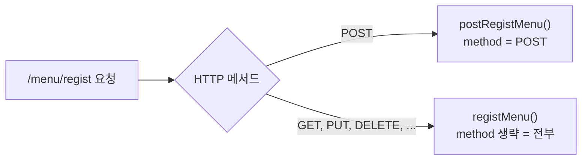

## 들어가며 (Situation)

Servlet을 배울 때는 요청 URL마다 서블릿 클래스를 만들고, `doGet()`/`doPost()`를 오버라이딩해서 HTTP 메서드를 나눴다([Servlet의 service와 doGet/doPost]()). Spring Web MVC 첫날(`chap01-request-mapping`)에는 이 일을 어노테이션 하나로 했다.

```java
@Controller
public class MethodController {

    @RequestMapping("/menu/regist")
    public String registMenu(Model model) {
        model.addAttribute("message", "GET 방식의 메뉴 등록 핸들러 메서드 동작함..");
        return "mappingResult";
    }

    @RequestMapping(value = "/menu/regist", method = RequestMethod.POST)
    public String postRegistMenu(Model model) {
        model.addAttribute("message", "POST 방식의 메뉴 등록 핸들러 메서드 동작함..");
        return "mappingResult";
    }

    @GetMapping("/menu/modify")
    public String getModifyMenu(Model model) { ... }

    @PostMapping("/menu/modify")
    public String postModifyMenu(Model model) { ... }
}
```

```java
@Controller
@RequestMapping("/order/*")
public class ClassController {

    @GetMapping("/regist")
    public String registOrder(Model model) { ... }

    @GetMapping("/detail/{orderNo}")
    public String pathVariable(Model model, @PathVariable("orderNo") int no) {
        model.addAttribute("message", no + "번 주문 상세조회!");
        return "mappingResult";
    }
}
```

## 문제 상황 (Task)

`index.html`에는 버튼이 10개 있었다. 그런데 컨트롤러에 있는 핸들러 메서드는 6개뿐이다. `/order/regist`(POST), `/order/modify`(GET·POST), `/order/delete`(POST)에는 짝이 되는 메서드가 없다.

그리고 첫 번째 메서드 `registMenu()`에는 이름과 화면 메시지 모두 "GET"이 붙어 있지만, `@RequestMapping`에 `method`를 적지 않았다. 정말 GET만 받는지 확인하고 싶었다.

1. `method`를 생략한 `@RequestMapping`은 어떤 HTTP 메서드를 받을까?
2. 클래스의 `"/order/*"`와 메서드의 `"/regist"`는 어떻게 합쳐질까?
3. 짝이 없는 요청은 어떤 응답을 받을까?

## 해결 과정 (Action)

### 1. 앱을 띄우고 curl로 모든 버튼 요청 보내기

브라우저 버튼은 GET과 POST만 보낼 수 있다. 그래서 `curl -X`로 메서드를 직접 바꿔 보냈다. 서버 포트는 `application.yaml`에 적은 7777이다.

```bash
curl -s -X PUT localhost:7777/menu/regist
curl -s -o /dev/null -w "%{http_code}" -X POST localhost:7777/order/regist
```

| 요청 | 상태 코드 | 실행된 핸들러 / 결과 |
|------|-----------|----------------------|
| `GET /menu/regist` | 200 | `registMenu()` — "GET 방식의 메뉴 등록…" |
| `POST /menu/regist` | 200 | `postRegistMenu()` — "POST 방식의 메뉴 등록…" |
| **`PUT /menu/regist`** | **200** | **`registMenu()` — "GET 방식의 메뉴 등록…"** |
| **`DELETE /menu/regist`** | **200** | **`registMenu()` — "GET 방식의 메뉴 등록…"** |
| `GET /order/regist` | 200 | `registOrder()` |
| `POST /order/regist` | **405** | Method Not Allowed, `Allow: GET` |
| `GET /order/modify` | **404** | Not Found |
| `POST /order/delete` | **404** | Not Found |
| `GET /order/detail/3` | 200 | "3번 주문 상세조회!" |
| `GET /order/detail/abc` | **400** | Bad Request |
| `GET /order/regist/` (끝에 `/`) | **404** | Not Found |

### 2. `method`를 생략하면 "모든 메서드"다

PUT과 DELETE가 "GET 방식의…" 메시지를 받았다. `registMenu()`는 GET 전용이 아니었다. Spring 문서는 이렇게 설명한다.

> By default, `@RequestMapping` maps all HTTP methods.

그렇다면 POST는 왜 `postRegistMenu()`로 갔을까? 같은 URL에 매핑이 둘 있으면 Spring은 **더 구체적인 조건**을 고른다. `method = POST`라는 조건이 붙은 매핑이 조건 없는 매핑보다 구체적이므로, POST만 그쪽으로 가고 나머지 메서드는 전부 `registMenu()`가 받는다.



메서드 이름이 "GET용"처럼 보여도, 의도를 지키는 것은 이름이 아니라 **매핑 조건**이다. 그래서 `@GetMapping`처럼 메서드를 박아 둔 축약 어노테이션을 쓰는 편이 안전하다. 수업에서 `/menu/modify`를 `@GetMapping`/`@PostMapping`으로 바꿔 쓴 이유가 여기에 있다.

| 어노테이션 | 받는 메서드 |
|-----------|-------------|
| `@RequestMapping("/x")` | 모든 HTTP 메서드 |
| `@RequestMapping(value="/x", method=POST)` | POST |
| `@GetMapping("/x")` | GET (HEAD도 자동 처리) |
| `@PostMapping("/x")` | POST |

### 3. 404와 405는 다르다

`/order/regist`에 POST를 보내면 405, `/order/modify`에 GET을 보내면 404였다.

- **405**: URL에 맞는 핸들러는 **있다.** 하지만 그 핸들러가 이 메서드를 받지 않는다. 응답 헤더 `Allow: GET`이 "이 주소는 GET만 된다"고 알려 준다.
- **404**: URL에 맞는 핸들러가 **아예 없다.**

서버 로그도 달랐다.

```text
WARN ... DefaultHandlerExceptionResolver : Resolved [org.springframework.web.HttpRequestMethodNotSupportedException: Request method 'POST' is not supported]
```

화면 버튼은 10개인데 핸들러는 6개라서 4개는 404나 405가 났다. 버튼(View)과 핸들러(Controller)가 서로를 모르기 때문에, 둘을 맞추는 것은 개발자의 몫이다.

### 4. `"/order/*"` + `"/regist"` = `"/order/regist"`

클래스에 `/order/*`를 붙였는데, 실제 주소는 `/order/*/regist`가 아니라 `/order/regist`였다. Spring은 클래스와 메서드의 패턴을 **합칠(combine)** 때, 클래스 패턴이 `/*`로 끝나면 그 `*` 자리를 메서드 패턴으로 바꾼다. 그래서 `@RequestMapping("/order")`로 써도 결과가 같다. 요즘 예제는 대부분 `*` 없이 `/order`로 쓴다.

끝에 `/`를 붙인 `/order/regist/`는 404였다. Spring Framework 6부터는 끝 슬래시를 자동으로 맞춰 주지 않는다.

### 5. `@PathVariable`과 400

`/order/detail/3`의 `3`은 `@PathVariable("orderNo") int no`로 들어왔다. `abc`를 넣으면 `int`로 바꿀 수 없어서 400이 났다.

```text
WARN ... Resolved [org.springframework.web.method.annotation.MethodArgumentTypeMismatchException: Method parameter 'orderNo': Failed to convert value of type 'java.lang.String' to required type 'int'; For input string: "abc"]
```

Servlet에서는 `Integer.parseInt()`를 직접 불렀다면 `NumberFormatException`이 터져 500이 됐을 것이다. Spring은 변환 실패를 **클라이언트 잘못(400)**으로 분류해 준다.

## 결과 (Result)

| 확인 항목 | 결과 |
|-----------|------|
| 화면 버튼 10개 중 정상 응답 | 6개 (나머지 4개: 404 3개, 405 1개) |
| `method` 생략 매핑에 PUT/DELETE | 200, GET용 메서드가 처리 |
| 같은 URL, 핸들러는 있지만 메서드 불일치 | 405 + `Allow` 헤더 |
| 핸들러 없음 / 끝 슬래시 | 404 |
| `@PathVariable` 타입 변환 실패 | 400 |
| 환경 | Spring Boot 4.1.2, spring-webmvc 7.0.10, Tomcat 11.0.27 |

배운 점은 다음과 같다.

- `@RequestMapping`에 `method`를 적지 않으면 **모든** HTTP 메서드를 받는다. 메서드를 하나로 정하고 싶으면 `@GetMapping`/`@PostMapping`을 쓴다.
- 404는 "주소가 없다", 405는 "주소는 있는데 그 메서드는 안 된다"이다. 둘을 구분하면 디버깅할 곳이 바로 보인다.

## 더 학습하면 좋은 개념

- **HTTP 메서드의 의미 (안전성·멱등성)** — GET은 조회, POST는 생성처럼 메서드마다 약속된 의미가 있다. 매핑을 메서드별로 나누는 이유다.
- **REST API 설계** — 같은 URL(`/orders/3`)에 GET·PUT·DELETE를 붙여 자원을 다루는 방식. `@PathVariable`이 핵심 도구다.
- **`HandlerMapping`과 `DispatcherServlet`** — 요청이 어떤 핸들러로 갈지 정하는 Spring MVC의 내부 구조.
- **`PathPattern` 문법** — `{name}`, `*`, `**` 같은 패턴이 어떻게 매칭되는지.

## 참고 자료

- [Spring Framework Reference - Mapping Requests](https://docs.spring.io/spring-framework/reference/web/webmvc/mvc-controller/ann-requestmapping.html)
- [Spring Framework Javadoc - RequestMapping](https://docs.spring.io/spring-framework/docs/current/javadoc-api/org/springframework/web/bind/annotation/RequestMapping.html)
- [MDN - 405 Method Not Allowed](https://developer.mozilla.org/en-US/docs/Web/HTTP/Status/405)
- [MDN - HTTP request methods](https://developer.mozilla.org/en-US/docs/Web/HTTP/Methods)

---

**요약**
1. `method`를 생략한 `@RequestMapping("/menu/regist")`는 GET뿐 아니라 PUT·DELETE도 받았다. POST만 더 구체적인 `method = POST` 매핑으로 갔다.
2. 핸들러가 없는 주소는 404, 주소는 있지만 메서드가 다르면 405(`Allow: GET`)가 났다. 화면 버튼 10개 중 4개가 그랬다.
3. 클래스의 `/order/*`와 메서드의 `/regist`는 `/order/regist`로 합쳐지고, `@PathVariable` 변환 실패는 400으로 처리된다.
