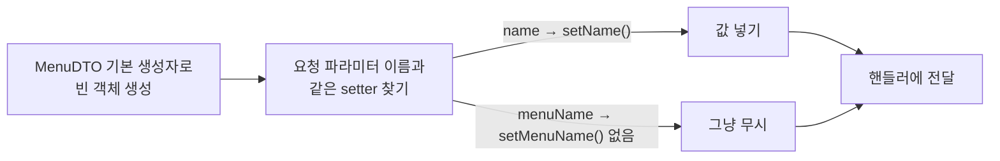

## 들어가며 (Situation)

`chap02-handler-method`에서는 화면에서 보낸 값을 핸들러 메서드가 받는 방법 세 가지를 실습했다. 메뉴 등록·수정·검색 폼이 각각 다른 방법을 쓴다.

```java
@Controller
@RequestMapping("/request/*")
public class RequestController {

    // 1. WebRequest : Servlet의 HttpServletRequest 역할
    @PostMapping("/regist")
    public String registMenu(Model model, WebRequest request) {
        String menuName = request.getParameter("name");
        int menuPrice = Integer.parseInt(request.getParameter("price"));
        int categoryCode = Integer.parseInt(request.getParameter("categoryCode"));
        ...
        return "request/printResult";
    }

    // 2. @RequestParam : 파라미터 하나씩 꺼내기
    @PostMapping("modify")
    public String modifyMenu(Model model,
             @RequestParam("modifyName") String name,
             @RequestParam("modifyPrice") int price) { ... }

    // 3. @ModelAttribute : 파라미터를 객체 하나로 묶기
    @PostMapping("search")
    public String searchMenu(Model model, @ModelAttribute MenuDTO menu) { ... }
}
```

수업 코드에는 주의사항이 주석으로 적혀 있었다.

```java
/* @RequestParam ... input 의 name 속성과 변수명을 일치시키지 않으면 400 Bad Request 가 발생한다. */
```

```java
public class MenuDTO {
    /* DTO의 변수명과 실제 html에서 데이터와 상호작용하는 변수명이 다르면 에러 발생 (500)
       NullPointerException이 발생한다. */
    private String name;
    private int price;
    private int categoryCode;
    private String orderableStatus;
}
```

## 문제 상황 (Task)

세 방법 모두 "폼의 `name`과 코드의 이름을 맞춰야 한다"는 점은 같다. 그런데 **맞추지 않았을 때 어떻게 되는지**는 서로 다르다고 적혀 있었다. `@RequestParam`은 400, `@ModelAttribute`는 500이라고 한다. 정말 그런지, `WebRequest`는 어떤지 직접 확인하고 싶었다.

- 이름이 틀리면 각각 어떤 응답이 올까?
- 숫자 칸에 빈 값이나 문자가 오면?
- 어떤 실패가 "조용히" 지나갈까?

## 해결 과정 (Action)

### 1. 같은 실수를 세 방법에 똑같이 넣어 보기

앱을 띄우고 curl로 폼 요청을 흉내 냈다. 정상 요청 하나와, 이름이 틀리거나 값이 이상한 요청을 보냈다.

```bash
curl -s -d name=tteok -d price=5000 -d categoryCode=1 localhost:8080/request/regist
curl -s -d name=ramen -d price=3000 localhost:8080/request/modify      # 이름 틀림
curl -s -d menuName=tteok -d menuPrice=5000 -d categoryCode=1 -d orderableStatus=Y \
     localhost:8080/request/search                                     # 이름 틀림
```

| 방법 | 요청 | 상태 | 원인(로그) |
|------|------|------|-----------|
| `WebRequest` | 정상 | 200 | — |
| `WebRequest` | `price=` (빈 값) | **500** | `NumberFormatException: For input string: ""` |
| `WebRequest` | `price` 없음 | **500** | `NumberFormatException: Cannot parse null string` |
| `@RequestParam` | 정상 | 200 | — |
| `@RequestParam` | 이름 틀림 (`name`, `price`) | **400** | `MissingServletRequestParameterException: Required request parameter 'modifyName' ... is not present` |
| `@RequestParam` | `modifyPrice=abc` | **400** | `MethodArgumentTypeMismatchException` |
| `@ModelAttribute` | 정상 | 200 | `MenuDTO(name=tteok, price=5000, categoryCode=1, orderableStatus=Y)` |
| `@ModelAttribute` | 이름 틀림 (`menuName`, `menuPrice`) | **200** | `MenuDTO(name=null, price=0, categoryCode=1, orderableStatus=Y)` |
| `@ModelAttribute` | `price=` 또는 `price=abc` | **400** | `MethodArgumentNotValidException` (바인딩 실패) |

### 2. `@ModelAttribute`는 이름이 틀려도 에러가 나지 않는다

주석과 달리 500도, `NullPointerException`도 없었다. 응답은 **200**이었고 검색 결과 화면은 이랬다.

```html
<h1>메뉴 검색 결과!</h1>
<h3></h3>     <!-- name : null -->
<h3>0</h3>    <!-- price : int 기본값 -->
<h3>1</h3>
<h3>Y</h3>
```

`@ModelAttribute`는 다음 순서로 동작한다.



맞는 이름이 없는 파라미터는 **무시**된다. 받지 못한 필드는 처음 값 그대로 남는다. `String`은 `null`, `int`는 `0`이다. Thymeleaf의 `th:text`는 `null`을 빈 문자열로 출력하므로 NPE도 나지 않았다.

이게 가장 위험한 실패다. 400이나 500은 바로 눈에 띄지만, 200에 값이 비어 있으면 **틀렸다는 사실을 모른 채** 다음 단계로 넘어간다. 등록 기능이었다면 가격 0원짜리 메뉴가 DB에 들어갔을 것이다. 이런 실패를 막으려면 DTO에 `@NotBlank`, `@Min` 같은 검증 규칙을 붙이고 `@Valid`로 검사해야 한다.

반대로 **타입 변환**은 실패하면 400이었다. `price=abc`는 이름은 맞지만 `int`로 바꿀 수 없어서 바인딩 에러가 됐다.

### 3. `@RequestParam`은 기본이 "필수"

`@RequestParam`은 `required` 속성의 기본값이 `true`다. 파라미터가 없으면 핸들러를 부르기 전에 400으로 끝난다. 이름 실수를 **바로 알려 주는** 쪽이다. 꼭 필요하지 않은 값이면 `required = false`나 `defaultValue`를 쓴다.

```java
@RequestParam(value = "modifyPrice", defaultValue = "0") int price   // 예시 코드
```

### 4. `WebRequest`는 Servlet 시절과 같다

`WebRequest.getParameter()`는 [Servlet의 getParameter()]()처럼 문자열이나 `null`을 돌려줄 뿐이다. 숫자 변환은 직접 한 `Integer.parseInt()`가 맡는다. 그래서 빈 값이 오면 `NumberFormatException`이 그대로 터져 **500**이 됐다. 클라이언트가 값을 잘못 보냈는데 서버 오류(500)로 응답한 셈이다.

| | `WebRequest` | `@RequestParam` | `@ModelAttribute` |
|---|---|---|---|
| 형 변환 | 직접 (`parseInt`) | Spring | Spring |
| 이름 틀림 | `null` → 직접 처리 안 하면 500 | **400** | **200, 필드 비어 있음** |
| 타입 틀림 | 500 | 400 | 400 |
| 어울리는 곳 | 거의 없음 (Servlet 방식) | 값 1~2개 | 폼 전체, DTO |

### 5. 덤: 존재하지 않는 `modifyAll`, 비어 있는 결과 화면

`modify.html`의 두 번째 폼은 `action="modifyAll"`로 보내는데 컨트롤러에 그런 매핑이 없어서 404였다. 또 첫 번째 폼은 200이지만 `modifyMenu()`가 `message`를 모델에 넣지 않아서 결과 화면의 `<h3>`가 비어 있었다. 콘솔에만 `name = ramen`, `price = 3000`이 찍혔다.

`searchResult.html`이 `${menuDTO.getName()}`으로 값을 꺼낸 이유도 확인했다. `@ModelAttribute`는 받은 객체를 **클래스 이름의 첫 글자를 소문자로 바꾼 이름**(`menuDTO`)으로 모델에 자동으로 넣는다. 그래서 `model.addAttribute("menu", menu)`가 없어도 `menuDTO`로 꺼낼 수 있다.

## 결과 (Result)

| 실수 | `WebRequest` | `@RequestParam` | `@ModelAttribute` |
|------|--------------|-----------------|-------------------|
| 파라미터 이름 틀림 | 500 | 400 | **200 (null/0)** |
| 숫자 칸에 빈 값 | 500 | 400 | 400 |
| 숫자 칸에 문자 | 500 | 400 | 400 |

환경: Spring Boot 4.1.2, spring-webmvc 7.0.10.

배운 점은 다음과 같다.

- 수업 주석의 "이름이 다르면 500(NPE)"은 이번 환경에서 재현되지 않았다. `@ModelAttribute`는 이름이 틀린 파라미터를 **조용히 무시**한다. 그래서 가장 눈치채기 어렵다.
- 400은 "클라이언트가 잘못 보냈다", 500은 "서버가 처리하다 터졌다"이다. 변환을 Spring에 맡기면 잘못된 입력이 500 대신 400이 된다.

## 더 학습하면 좋은 개념

- **Bean Validation (`@Valid`, `@NotBlank`, `@Min`)** — `@ModelAttribute`의 "조용한 실패"를 막는 표준 방법이다.
- **`BindingResult`** — 바인딩 실패를 예외 대신 객체로 받아 화면에 에러 메시지를 다시 보여 주는 방법.
- **`@RequestBody`와 JSON** — 폼이 아니라 JSON 본문을 객체로 받는 방법. 실패 방식이 또 다르다.
- **HTTP 상태 코드 4xx vs 5xx** — 누구의 잘못인지 응답으로 알려 주는 약속.

## 참고 자료

- [Spring Framework Reference - @RequestParam](https://docs.spring.io/spring-framework/reference/web/webmvc/mvc-controller/ann-methods/requestparam.html)
- [Spring Framework Reference - @ModelAttribute](https://docs.spring.io/spring-framework/reference/web/webmvc/mvc-controller/ann-methods/modelattrib-method-args.html)
- [Spring Framework Reference - Method Arguments](https://docs.spring.io/spring-framework/reference/web/webmvc/mvc-controller/ann-methods/arguments.html)
- [Spring Framework Javadoc - WebRequest](https://docs.spring.io/spring-framework/docs/current/javadoc-api/org/springframework/web/context/request/WebRequest.html)

---

**요약**
1. 같은 "이름 틀림" 실수가 `WebRequest`는 500, `@RequestParam`은 400, `@ModelAttribute`는 200(필드 `null`/`0`)으로 끝났다.
2. `@ModelAttribute`는 맞는 setter가 없는 파라미터를 무시해서, 수업 주석의 "500(NPE)"과 달리 에러 없이 빈 값이 화면에 나갔다.
3. 형 변환을 Spring에 맡기면 잘못된 입력이 400이 되고, 이름 실수를 확실히 잡으려면 `@RequestParam`의 필수 검사나 `@Valid` 검증이 필요하다.
