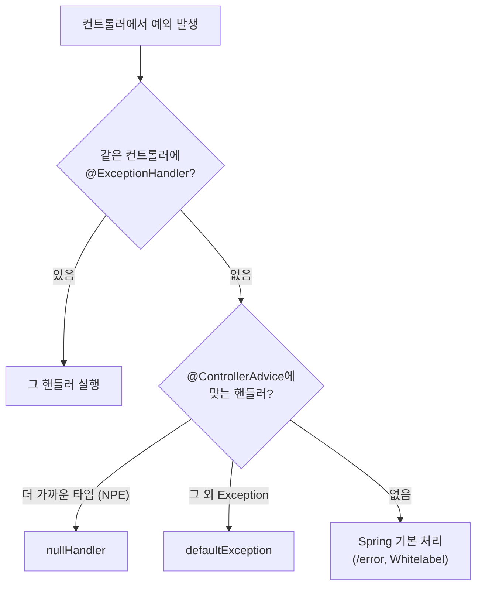

## 들어가며 (Situation)

[Servlet에서는 `sendError()`와 `web.xml`의 `<error-page>`]()로 에러 화면을 만들었다. `chap04-exception-handler`에서는 Spring 방식으로 바꿨다.

- `@ExceptionHandler` : 같은 컨트롤러 안에서 난 예외를 처리
- `@ControllerAdvice` : 모든 컨트롤러의 예외를 한곳에서 처리

```java
@Controller
public class ExceptionTestController {

    @GetMapping("nullpointer")
    public String nullPointer() {
        String str = null;
        System.out.println(str.toLowerCase(Locale.ROOT));   // NPE
        return "/";
    }

    @ExceptionHandler(NullPointerException.class)
    public String nullHandler(Model model, NullPointerException e) {
        model.addAttribute("key", e.getMessage());
        return "error/nullPointer";
    }

    @GetMapping("userexception")
    public String userException() throws MemberNotFoundException {
        throw new MemberNotFoundException("아프지 말자 우리");
    }

    @ExceptionHandler(MemberNotFoundException.class)
    public String userException(Model model, MemberNotFoundException e) { ... }
}
```

```java
@ControllerAdvice
public class GlobalExceptionHandler {

    /* 예외처리 핸들러는 우선순위가 존재한다.
       같은 클래스 내부에 있는 핸들러 > 전역 핸들러 */
    @ExceptionHandler(NullPointerException.class)
    public String nullHandler(Model model, NullPointerException e) {
        System.out.println("전역 예외처리 핸들러 동작!");
        ...
    }

    @ExceptionHandler(Exception.class)
    public String defaultException(Model model, Exception e) {
        model.addAttribute("class", e.getClass());
        model.addAttribute("message", e.getMessage());
        return "error/default";
    }
}
```

사용자 정의 예외는 이렇게 만들었다.

```java
public class MemberNotFoundException extends Throwable { ... }
```

## 문제 상황 (Task)

화면에서는 다섯 버튼 모두 "많이 놀라셨죠?" 또는 "Default 예외 페이지!"가 잘 떴다. 겉보기에는 문제가 없었다. 그런데 확인하고 싶은 점이 세 가지 있었다.

1. 에러 화면을 보여 줄 때 HTTP **상태 코드**는 무엇일까?
2. `index.html`의 "전역 - 사용자 정의 예외" 버튼(`/global-userexception`)은 매핑이 없는데 왜 Default 페이지가 뜰까?
3. `MemberNotFoundException`은 `Exception`이 아니라 `Throwable`을 상속한다. 전역 `@ExceptionHandler(Exception.class)`가 이걸 잡을 수 있을까?

## 해결 과정 (Action)

### 1. 상태 코드 확인: 전부 200

```bash
curl -s -o /dev/null -w "%{http_code}" localhost:8080/nullpointer
```

| 요청 | 처리한 핸들러 | 화면 | 상태 코드 |
|------|---------------|------|-----------|
| `/nullpointer` | 같은 클래스의 `nullHandler` | 많이 놀라셨죠? | **200** |
| `/userexception` | 같은 클래스의 `userException` | 많이 놀라셨죠? + "아프지 말자 우리" | **200** |
| `/global-nullpointer` | 전역 `nullHandler` (콘솔에 "전역 예외처리 핸들러 동작!") | 많이 놀라셨죠? | **200** |
| `/global-default` | 전역 `defaultException` | `ArrayIndexOutOfBoundsException` 에러 발생! | **200** |
| `/global-userexception` | 전역 `defaultException` | `NoResourceFoundException` 에러 발생! | **200** |

에러 화면은 잘 나왔지만 상태 코드는 모두 **200 OK**였다. 브라우저는 화면만 보여 주니 사람은 차이를 모른다. 하지만 검색 엔진, 모니터링 도구, 다른 프로그램(API 클라이언트)은 상태 코드로 성공·실패를 판단한다. 200이면 "성공"으로 기록된다.

`@ExceptionHandler`가 View 이름만 돌려주면 Spring은 상태를 바꾸지 않는다. 상태를 정하려면 직접 지정해야 한다.

```java
@ExceptionHandler(Exception.class)
@ResponseStatus(HttpStatus.INTERNAL_SERVER_ERROR)    // 예시 코드
public String defaultException(Model model, Exception e) { ... }
```

`ModelAndView`를 돌려준다면 `mv.setStatus(HttpStatus.NOT_FOUND)`처럼 지정할 수도 있다.

### 2. 404도 전역 `Exception` 핸들러가 먹었다

`/global-userexception`은 매핑이 없다. 원래라면 404 화면이 떠야 한다. 그런데 Default 페이지에 이런 문구가 나왔다.

```text
class org.springframework.web.servlet.resource.NoResourceFoundException 에러 발생!
원인 : No static resource global-userexception for request '/global-userexception'.
```

Spring Framework 6.1부터는 매핑도 없고 정적 파일도 없으면 `NoResourceFoundException`을 던진다. 이것도 `Exception`의 자식이라 `@ExceptionHandler(Exception.class)`에 잡혔다. 결과적으로 **없는 주소가 "200 + 서버 에러 화면"**이 됐다. `Exception.class` 하나로 모든 것을 받으면 404 같은 정상적인 HTTP 실패까지 삼킨다.

### 3. 우선순위: 같은 클래스가 먼저, 그다음 전역

`NullPointerException` 핸들러는 두 군데에 있다. `/nullpointer`는 같은 클래스의 핸들러가, `/global-nullpointer`는 전역 핸들러가 처리했다. 콘솔의 "전역 예외처리 핸들러 동작!"은 `/global-nullpointer` 때 **한 번만** 찍혔다.



전역 클래스 안에서는 `NullPointerException`과 `Exception` 둘 다 NPE에 맞지만, 예외 타입에 **더 가까운** `NullPointerException` 쪽이 선택된다.

### 4. `Throwable`을 상속한 예외는 전역 `Exception` 핸들러에서 어떻게 보일까

수업 코드에서 `MemberNotFoundException`은 같은 클래스의 핸들러가 처리하므로 문제가 드러나지 않았다. 그래서 프로젝트를 **임시 폴더에 복사**하고, 같은 예외를 로컬 핸들러가 없는 `GlobalTestController`에서 던져 봤다(예시 코드).

```java
@GetMapping("global-userexception")
public String globalUser() throws MemberNotFoundException {
    throw new MemberNotFoundException("전역에서 받을 수 있을까?");
}
```

결과는 이랬다.

```text
class java.lang.IllegalStateException 에러 발생! 원인 : Invocation failure
Handler [com.wanted.exceptionhandler.GlobalTestController]
Method [public java.lang.String com.wanted.exceptionhandler.GlobalTestController.globalUser() throws com.wanted.exceptionhandler.MemberNotFoundException] ...
```

`MemberNotFoundException`은 `Exception`이 아니므로 `Exception.class` 핸들러에 그대로 잡히지 않는다. 대신 Spring이 핸들러를 호출하다 `Exception`도 `Error`도 아닌 `Throwable`을 만나자 `IllegalStateException("Invocation failure")`으로 **감싸서** 던졌다. 전역 핸들러는 그 감싼 예외를 받았고, 내가 적은 "전역에서 받을 수 있을까?"는 화면 어디에도 없었다.

Java의 예외 계층을 다시 보면 이유가 분명하다.

| 클래스 | 용도 |
|--------|------|
| `Throwable` | 모든 예외의 최상위. 직접 상속하는 일은 거의 없다 |
| `Error` | JVM 수준의 심각한 문제 (`OutOfMemoryError`) |
| `Exception` | 프로그램이 처리할 수 있는 예외 (checked) |
| `RuntimeException` | 처리를 강제하지 않는 예외 (unchecked) |

[예외 단원]()에서 배운 대로 사용자 정의 예외는 `Exception`이나 `RuntimeException`을 상속한다. `extends Throwable`은 프레임워크의 예외 처리 체계 밖으로 나가는 선택이었다.

## 결과 (Result)

| 확인 항목 | 결과 |
|-----------|------|
| 에러 화면 5종의 상태 코드 | 모두 200 |
| 매핑 없는 주소 | `NoResourceFoundException` → 전역 `Exception` 핸들러 → 200 |
| NPE 핸들러가 두 곳에 있을 때 | 같은 컨트롤러 것이 우선, 전역 것은 다른 컨트롤러에서만 |
| `Throwable` 상속 예외를 전역에서 받으면 | `IllegalStateException("Invocation failure")`로 감싸져 원래 메시지 사라짐 |
| 환경 | Spring Boot 4.1.2, spring-webmvc 7.0.10 |

배운 점은 다음과 같다.

- 에러 화면을 보여 주는 것과 에러 **상태 코드**를 보내는 것은 별개다. `@ResponseStatus`나 `setStatus()`로 직접 정해야 한다.
- `@ExceptionHandler(Exception.class)`는 404까지 삼킨다. 전역 기본 핸들러를 만들 때는 HTTP 관련 예외를 따로 처리하거나 빼 둔다.
- 사용자 정의 예외는 `Exception`/`RuntimeException`을 상속한다. `Throwable`을 상속하면 프레임워크가 예상한 경로를 벗어난다.

## 더 학습하면 좋은 개념

- **`@RestControllerAdvice`와 `ProblemDetail`** — JSON API에서 에러를 표준 형식(RFC 9457)으로 응답하는 방법.
- **`ResponseEntityExceptionHandler`** — Spring MVC 내부 예외(400, 404, 405 등)를 올바른 상태 코드로 처리하는 기본 클래스.
- **Spring Boot의 `/error`와 `BasicErrorController`** — 처리되지 않은 예외가 마지막에 가는 곳.
- **예외 체이닝(`getCause()`)** — 감싸진 예외에서 원래 예외를 꺼내는 방법.

## 참고 자료

- [Spring Framework Reference - Exceptions (@ExceptionHandler)](https://docs.spring.io/spring-framework/reference/web/webmvc/mvc-controller/ann-exceptionhandler.html)
- [Spring Framework Reference - Controller Advice](https://docs.spring.io/spring-framework/reference/web/webmvc/mvc-controller/ann-advice.html)
- [Spring Framework Javadoc - NoResourceFoundException](https://docs.spring.io/spring-framework/docs/current/javadoc-api/org/springframework/web/servlet/resource/NoResourceFoundException.html)
- [Java SE 21 API - Throwable](https://docs.oracle.com/en/java/javase/21/docs/api/java.base/java/lang/Throwable.html)
- [MDN - HTTP response status codes](https://developer.mozilla.org/en-US/docs/Web/HTTP/Status)

---

**요약**
1. `@ExceptionHandler`로 만든 에러 화면 5종은 모두 상태 코드 200이었다. 상태 코드는 `@ResponseStatus`나 `setStatus()`로 직접 정해야 한다.
2. 매핑 없는 주소의 `NoResourceFoundException`까지 전역 `@ExceptionHandler(Exception.class)`가 잡아서 404가 "200 + Default 에러 화면"이 됐다.
3. `Throwable`을 상속한 사용자 정의 예외를 전역에서 받으면 `IllegalStateException("Invocation failure")`로 감싸져 원래 메시지가 사라졌다.
