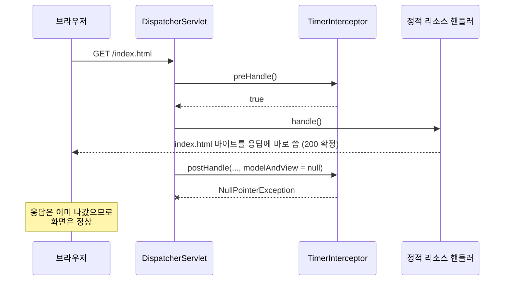

## 들어가며 (Situation)

`chap05-interceptor`에서는 핸들러 메서드의 실행 시간을 재는 인터셉터를 만들었다. [Servlet 필터]()가 DispatcherServlet **앞**에서 요청을 가로챘다면, 인터셉터는 DispatcherServlet **안**에서 핸들러 메서드 앞뒤를 가로챈다.

```java
@Component
public class TimerInterceptor implements HandlerInterceptor {

    @Override
    public boolean preHandle(HttpServletRequest request, HttpServletResponse response, Object handler) {
        System.out.println("preHandle 동작함..");
        request.setAttribute("startTime", System.currentTimeMillis());
        return true;
    }

    @Override
    public void postHandle(HttpServletRequest request, HttpServletResponse response,
                           Object handler, @Nullable ModelAndView modelAndView) {
        System.out.println("postHandler() 호출됨..");
        long endTime = System.currentTimeMillis();
        long startTime = (long) request.getAttribute("startTime");
        modelAndView.addObject("interval", endTime - startTime);
    }
}
```

```java
@Configuration
public class WebConfig implements WebMvcConfigurer {
    ...
    @Override
    public void addInterceptors(InterceptorRegistry registry) {
        registry.addInterceptor(timerInterceptor)
                .addPathPatterns("/*")
                .excludePathPatterns("/css/**")
                .excludePathPatterns("/images/**")
                .excludePathPatterns("/js/**")
                .excludePathPatterns("/video/**");
    }
}
```

`/stopwatch` 버튼을 누르면 핸들러가 `Thread.sleep(2000)`으로 2초를 쉬고, 결과 화면에 `핸들러메서드 호출 수행 시간 : 2014`가 찍혔다. 의도대로 동작했다.

## 문제 상황 (Task)

`postHandle()`의 매개변수에는 `@Nullable`이 붙어 있다. IDE가 오버라이딩 코드를 만들 때 함께 붙여 준 것이다. 그런데 코드는 `modelAndView.addObject(...)`를 null 검사 없이 부른다.

1. `modelAndView`가 `null`인 요청이 실제로 있을까?
2. 있다면 사용자는 무엇을 보게 될까?

## 해결 과정 (Action)

### 1. 여러 경로를 요청하고 로그 세기

요청마다 `preHandle` 출력과 `NullPointerException` 로그가 몇 줄 늘어나는지 셌다.

```bash
curl -s -o /dev/null -w "%{http_code}" localhost:8080/stopwatch
curl -s -o /dev/null -w "%{http_code}" localhost:8080/
curl -s -o /dev/null -w "%{http_code}" localhost:8080/index.html
curl -s -o /dev/null -w "%{http_code}" localhost:8080/nope
curl -s -o /dev/null -w "%{http_code}" localhost:8080/a/b
```

| 요청 | 응답 | `preHandle` 호출 | NPE 로그 |
|------|------|------------------|----------|
| `/stopwatch` | 200 | 1 | 없음 |
| `/` | **200** | 3 | **있음** |
| `/index.html` | **200** | 2 | **있음** |
| `/nope` | 404 | 2 | 있음 |
| `/a/b` | 404 | 1 | 있음 |

정상 동작한 것은 `/stopwatch` 하나뿐이었다. 나머지는 모두 서버 로그에 이런 에러를 남겼다.

```text
ERROR ... Servlet.service() for servlet [dispatcherServlet] threw exception
java.lang.NullPointerException: Cannot invoke "org.springframework.web.servlet.ModelAndView.addObject(String, Object)" because "modelAndView" is null
```

특히 메인 화면 `/`와 `/index.html`은 사용자 화면에 **200으로 정상 표시**됐다. 에러는 로그에만 남았다.

### 2. 누가 `ModelAndView`를 null로 넘겼나

`postHandle()`의 `ModelAndView`는 핸들러가 "View 이름과 Model"을 만들었을 때만 채워진다. 그렇지 않은 핸들러는 `null`을 넘긴다.

| 요청을 처리한 핸들러 | 만드는 것 | `ModelAndView` |
|----------------------|-----------|----------------|
| `@Controller`가 View 이름 반환 (`/stopwatch`) | View + Model | 있음 |
| 정적 리소스 핸들러 (`/index.html`) | 파일을 바로 응답에 씀 | **null** |
| 에러 처리 `/error` (curl처럼 JSON을 받을 때) | `ResponseEntity` (JSON) | **null** |
| `@ResponseBody`, `@RestController` | 데이터를 바로 응답에 씀 | **null** |

`/`는 Spring Boot가 `index.html`로 forward하고, `/nope`와 `/a/b`는 404가 나서 `/error`로 다시 디스패치된다. 이 내부 요청들의 경로(`/index.html`, `/error`)가 `addPathPatterns("/*")`에 걸렸다. 그래서 `preHandle` 호출 수가 1보다 컸다. `/a/b`는 `/*`에 맞지 않지만 `/error` 디스패치에서 인터셉터가 동작했다.



정적 파일은 핸들러가 응답 본문을 이미 써 버린 뒤라서, `postHandle()`에서 예외가 나도 브라우저는 200 화면을 받는다. 그래서 **눈으로는 문제를 알 수 없었다.**

### 3. 고치기: null 검사

Spring 문서도 `postHandle`의 `ModelAndView`는 null일 수 있다고 적는다. 그래서 `@Nullable`이 붙어 있다. 값을 넣을 대상이 없으면 건너뛰면 된다. (**예시 코드**)

```java
@Override
public void postHandle(HttpServletRequest request, HttpServletResponse response,
                       Object handler, @Nullable ModelAndView modelAndView) {
    if (modelAndView == null) {
        return;     // 정적 리소스, @ResponseBody, 에러 JSON 등
    }
    long startTime = (long) request.getAttribute("startTime");
    modelAndView.addObject("interval", System.currentTimeMillis() - startTime);
}
```

경로를 좁히는 방법도 있다. 수업 코드는 `/css/**` 같은 정적 폴더를 제외했지만, `index.html`은 `static/` 바로 아래에 있어서 제외 패턴에 걸리지 않았다. 시간을 재고 싶은 경로만 `addPathPatterns("/stopwatch")`처럼 명시하면 정적 파일과 `/error`가 애초에 빠진다.

### 4. 필터와 인터셉터 비교

| 항목 | Servlet Filter | HandlerInterceptor |
|------|----------------|--------------------|
| 위치 | DispatcherServlet 앞 | DispatcherServlet 안, 핸들러 앞뒤 |
| 아는 것 | 요청/응답 | 요청/응답 + 어떤 핸들러인지 + `ModelAndView` |
| 등록 | `@WebFilter`, `FilterRegistrationBean` | `WebMvcConfigurer.addInterceptors()` |
| 어울리는 일 | 인코딩, 보안 | 로그인 체크, 실행 시간, 공통 모델 값 |

## 결과 (Result)

| 확인 항목 | 결과 |
|-----------|------|
| `/stopwatch` 실행 시간 | 2014ms (`sleep(2000)` + 처리 시간) |
| NPE가 난 요청 | `/`, `/index.html`, 404 요청(→ `/error`) |
| 사용자 화면 | `/`, `/index.html`은 200 정상 표시 (로그에만 에러) |
| 원인 | 정적 리소스·에러 JSON 핸들러는 `ModelAndView`가 `null` |
| 환경 | Spring Boot 4.1.2, spring-webmvc 7.0.10 |

배운 점은 다음과 같다.

- `postHandle()`의 `ModelAndView`는 View를 만드는 컨트롤러에서만 존재한다. `@Nullable`은 장식이 아니라 실제로 null이 온다는 표시다.
- 인터셉터는 forward, 에러 디스패치 같은 **내부 요청**에도 걸릴 수 있다. 경로 패턴은 넓게 잡기보다 필요한 곳만 지정하는 편이 안전하다.
- 화면이 멀쩡해도 서버 로그를 봐야 한다. 응답이 먼저 나간 뒤의 에러는 화면에 드러나지 않는다.

## 더 학습하면 좋은 개념

- **`afterCompletion()`** — 뷰 렌더링까지 끝난 뒤, 예외가 나도 호출되는 세 번째 메서드. 실행 시간 측정은 여기가 더 정확하다.
- **`DispatcherType` (REQUEST, FORWARD, ERROR)** — 같은 요청 안에서 일어나는 내부 디스패치의 종류.
- **JSpecify `@Nullable`** — null이 올 수 있음을 타입에 표시하는 표준 어노테이션. Spring 7이 도입했다.
- **AOP와 인터셉터의 차이** — 둘 다 "앞뒤에 끼워 넣기"지만, 대상이 메서드인지 웹 요청인지가 다르다.

## 참고 자료

- [Spring Framework Reference - Interception](https://docs.spring.io/spring-framework/reference/web/webmvc/mvc-servlet/handlermapping-interceptor.html)
- [Spring Framework Javadoc - HandlerInterceptor](https://docs.spring.io/spring-framework/docs/current/javadoc-api/org/springframework/web/servlet/HandlerInterceptor.html)
- [Spring Framework Reference - MVC Config: Interceptors](https://docs.spring.io/spring-framework/reference/web/webmvc/mvc-config/interceptors.html)
- [Spring Boot Reference - Static Content / Welcome Page](https://docs.spring.io/spring-boot/reference/web/servlet.html#web.servlet.spring-mvc.static-content)

---

**요약**
1. 시간 측정 인터셉터는 `/stopwatch`에서만 정상이고, `/`·`/index.html`·404 요청에서는 `postHandle()`의 `modelAndView.addObject()`가 NPE를 냈다.
2. 정적 리소스 핸들러와 `/error`의 JSON 응답은 `ModelAndView`를 만들지 않아 `null`을 넘기고, 정적 파일은 응답이 먼저 나가서 화면은 200으로 멀쩡했다.
3. `if (modelAndView == null) return;`으로 막거나, `addPathPatterns`를 필요한 경로로 좁히면 된다.
