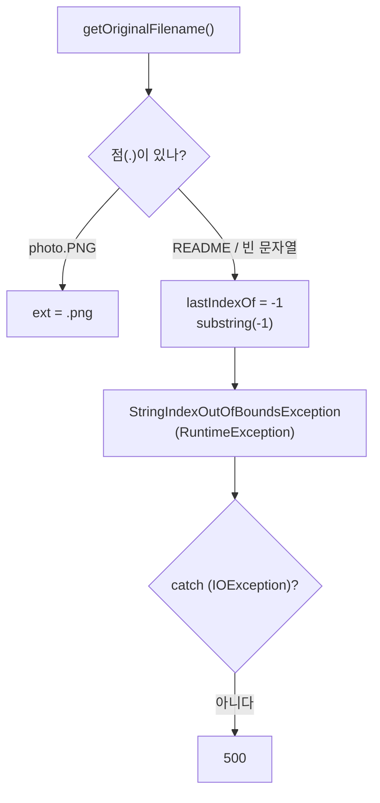

## 들어가며 (Situation)

`chap06-file-upload`에서는 이미지를 업로드해서 서버 폴더에 저장하고, 결과 화면에 다시 보여 주는 기능을 만들었다. 흐름은 수업 주석에 정리돼 있었다.

```java
/* 1. 사용자가 업로드한 파일/설명 확인
 * 2. 파일 저장 경로 확인 및 파일 저장 경로가 없다면 생성
 * 3. 원본 파일명을 UUID 기반의 새로운 이름으로 변경
 * 4. 생성 된 경로에 파일 저장
 * 5. 결과 메세지와 파일 저장 위치 URL 을 Model 에 담아 응답 */
```

```java
private String save(MultipartFile file) throws IOException {
    String originName = file.getOriginalFilename();
    // test / .png / 대문자를 소문자로 변경 (.PNG -> .png)
    String ext = originName.substring(originName.lastIndexOf(".")).toLowerCase();
    String savedName = UUID.randomUUID().toString() + ext;

    File dir = new File(uploadDir).getAbsoluteFile();
    dir.mkdirs();
    file.transferTo(new File(dir, savedName));
    return savedName;
}
```

여러 파일을 올리는 `multi-file`은 하나라도 실패하면 앞서 저장한 파일을 지운다. 트랜잭션의 rollback처럼 동작하게 만든 것이다.

```java
} catch (Exception e) {
    // 실패 시에 이전에 저장된 파일을 삭제
    for (FileDTO file : files) {
        new File(new File(uploadDir).getAbsoluteFile(), file.getSavedName()).delete();
    }
    mv.addObject("message", "멀티 파일 업로드 실패!");
}
```

저장된 파일은 `WebConfig`에서 `/uploads/**` 요청을 실제 폴더와 연결해서 ``로 보여 준다.

## 문제 상황 (Task)

실습 후 `uploads/` 폴더를 보니 크기가 252,784바이트로 똑같은 PNG가 세 개 있었다. 같은 스크린샷을 세 번 올렸는데 이름이 모두 달라서 덮어쓰지 않고 따로 저장된 것이다. UUID 덕분이다.

그런데 `save()`는 원본 파일명에 **점(`.`)이 있다고 가정**한다. 그리고 단일 업로드는 `IOException`만 잡는다. 이런 질문이 생겼다.

1. 확장자가 없는 파일(`README`)이나, 파일을 고르지 않고 제출하면?
2. 여러 파일 중 하나만 실패하면 정말 앞 파일이 지워질까?
3. 설명(`description`)을 비우면?

## 해결 과정 (Action)

### 1. 원본 폴더 대신 복사본으로 실험

수업 폴더의 `uploads/`를 더럽히지 않으려고 프로젝트를 임시 폴더에 복사해서 띄웠다. curl의 `-F`로 `multipart/form-data` 요청을 만들었다.

```bash
printf 'hello' > a.png; printf 'x' > b.PNG; printf 'noext' > README
curl -s -F singleFile=@a.png -F description=d localhost:8080/single-file
curl -s -F singleFile=@README -F description=d localhost:8080/single-file
curl -s -F multiFile=@a.png -F multiFile=@README -F description=d localhost:8080/multi-file
```

| 요청 | 결과 | 비고 |
|------|------|------|
| 단일 `a.png` | 200, "파일 업로드 성공!" | `/uploads/99c24123-...e7d5.png` |
| 단일 `b.PNG` | 200 | 저장명 끝이 `.png` (소문자 변환 확인) |
| 단일 `README` (확장자 없음) | **500** | `StringIndexOutOfBoundsException: Range [-1, 6) out of bounds for length 6` |
| 단일, 파일 선택 안 함 | **500** | `StringIndexOutOfBoundsException: Range [-1, 0) out of bounds for length 0` |
| 단일, `description` 없음 | 400 | `MissingServletRequestParameterException` |
| 다중 `a.png` + `README` | 200, "멀티 파일 업로드 실패!" | 폴더 파일 수 2 → 2 (앞 파일 삭제됨) |
| 다중 `README` + `a.png` | 200, "멀티 파일 업로드 실패!" | 폴더 파일 수 2 → 2 |
| 다중 `a.png` + `b.PNG` | 200, "멀티 파일 업로드 성공!" | 폴더 파일 수 2 → 4 |

### 2. `lastIndexOf(".")`가 -1을 돌려줄 때

`"README".lastIndexOf(".")`는 점이 없으므로 `-1`이다. `substring(-1)`은 범위를 벗어나 `StringIndexOutOfBoundsException`을 던진다. 파일을 고르지 않고 제출하면 원본 파일명이 빈 문자열 `""`이라서 같은 예외가 난다(`length 0`).

이 예외는 `IOException`이 아니라 `RuntimeException`이다. 단일 업로드의 `catch (IOException e)`를 그냥 지나쳐서 **500**이 됐다. 사용자가 실수로 빈 폼을 보냈는데 서버 오류가 난 것이다.



고친다면 파일이 비었는지와 확장자를 먼저 확인한다. (**예시 코드**)

```java
if (file.isEmpty()) {
    throw new IllegalArgumentException("파일을 선택해 주세요.");
}
String originName = file.getOriginalFilename();
int dot = (originName == null) ? -1 : originName.lastIndexOf(".");
if (dot == -1) {
    throw new IllegalArgumentException("확장자가 있는 파일만 올릴 수 있습니다.");
}
String ext = originName.substring(dot).toLowerCase();
```

### 3. 다중 업로드의 "되돌리기"는 동작했다

`a.png`가 먼저 저장된 뒤 `README`에서 예외가 났다. `catch`에서 `files` 목록의 파일을 지웠고, 폴더 파일 수는 그대로 2였다. `files.add(...)`가 `save()` **성공 뒤에** 실행되므로, 목록에는 실제로 저장된 파일만 들어 있다. 순서가 맞아서 잘 동작했다.

다만 응답은 200에 "실패!" 메시지다. [이전 글]()에서 본 것처럼, 실패를 화면 문구로만 알리면 상태 코드로는 성공처럼 보인다.

### 4. UUID로 저장명을 바꾸는 이유

| 원본 이름 그대로 저장 | UUID 저장명 |
|-----------------------|-------------|
| 같은 이름이면 덮어씀 | 매번 다른 이름 (실습 폴더의 같은 PNG 3개) |
| 한글·공백 때문에 URL 문제 | 영문·숫자·하이픈만 사용 |
| `../` 같은 경로 조작 위험 | 사용자가 이름을 정할 수 없음 |
| 원본 이름 보존 | 원본 이름은 DB에 따로 저장해야 함 (`FileDTO.originFileName`) |

그래서 `FileDTO`에 원본 이름, 저장 이름, 경로를 함께 담는다. 나중에 DB에 저장하면 "다운로드할 때 원래 이름으로 돌려주기"가 가능하다.

### 5. `/uploads/**` 매핑과 크기 제한

`addResourceHandler("/uploads/**").addResourceLocations("file:./uploads")`로 저장한 파일을 바로 열 수 있었다(`/uploads/7347...png` → 200). 크기 제한은 `application.yaml`의 `spring.servlet.multipart.max-file-size: 200MB`, `max-request-size: 1000MB`로 정했다.

한 가지 걱정도 생겼다. 확장자를 사용자가 보낸 파일명에서 그대로 가져오므로 `evil.html`도 `.html`로 저장되고, 같은 사이트 주소로 열린다. 이미지 업로드라면 허용할 확장자 목록(`.png`, `.jpg` …)을 정해 두는 것이 안전하다.

## 결과 (Result)

| 확인 항목 | 결과 |
|-----------|------|
| 확장자 없는 파일 / 빈 제출 | 500 (`StringIndexOutOfBoundsException`) |
| 대문자 확장자 | `.PNG` → `.png` 저장 |
| 다중 업로드 중 하나 실패 | 앞서 저장한 파일 삭제, 폴더 파일 수 유지 |
| 같은 파일 3번 업로드 | 서로 다른 UUID 이름 3개 (실습 폴더 기준) |
| 환경 | Spring Boot 4.1.2, spring-webmvc 7.0.10 |

배운 점은 다음과 같다.

- 사용자가 보낸 파일명은 **믿을 수 없는 입력**이다. 점이 없을 수도, 비어 있을 수도, 위험한 확장자일 수도 있다.
- `catch (IOException e)`는 `RuntimeException`을 잡지 못한다. 어떤 예외가 날 수 있는지 먼저 따져 봐야 한다.
- 여러 파일 저장은 DB 트랜잭션처럼 자동으로 되돌려지지 않는다. "성공한 것만 목록에 넣고, 실패하면 목록을 지운다"는 순서가 중요하다.

## 더 학습하면 좋은 개념

- **`Content-Type`과 파일 시그니처(매직 넘버)** — 확장자만 믿지 않고 파일 내용으로 형식을 확인하는 방법.
- **오브젝트 스토리지 (S3 등)** — 수업 페이지가 "추후에는 권장하지 않는 방식"이라고 한 이유. 서버 디스크 대신 별도 저장소에 올린다.
- **`multipart/form-data` 형식** — `enctype`을 맞춰야 하는 이유와 경계(boundary) 구조.
- **`MaxUploadSizeExceededException`** — 크기 제한을 넘었을 때의 예외와 처리 방법.

## 참고 자료

- [Spring Framework Reference - Multipart Resolver](https://docs.spring.io/spring-framework/reference/web/webmvc/mvc-servlet/multipart.html)
- [Spring Framework Reference - Multipart (Handler Method Arguments)](https://docs.spring.io/spring-framework/reference/web/webmvc/mvc-controller/ann-methods/multipart-forms.html)
- [Spring Framework Reference - Static Resources](https://docs.spring.io/spring-framework/reference/web/webmvc/mvc-config/static-resources.html)
- [Java SE 21 API - String.lastIndexOf](https://docs.oracle.com/en/java/javase/21/docs/api/java.base/java/lang/String.html#lastIndexOf(java.lang.String))
- [OWASP - File Upload Cheat Sheet](https://cheatsheetseries.owasp.org/cheatsheets/File_Upload_Cheat_Sheet.html)

---

**요약**
1. 확장자 없는 파일이나 빈 제출은 `lastIndexOf(".")`가 -1이라 `substring(-1)`에서 `StringIndexOutOfBoundsException`이 나고, `IOException`만 잡는 단일 업로드는 500이 됐다.
2. 다중 업로드는 저장에 성공한 파일만 목록에 넣고 실패 시 그 목록을 지우므로, 중간에 실패해도 폴더 파일 수가 그대로였다.
3. UUID 저장명은 같은 파일 3번 업로드를 서로 다른 이름으로 지켜 줬지만, 확장자는 사용자 입력이라 빈 파일·확장자 검사와 허용 목록이 필요하다.
